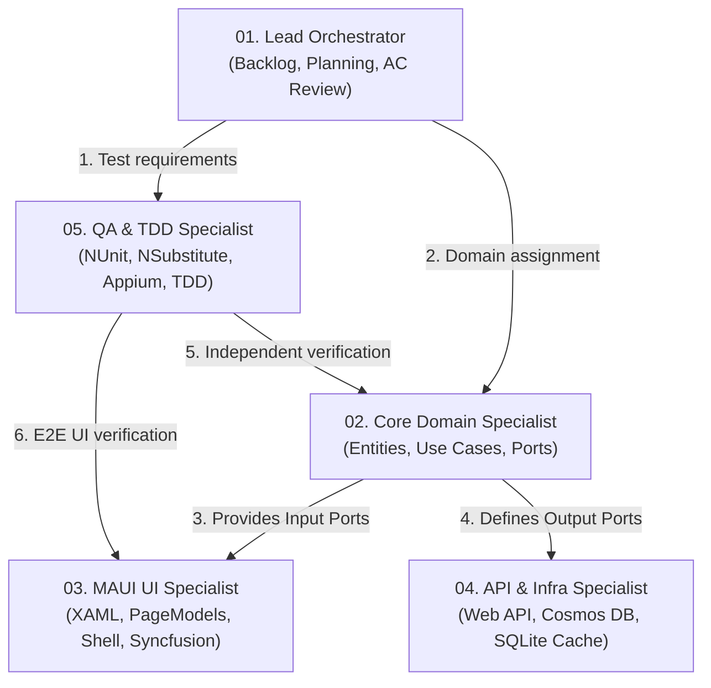

# ROOMTORENTRADAR MULTI-AGENT MANIFEST
> **Project:** Student Room Rental Radar for ICTU Students  
> **Team:** Group 2 — Software Development Process Training Course  
> **Architecture:** Hexagonal Architecture (Ports & Adapters)  
> **Tech Stack:** .NET MAUI 10 (Client), ASP.NET Core (REST API), Azure Cosmos DB (Spatial NoSQL), SQLite (Offline Cache)

---

## 1. OBJECTIVES AND QUALITY STANDARDS (SPRINT 1)

- **Sprint 1 Goal:** Deliver the core room-discovery experience (US01 – US12), including: verified listing browse, room details and 360° photo viewer, price/area/map search, favourite bookmarks, side-by-side room comparison, new-listing alerts, and landlord publishing.
- **Quality Targets:**
  - 100% of User Stories meet Acceptance Criteria (AC).
  - 0 Critical defects, ≤ 3 High defects prior to handover.
  - Strict decoupling between Core business logic and external adapters.

---

## 2. MULTI-AGENT ROLES MATRIX

The engineering team is composed of 5 specialized subagents with distinct responsibilities and sandboxed scopes:



1. **`roles/01-lead-orchestrator.md`**: Acts as PO & Scrum Master. Analyzes backlog requirements, enforces Acceptance Criteria, decomposes micro-tasks, and monitors architectural boundaries.
2. **`roles/02-core-domain-specialist.md`**: Pure C# expert. Implements Entities, Value Objects, Use Cases, and defines Ports. Free of any UI or DB dependencies.
3. **`roles/03-maui-ui-specialist.md`**: MAUI Frontend expert. Implements XAML layouts, PageModels (CommunityToolkit.Mvvm), Syncfusion controls, Compiled Bindings, and AppShell navigation.
4. **`roles/04-api-infra-specialist.md`**: Backend & Adapter expert. Implements ASP.NET Core REST API, Cosmos DB spatial queries, Google Maps adapters, and SQLite offline caching.
5. **`roles/05-qa-tdd-specialist.md`**: Independent test engineer. Writes NUnit + NSubstitute Unit Tests and Appium UI tests following the TDD Red-Green-Refactor cycle. **FORBIDDEN from modifying production code.**

---

## 3. PROJECT BASELINE PARAMETERS

- **Target University:** University of Information and Communication Technology (ICTU)
- **ICTU Campus Coordinates:** `Latitude = 21.5851`, `Longitude = 105.8066` (default origin for distance calculation in US01, US09).
- **Room Comparison Limit (US10):** Maximum of 3 rooms side by side.
- **Photo Upload Limit (US08):** Maximum 10 MB per photo, JPG/PNG format, minimum 3 photos.
- **Android Dev Environment:** Connects to local Web API via loopback IP `10.0.2.2`.

---

## 4. STANDARD EXECUTION COMMANDS

- **Compile MAUI Client:**
  ```powershell
  dotnet build RoomToRentRadar/RoomToRentRadar.csproj
  ```
- **Execute Unit Tests:**
  ```powershell
  dotnet test RoomToRentRadarUnitTests/RoomToRentRadarUnitTests.csproj
  ```
