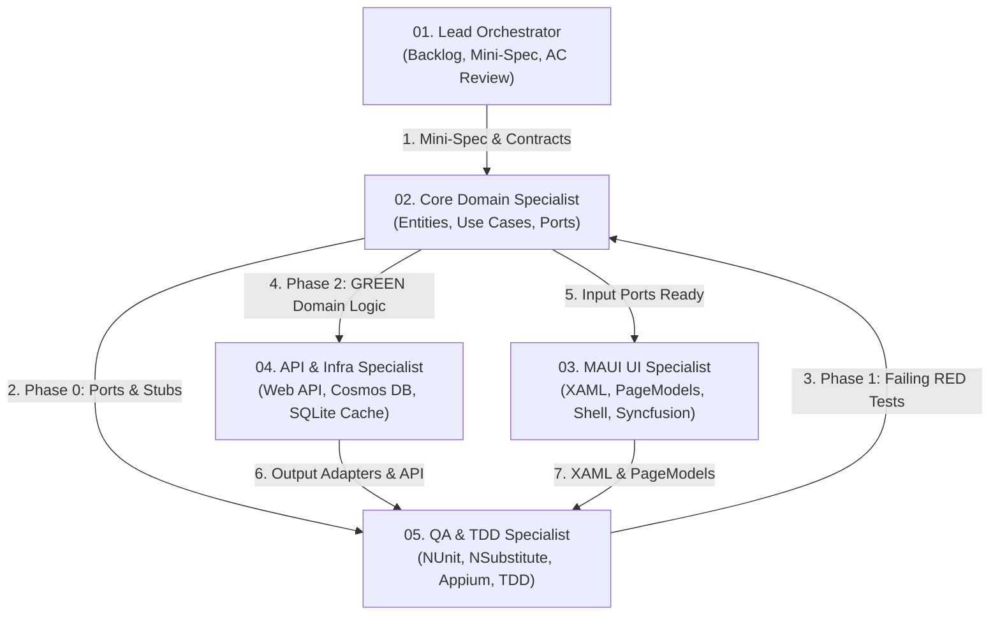

# ROOMTORENTRADAR MULTI-AGENT MANIFEST
> **Project:** Student Room Rental Radar for ICTU Students  
> **Team:** Group 2 — Software Development Process Training Course  
> **Architecture:** Hexagonal Architecture (Ports & Adapters)  
> **Tech Stack:** .NET MAUI 10 (Client), ASP.NET Core (REST API), Azure Cosmos DB (Spatial NoSQL), SQLite (Offline Cache)

---

## 1. OBJECTIVES AND QUALITY STANDARDS

- **Product Backlog Goal:** Deliver the end-to-end room-discovery, landlord publishing, and platform security experience across all Product Backlog User Stories (e.g., verified listing browse, room details and 360° photo viewer, price/area/map search, favourite bookmarks, side-by-side room comparison, new-listing alerts, landlord publishing, and role-based authentication).
- **Quality Targets:**
  - 100% of User Stories in scope meet Acceptance Criteria (AC).
  - 0 Critical defects, ≤ 3 High defects prior to handover.
  - Strict decoupling between Core business logic and external adapters.

---

## 2. MULTI-AGENT ROLES MATRIX

The engineering team is composed of 5 specialized subagents with distinct responsibilities and sandboxed scopes:



1. **`roles/01-lead-orchestrator.md`**: Acts as PO & Scrum Master. Analyzes backlog requirements, enforces Acceptance Criteria, locks down Mini-Spec type signatures, decomposes micro-tasks, and monitors architectural boundaries.
2. **`roles/02-core-domain-specialist.md`**: Pure C# expert. Authors Phase 0 Contracts/Stubs, then implements Entities, Value Objects, Use Cases, and defines Ports. Free of any UI or DB dependencies.
3. **`roles/03-maui-ui-specialist.md`**: MAUI Frontend expert. Implements XAML layouts, PageModels (CommunityToolkit.Mvvm), Syncfusion controls, Compiled Bindings, and AppShell navigation.
4. **`roles/04-api-infra-specialist.md`**: Backend & Adapter expert. Implements ASP.NET Core REST API (`RoomToRentRadar.Api`), Cosmos DB spatial queries, Google Maps adapters, and client-side HTTP/SQLite offline caching adapters.
5. **`roles/05-qa-tdd-specialist.md`**: Independent test engineer. Writes NUnit + NSubstitute Unit Tests and Appium UI tests following the C# TDD Contract-Red-Green-Refactor cycle. **FORBIDDEN from modifying production code.**

---

## 3. TARGET SOLUTION & DIRECTORY ARCHITECTURE (9-PROJECT HEXAGONAL + DDD)

1. **`RoomToRentRadar.Domain/` (Pure C# DDD Domain Layer — `net10.0`):**
   - `Aggregates/`, `Entities/`, `ValueObjects/`, `Enums/`, `Events/`, `Specifications/`, `Services/`, `Exceptions/`, `Primitives/`.
2. **`RoomToRentRadar.Ports/` (Hexagonal Boundaries & Contracts — `net10.0`):**
   - `Contracts/Requests/[<Feature>/]`, `Contracts/Responses/[<Feature>/]`, `Contracts/Common/`: Immutable shared DTOs (`*Dto`, `*Request`, `PagedResult<T>`), optionally grouped by feature subfolder (e.g., `Rooms/`, `Auth/`, `Bookmarks/`).
   - `Inbound/UseCases/[<Feature>/]`: Driving Input Ports (`I*UseCase`), organized flat or by feature subfolder.
   - `Outbound/Repositories/`, `Outbound/ExternalServices/`, `Outbound/Caching/`: Driven Output Ports (`I*Repository`, `I*Port`).
3. **`RoomToRentRadar.Application/` (UseCase Services Layer — `net10.0`):**
   - `UseCases/<Feature>/`: Feature-grouped implementations of `I*UseCase` (`*UseCase`, e.g., `UseCases/Rooms/`, `UseCases/Bookmarks/`, `UseCases/Landlords/`, `UseCases/Auth/`, etc.).
   - `Mappers/` & `DependencyInjection.cs` (`AddApplicationServices()`).
4. **`RoomToRentRadar.Datastore/` (Dedicated Database Layer — `net10.0`):**
   - `CosmosDb/` (`Documents/`, `Context/`, `Configurations/`) & `Sqlite/` (`Tables/`, `Context/`).
   - `DependencyInjection.cs` (`AddDatastore()`).
5. **`RoomToRentRadar.Infrastructure/` (Repositories & Driven Adapters — `net10.0`):**
   - `Repositories/`: Implementations of `I*Repository` (e.g., `CosmosRoomRepository`, `SqliteBookmarkRepository`, `CosmosUserRepository`).
   - `Adapters/<Category>/`: Implementations of `I*Port` (`*Adapter`), grouped by technical capability (e.g., `Adapters/Http/`, `Adapters/Caching/`, `Adapters/Mocks/`, `Adapters/Security/`, etc.).
   - `DependencyInjection.cs` (`AddInfrastructure()`).
6. **`RoomToRentRadar.Api/` (ASP.NET Core REST API Backend — `net10.0`):**
   - `Controllers/`, `Middlewares/`, & `Authorization/` (or feature-specific API infrastructure): RESTful endpoints (`RoomsController`, `AuthController`, etc.), exception handling, and security policies.
7. **`RoomToRentRadar/` (.NET MAUI 10 Mobile Client — MVVM UI):**
   - `Pages/` (including `Pages/Controls/`), `PageModels/`, `Resources/Styles/`, `Converters/`, & `AppShell.xaml(.cs)`: Presentation layer (`.xaml` views and `*PageModel` classes).
   - `DeviceAdapters/`: Platform/device-specific adapters (e.g., `MauiMapRadarAdapter`).
8. **`RoomToRentRadarUnitTests/` (NUnit 4 + NSubstitute Test Suite — `net10.0`):**
   - `Domain/[<Feature>/]`, `Application/[<Feature>/]`, `Infrastructure/[<Feature>/]`.
9. **`RoomToRentRadarUIAppiumTests/` (NUnit 4 + Appium E2E Suite — `net10.0`):**
   - `Journeys/`.

---

## 4. MULTI-AGENT HANDOFF & ESCALATION PROTOCOL

1. **Contract-First Handoff (Zero Compilation Deadlocks):**
   - `@Lead` publishes a Mini-Spec locking down exact interface, DTO, and class names.
   - `@Core` creates **Phase 0 Stubs** (interfaces + classes throwing `NotImplementedException`) and verifies `dotnet build` = 0 errors before handing off to `@QA`.
   - `@QA` writes **Phase 1 RED Tests** against those stubs (`dotnet test` compiles cleanly and fails on assertions/`NotImplementedException`), then hands off to `@Core` and `@Infra` for **Phase 2 GREEN Implementation**.
2. **Failure Escalation Loop:**
   - If any test fails during verification, `@QA` is **strictly forbidden** from editing production files. `@QA` emits a structured **Defect Report** (Test Name, Expected vs. Actual, Suspected Layer, Assigned Role) to `@Lead` for re-delegation.

---

## 5. PROJECT BASELINE PARAMETERS

- **Target University:** University of Information and Communication Technology (ICTU)
- **ICTU Campus Coordinates:** `Latitude = 21.5851`, `Longitude = 105.8066` (default origin for distance calculation in US01, US09).
- **Room Comparison Limit (US10):** Maximum of 3 rooms side by side.
- **Photo Upload Limit (US08):** Maximum 10 MB per photo, JPG/PNG format, minimum 3 photos.
- **Android Dev Environment:** Connects to local Web API via loopback IP `10.0.2.2`.

---

## 6. STANDARD EXECUTION COMMANDS

- **Compile MAUI Client:**
  ```powershell
  dotnet build RoomToRentRadar/RoomToRentRadar.csproj
  ```
- **Compile Web API:**
  ```powershell
  dotnet build RoomToRentRadar.Api/RoomToRentRadar.Api.csproj
  ```
- **Execute Unit Tests:**
  ```powershell
  dotnet test RoomToRentRadarUnitTests/RoomToRentRadarUnitTests.csproj
  ```
