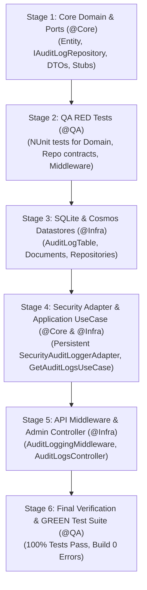

# AUDIT LOG IMPLEMENTATION PLAN & MINI-SPEC
> **Project:** RoomToRentRadar (ICTU Room Rental Radar)  
> **Target Feature:** System-Wide Audit & Action Logging (Audit Trail & Activity Log)  
> **Architecture:** Hexagonal Architecture (Ports & Adapters) + DDD  
> **Datastore Targets:** SQLite (`SqliteDbContext`) & Azure Cosmos DB (`CosmosDbContext`)  
> **Author Role:** `@Lead` (01. Lead Orchestrator)

---

## 1. MỤC TIÊU & YÊU CẦU NGHIỆP VỤ (REQUIREMENTS & AC)

### 1.1. Mục tiêu
Ghi nhận đầy đủ vết hoạt động (audit trail) của hệ thống phục vụ mục đích bảo mật, truy vết sự cố, giám sát hành vi người dùng (Sinh viên, Chủ trọ, Quản trị viên) và tuân thủ tiêu chuẩn an toàn thông tin.

### 1.2. Phân loại 2 cấp độ ghi Log
1. **Business & Security Audit Log (Cấp độ Nghiệp vụ & Bảo mật):**
   - Được gọi tường minh từ Use Cases hoặc Security Adapters khi có các sự kiện quan trọng:
     - `AUTH`: Đăng ký, Đăng nhập (thành công/thất bại), Khóa tài khoản, Cấp/Hủy JWT Refresh Token, Đăng nhập qua ICTU SSO.
     - `LANDLORD`: Admin phê duyệt chủ trọ, từ chối chủ trọ, cập nhật giấy phép kinh doanh.
     - `ROOM`: Tạo phòng mới, chỉnh sửa thông tin phòng, cập nhật trạng thái (Còn phòng / Hết phòng), xóa bài đăng.
     - `BOOKMARK & INTERACTION`: Thêm/xóa danh sách yêu thích, gửi tin nhắn/yêu cầu liên hệ, báo cáo vi phạm.
2. **HTTP Mutation Audit Log (Cấp độ API Middleware):**
   - Tự động bắt tất cả các request thay đổi trạng thái dữ liệu (`POST`, `PUT`, `PATCH`, `DELETE`) tại Web API.
   - Ghi nhận: Route, HTTP Method, User ID, Role, Client IP, User-Agent, Mã phản hồi (Status Code), Thời gian xử lý (Execution Duration Ms), Trạng thái (Thành công/Thất bại).

### 1.3. Tiêu chí chất lượng & phi chức năng (Non-Functional Requirements)
- **Non-blocking / Resilient:** Lỗi khi ghi audit log không được làm gián đoạn hoặc hủy transaction của nghiệp vụ chính (Graceful error handling).
- **Security & PII Protection:** Tuyệt đối không ghi mật khẩu raw, JWT secret key, mã thẻ hoặc thông tin nhạy cảm vào `DetailsJson`.
- **RBAC Strictness:** Chỉ tài khoản có vai trò `Admin` mới được quyền truy vấn danh sách và chi tiết Audit Log qua API.

---

## 2. KIẾN TRÚC & MINI-SPEC TYPE SIGNATURES

### 2.1. Domain Layer (`RoomToRentRadar.Domain`)
- **Entity:** `RoomToRentRadar.Domain.Entities.AuditLogEntry`
  ```csharp
  namespace RoomToRentRadar.Domain.Entities;

  public sealed class AuditLogEntry
  {
      public string Id { get; init; } = Guid.NewGuid().ToString("N");
      public string? UserId { get; init; }
      public string? UserEmail { get; init; }
      public string Role { get; init; } = "Anonymous";
      public string Action { get; init; } = string.Empty;
      public string EntityType { get; init; } = string.Empty;
      public string? EntityId { get; init; }
      public string? DetailsJson { get; init; }
      public string? IpAddress { get; init; }
      public string? UserAgent { get; init; }
      public int? StatusCode { get; init; }
      public long? DurationMs { get; init; }
      public bool IsSuccess { get; init; } = true;
      public string? ErrorMessage { get; init; }
      public DateTime TimestampUtc { get; init; } = DateTime.UtcNow;
  }
  ```

### 2.2. Ports Layer (`RoomToRentRadar.Ports`)
- **DTOs (`RoomToRentRadar.Ports.Contracts.Common` & `Audit`):**
  - `CreateAuditLogRequest(string? UserId, string? UserEmail, string Role, string Action, string EntityType, string? EntityId, string? DetailsJson, string? IpAddress, string? UserAgent, int? StatusCode, long? DurationMs, bool IsSuccess, string? ErrorMessage)`
  - `AuditLogQueryRequest(string? UserId, string? Action, string? EntityType, DateTime? FromUtc, DateTime? ToUtc, int PageIndex = 1, int PageSize = 50)`
  - `AuditLogDto(string Id, string? UserId, string? UserEmail, string Role, string Action, string EntityType, string? EntityId, string? DetailsJson, string? IpAddress, int? StatusCode, long? DurationMs, bool IsSuccess, string? ErrorMessage, DateTime TimestampUtc)`
  - `PagedResult<T>`: DTO dùng chung cho phân trang.
- **Outbound Repositories (`RoomToRentRadar.Ports.Outbound.Repositories`):**
  - `IAuditLogRepository`:
    ```csharp
    public interface IAuditLogRepository
    {
        Task InsertAsync(AuditLogEntry entry, CancellationToken ct = default);
        Task<PagedResult<AuditLogEntry>> QueryAsync(AuditLogQueryRequest request, CancellationToken ct = default);
    }
    ```
- **Inbound UseCases (`RoomToRentRadar.Ports.Inbound.UseCases.Audit`):**
  - `IGetAuditLogsUseCase`:
    ```csharp
    public interface IGetAuditLogsUseCase
    {
        Task<PagedResult<AuditLogDto>> ExecuteAsync(AuditLogQueryRequest request, CancellationToken ct = default);
    }
    ```

### 2.3. Datastore Layer (`RoomToRentRadar.Datastore.*`)
- **SQLite (`RoomToRentRadar.Datastore.Sqlite`):**
  - Table: `Tables/AuditLogTable.cs`
  - Context migration: Bổ sung câu lệnh tạo bảng `AuditLogs` và Indexes (`IX_AuditLogs_TimestampUtc`, `IX_AuditLogs_UserId`, `IX_AuditLogs_Action`) trong `SqliteDbContext.cs`.
  - Repository: `Repositories/SqliteAuditLogRepository.cs` implementing `IAuditLogRepository`.
- **Azure Cosmos DB (`RoomToRentRadar.Datastore.CosmosDb`):**
  - Document: `Documents/AuditLogDocument.cs` (PartitionKey `/action` hoặc `/userId`).
  - Container setup: `AuditLogsContainerName` trong `CosmosDbSettings.cs`, tạo container tự động trong `CosmosDbContext.cs`.
  - Repository: `Repositories/CosmosAuditLogRepository.cs` implementing `IAuditLogRepository`.

### 2.4. Infrastructure Layer (`RoomToRentRadar.Infrastructure`)
- Cập nhật [`SecurityAuditLoggerAdapter`](file:///f:/Mobile%20Class%20Project/RoomToRentRadar/RoomToRentRadar.Infrastructure/Adapters/Security/SecurityAuditLoggerAdapter.cs):
  - Nhận `IAuditLogRepository` (thông qua DI factory hoặc queue) để vừa ghi trace log, vừa persist vào cơ sở dữ liệu (SQLite / Cosmos DB).
- Đăng ký DI trong `Infrastructure/DependencyInjection.cs`.

### 2.5. API Backend Layer (`RoomToRentRadar.Api`)
- **Middleware:** `Middlewares/AuditLoggingMiddleware.cs`
  - Bắt các request mutating: ghi nhận `User.Identity.Name`, `User.Claims`, Client IP, Route, DurationMs, Status Code.
- **Controller:** `Controllers/AuditLogsController.cs`
  - Route: `GET /api/admin/audit-logs`
  - Bảo vệ bởi policy `[Authorize(Policy = AuthorizationPolicies.AdminPolicy)]`.

---

## 3. TASK BREAKDOWN & TRÌNH TỰ THỰC THI (TDD & MULTI-AGENT)



### Chi tiết từng Task:

#### Task 1: [Core] Phase 0 - Định nghĩa Contracts, Entity, DTOs và Port Interfaces (Ước tính: 1.0h)
- **Role:** `@Core`
- **Files:**
  - `RoomToRentRadar.Domain/Entities/AuditLogEntry.cs`
  - `RoomToRentRadar.Ports/Contracts/Common/PagedResult.cs`
  - `RoomToRentRadar.Ports/Contracts/Requests/Audit/AuditLogQueryRequest.cs`
  - `RoomToRentRadar.Ports/Contracts/Responses/Audit/AuditLogDto.cs`
  - `RoomToRentRadar.Ports/Outbound/Repositories/IAuditLogRepository.cs`
  - `RoomToRentRadar.Ports/Inbound/UseCases/Audit/IGetAuditLogsUseCase.cs`
  - `RoomToRentRadar.Application/UseCases/Audit/GetAuditLogsUseCase.cs` (Phase 0 Stub throwing `NotImplementedException`)
- **DoD:** `dotnet build RoomToRentRadar.Domain` và `dotnet build RoomToRentRadar.Ports` đạt 0 error, 0 warning.

#### Task 2: [QA] Phase 1 - Viết Unit Tests kiểm thử RED Phase (Ước tính: 1.5h)
- **Role:** `@QA`
- **Files:**
  - `RoomToRentRadarUnitTests/Domain/AuditLogEntryTests.cs` (kiểm tra khởi tạo, validate, timestamps)
  - `RoomToRentRadarUnitTests/Application/Audit/GetAuditLogsUseCaseTests.cs` (kiểm tra phân trang, filter)
  - `RoomToRentRadarUnitTests/Infrastructure/SqliteAuditLogRepositoryTests.cs`
  - `RoomToRentRadarUnitTests/Api/AuditLoggingMiddlewareTests.cs`
- **DoD:** Toàn bộ test suite biên dịch thành công; các test mới fail do `NotImplementedException` (đúng chuẩn RED phase).

#### Task 3: [Infra] Phase 2 - Cài đặt Datastore SQLite & Cosmos DB (Ước tính: 2.0h)
- **Role:** `@Infra`
- **Files:**
  - SQLite:
    - `RoomToRentRadar.Datastore.Sqlite/Tables/AuditLogTable.cs`
    - Cập nhật `RoomToRentRadar.Datastore.Sqlite/Context/SqliteDbContext.cs` (bổ sung migration tạo bảng `AuditLogs` và 3 index)
    - `RoomToRentRadar.Datastore.Sqlite/Repositories/SqliteAuditLogRepository.cs`
    - `RoomToRentRadar.Datastore.Sqlite/DependencyInjection.cs`
  - Cosmos DB:
    - `RoomToRentRadar.Datastore.CosmosDb/Documents/AuditLogDocument.cs`
    - Cập nhật `RoomToRentRadar.Datastore.CosmosDb/Context/CosmosDbContext.cs` & `CosmosDbSettings.cs`
    - `RoomToRentRadar.Datastore.CosmosDb/Repositories/CosmosAuditLogRepository.cs`
    - `RoomToRentRadar.Datastore.CosmosDb/DependencyInjection.cs`
- **DoD:** Repository lưu và truy vấn thành công với cả SQLite (in-memory test / local file) và Cosmos DB mock/emulator.

#### Task 4: [Core & Infra] Phase 2 - Hiện thực Adapter & Use Case GREEN Phase (Ước tính: 1.5h)
- **Role:** `@Core` & `@Infra`
- **Files:**
  - Cập nhật `RoomToRentRadar.Infrastructure/Adapters/Security/SecurityAuditLoggerAdapter.cs` (ghi nhận log vào `IAuditLogRepository` với cơ chế resilient try-catch).
  - Hoàn thiện `RoomToRentRadar.Application/UseCases/Audit/GetAuditLogsUseCase.cs`.
  - Cập nhật `RoomToRentRadar.Application/DependencyInjection.cs` và `RoomToRentRadar.Infrastructure/DependencyInjection.cs`.
- **DoD:** Các Unit Tests cho `GetAuditLogsUseCase` và `SecurityAuditLoggerAdapter` chuyển sang GREEN (100% Pass).

#### Task 5: [Infra] Phase 2 - Xây dựng API Middleware & Controller (Ước tính: 1.5h)
- **Role:** `@Infra`
- **Files:**
  - `RoomToRentRadar.Api/Middlewares/AuditLoggingMiddleware.cs` (tự động log các request `POST`, `PUT`, `DELETE`, `PATCH`).
  - `RoomToRentRadar.Api/Controllers/AuditLogsController.cs` (endpoint tra cứu log phân trang cho Admin).
  - Cập nhật pipeline trong `RoomToRentRadar.Api/Program.cs`.
- **DoD:** Gửi request mutating qua Postman/Integration Test -> bảng `AuditLogs` tự sinh record tương ứng; Gọi `GET /api/admin/audit-logs` bằng token Admin trả về kết quả 200, user thường bị 403.

#### Task 6: [QA] Phase 3 - Chạy Regression Test & Kiểm định toàn diện (Ước tính: 1.0h)
- **Role:** `@QA`
- **Verification Commands:**
  ```powershell
  dotnet build RoomToRentRadar.Api/RoomToRentRadar.Api.csproj
  dotnet test RoomToRentRadarUnitTests/RoomToRentRadarUnitTests.csproj
  ```
- **DoD:** 100% Unit Tests & Integration Tests PASS; 0 lỗi kiến trúc vi phạm `.agents/GUARDRAILS.md`.

---

## 4. DỰ TOÁN THỜI GIAN & PHÂN CÔNG TỔNG QUAN

| Giai đoạn | Nội dung | Phụ trách | Thời gian |
|---|---|---|---|
| **Stage 1** | Mini-Spec, Domain Entities, Ports & DTO Contracts | `@Core` | 1.0h |
| **Stage 2** | Viết Unit Test Suite (RED Phase) | `@QA` | 1.5h |
| **Stage 3** | Cài đặt Table SQLite, Cosmos DB Document & Repositories | `@Infra` | 2.0h |
| **Stage 4** | Nâng cấp SecurityAuditLoggerAdapter & Hiện thực UseCase | `@Core` / `@Infra` | 1.5h |
| **Stage 5** | Xây dựng AuditLoggingMiddleware & Admin Controller | `@Infra` | 1.5h |
| **Stage 6** | Chạy toàn bộ Unit Tests & Đánh giá hồi quy | `@QA` | 1.0h |
| **Tổng cộng** | | | **8.5h** |

