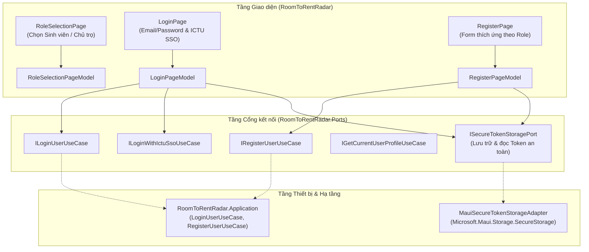
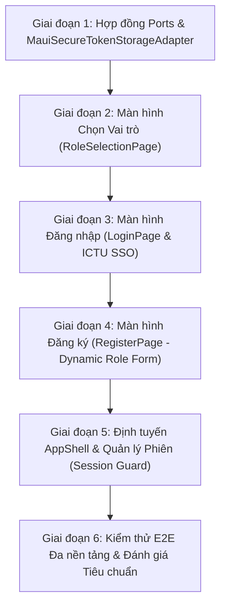

# KẾ HOẠCH TRIỂN KHAI GIAO DIỆN XÁC THỰC (AUTH UI IMPLEMENTATION PLAN)
> **Nhiệm vụ:** Build login, registration, and role-selection UI screens with token storage  
> **Dự án:** RoomToRentRadar (Hệ thống Tìm kiếm & Quản lý Phòng trọ Sinh viên ICTU)  
> **Nền tảng mục tiêu:** Windows App, Android, iOS (.NET MAUI 10)  
> **Kiến trúc:** Clean MVVM + Hexagonal Architecture (Ports & Adapters)  
> **Hệ thống Design System:** Navy Blue (`#163A5F`) + Ocean Blue (`#256D85`) + Teal (`#4CB5AE`)  
> **Tiêu chuẩn:** WCAG 2.2 AA, Compiled Binding 100% (`x:DataType`), Mobile Touch $\ge 48\text{px}$, Zero Hardcoded Hex  

---

## 1. MỤC TIÊU VÀ PHẠM VI DỰ ÁN

### 1.1. Mục tiêu nghiệp vụ
Xây dựng trọn vẹn luồng trải nghiệm xác thực (Authentication & Onboarding) dành cho cả 2 đối tượng người dùng chính của hệ thống:
1. **Sinh viên ICTU (`Student`):** Tìm kiếm phòng trọ, lưu danh sách yêu thích (US04), so sánh 3 phòng (US10), xem ảnh 360° (US03), đăng nhập nhanh qua tài khoản trường (ICTU SSO).
2. **Chủ trọ / Quản lý (`Landlord`):** Đăng bài cho thuê phòng (US08), quản lý danh sách phòng, theo dõi số liệu thống kê phòng trống.

### 1.2. Danh sách Màn hình & Thành phần cốt lõi
1. **Màn hình Chọn Vai trò (`RoleSelectionPage`):** Onboarding trực quan giúp người dùng định vị danh tính (`Sinh viên` vs `Chủ trọ`) với các tính năng đặc thù và huy hiệu nổi bật.
2. **Màn hình Đăng nhập (`LoginPage`):** Hỗ trợ đăng nhập truyền thống (Email + Password) và 1-Click ICTU SSO Login, ghi nhớ đăng nhập, xử lý trạng thái chờ (loading spinner).
3. **Màn hình Đăng ký (`RegisterPage`):** Biểu mẫu thích ứng theo vai trò (Sinh viên: yêu cầu Mã SV ICTU; Chủ trọ: yêu cầu Số điện thoại xác thực danh tính), kiểm tra mật khẩu và điều khoản dịch vụ.
4. **Cơ chế Lưu trữ Token An toàn (`MauiSecureTokenStorageAdapter`):** Lưu trữ mã hóa `AccessToken`, `RefreshToken`, thời hạn hết hạn và hồ sơ người dùng `UserProfileDto` qua API `SecureStorage` của .NET MAUI (Android KeyStore, iOS Keychain, Windows DPAPI).
5. **Điều hướng & Bảo vệ Phiên làm việc (Session Guard):** Tự động kiểm tra token khi mở ứng dụng; nếu hợp lệ điều hướng thẳng vào `AppShell` (Trang chủ), nếu hết hạn điều hướng về `LoginPage`.

---

## 2. KIẾN TRÚC & QUY TẮC PHÂN TẦNG HEXAGONAL (PORTS & ADAPTERS)



### 2.1. Hợp đồng Port Lưu trữ Token (`RoomToRentRadar.Ports/Outbound/Security/ISecureTokenStoragePort.cs`)
```csharp
namespace RoomToRentRadar.Ports.Outbound.Security;

public interface ISecureTokenStoragePort
{
    Task SaveSessionAsync(AuthTokensDto tokens, CancellationToken ct = default);
    Task<string?> GetAccessTokenAsync(CancellationToken ct = default);
    Task<string?> GetRefreshTokenAsync(CancellationToken ct = default);
    Task<UserProfileDto?> GetCachedUserProfileAsync(CancellationToken ct = default);
    Task<bool> HasValidTokenAsync(CancellationToken ct = default);
    Task ClearSessionAsync(CancellationToken ct = default);
}
```

### 2.2. Adapter Triển khai MAUI (`RoomToRentRadar/DeviceAdapters/MauiSecureTokenStorageAdapter.cs`)
- Tiêu thụ `Microsoft.Maui.Storage.SecureStorage.Default` để mã hóa token an toàn theo chuẩn phần cứng thiết bị.
- Hỗ trợ lưu trữ JSON serialized của `UserProfileDto` để hiển thị avatar, tên người dùng tức thì khi mở app mà không cần đợi API.

---

## 3. THIẾT KẾ CHI TIẾT CÁC MÀN HÌNH GIAO DIỆN (UI/UX SPECIFICATION)

### 3.1. Màn hình Chọn Vai trò (`RoleSelectionPage.xaml`)
* **Bố cục Thích ứng (Responsive Composition):**
  - Mobile: Xếp dọc 2 thẻ lựa chọn toàn màn hình.
  - Windows/Desktop: Căn giữa màn hình (Max-width: 680px), xếp ngang 2 thẻ so sánh song song.
* **Thành phần giao diện:**
  - Tiêu đề Hero: `"Bạn tham gia RoomToRentRadar với vai trò nào?"` (`TextH1`, Navy Blue).
  - Phụ đề: `"Lựa chọn vai trò để hệ thống cá nhân hóa trải nghiệm của bạn."` (`TextBodyMedium`, Slate Muted).
  - **Thẻ 1: Sinh viên tìm trọ (`Student`):**
    - Biểu tượng: 🎓 (Mũ cử nhân / Sinh viên)
    - Badge: `"Miễn phí 100%"` (Teal Badge)
    - Tiêu đề: `"Sinh viên / Người thuê"`
    - Tính năng cốt lõi: *"Tìm phòng trọ quanh ICTU, xem ảnh 360°, so sánh phòng và nhận thông báo phòng mới."*
  - **Thẻ 2: Chủ trọ cho thuê (`Landlord`):**
    - Biểu tượng: 🏠 (Ngôi nhà / Quản lý)
    - Badge: `"Đăng tin nhanh"` (Navy Blue Badge)
    - Tiêu đề: `"Chủ trọ / Ban quản lý"`
    - Tính năng cốt lõi: *"Đăng tin phòng trọ, quản lý khách thuê, tiếp cận hàng nghìn sinh viên ICTU."*
  - Nút CTA: `RadaButton` `"Tiếp tục với vai trò đã chọn"` (`Variant="Primary"`), chuyển sang `RegisterPage` kèm tham số `Role`.
  - Liên kết phụ: `"Đã có tài khoản? Đăng nhập ngay"` (`GhostButton`).

### 3.2. Màn hình Đăng nhập (`LoginPage.xaml`)
* **Bố cục Thích ứng:**
  - Mobile: Single-column cuộn với `ScrollView`, lề chuẩn 16pt.
  - Windows Desktop: Thiết kế dạng Split Card đối xứng (hoặc hộp thoại đăng nhập căn giữa $460\text{px}$ có bóng đổ `Elevation2Shadow`).
* **Thành phần giao diện:**
  - Logo & Thương hiệu RoomToRentRadar (Huy hiệu Radar + Tiêu đề `TextDisplay`).
  - Lời chào: `"Đăng nhập vào Radar phòng trọ ICTU"`.
  - **Khối 1: Nút Đăng nhập 1-Click qua ICTU SSO:**
    - `RadaButton` (`Variant="Accent"`, Icon trường ICTU): `"Đăng nhập bằng tài khoản ICTU SSO"`.
    - Phân cách: Dòng kẻ Divider có chữ `"hoặc đăng nhập bằng Email"`.
  - **Khối 2: Biểu mẫu Email & Mật khẩu:**
    - `ValidatedEntry` Email: Placeholder `"ten.sv@ictu.edu.vn hoặc email cá nhân"`, bàn phím `Email`.
    - `ValidatedEntry` Mật khẩu: `IsPassword="True"`, có nút ẩn/hiện mật khẩu (mắt xem).
    - Hàng phụ: Checkbox `"Ghi nhớ đăng nhập"` bên trái + Liên kết `"Quên mật khẩu?"` bên phải.
  - **Khối 3: Nút Hành động & Điều hướng:**
    - `RadaButton` `"Đăng nhập"` (`Variant="Primary"`, binding `IsLoading="{Binding IsBusy}"`).
    - Footer: `"Chưa có tài khoản?"` + Nút `"Đăng ký ngay"` (chuyển sang `RoleSelectionPage`).

### 3.3. Màn hình Đăng ký Tài khoản (`RegisterPage.xaml`)
* **Tính năng Biểu mẫu Thông minh (Dynamic Role Form):**
  - Thanh tiêu đề `PageHeaderBar` có nút Back quay lại trang trước.
  - Huy hiệu Role Pill Badge: Thể hiện rõ người dùng đang đăng ký với vai trò `Sinh viên` hay `Chủ trọ` kèm nút bấm chuyển đổi nhanh.
* **Các trường nhập liệu chuẩn hóa (`ValidatedEntry`):**
  1. **Họ và tên (`FullName`):** Bắt buộc, tối thiểu 2 ký tự.
  2. **Địa chỉ Email (`Email`):** Bắt buộc, kiểm tra Regex định dạng email hợp lệ. (Gợi ý dùng email `@ictu.edu.vn` nếu là Sinh viên).
  3. **Mã sinh viên (`StudentCode`):** *Chỉ hiển thị khi `Role == Student`*. Bắt buộc với sinh viên (Regex: `DTC\d{7,10}`).
  4. **Số điện thoại (`PhoneNumber`):** *Bắt buộc khi `Role == Landlord`* để sinh viên có thể liên hệ xem phòng. Kiểm tra Regex 10 chữ số đầu số Việt Nam (`03x, 05x, 07x, 08x, 09x`).
  5. **Mật khẩu (`Password`):** Tối thiểu 8 ký tự, có chỉ báo độ mạnh (Yếu / Trung bình / Mạnh).
  6. **Xác nhận mật khẩu (`ConfirmPassword`):** Báo lỗi ngay lập tức nếu không khớp với mật khẩu.
  7. **Hộp kiểm Điều khoản:** Checkbox `"Tôi đồng ý với Quy chế hoạt động & Chính sách bảo mật của RoomToRentRadar"`.
* **Nút bấm:**
  - `RadaButton` `"Tạo tài khoản"` (`Variant="Primary"`, binding `IsLoading="{Binding IsBusy}"`).
  - Khi đăng ký thành công: Tự động lưu Token và điều hướng trực tiếp vào Trang chủ `AppShell`.

---

## 4. KẾ HOẠCH TRIỂN KHAI THEO 6 GIAI ĐOẠN (PHASED EXECUTION PLAN)



### Giai đoạn 1: Hợp đồng Ports & Adapter Lưu trữ Token An toàn
- [ ] **Task 1.1:** Tạo interface `ISecureTokenStoragePort` trong `RoomToRentRadar.Ports/Outbound/Security/`.
- [ ] **Task 1.2:** Triển khai `MauiSecureTokenStorageAdapter` trong `RoomToRentRadar/DeviceAdapters/` sử dụng `Microsoft.Maui.Storage.SecureStorage`.
- [ ] **Task 1.3:** Đăng ký Dependency Injection trong `MauiProgram.cs` (`builder.Services.AddSingleton<ISecureTokenStoragePort, MauiSecureTokenStorageAdapter>()`).
- [ ] **Task 1.4:** Viết Unit Test cho việc mã hóa/giải mã và kiểm tra hạn sử dụng của Token.

### Giai đoạn 2: Xây dựng Màn hình Chọn Vai trò (`RoleSelectionPage`)
- [ ] **Task 2.1:** Tạo `RoleSelectionPageModel.cs` kế thừa `CommunityToolkit.Mvvm`, quản lý trạng thái chọn vai trò (`SelectedRole: Student | Landlord`).
- [ ] **Task 2.2:** Xây dựng giao diện XAML `RoleSelectionPage.xaml` với 2 thẻ lựa chọn tương tác cao cấp (hiệu ứng viền phát sáng khi chọn, icon lớn, badge nổi bật).
- [ ] **Task 2.3:** Tối ưu hóa layout responsive (Horizontal trên Windows, Vertical trên Android/iOS).
- [ ] **Task 2.4:** Đăng ký route `"roleselection"` trong Shell Navigation.

### Giai đoạn 3: Xây dựng Màn hình Đăng nhập (`LoginPage`)
- [ ] **Task 3.1:** Tạo `LoginPageModel.cs` inject `ILoginUserUseCase`, `ILoginWithIctuSsoUseCase`, và `ISecureTokenStoragePort`.
- [ ] **Task 3.2:** Xây dựng `LoginPage.xaml` với bố cục Hero Logo, nút ICTU SSO, hai ô nhập liệu `ValidatedEntry` (Email & Password), nút nhớ mật khẩu và `RadaButton` Đăng nhập.
- [ ] **Task 3.3:** Xử lý xác thực Client-side (Validation rules: Email đúng định dạng, Password không được để trống).
- [ ] **Task 3.4:** Tích hợp gọi `ExecuteAsync` của UseCase, bắt lỗi thân thiện (`Tài khoản hoặc mật khẩu không chính xác`) và lưu Token an toàn khi thành công.

### Giai đoạn 4: Xây dựng Màn hình Đăng ký Tài khoản (`RegisterPage`)
- [ ] **Task 4.1:** Tạo `RegisterPageModel.cs` inject `IRegisterUserUseCase` và `ISecureTokenStoragePort`.
- [ ] **Task 4.2:** Xây dựng `RegisterPage.xaml` hỗ trợ biến đổi linh hoạt:
  - Nếu `Role == Student`: Hiện trường Mã sinh viên (`StudentCode`).
  - Nếu `Role == Landlord`: Hiện trường Số điện thoại bắt buộc (`PhoneNumber`).
- [ ] **Task 4.3:** Tích hợp kiểm tra ràng buộc mật khẩu (Password Strength & Confirm Password Match).
- [ ] **Task 4.4:** Xử lý điều hướng thông minh sau khi đăng ký thành công (Welcome banner & vào thẳng trang chủ).

### Giai đoạn 5: Tích hợp Điều hướng Shell & Quản lý Phiên làm việc (Session Guard)
- [ ] **Task 5.1:** Cấu hình luồng định tuyến trong `AppShell.xaml` và `AppShell.xaml.cs`:
  - Khai báo các route độc lập không nằm trên TabBar: `login`, `register`, `roleselection`.
- [ ] **Task 5.2:** Xây dựng logic kiểm tra phiên (`AppStartupSessionCheck`):
  - Khi app khởi chạy, đọc `SecureStorage`. Nếu token hợp lệ, chuyển thẳng tới `//main`. Nếu chưa đăng nhập, mở `//login`.
- [ ] **Task 5.3:** Bổ sung nút "Đăng xuất" trong trang Cá nhân / Quản lý để xóa Token khỏi `SecureStorage` và điều hướng về màn hình đăng nhập.

### Giai đoạn 6: Kiểm thử, Tối ưu Hiệu năng & Thẩm định Tiêu chuẩn
- [ ] **Task 6.1:** Kiểm tra biên dịch `dotnet build RoomToRentRadar/RoomToRentRadar.csproj` đạt 0 Warnings, 0 Errors.
- [ ] **Task 6.2:** Kiểm tra tương thích trải nghiệm trên cả 3 nền tảng:
  - **Windows:** Thao tác phím Tab, phím Enter để submit form, responsive căn giữa.
  - **Android & iOS:** Thao tác chạm ngón tay mượt mà, bàn phím ảo không che khuất ô nhập liệu cuối cùng (`SoftInputModeAdjust.Resize`), Safe Area Insets không bị cắt lẹm.
- [ ] **Task 6.3:** Kiểm tra chuẩn khả năng tiếp cận WCAG 2.2 AA (độ tương phản chữ, `SemanticProperties.Description` trên toàn bộ inputs).

---

## 5. PHÂN BỔ VAI TRÒ ĐỘI NGŨ (MULTI-AGENT ROLES)

| Giai đoạn | Vai trò chịu trách nhiệm | Nhiệm vụ chi tiết |
| :--- | :--- | :--- |
| **Giai đoạn 1** | `@Core` + `@UI` | Định nghĩa interface `ISecureTokenStoragePort` và hiện thực hóa `MauiSecureTokenStorageAdapter`. |
| **Giai đoạn 2, 3, 4** | `@UI` (MAUI UI Specialist) | Lập trình toàn bộ View (`.xaml`), PageModel (`CommunityToolkit.Mvvm`) và kết nối Input Ports. |
| **Giai đoạn 5** | `@UI` + `@Lead` | Định cấu hình AppShell routes và luồng chuyển đổi giữa Auth Flow và Main App Flow. |
| **Giai đoạn 6** | `@QA` + `@UI` | Kiểm thử NUnit Unit Tests cho PageModels & xác thực trải nghiệm đa nền tảng. |

---

## 6. TIÊU CHUẨN HOÀN THÀNH (DEFINITION OF DONE - DOD)
- [ ] Cả 3 màn hình `RoleSelectionPage`, `LoginPage`, và `RegisterPage` đều sử dụng 100% Design Tokens và Components từ bộ UI dùng chung (`RadaButton`, `ValidatedEntry`, `PageHeaderBar`, `Colors.xaml`).
- [ ] Token xác thực được lưu trữ mã hóa an toàn qua `ISecureTokenStoragePort` (không lưu plaintext).
- [ ] Hoạt động trơn tru trên cả Windows App, Android và iOS.
- [ ] Tất cả các file XAML đều áp dụng Compiled Binding (`x:DataType`) nghiêm ngặt.
- [ ] `dotnet build` đạt **0 Errors, 0 Warnings** và toàn bộ Unit Tests vượt qua 100%.

