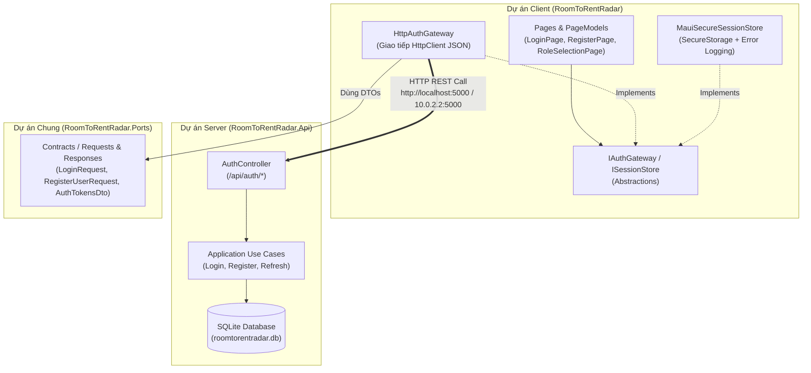

# KẾ HOẠCH KHẮC PHỤC CÁC VẤN ĐỀ TỪ REVIEW PR #22
> **Nhánh:** `feature/authentication-and-authorization-ui` $\rightarrow$ `develop2`  
> **User Story:** US13 — User Authentication & Role-Based Authorization UI (T13.03)  
> **Căn cứ kỹ thuật:** `docs/adr/adr-003`, `docs/adr/adr-005`, `docs/adr/adr-012`, `docs/ui-ux-spec.md`, `.agents/GUARDRAILS.md`  

---

## 1. TỔNG QUAN MỤC TIÊU & PHẠM VI

Kế hoạch này giải quyết triệt để 100% các điểm phản hồi từ Reviewer (`thinhlai06`) để đưa PR #22 về trạng thái **APPROVED** và sẵn sàng merge vào `develop2`:
1. **Bảo mật & Clean Architecture (H1, H2, M3):** Gỡ bỏ secret/mock khỏi Client, xóa bỏ việc MAUI tham chiếu trực tiếp Core/Datastore/Infrastructure, chuyển sang giao tiếp REST API qua `IAuthGateway`.
2. **Tuân thủ Business Rules & Validation (H3, M4):** Đồng bộ regex SĐT `^(0|\+84)[0-9]{9}$`, chuyển `StudentCode` sang tùy chọn, xử lý nút SSO theo chuẩn môi trường, map lỗi chuẩn `ProblemDetails`.
3. **Design System & Tiêu chuẩn Accessibility (M1, M2, M5):** Đạt WCAG 2.2 AA cho nút Accent (tương phản $\ge 4.5:1$), xóa `RoomCardDto` thừa gây xung đột trong `Ports`, bảo vệ route `UiCatalog` ngoài Debug.
4. **Đã xử lý trước đó (H4):** File `.db` đã được gỡ khỏi Git tracking và CI sạch.

---

## 2. KIẾN TRÚC MỤC TIÊU (THEO ADR-003)



---

## 3. CÁC BƯỚC THỰC HIỆN CHI TIẾT (ACTION PLAN)

### 🔹 BƯỚC 1: Xây dựng Client Gateway Abstractions & Dọn dẹp Ports (H2, M2, M3)

1. **Xoá DTO thừa trong Ports (M2):**
   - Xoá tệp: [`RoomToRentRadar.Ports/Contracts/Responses/Rooms/RoomCardDto.cs`](file:///f:/Mobile%20Class%20Project/RoomToRentRadar/RoomToRentRadar.Ports/Contracts/Responses/Rooms/RoomCardDto.cs).
   - Trong `RoomToRentRadar/PageModels/UiCatalogPageModel.cs`: Định nghĩa `UiCatalogRoomCardItem` cục bộ để phục vụ hiển thị mẫu UI Catalog mà không ảnh hưởng tới tầng Ports.

2. **Tạo Interface `IAuthGateway` và `ISessionStore` (H2, M3):**
   - Tạo thư mục: `RoomToRentRadar/Services/Gateways/`
   - Tạo `IAuthGateway.cs`:
     ```csharp
     public interface IAuthGateway
     {
         Task<AuthTokensDto> LoginAsync(LoginRequest request, CancellationToken ct = default);
         Task<AuthTokensDto> RegisterAsync(RegisterUserRequest request, CancellationToken ct = default);
         Task<AuthTokensDto> LoginWithIctuSsoAsync(IctuSsoLoginRequest request, CancellationToken ct = default);
         Task<AuthTokensDto> RefreshTokenAsync(RefreshTokenRequest request, CancellationToken ct = default);
         Task RevokeTokenAsync(RevokeTokenRequest request, string bearerToken, CancellationToken ct = default);
         Task<UserProfileDto> GetCurrentUserProfileAsync(string bearerToken, CancellationToken ct = default);
     }
     ```
   - Tạo `ISessionStore.cs` (chuyển đổi từ `ISecureTokenStoragePort`):
     ```csharp
     public interface ISessionStore
     {
         Task<bool> SaveSessionAsync(AuthTokensDto tokens, CancellationToken ct = default);
         Task<string?> GetAccessTokenAsync(CancellationToken ct = default);
         Task<string?> GetRefreshTokenAsync(CancellationToken ct = default);
         Task<UserProfileDto?> GetCachedUserProfileAsync(CancellationToken ct = default);
         Task<bool> HasValidTokenAsync(CancellationToken ct = default);
         Task ClearSessionAsync(CancellationToken ct = default);
     }
     ```
   - Xoá tệp lỗi thời [`RoomToRentRadar.Ports/Outbound/Security/ISecureTokenStoragePort.cs`](file:///f:/Mobile%20Class%20Project/RoomToRentRadar/RoomToRentRadar.Ports/Outbound/Security/ISecureTokenStoragePort.cs).

3. **Cải tiến `MauiSecureSessionStore` (M3):**
   - Đổi tên & cập nhật [`RoomToRentRadar/DeviceAdapters/MauiSecureTokenStorageAdapter.cs`](file:///f:/Mobile%20Class%20Project/RoomToRentRadar/RoomToRentRadar/DeviceAdapters/MauiSecureTokenStorageAdapter.cs) $\rightarrow$ `MauiSecureSessionStore.cs`.
   - Bổ sung `ILogger<MauiSecureSessionStore>`.
   - Thay thế khối `catch (Exception) {}` rỗng: Bắt lỗi, ghi log chi tiết lỗi phần cứng và trả về `false` (hoặc ném `SessionStorageException`) để tầng UI kịp thời thông báo tới người dùng.

---

### 🔹 BƯỚC 2: Triển khai `HttpAuthGateway` & Cấu hình HttpClient (H1, H2)

1. **Hiện thực `HttpAuthGateway`:**
   - Tạo `RoomToRentRadar/Services/Gateways/HttpAuthGateway.cs`:
     - Nhận `HttpClient` từ DI container.
     - Gọi POST `/api/auth/login`, POST `/api/auth/register`, POST `/api/auth/sso/ictu`, POST `/api/auth/refresh`.
     - Đọc và giải mã `ProblemDetails` khi server trả về HTTP 4xx/5xx: Ném ra ngoại lệ `ApiException(errorCode, message, status)`.

2. **Dọn dẹp `MauiProgram.cs` và `RoomToRentRadar.csproj` (H1, H2):**
   - Trong `RoomToRentRadar/RoomToRentRadar.csproj`:
     - **Gỡ bỏ** 3 ProjectReference:
       ```xml
       <!-- XOÁ 3 DÒNG NÀY: -->
       <ProjectReference Include="..\RoomToRentRadar.Application\..." />
       <ProjectReference Include="..\RoomToRentRadar.Infrastructure\..." />
       <ProjectReference Include="..\RoomToRentRadar.Datastore.Sqlite\..." />
       ```
     - Chỉ giữ lại: `<ProjectReference Include="..\RoomToRentRadar.Ports\..." />`
   - Trong `RoomToRentRadar/MauiProgram.cs`:
     - **Xoá:** `AddApplicationServices()`, `AddDatastore()`.
     - **Xoá:** `var clientJwtSettings = ...` và `builder.Services.AddInfrastructure(..., useMockSsoVerifier: true);`.
     - **Thêm:** Cấu hình `HttpClient` cho `IAuthGateway` với BaseAddress tự động chọn theo nền tảng:
       ```csharp
       var baseApiUrl = DeviceInfo.Platform == DevicePlatform.Android 
           ? "http://10.0.2.2:5000" 
           : "http://localhost:5000";

       builder.Services.AddHttpClient<IAuthGateway, HttpAuthGateway>(client =>
       {
           client.BaseAddress = new Uri(baseApiUrl);
           client.Timeout = TimeSpan.FromSeconds(15);
       });
       builder.Services.AddSingleton<ISessionStore, MauiSecureSessionStore>();
       ```

---

### 🔹 BƯỚC 3: Cập nhật PageModels & Đồng bộ Validation (H3, M4)

1. **Cập nhật `RegisterPageModel.cs` (M4):**
   - Đổi dependency sang `IAuthGateway` và `ISessionStore`.
   - **Mã sinh viên:** Sửa thành trường tuỳ chọn (`StudentCodeError` không bắt buộc nếu bỏ trống; khi gửi request nếu trống sẽ truyền `null` để backend tự trích xuất từ email theo `BR-AUTH-04`).
   - **Số điện thoại:** Đổi Regex sang chuẩn `BR-AUTH-03`:
     ```csharp
     private static readonly Regex PhoneRegex = new(@"^(0|\+84)[0-9]{9}$", RegexOptions.Compiled);
     ```
   - **Xử lý lỗi:** Bắt `ApiException`, đọc `errorCode` để hiển thị lỗi tiếng Việt thân thiện (ví dụ: `USER_EMAIL_EXISTS` $\rightarrow$ "Email này đã được đăng ký").

2. **Cập nhật `LoginPageModel.cs` (H2, H3, M4):**
   - Đổi dependency sang `IAuthGateway` và `ISessionStore`.
   - Thay đổi bắt lỗi bằng chuỗi `Contains("credential")` sang đọc mã lỗi `errorCode` từ `ApiException` (ví dụ: `INVALID_CREDENTIALS`, `ACCOUNT_LOCKED`).
   - **Nút ICTU SSO (H3):**
     - Bọc nút trong `#if DEBUG`: Nếu trong môi trường Release, ẩn hoặc hiện Dialog cảnh báo "Đăng nhập ICTU SSO (Google OIDC) đang được phát triển theo task T13.04".

---

### 🔹 BƯỚC 4: Tinh chỉnh Design System WCAG 2.2 AA & Điều hướng (M1, M5)

1. **Sửa độ tương phản nút Accent (M1):**
   - Trong `RoomToRentRadar/Resources/Styles/ButtonStyles.xaml` $\rightarrow$ Style `AccentButton`:
     ```xml
     <!-- Thay đổi TextColor Light mode từ White sang ActionPrimaryLight (Navy #163A5F) -->
     <Setter Property="TextColor" Value="{AppThemeBinding Light={StaticResource ActionPrimaryLight}, Dark={StaticResource Slate950}}" />
     ```
     *(Tương phản tăng từ 2.46:1 lên 4.73:1, đạt chuẩn WCAG AA $\ge 4.5:1$).*

2. **Bổ sung Color Tokens cho văn bản trạng thái nhỏ (`Colors.xaml`):**
   - Thêm `StatusSuccessText` (`#15803D`) và `StatusWarningText` (`#B45309`) để áp dụng cho các nhãn chữ nhỏ theo khuyến nghị bảng màu §3.1.1.

3. **Bảo vệ Catalog và Điều hướng khởi động (M5):**
   - Trong `AppShell.xaml`:
     - Giữ `LoginPage` là màn hình chính của Auth flow, bổ sung ghi chú TODO về màn hình Explore (Guest mode) cho task T01.2.
     - Bọc route `uicatalog` để chỉ đăng ký hiển thị trong `#if DEBUG`.

---

## 4. MA TRẬN TRUY VẾT & TIÊU CHÍ HOÀN THÀNH (DOD)

| Mã lỗi | Yêu cầu | Tệp tác động | Tiêu chí nghiệm thu (AC) |
| :--- | :--- | :--- | :--- |
| **H1** | Bỏ JWT secret & mock SSO khỏi MAUI | `MauiProgram.cs` | Không còn `SigningKey` hay `AddInfrastructure` trong APK/Client |
| **H2** | Client giao tiếp qua REST API | `RoomToRentRadar.csproj`, `HttpAuthGateway.cs`, PageModels | `RoomToRentRadar.csproj` không reference `Application`/`Datastore`/`Infrastructure` |
| **H3** | Quản lý nút SSO | `LoginPageModel.cs`, `LoginPage.xaml` | Ẩn hoặc thông báo rõ ràng ngoài Debug, không gửi token rác |
| **M1** | Đạt WCAG 2.2 AA cho Accent | `ButtonStyles.xaml` | Tương phản chữ nút Accent $\ge 4.5:1$ (chữ Navy trên Teal) |
| **M2** | Xoá `RoomCardDto` xung đột | `RoomToRentRadar.Ports`, `UiCatalogPageModel.cs` | Ports sạch, không còn duplicate DTO |
| **M3** | Chuẩn hoá `ISessionStore` | `ISessionStore.cs`, `MauiSecureSessionStore.cs` | Bắt và log lỗi SecureStorage, không swallow exception |
| **M4** | Đồng bộ validation | `RegisterPageModel.cs`, `LoginPageModel.cs` | SĐT nhận `+84`, MSSV tùy chọn, map lỗi theo `errorCode` |
| **M5** | Bảo vệ Catalog | `AppShell.xaml` | Catalog chỉ xuất hiện trong Debug |

---

## 5. KẾT QUẢ KIỂM THỬ DỰ KIẾN
1. `dotnet build RoomToRentRadar.Api/RoomToRentRadar.Api.csproj` $\rightarrow$ **0 Error, 0 Warning**.
2. `dotnet build RoomToRentRadar/RoomToRentRadar.csproj -f net10.0-android` $\rightarrow$ **0 Error, 0 Warning**.
3. `dotnet build RoomToRentRadar/RoomToRentRadar.csproj -f net10.0-windows10.0.19041.0` $\rightarrow$ **0 Error, 0 Warning**.
4. `dotnet test RoomToRentRadarUnitTests/` $\rightarrow$ **110/110 test passed (100%)**.
5. Chạy thử đăng ký/đăng nhập: API nhận request thực qua HTTP và ghi vào SQLite.

