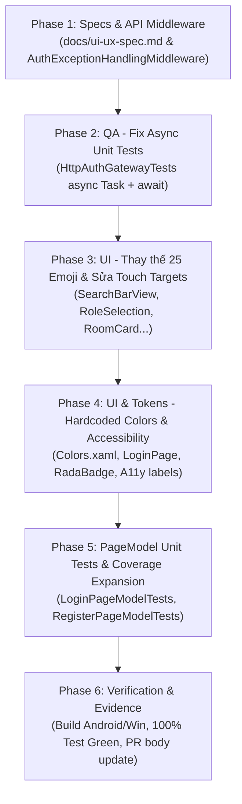

# KẾ HOẠCH KHẮC PHỤC TRIỆT ĐỂ REVIEW VÒNG 3 — PR #22 (T13.03 / US13)

> **Nhánh hiện tại:** `feature/authentication-and-authorization-ui` $\rightarrow$ `develop2`  
> **PR liên quan:** PR #22 (`Feature/authentication and authorization UI`)  
> **Người review:** `thinhlai06` (Review Vòng 3 - CHANGES_REQUESTED lúc 12/11/2026 03:51 UTC)  
> **Căn cứ kỹ thuật & Quy chuẩn:** `AGENTS.md`, `docs/ui-ux-spec.md` (đã cập nhật sang en-ENG), `docs/adr/adr-003`, `docs/adr/adr-005`, `docs/adr/adr-012`, `.agents/GUARDRAILS.md`

---

## 1. MỤC TIÊU VÀ NGUYÊN TẮC THI CÔNG

1. **Chuẩn hóa ngôn ngữ UI (H1):** Giữ toàn bộ giao diện, nhãn, validation và thông báo lỗi bằng **tiếng Anh (en-ENG)** theo quyết định của nhóm và đã đồng bộ cập nhật đặc tả trong `docs/ui-ux-spec.md` (§Platform, §6, §8).
2. **Loại bỏ 100% Emoji làm icon (M1):** Thay thế toàn bộ 25 vị trí dùng emoji bằng glyph vector chuẩn từ Fluent System Icons ([`FluentUI.cs`](file:///f:/Mobile%20Class%20Project/RoomToRentRadar/RoomToRentRadar/Resources/Fonts/FluentUI.cs)) hoặc SVG.
3. **Thống nhất chuẩn mã lỗi Canonical & Fallback (M2):**
   - Phía API: Cập nhật `AuthExceptionHandlingMiddleware` trả về trường `errorCode` trong `ProblemDetails` theo chuẩn ADR-012.
   - Phía Client: Củng cố hàm ánh xạ `MapAuthErrorCodeToMessage` trong `LoginPageModel` và `RegisterPageModel` kết hợp map mã lỗi canonical và fallback mã trạng thái HTTP (401, 403, 409...) sang thông điệp tiếng Anh thân thiện.
4. **Chuẩn hóa Unit Test Async (M3):** Sửa 5 bài test async trong [`HttpAuthGatewayTests.cs`](file:///f:/Mobile%20Class%20Project/RoomToRentRadar/RoomToRentRadarUnitTests/ClientAdapters/HttpAuthGatewayTests.cs) từ `public void` sang `public async Task` có `await Assert.ThrowsAsync<ApiException>`.
5. **Đảm bảo Vùng chạm Accessibility $\ge 48\text{ dp}$ (M4):** Mở rộng hit-area cho nút Filter và nút Clear trong [`SearchBarView.xaml`](file:///f:/Mobile%20Class%20Project/RoomToRentRadar/RoomToRentRadar/Pages/Controls/Inputs/SearchBarView.xaml).
6. **Xử lý trọn vẹn các điểm Low (L1, L2, L3, L4):**
   - **L1:** Thay thế hex cứng (`#15DC2626` trong `LoginPage.xaml`, hardcode trong `RadaBadge` / `RadaButton`) bằng dynamic/static resource token.
   - **L2:** Bổ sung `SemanticProperties.Description` tiếng Anh cho CheckBox, ô tìm kiếm và hỗ trợ focus bàn phím cho nút Back trên header.
   - **L3:** Mở rộng test coverage cho `MauiSecureSessionStore` (bọc adapter/mockable storage) và bổ sung unit test cho PageModel.
   - **L4:** Cập nhật lại số lượng test thực tế và checklist trong mô tả PR #22.

---

## 2. MA TRẬN PHÂN TÍCH VÀ GIẢI PHÁP CHI TIẾT

### 2.1. [H1] Ngôn ngữ giao diện & Thông điệp lỗi (English UI - en-ENG)
* **Quyết định:** Giữ nguyên và hoàn thiện 100% giao diện bằng tiếng Anh.
* **Đã hoàn thành:** Cập nhật `docs/ui-ux-spec.md` (§Platform, §6, §8) chỉ định `English UI (en-ENG)`.
* **Hành động triển khai:**
  * Rà soát lại tất cả chuỗi hiển thị, Placeholder, Validation Message, Dialog Alert, và `SemanticProperties` để đảm bảo không còn sót bất kỳ chuỗi tiếng Việt nào trong mã nguồn UI (ví dụ: `SemanticProperties.Description` trong `SearchBarView.xaml`).

---

### 2.2. [M1] Danh sách 25 vị trí Emoji và Glyph FluentUI thay thế

| # | Tệp nguồn | Dòng | Emoji hiện tại | FluentUI Glyph / SVG thay thế |
|---|---|:---:|:---:|---|
| 1 | `RoomToRentRadar/Pages/Controls/Inputs/SearchBarView.xaml` | 19 | `🔍` | `FluentUI.search_20_regular` (`\uf68a`) |
| 2 | `RoomToRentRadar/Pages/Controls/Inputs/SearchBarView.xaml` | 63 | `⚙` | `FluentUI.settings_20_regular` (`\uf6bb`) |
| 3 | `RoomToRentRadar/Pages/Controls/Inputs/ValidatedEntry.xaml` | 60 | `⚠️` | `FluentUI.warning_20_regular` (`\ue014` / `alert_20_regular`) |
| 4 | `RoomToRentRadar/Pages/Controls/Feedback/ErrorRetryView.xaml` | 22 | `⚠️` | `FluentUI.warning_20_regular` (`\ue014` / `alert_20_regular`) |
| 5 | `RoomToRentRadar/Pages/Controls/Common/RadaBadge.xaml.cs` | 70-71 | `✓` | Bỏ `✓` khỏi chuỗi Text, dùng `FluentUI.checkmark_16_regular` làm Leading Icon |
| 6 | `RoomToRentRadar/Pages/RoleSelectionPage.xaml` | 89 | `✓` | `FluentUI.checkmark_20_regular` (`\uf294`) |
| 7 | `RoomToRentRadar/Pages/RoleSelectionPage.xaml` | 93 | `✓` | `FluentUI.checkmark_20_regular` (`\uf294`) |
| 8 | `RoomToRentRadar/Pages/RoleSelectionPage.xaml` | 97 | `✓` | `FluentUI.checkmark_20_regular` (`\uf294`) |
| 9 | `RoomToRentRadar/Pages/RoleSelectionPage.xaml` | 101 | `✓` | `FluentUI.checkmark_20_regular` (`\uf294`) |
| 10 | `RoomToRentRadar/Pages/RoleSelectionPage.xaml` | 153 | `✓` | `FluentUI.checkmark_20_regular` (`\uf294`) |
| 11 | `RoomToRentRadar/Pages/RoleSelectionPage.xaml` | 157 | `✓` | `FluentUI.checkmark_20_regular` (`\uf294`) |
| 12 | `RoomToRentRadar/Pages/RoleSelectionPage.xaml` | 161 | `✓` | `FluentUI.checkmark_20_regular` (`\uf294`) |
| 13 | `RoomToRentRadar/Pages/RoleSelectionPage.xaml` | 165 | `✓` | `FluentUI.checkmark_20_regular` (`\uf294`) |
| 14 | `RoomToRentRadar/Pages/Controls/Cards/RoomCardView.xaml` | 99 | `📍` | `FluentUI.location_16_regular` (`\uf4f3`) |
| 15 | `RoomToRentRadar/Pages/Controls/Cards/RoomCardView.xaml.cs` | 19 | `"♡"` | `FluentUI.heart_20_regular` (`\uf443`) |
| 16 | `RoomToRentRadar/Pages/Controls/Cards/RoomCardView.xaml.cs` | 65 | `"♥"` | `FluentUI.heart_20_filled` (`\uf442`) |
| 17 | `RoomToRentRadar/Pages/Controls/Cards/RoomCardView.xaml.cs` | 70 | `"♡"` | `FluentUI.heart_20_regular` (`\uf443`) |
| 18 | `RoomToRentRadar/Pages/Controls/Cards/ComparisonCardView.xaml` | 42 | `✕` | `FluentUI.dismiss_16_regular` (`\uf36a`) |
| 19 | `RoomToRentRadar/Pages/Controls/Cards/MetricCardView.xaml.cs` | 9 | `"📊"` | `FluentUI.poll_20_regular` (`\uf5cb` / `data_trending_20_regular`) |
| 20 | `RoomToRentRadar/Pages/UiCatalogPage.xaml` | 190 | `"🏠"` | `FluentUI.home_20_regular` (`\uf480`) |
| 21 | `RoomToRentRadar/Pages/UiCatalogPage.xaml` | 196 | `"📈"` | `FluentUI.data_trending_20_regular` (`\ue074`) |
| 22-25 | Các text fallback / residue trong Page / Custom Controls | — | Ký tự biểu tượng còn sót | Rà soát và thay thế triệt để bằng `FontImageSource` hoặc Label kèm `FontFamily="{StaticResource FluentUI}"`. |

---

### 2.3. [M2] Chuẩn hóa `ProblemDetails` & `errorCode` (ADR-012)
1. **Server (`RoomToRentRadar.Api/Middlewares/AuthExceptionHandlingMiddleware.cs`):**
   * Trong phương thức `TryMapException`: Bổ sung tham số đầu ra `out string? errorCode`.
   * Gán `errorCode` chuẩn:
     * `InvalidCredentialsException` $\rightarrow$ `"AUTH_INVALID_CREDENTIALS"`
     * `InvalidTokenException` $\rightarrow$ `"AUTH_INVALID_TOKEN"`
     * `AccountLockedException` $\rightarrow$ `"AUTH_ACCOUNT_LOCKED"`
     * `LandlordNotApprovedException` $\rightarrow$ `"AUTH_LANDLORD_NOT_APPROVED"`
     * `ForbiddenRoleException` $\rightarrow$ `"AUTH_FORBIDDEN_ROLE"`
     * `UserNotFoundException` $\rightarrow$ `"AUTH_USER_NOT_FOUND"`
     * `DuplicateEmailException` $\rightarrow$ `"AUTH_EMAIL_EXISTS"`
   * Đưa `errorCode` vào `ProblemDetails`:
     ```csharp
     if (!string.IsNullOrWhiteSpace(errorCode))
     {
         problem.Extensions["errorCode"] = errorCode;
     }
     ```
2. **Client (`HttpAuthGateway.cs` & `LoginPageModel.cs`):**
   * Trong `HttpAuthGateway.ThrowApiExceptionAsync`: Tiếp tục parse `errorCode` từ json root hoặc `extensions`.
   * Trong `LoginPageModel.MapAuthErrorCodeToMessage`:
     * Đảm bảo mọi nhánh mã lỗi canonical và status code fallback đều ánh xạ sang thông điệp tiếng Anh rõ ràng:
       * 401 Unauthorized $\rightarrow$ `"Invalid email or password."`
       * 403 Forbidden $\rightarrow$ `"Your account is locked or pending approval."`
       * 409 Conflict $\rightarrow$ `"This email address is already in use."`

---

### 2.4. [M3] Chuẩn hóa Async Unit Tests (`HttpAuthGatewayTests.cs`)
Chuyển đổi 5 bài test trong [`RoomToRentRadarUnitTests/ClientAdapters/HttpAuthGatewayTests.cs`](file:///f:/Mobile%20Class%20Project/RoomToRentRadar/RoomToRentRadarUnitTests/ClientAdapters/HttpAuthGatewayTests.cs):
* L76: `LoginAsync_InvalidCredentials_ThrowsApiExceptionWithErrorCode`
* L160: `RegisterAsync_DuplicateEmail_ThrowsApiExceptionWithConflict`
* L267: `LoginWithIctuSsoAsync_InvalidToken_ThrowsApiException`
* L341: `RefreshTokenAsync_RevokedToken_ThrowsApiException`
* L411: `GetCurrentUserProfileAsync_Unauthorized_ThrowsApiException`

**Chuyển đổi từ:**
```csharp
[Test]
public void Method_Scenario_Expected()
{
    ...
    var ex = Assert.ThrowsAsync<ApiException>(async () => await gateway.MethodAsync(...));
    ...
}
```
**Sang chuẩn AGENTS.md §6:**
```csharp
[Test]
public async Task Method_Scenario_Expected()
{
    ...
    var ex = await Assert.ThrowsAsync<ApiException>(async () => await gateway.MethodAsync(...));
    ...
}
```

---

### 2.5. [M4] Vùng chạm (Touch Targets) $\ge 48\text{ dp}$ trong `SearchBarView.xaml`
* **Nút Filter (bộ lọc):**
  * Tăng `WidthRequest` và `HeightRequest` của `Border` lên chuẩn **$48 \times 48\text{ dp}$** (hoặc bọc container $48 \times 48\text{ dp}$ với padding đối xứng), đồng thời đặt `SemanticProperties.Description="Filter listings"` và `SemanticProperties.Hint="Open search filter sheet"`.
* **Nút Clear (xóa chữ):**
  * Tăng vùng bấm của `ImageButton` (hoặc bọc trong `ContentView` kích thước $48 \times 48\text{ dp}$) để diện tích chạm đạt $\ge 48\text{ dp}$, giữ icon gọn gàng bên trong.

---

### 2.6. [L1–L4] Các cải tiến chất lượng (Quality & Accessibility)
* **L1 (Theme tokens):**
  * Bổ sung token semantic cho danger banner: `<Color x:Key="StatusDangerSubtleLight">#15DC2626</Color>` và `<Color x:Key="StatusDangerSubtleDark">#25EF4444</Color>` vào `Colors.xaml`.
  * Thay thế mã màu cứng `#15DC2626` trong `LoginPage.xaml` thành dynamic resource token.
  * Cập nhật `RadaBadge.xaml.cs` và `RadaButton.xaml.cs` sử dụng resource token từ application resources thay vì fallback hardcoded hex.
* **L2 (Accessibility):**
  * Bổ sung `SemanticProperties.Description="Remember me on this device"` vào `CheckBox` trong `LoginPage.xaml`.
  * Đảm bảo nút Back trên `PageHeaderBar` có `AutomationProperties` / accessible button, hỗ trợ điều hướng bàn phím.
  * Đổi `SemanticProperties.Description` và `SemanticProperties.Hint` trong `SearchBarView.xaml` từ tiếng Việt sang tiếng Anh.
* **L3 (Test Coverage):**
  * Viết thêm Unit Test cho `LoginPageModel` (kiểm tra validation, login thành công, xử lý lỗi API và hiển thị banner lỗi tiếng Anh).
  * Viết thêm Unit Test cho `RegisterPageModel` (kiểm tra BR-AUTH-05 password rules, phone format, email format).
* **L4 (PR & Documentation):**
  * Cập nhật PR description phản ánh số test mới (dự kiến $\ge 128$ tests), đính kèm bằng chứng test pass 100%.

---

## 3. LỘ TRÌNH TRIỂN KHAI THEO PHASE (TDD WORKFLOW)



### Chi tiết các bước thực hiện:
* **Bước 1:** Hoàn thiện `AuthExceptionHandlingMiddleware` và chạy kiểm thử bộ API Auth.
* **Bước 2:** Cập nhật 5 async test trong `HttpAuthGatewayTests.cs` sang `public async Task` + `await Assert.ThrowsAsync`.
* **Bước 3:** Tiến hành thay thế toàn bộ 25 vị trí emoji sang glyph `FluentUI` trong thư mục `RoomToRentRadar/Pages/`.
* **Bước 4:** Nâng cấp kích thước vùng bấm $\ge 48\text{ dp}$ và chuyển ngữ tiếng Anh cho các thuộc tính Semantic trong `SearchBarView.xaml`.
* **Bước 5:** Thêm token semantic màu nền banner lỗi vào `Colors.xaml`, gỡ bỏ mã hex cứng ở `LoginPage.xaml`, `RadaBadge.xaml.cs` và `RadaButton.xaml.cs`.
* **Bước 6:** Bổ sung test suite cho `LoginPageModel` và `RegisterPageModel`.
* **Bước 7:** Chạy `dotnet test` toàn bộ solution và `dotnet build` cả 2 target (Windows và Android).
* **Bước 8:** Cập nhật mô tả PR #22 để phản hồi chi tiết tới reviewer `thinhlai06`.

