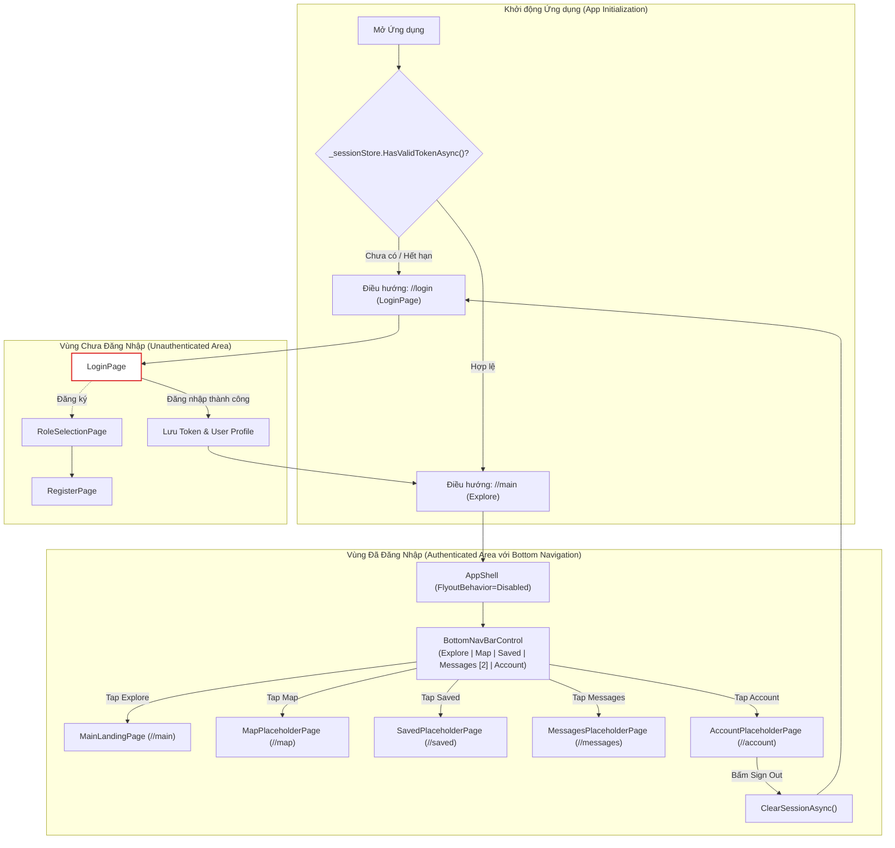
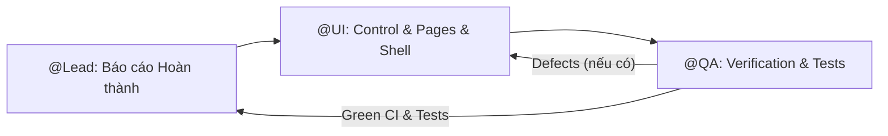

# KẾ HOẠCH TRIỂN KHAI THANH ĐIỀU HƯỚNG ĐÁY MỚI & BẢO VỆ PHIÊN ĐĂNG NHẬP (BOTTOM NAVIGATION BAR & AUTH GATEWAY PLAN)

> **Tài liệu quy chuẩn:** Tuân thủ triệt để [AGENTS.md](file:///f:/Mobile%20Class%20Project/RoomToRentRadar/AGENTS.md), [.agents/GUARDRAILS.md](file:///f:/Mobile%20Class%20Project/RoomToRentRadar/.agents/GUARDRAILS.md), [docs/ui-ux-spec.md](file:///f:/Mobile%20Class%20Project/RoomToRentRadar/docs/ui-ux-spec.md) (§2.1, §3), [docs/system-architecture.md](file:///f:/Mobile%20Class%20Project/RoomToRentRadar/docs/system-architecture.md) (§5) và ADR-003/004.  
> **Nhánh làm việc:** `feature/navigation-bar-and-user-profile-ui`  
> **Đối tượng:** Mobile Android (.NET MAUI 10) & Windows Desktop  
> **Kiến trúc:** Clean MVVM + Hexagonal Ports & Adapters  
> **Tiêu chuẩn UI:** WCAG 2.2 AA (Touch Target $\ge 48\text{ dp}$), 100% Compiled Binding (`x:DataType`), Không dùng Emoji (100% Fluent System Icons glyphs từ `FluentUI.cs`), Zero Hardcoded Colors (sử dụng Design Tokens).

---

## 1. MỤC TIÊU VÀ PHẠM VI DỰ ÁN

### 1.1. Hiện trạng & Vấn đề kiến trúc
1. **Flyout Drawer không phù hợp:** `AppShell.xaml` hiện đang dùng `Shell.FlyoutBehavior="Flyout"`. Menu trượt ngang chứa các trang `Sign In`, `Explore`, `UI Catalog` và chuyển đổi theme. Đây là thiết kế tạm thời, không đúng với chuẩn ứng dụng di động tìm phòng trọ sinh viên (theo `docs/ui-ux-spec.md` §2.1).
2. **Lỗ hổng phân quyền điều hướng (Chưa có Auth Gate):** Người dùng khi mở ứng dụng có thể mở Flyout Drawer và bấm thẳng vào `Explore` (`MainLandingPage`) mà không cần đăng nhập.
3. **Thiếu trải nghiệm Bottom TabBar chuẩn:** Ứng dụng chưa có thanh điều hướng cố định dưới đáy màn hình (Bottom Navigation Bar) đồng nhất giữa các phân hệ: Khám phá (`Explore`), Bản đồ (`Map`), Đã lưu (`Saved`), Tin nhắn (`Messages` với số đếm unread), và Tài khoản (`Account`).

### 1.2. Mục tiêu kỹ thuật mới
1. **Loại bỏ hoàn toàn thiết kế Flyout navigation cũ:** Vô hiệu hóa `Shell.FlyoutBehavior="Disabled"` và gỡ bỏ menu Flyout drawer.
2. **Triển khai Bottom Navigation Bar chuẩn theo ảnh tham chiếu thiết kế:**
   - **Tab 1 - Explore (`//explore` hoặc `//main`):** Icon la bàn (`compass_northwest_24_regular`), thanh chỉ báo Active Indicator Pill màu Teal (`#4CB5AE`) ở đỉnh tab, nhãn `Explore` (Bold, Navy `#163A5F`).
   - **Tab 2 - Map (`//map`):** Icon bản đồ (`map_24_regular`), nhãn `Map` (`#94A3B8`).
   - **Tab 3 - Saved (`//saved`):** Icon trái tim (`heart_24_regular`), nhãn `Saved` (`#94A3B8`).
   - **Tab 4 - Messages (`//messages`):** Icon bong bóng hội thoại (`chat_24_regular`), Huy hiệu thông báo đỏ tròn (`StatusDangerLight` `#DC2626`) chứa số lượng tin nhắn chưa đọc (Badge count = 2), nhãn `Messages` (`#94A3B8`).
   - **Tab 5 - Account (`//account`):** Icon người dùng (`person_24_regular`), nhãn `Account` (`#94A3B8`).
3. **Cơ chế Bảo vệ phiên làm việc (Authentication Gate):**
   - **Khi chưa đăng nhập:** Ứng dụng chỉ hiển thị luồng Xác thực (`LoginPage`, `RegisterPage`, `RoleSelectionPage`). Thanh điều hướng Bottom Bar bị ẩn hoàn toàn (`Shell.TabBarIsVisible="False"`).
   - **Khi đăng nhập thành công:** Lưu token vào `ISessionStore` (Android KeyStore / Windows DPAPI), sau đó điều hướng vào `//main` và hiển thị thanh Bottom Navigation Bar mới.
   - **Kiểm tra phiên tự động khi mở app (Session Guard):** Khi khởi động, app kiểm tra `_sessionStore.HasValidTokenAsync()`. Nếu hợp lệ -> vào ngay `//main`; nếu không -> giữ ở `//login`.
   - **Khi đăng xuất:** Xóa phiên qua `_sessionStore.ClearSessionAsync()`, điều hướng về `//login` và ẩn Bottom Navigation Bar.

---

## 2. THIẾT KẾ KIẾN TRÚC & QUY TẮC PHÂN TẦNG



### 2.1. Phân định Trách nhiệm theo ADR-003 & Hexagonal
- **`RoomToRentRadar.Ports`:** Không phụ thuộc tầng UI; đã có `ISessionStore`, `IAuthGateway`, `UserProfileDto`, `AuthTokensDto`.
- **`RoomToRentRadar.Client.Adapters`:** Cung cấp `HttpAuthGateway`, `MauiSecureTokenStorageAdapter`.
- **`RoomToRentRadar` (MAUI UI):**
  - Quản lý các View và ViewModels (`CommunityToolkit.Mvvm`).
  - Không bao giờ tham chiếu trực tiếp đến `Domain`, `Application`, `Datastore.Sqlite` hay `Infrastructure`.
  - Phụ thuộc duy nhất vào `I*Gateway` và `ISessionStore` thông qua Dependency Injection.

---

## 3. THIẾT KẾ GIAO DIỆN CHI TIẾT (UI/UX SPECIFICATION)

### 3.1. Thiết kế Chi tiết `BottomNavBarControl`
* **Vị trí & Kích thước:**
  - Cố định ở đáy màn hình (`VerticalOptions="End"`).
  - Chiều cao thanh: $60\text{ dp} - 64\text{ dp}$ (thêm `Safe Area Inset` trên thiết bị có thanh điều hướng ảo).
  - Chiều rộng mỗi tab: Phân bổ đều bằng `Grid ColumnDefinitions="*, *, *, *, *"`.
  - Mỗi vùng chạm (Touch Target): Chiều rộng $\ge 56\text{ dp}$, Chiều cao $\ge 48\text{ dp}$ (Đạt chuẩn WCAG 2.2 AA).
* **Bảng Token Màu sắc & Kiểu chữ (Zero Hardcoded Hex):**
  | Thành phần | Trạng thái Đang chọn (Active) | Trạng thái Không chọn (Inactive) |
  |---|---|---|
  | **Thanh chỉ báo đỉnh (Top Indicator Pill)** | `ActionTealLight` (`#4CB5AE`) / `Teal500`, bo góc 2dp, rộng 32dp, dày 3dp | Ẩn hoàn toàn (`IsVisible="False"`) |
  | **Màu Icon (Fluent Glyph)** | `ActionPrimaryLight` (`#163A5F`) / `Navy700` | `TextMutedLight` (`#94A3B8`) / `Slate400` |
  | **Kích thước Icon** | $24\text{ dp}$ | $24\text{ dp}$ |
  | **Nhãn chữ (Label)** | `FontSizeCaption` ($12\text{ dp}$), `FontFamilySemibold`, Bold, Màu `ActionPrimaryLight` | `FontSizeCaption` ($12\text{ dp}$), `FontFamilyRegular`, Regular, Màu `TextMutedLight` |
  | **Huy hiệu tin nhắn (Badge)** | Nền `StatusDangerLight` (`#DC2626`), Chữ Trắng, Bold, Căn góc trên phải của icon | Hiển thị động theo `UnreadMessagesCount > 0` |
  | **Nền thanh (Bar Surface)** | `SurfaceCardLight` (`#FFFFFF`) / Dark: `SurfaceCardDark` (`#162234`) | — |
  | **Đường viền đỉnh (Top Border)** | Stroke $1\text{ px}$, `BorderSubtleLight` (`#E2E8F0`) / Dark: `BorderSubtleDark` (`#162234`) | — |
  | **Đổ bóng (Elevation)** | `Elevation1Shadow` (Đổ bóng nhẹ hướng lên trên) | — |

### 3.2. Mapping Icon Glyphs từ `FluentUI.cs`
Theo quy định của `AGENTS.md` §6: **Tuyệt đối không dùng emoji**. 100% sử dụng glyph font từ `Resources/Fonts/FluentUI.cs`:
1. **Explore:** `FluentUI.compass_northwest_24_regular` (`\uf311`)
2. **Map:** `FluentUI.map_24_regular` (`\uf52e`)
3. **Saved:** `FluentUI.heart_24_regular` (`\uf47a`)
4. **Messages:** `FluentUI.chat_24_regular` (`\uf287`)
5. **Account:** `FluentUI.person_24_regular` (`\uf5be`)

---

## 4. KẾ HOẠCH TRIỂN KHAI CHI TIẾT (STEP-BY-STEP WORKFLOW)

Quy trình phối hợp các Agent Roles theo AGENTS.md §9:



### Bước 1: `@UI` Tạo Custom Control `BottomNavBarControl`
- Tạo file XAML: `RoomToRentRadar/Pages/Controls/Navigation/BottomNavBarControl.xaml`
- Tạo file Code-behind: `RoomToRentRadar/Pages/Controls/Navigation/BottomNavBarControl.xaml.cs`
- Khai báo các `BindableProperty`:
  - `SelectedTab`: Enum hoặc chuỗi (`"Explore"`, `"Map"`, `"Saved"`, `"Messages"`, `"Account"`).
  - `UnreadMessagesCount`: int (Mặc định = 2 để khớp thiết kế mẫu).
  - `TabSelectedCommand`: ICommand.
- Tích hợp animation nhẹ khi chuyển tab (Scale icon / Fade indicator).
- Đảm bảo `x:DataType` được biên dịch 100%.

### Bước 2: `@UI` Tạo các Placeholder Pages cho các Tab chưa có
Để đảm bảo điều hướng hoạt động hoàn hảo mà không vỡ ứng dụng:
- `Pages/MapPlaceholderPage.xaml` + `.cs` (Map Tab)
- `Pages/SavedPlaceholderPage.xaml` + `.cs` (Saved Tab)
- `Pages/MessagesPlaceholderPage.xaml` + `.cs` (Messages Tab)
- `Pages/AccountPlaceholderPage.xaml` + `.cs` (Account / User Profile Tab)
Mỗi trang kế thừa chuẩn Design System: có `PageHeaderBar`, `EmptyStateView` hoặc thông tin tài khoản hiện tại, nút Đăng xuất.

### Bước 3: `@UI` Tái cấu trúc `AppShell.xaml` & `AppShell.xaml.cs`
- Thay đổi `Shell.FlyoutBehavior="Disabled"`.
- Gỡ bỏ toàn bộ `FlyoutHeader`, `FlyoutFooter` và các `ShellContent` trôi nổi trong Flyout.
- Cấu hình các Route chính:
  - Auth Flow: `login` (`LoginPage`), `register` (`RegisterPage`), `roleselection` (`RoleSelectionPage`).
  - Authenticated Flow: `main` / `explore` (`MainLandingPage`), `map` (`MapPlaceholderPage`), `saved` (`SavedPlaceholderPage`), `messages` (`MessagesPlaceholderPage`), `account` (`AccountPlaceholderPage`).
- Thiết lập cơ chế ẩn thanh điều hướng trên trang đăng nhập (`Shell.TabBarIsVisible="False"`) và hiển thị trên các trang nội bộ.

### Bước 4: `@UI` Triển khai Logic Session Guard khi Khởi động
- Trong `App.xaml.cs` hoặc `AppShell.xaml.cs`:
  - Tiêm `ISessionStore` vào `AppShell`.
  - Phương thức `CheckSessionAndNavigateAsync()`:
    - Nếu `await _sessionStore.HasValidTokenAsync()` là `true` -> Điều hướng ngay vào `//main`.
    - Nếu là `false` -> Giữ nguyên tại `//login`.

### Bước 5: `@QA` Kiểm thử Tự động & Hướng dẫn Xác minh Thủ công
- Viết Unit Tests cho Logic Điều hướng và Session Guard trong `RoomToRentRadarUnitTests`:
  - `LoginPageModelTests`: Xác minh đăng nhập thành công điều hướng đúng vào `//main`.
  - `MainLandingPageModelTests`: Xác minh đăng xuất xóa token và điều hướng về `//login`.
  - `BottomNavBarControlTests`: Kiểm tra hiển thị số đếm badge tin nhắn và cập nhật tab được chọn.
- Chạy toàn bộ test suite:
  ```powershell
  dotnet test RoomToRentRadarUnitTests/RoomToRentRadarUnitTests.csproj
  ```
- Build thử nghiệm cho Android:
  ```powershell
  dotnet build RoomToRentRadar/RoomToRentRadar.csproj -f net10.0-android
  ```

---

## 5. TIÊU CHÍ HOÀN THÀNH (DEFINITION OF DONE)

- [ ] Toàn bộ thiết kế Flyout Drawer cũ bị loại bỏ; `Shell.FlyoutBehavior="Disabled"`.
- [ ] Giao diện Bottom Navigation Bar mới giống 100% hình ảnh tham chiếu thiết kế (Top indicator pill, icon glyphs chuẩn, unread badge đỏ "2", nhãn chữ phân cấp màu sắc).
- [ ] Chỉ khi đăng nhập thành công mới vào được màn hình chính và nhìn thấy Bottom Navigation Bar.
- [ ] Khi chưa đăng nhập, người dùng bắt buộc phải ở màn hình Auth, không thể vượt qua bằng các menu tắt.
- [ ] Bấm Đăng xuất từ trang Tài khoản (`Account`) đưa người dùng về `LoginPage` và ẩn Bottom Navigation Bar.
- [ ] `dotnet build` Android và Windows: 0 lỗi.
- [ ] Toàn bộ Unit Tests: 100% Pass.
- [ ] Tuân thủ nghiêm ngặt quy tắc Git: Conventional Commits, không Co-Authored-By / AI attribution.
