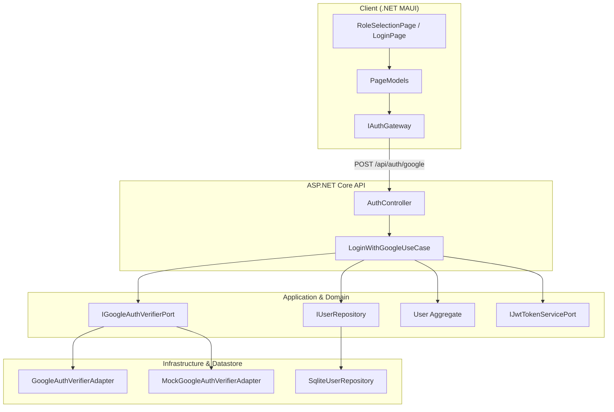

# KẾ HOẠCH TRIỂN KHAI: ĐĂNG NHẬP GOOGLE & TỐI ƯU GIAO DIỆN AUTH

> **Mã công việc:** `feat(US13/T13.3)` & `fix(AUTH/UI-CLEANUP)`  
> **Kiến trúc áp dụng:** Hexagonal / Clean Architecture (.NET 10, ASP.NET Core, .NET MAUI)  
> **Tài liệu quy chuẩn:** `AGENTS.md`, `docs/prd.md`, `docs/business-analysis.md`, `docs/system-architecture.md`, `docs/api/openapi.yaml`, `docs/ui-ux-spec.md`

---

## 1. Mục tiêu & Phạm vi (Scope of Work)

### 1.1. Đăng nhập bằng Google (Google Sign-In)
1. **Sinh viên (Student):**
   - Đăng nhập bằng tài khoản Google. Bắt buộc email phải có đuôi trường `@ictu.edu.vn` (tuân thủ quy tắc `BR-AUTH-04`).
   - Tài khoản sinh viên được kích hoạt sẵn (`IsVerified = true`), tự động trích xuất mã sinh viên từ tiền tố email.
2. **Chủ trọ (Landlord):**
   - Đăng nhập bằng tài khoản Google cá nhân (Gmail `@gmail.com` hoặc email thông thường).
   - Khi đăng nhập lần đầu tiên với vai trò Chủ trọ, hệ thống bắt buộc hiển thị form nhập **Số điện thoại** (`PhoneNumber`) hợp lệ của Việt Nam (`^(0|\+84)[0-9]{9}$` theo `BR-AUTH-03` & `BR-AUTH-04`).
   - Tài khoản Chủ trọ mới tạo có trạng thái `IsVerified = false` (chờ Quản trị viên duyệt trước khi đăng bài).
3. **Lựa chọn vai trò (Role Selection):**
   - Tại `RoleSelectionPage`, bổ sung hành động đăng nhập bằng Google tương ứng cho từng vai trò:
     - Nút *"Tiếp tục với Google"* khi chọn thẻ Sinh viên.
     - Nút *"Tiếp tục với Google"* khi chọn thẻ Chủ trọ.
   - Tại `LoginPage`, bổ sung nút *"Đăng nhập nhanh với Google"* (nếu tài khoản đã tồn tại, hệ thống tự động nhận diện vai trò đã lưu; nếu là tài khoản mới, điều hướng người dùng tới bước chọn vai trò).
4. **Tự động liên kết tài khoản (Account Linking):**
   - Nếu email tài khoản Google trùng với tài khoản đã đăng ký bằng Mật khẩu (Local) trước đó:
     - Tự động cập nhật `SsoSubjectId` và liên kết với Google.
     - Giữ nguyên dữ liệu cũ, không tạo tài khoản trùng lặp và cấp cặp token JWT (`AccessToken` + `RefreshToken`) để đăng nhập thành công.
5. **Cơ chế Dev/Test & Môi trường Production:**
   - Triển khai `MockGoogleAuthVerifierAdapter` cho môi trường Development (chạy test độc lập mà không phụ thuộc vào Internet hay Google API Key).
   - Triển khai `GoogleAuthVerifierAdapter` sẵn sàng cho Production (kiểm tra JWT signature, issuer, audience, expiration từ Google JWKS).
   - Kèm tài liệu hướng dẫn tạo Google OAuth Client ID trên Google Cloud Console & Firebase để cấu hình vào app.

---

### 1.2. Tối ưu Giao diện Nhập liệu (UI Cleanup & Show Password)
1. **Loại bỏ các dấu chấm than / icon gây hiểu nhầm:**
   - **Vị trí 1 (Bên phải trong ô nhập):** Loại bỏ nút `ClearButton` đang gán icon `info_24_regular` (hình chữ i trong vòng tròn gây hiểu nhầm là dấu chấm than khi gõ văn bản) khỏi các ô nhập trên màn hình Login và Register.
   - **Vị trí 2 (Bên dưới ô nhập):** Loại bỏ icon tam giác cảnh báo `warning_20_regular` (`⚠️`) ở dòng báo lỗi `ErrorMessage` trong `ValidatedEntry`. Chỉ giữ lại dòng chữ thông báo lỗi màu đỏ trang nhã, đúng theo design system.
2. **Nút Ẩn / Hiện Mật khẩu (Show / Hide Password Toggle):**
   - Tại các ô nhập có `IsPassword="True"`:
     - Thêm nút icon con mắt ở góc phải bên trong ô nhập.
     - Icon: `eye_20_regular` (`\ue5f2`) khi mật khẩu đang ẩn (`••••`), và `eye_off_20_regular` (`\ue5f5`) khi mật khẩu đang hiển thị văn bản rõ.
     - Bấm nút sẽ chuyển đổi qua lại giữa ẩn và hiện mật khẩu.
     - Áp dụng đồng bộ cho:
       - Ô **Mật khẩu** tại `LoginPage`.
       - Ô **Mật khẩu** và **Xác nhận mật khẩu** tại `RegisterPage`.
     - Kích thước vùng bấm đạt chuẩn tối thiểu 48x48 dp theo Accessibility Guideline của dự án.

---

## 2. Thiết kế Kiến trúc & Hợp đồng Kỹ thuật (Technical Specifications)



### 2.1. Hợp đồng Ports & DTOs
- **Namespace `RoomToRentRadar.Domain.Enums`:**
  - `AuthProvider`: Bổ sung `Google = 3` (bên cạnh `Local = 1`, `IctuSso = 2`).
- **Namespace `RoomToRentRadar.Ports.Contracts.Requests.Auth`:**
  ```csharp
  public record GoogleLoginRequest(
      string IdToken,
      UserRole Role,
      string? PhoneNumber = null,
      string? DeviceInfo = null
  );
  ```
- **Namespace `RoomToRentRadar.Ports.Contracts.Responses.Auth`:**
  ```csharp
  public record GoogleUserPayload(
      string Email,
      string FullName,
      string SubjectId
  );
  ```
- **Namespace `RoomToRentRadar.Ports.Outbound.ExternalServices`:**
  ```csharp
  public interface IGoogleAuthVerifierPort
  {
      Task<GoogleUserPayload> VerifyIdTokenAsync(string idToken, CancellationToken ct = default);
  }
  ```
- **Namespace `RoomToRentRadar.Ports.Inbound.UseCases.Auth`:**
  ```csharp
  public interface ILoginWithGoogleUseCase
  {
      Task<AuthTokensDto> ExecuteAsync(GoogleLoginRequest request, CancellationToken ct = default);
  }
  ```

### 2.2. Domain Layer (`User` Aggregate)
- Bổ sung phương thức tạo mới người dùng bằng Google:
  ```csharp
  public static User RegisterGoogle(
      string email,
      string fullName,
      string googleSubjectId,
      UserRole role,
      string? phoneNumber,
      DateTime utcNow);
  ```
  - Nếu `role == UserRole.Student`: Kiểm tra email trường (`IsIctuStudentEmail()`), tự sinh `StudentCode`, gán `IsVerified = true`.
  - Nếu `role == UserRole.Landlord`: Kiểm tra số điện thoại bắt buộc (`NormalizeAndValidatePhone`), gán `IsVerified = false`.
- Bổ sung phương thức liên kết tài khoản:
  ```csharp
  public void LinkGoogle(string googleSubjectId, string? phoneNumber, DateTime utcNow);
  ```

### 2.3. OpenAPI Spec (`docs/api/openapi.yaml`)
- Thêm endpoint `POST /api/auth/google`:
  - Request Body: `GoogleLoginRequest`.
  - Responses: `200 OK` (`AuthTokensDto`), `400 Bad Request` (thiếu dữ liệu/sai định dạng), `422 Unprocessable Content` (email sinh viên không phải `@ictu.edu.vn` hoặc chủ trọ thiếu số điện thoại).

---

## 3. Kế hoạch Thực hiện Từng Bước (Step-by-step Execution Plan)

### Giai đoạn 1: Chuẩn bị Nhánh & Môi trường
- [ ] **Bước 1.1:** Tạo nhánh tính năng mới từ `develop2`:
  ```bash
  git switch develop2
  git pull origin develop2
  git switch -c feature/group2-US13-T13.3-google-auth-and-ui-cleanup
  ```

### Giai đoạn 2: Tối ưu UI & Component `ValidatedEntry` (UI Cleanup)
- [ ] **Bước 2.1:** Cập nhật `ValidatedEntry.xaml` & `ValidatedEntry.xaml.cs`:
  - Loại bỏ hoàn toàn nút `ClearButton` dùng icon `info_24_regular`.
  - Loại bỏ icon `warning_20_regular` (`⚠️`) ở `ErrorLayout`, chỉ hiển thị nhãn chữ báo lỗi màu đỏ.
  - Thêm thuộc tính bindable `ShowPasswordToggle` (mặc định `true` khi `IsPassword = true`).
  - Thêm nút bấm toggle mật khẩu tại Column 1 của ô nhập với 2 trạng thái icon:
    - `eye_20_regular` (`\ue5f2`) khi ẩn mật khẩu.
    - `eye_off_20_regular` (`\ue5f5`) khi hiện mật khẩu.
  - Xử lý sự kiện click để bật/tắt `InnerEntry.IsPassword` mượt mà.
- [ ] **Bước 2.2:** Rà soát và cập nhật `LoginPage.xaml` & `RegisterPage.xaml` để giao diện hiển thị gọn gàng, không còn bất kỳ dấu chấm than/icon cảnh báo nào trong hoặc dưới các ô nhập.

### Giai đoạn 3: Tầng Core & Hợp đồng (Domain, Ports, Application)
- [ ] **Bước 3.1:** Thêm giá trị `Google = 3` vào `AuthProvider.cs`.
- [ ] **Bước 3.2:** Bổ sung phương thức `RegisterGoogle` và `LinkGoogle` vào Aggregate `User.cs`.
- [ ] **Bước 3.3:** Tạo các DTOs và Interfaces:
  - `GoogleLoginRequest.cs`, `GoogleUserPayload.cs`.
  - `IGoogleAuthVerifierPort.cs`, `ILoginWithGoogleUseCase.cs`.
- [ ] **Bước 3.4:** Viết ca kiểm thử RED (TDD) cho Domain và UseCase:
  - `User_RegisterGoogle_Student_ValidEmail_Success`.
  - `User_RegisterGoogle_Student_NonIctuEmail_ThrowsValidationException`.
  - `User_RegisterGoogle_Landlord_MissingPhone_ThrowsValidationException`.
  - `LoginWithGoogleUseCase_ExistingUser_LinksGoogleAndLogsIn`.
- [ ] **Bước 3.5:** Triển khai `LoginWithGoogleUseCase.cs` để các bài test chuyển sang GREEN:
  - Xác thực ID Token qua `IGoogleAuthVerifierPort`.
  - Kiểm tra tài khoản đã tồn tại: gọi `LinkGoogle`, cấp token đăng nhập.
  - Nếu tài khoản mới: tạo mới theo vai trò (Student hoặc Landlord), lưu cơ sở dữ liệu và cấp token đăng nhập.

### Giai đoạn 4: Tầng Hạ tầng & API (Infrastructure, Api, Datastore)
- [ ] **Bước 4.1:** Triển khai `MockGoogleAuthVerifierAdapter.cs` (hỗ trợ ID token dạng mock cho dev và test tự động).
- [ ] **Bước 4.2:** Triển khai `GoogleAuthVerifierAdapter.cs` (kiểm tra JWT chữ ký của Google, issuer `accounts.google.com`).
- [ ] **Bước 4.3:** Đăng ký dịch vụ trong `RoomToRentRadar.Infrastructure/DependencyInjection.cs`.
- [ ] **Bước 4.4:** Bổ sung endpoint `POST /api/auth/google` trong `AuthController.cs`.
- [ ] **Bước 4.5:** Cập nhật tài liệu hợp đồng `docs/api/openapi.yaml`.

### Giai đoạn 5: Tầng Client Gateway & Giao diện Ứng dụng (.NET MAUI)
- [ ] **Bước 5.1:** Bổ sung `LoginWithGoogleAsync` vào `IAuthGateway` và `HttpAuthGateway`.
- [ ] **Bước 5.2:** Cập nhật `RoleSelectionPage.xaml` và `RoleSelectionPageModel.cs`:
  - Thêm nút bấm *"Tiếp tục với Google"* cho thẻ Sinh viên và thẻ Chủ trọ.
  - Đối với Chủ trọ: hiển thị popup/dialog yêu cầu nhập số điện thoại trước khi gọi gateway đăng nhập.
- [ ] **Bước 5.3:** Cập nhật `LoginPage.xaml` và `LoginPageModel.cs`:
  - Thêm nút bấm *"Đăng nhập nhanh với Google"*.
  - Lưu phiên đăng nhập an toàn vào `ISessionStore` và điều hướng về trang chủ `//main`.

### Giai đoạn 6: Kiểm thử & Nghiệm thu Toàn diện (QA & Acceptance)
- [ ] **Bước 6.1:** Chạy toàn bộ Unit Tests của Solution (`dotnet test RoomToRentRadarUnitTests/RoomToRentRadarUnitTests.csproj`) đảm bảo 100% PASS.
- [ ] **Bước 6.2:** Biên dịch project Client MAUI (`dotnet build RoomToRentRadar/RoomToRentRadar.csproj -f net10.0-android`) đảm bảo 0 Errors.
- [ ] **Bước 6.3:** Soát xét checklist `GUARDRAILS.md` và quy tắc `AGENTS.md`.

---

## 4. Hướng dẫn Lấy Cấu hình Google Cloud Console & Firebase

Sau khi hoàn tất phát triển với bộ Mock Adapter, để kích hoạt đăng nhập Google thật trên ứng dụng, bạn chỉ cần thực hiện 4 bước sau:

1. **Tạo Project trên Google Cloud Console:**
   - Truy cập [Google Cloud Console](https://console.cloud.google.com/).
   - Tạo Project mới (ví dụ: `RoomToRentRadar`).
   - Vào mục **APIs & Services** $\rightarrow$ **OAuth consent screen**:
     - Chọn User Type: **External**.
     - Điền Tên ứng dụng (`RoomToRentRadar`) và Email hỗ trợ.
2. **Tạo Web Client ID (Dùng cho Backend API):**
   - Vào **Credentials** $\rightarrow$ **Create Credentials** $\rightarrow$ **OAuth client ID**.
   - Application type: **Web application**.
   - Copy **Client ID** và **Client Secret**.
   - Điền Client ID này vào `appsettings.json` của `RoomToRentRadar.Api`:
     ```json
     "GoogleAuth": {
       "ClientId": "<YOUR_WEB_CLIENT_ID>.apps.googleusercontent.com"
     }
     ```
3. **Tạo Android Client ID (Dùng cho Ứng dụng Di động):**
   - Vào lại **Create Credentials** $\rightarrow$ **OAuth client ID**.
   - Application type: **Android**.
   - Package name: `com.companyname.roomtorentradar` (kiểm tra trong `AndroidManifest.xml`).
   - Lấy mã SHA-1 fingerprint của keystore máy tính:
     ```powershell
     keytool -list -v -keystore "$env:USERPROFILE\.android\debug.keystore" -alias androiddebugkey -storepass android -keypass android
     ```
   - Dán mã SHA-1 vào Google Console và lưu lại.
4. **Cấu hình trên App MAUI:**
   - Cung cấp `Web Client ID` vào file cấu hình của app mobile để thư viện Google Sign-in lấy đúng ID Token gửi về Backend API.

