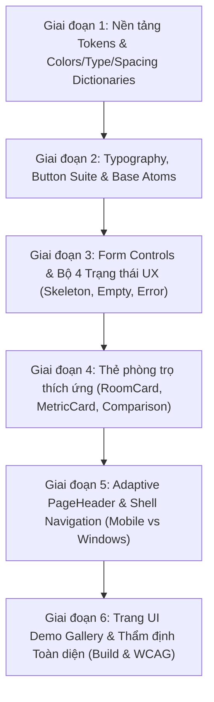

# KẾ HOẠCH TRIỂN KHAI HỆ THỐNG GIAO DIỆN CHUẨN (UI DESIGN SYSTEM & COMPONENT SUITE)
> **Dự án:** RoomToRentRadar (Hệ thống Tìm kiếm & Quản lý Phòng trọ Sinh viên ICTU)  
> **Nền tảng hỗ trợ:** Windows App (Desktop), Android, iOS (.NET MAUI 10)  
> **Kiến trúc áp dụng:** Clean MVVM + Hexagonal Architecture (Ports & Adapters)  
> **Bộ kỹ năng chỉ đạo:** UI Suite (`.agents/skills/ui/01-ui-ux-design` đến `08-ui-review`)  
> **Tiêu chuẩn chất lượng:** WCAG 2.2 AA, Zero Hardcoded Values, 3-Tier Design Tokens, 8pt Grid  

---

## 1. TỔNG QUAN VÀ MỤC TIÊU CHIẾN LƯỢC

### 1.1. Mục tiêu cốt lõi
Xây dựng một hệ thống UI Design System và bộ khung Component tái sử dụng toàn diện, đồng nhất 100% trải nghiệm và logic hiển thị trên cả 3 nền tảng:
- **Windows App (Desktop/Mouse/Keyboard):** Tối ưu không gian hiển thị rộng ($\ge 1280\text{px}$), hỗ trợ hover state, keyboard focus ring (`IsTabStop="True"`), bố cục lưới 3–4 cột, thanh điều hướng dạng Navigation Rail / Sidebar cố định.
- **Android:** Tối ưu thao tác chạm ngón tay (Touch Target $\ge 48\times 48\text{dp}$), Material Elevation & Ripple feedback, bố cục 1 cột thích ứng khi bàn phím ảo hiển thị (`SoftInputModeAdjust.Resize`), Bottom TabBar và Bottom Sheet.
- **iOS:** Tối ưu Safe Area Insets (Top Notch / Dynamic Island, Bottom Home Bar), hiệu ứng vuốt chuyển trang mượt mà (Cupertino swipe gestures), Modal Sheet vuốt đóng trực quan.

### 1.2. Các quy chuẩn bất khả xâm phạm (Guardrails)
1. **Zero Hardcoded Values:** Tuyệt đối không hardcode mã màu Hex, kích thước font chữ, hay padding lẻ tẻ trong các file view XAML. Toàn bộ phải kế thừa từ ResourceDictionary (Design Tokens).
2. **Kiến trúc Token 3 cấp (3-Tier Token Architecture):** Tier 1 (Reference) $\rightarrow$ Tier 2 (Semantic) $\rightarrow$ Tier 3 (Component). Component chỉ tiêu thụ Tier 2 & Tier 3.
3. **Thích ứng Light/Dark Mode:** Sử dụng `AppThemeBinding` và `DynamicResource`. Dark Mode không dùng pure black `#000000`, tuân thủ Elevation qua độ sáng bề mặt (Layer 0 $\rightarrow$ Layer 1 $\rightarrow$ Layer 2).
4. **Compiled Binding 100%:** Mọi View / ContentView / DataTemplate phải khai báo `x:DataType` tường minh để tối ưu thời gian render và bắt lỗi binding tại thời điểm build (XamlC).
5. **Cách ly ranh giới Hexagonal:** UI chỉ giao tiếp qua Input Ports (`I*UseCase`) trong PageModels. Tuyệt đối không gọi trực tiếp SQLite, Cosmos DB, hay HttpClient từ tầng UI.

---

## 2. PHÂN TÍCH KIẾN TRÚC THÀNH PHẦN (COMPONENT CATALOG)

```
RoomToRentRadar (Client)
 ├── Resources/
 │    └── Styles/
 │         ├── Tokens/
 │         │    ├── Colors.xaml          (Tier 1 Global Palette & Tier 2 Semantic Tokens)
 │         │    ├── Typography.xaml      (Font scale, Line-height, Font weights)
 │         │    ├── Spacing.xaml         (8pt grid spacing, layout margins, corner radii)
 │         │    └── Elevations.xaml      (Shadows & Dark Mode elevation layers)
 │         ├── ButtonStyles.xaml         (Primary, Secondary, Outline, Ghost, Destructive)
 │         ├── FormStyles.xaml           (Entries, SearchBars, Pickers, Checkboxes)
 │         └── CardStyles.xaml           (BaseCard, ElevatedCard, OutlinedCard)
 └── Pages/
      └── Controls/
           ├── Common/
           │    ├── RadaButton.xaml      (Button tích hợp Loading Spinner, Icon & Hover state)
           │    ├── RadaBadge.xaml       (Huy hiệu Verified, Status, Amenities)
           │    ├── PageHeaderBar.xaml   (Header thích ứng kèm Safe Area & Navigation)
           │    └── PriceTagView.xaml    (Định dạng tiền tệ VNĐ chuẩn kèm kỳ hạn)
           ├── Inputs/
           │    ├── ValidatedEntry.xaml  (Input kèm nhãn, nút xóa nhanh, thông báo lỗi)
           │    └── SearchBarView.xaml   (Thanh tìm kiếm có debounce & bộ lọc nhanh)
           ├── Cards/
           │    ├── RoomCardView.xaml    (Thẻ phòng thích ứng: Stacked mobile / Grid desktop)
           │    ├── ComparisonCardView.xaml (Cột so sánh phòng cho US10)
           │    └── MetricCardView.xaml  (Thẻ thống kê Dashboard dành cho chủ trọ)
           └── Feedback/
                ├── SkeletonShimmer.xaml (Khung xương tải trang chống giật layout)
                ├── EmptyStateView.xaml  (Trạng thái danh sách rỗng kèm nút phục hồi)
                └── ErrorRetryView.xaml  (Báo lỗi thân thiện tiếng Việt kèm nút Thử lại)
```

---

## 3. THIẾT KẾ CHI TIẾT DESIGN TOKENS (TIER 1 & TIER 2)

### 3.1. Bảng màu Ngữ nghĩa (Semantic Color Palette - Option 1: Navy Blue + Teal)
Hệ màu được xây dựng dựa trên bảng màu được lựa chọn (**Navy Blue + Ocean Blue + Teal**), đảm bảo phong cách chuyên nghiệp, đáng tin cậy và công nghệ cao, tuân thủ tiêu chuẩn tương phản WCAG 2.2 AA:

* **Primary:** `#163A5F` (Navy Blue) — Màu thương hiệu chủ đạo, tiêu đề chính, các nút hành động (CTA) hàng đầu.
* **Secondary:** `#256D85` (Ocean Blue) — Màu phân cấp phụ, icon phân loại, nút thứ cấp.
* **Accent:** `#4CB5AE` (Teal) — Màu điểm nhấn thị giác, huy hiệu "Đã xác thực", tag nổi bật, tiện ích nổi bật.
* **Background / Canvas:** `#F4F7FA` (Light Slate Tint) — Nền tổng thể thoáng đãng, dịu mắt.
* **Surface / Card:** `#FFFFFF` — Nền thẻ phòng trọ và khung chứa nội dung.
* **Text Primary:** `#1E293B` — Màu chữ nội dung chính với độ tương phản cao, chống mỏi mắt.

| Tên Semantic Token | Light Mode Value | Dark Mode Value | Ngữ cảnh sử dụng |
| :--- | :--- | :--- | :--- |
| `SurfaceCanvas` | `#F4F7FA` (Neutral Slate) | `#0B131E` (Deep Navy) | Nền toàn bộ màn hình ứng dụng |
| `SurfaceCard` | `#FFFFFF` (White) | `#162234` (Navy Slate) | Nền thẻ phòng, container nội dung |
| `SurfaceElevated` | `#FFFFFF` (White + Shadow) | `#22334B` (Elevated Navy) | Nền Bottom Sheet, Modal, Menu nổi |
| `SurfaceSubtle` | `#E8EEF5` (Soft Tint) | `#1A283C` (Subtle Dark) | Nền input field, chip tiện ích chưa chọn |
| `TextPrimary` | `#1E293B` (Slate-800) | `#F4F7FA` (Off-white) | Tiêu đề chính, giá phòng, thông tin mấu chốt |
| `TextSecondary` | `#475569` (Slate-600) | `#CBD5E1` (Slate-300) | Đoạn mô tả phòng, thông số diện tích |
| `TextMuted` | `#94A3B8` (Slate-400) | `#64748B` (Slate-500) | Khoảng cách đến ICTU, timestamp, placeholder |
| `TextInverse` | `#FFFFFF` (White) | `#0B131E` (Deep Navy) | Chữ trên nền nút CTA hoặc badge tối màu |
| `ActionPrimaryBg` | `#163A5F` (Navy Blue) | `#3572A5` (Soft Navy) | Nút hành động chính: "Tìm kiếm", "Đặt cọc" |
| `ActionPrimaryHover`| `#0F2942` (Darker Navy) | `#4A89C2` (Bright Navy) | Hiệu ứng rê chuột trên Windows |
| `ActionSecondaryBg`| `#256D85` (Ocean Blue) | `#256D85` (Ocean Blue) | Nút phụ: "Bộ lọc", "Quay lại" |
| `ActionAccentBg` | `#4CB5AE` (Teal) | `#5CE1D6` (Bright Teal) | Điểm nhấn hành động, tag nổi bật |
| `StatusSuccess` | `#4CB5AE` (Teal / Emerald)| `#5CE1D6` (Bright Teal) | Badge "Đã xác thực", "Còn phòng trống" |
| `StatusWarning` | `#D97706` (Amber-600) | `#F59E0B` (Amber-500) | Badge "Sắp hết phòng", Cảnh báo tiền cọc |
| `StatusDanger` | `#DC2626` (Red-600) | `#EF4444` (Red-500) | Badge "Hết phòng", Báo cáo vi phạm, Nút Xóa |
| `BorderSubtle` | `#E2E8F0` (Slate-200) | `#273B55` (Border Dark) | Đường kẻ phân cách card, viền divider |
| `BorderFocus` | `#256D85` (Ocean Blue) | `#4CB5AE` (Teal Focus) | Viền focus khi dùng phím Tab trên Windows |

### 3.2. Thang đo Typography (Typography Scale)
Sử dụng bộ font `OpenSans` và `SegoeUI` với font icons `FluentSystemIcons`:

| Role Name | Size Mobile | Size Windows | Weight | Vị trí áp dụng |
| :--- | :--- | :--- | :--- | :--- |
| `TextDisplay` | $32\text{pt}$ | $40\text{pt}$ | Bold | Giá tiền nổi bật, Hero Banner chào mừng |
| `TextH1` | $24\text{pt}$ | $28\text{pt}$ | Bold | Tiêu đề màn hình (Trang chủ, Chi tiết phòng) |
| `TextH2` | $20\text{pt}$ | $22\text{pt}$ | SemiBold | Tiêu đề phân mục (Tiện ích, Vị trí trên bản đồ) |
| `TextH3` | $16\text{pt}$ | $18\text{pt}$ | SemiBold | Tiêu đề thẻ phòng trọ, tên chủ nhà |
| `TextBodyLarge` | $16\text{pt}$ | $16\text{pt}$ | Regular | Thông tin mô tả nổi bật, quy định phòng trọ |
| `TextBodyMedium`| $14\text{pt}$ | $14\text{pt}$ | Regular | Văn bản chuẩn ứng dụng, địa chỉ chi tiết |
| `TextCaption` | $12\text{pt}$ | $12\text{pt}$ | Medium | Nhãn badge ("Cách ICTU 300m"), thời gian đăng |

### 3.3. Quy chuẩn Khoảng cách (8pt Spacing Grid) & Bo góc (Radius)
* **Khoảng cách:** `Space4` (4pt), `Space8` (8pt), `Space12` (12pt), `Space16` (16pt - Screen Margin chuẩn mobile), `Space24` (24pt - Khoảng cách Section), `Space32` (32pt), `Space48` (48pt - Desktop Margin).
* **Bo góc:** `RadiusSm` (4pt - Checkbox/Tags), `RadiusMd` (8pt - Buttons/Inputs), `RadiusLg` (12pt - Chuẩn cho Thẻ RoomCard), `RadiusXl` (16pt - Bottom Sheets), `RadiusPill` (9999pt - Avatars/Badges).
* **Kích thước bấm (Touch/Click Targets):** Mobile Touch Target tối thiểu $48\text{pt}$; Windows Click Target $38 - 42\text{pt}$.

---

## 4. CHI TIẾT THIẾT KẾ CÁC KHỐI UI CỐT LÕI (CORE COMPONENTS)

### 4.1. Hệ thống Nút bấm (Button Suite)
Xây dựng control `RadaButton` hoặc Custom Styles hỗ trợ:
1. **Biến thể (Variants):** `Primary` (Solid CTA), `Secondary` (Tonal Tint), `Outline` (Viền mảnh), `Ghost` (Icon/Text thuần túy), `Destructive` (Hủy/Xóa).
2. **Kích thước (Sizes):** `Small` (32pt), `Medium` (44pt), `Large` (52pt).
3. **Trạng thái (Visual States):**
   - `Default`: Màu chuẩn theo theme.
   - `Hover` (Chỉ Windows): Đổi màu nền sáng/tối hơn 1 nấc, con trỏ đổi sang Pointer.
   - `Pressed`: Co nhỏ nhẹ hoặc đổi màu active.
   - `Disabled`: Độ mờ $40\%$, vô hiệu hóa click/tap.
   - `IsLoading`: Hiển thị `ActivityIndicator` xoay mượt mà, chiều rộng nút giữ nguyên không bị giật nảy giao diện.

### 4.2. Hệ thống Thẻ phòng trọ (Adaptive Room Card System)
Control `RoomCardView.xaml`:
- **Thích ứng đa nền tảng:**
  - Mobile (<768px): Thẻ dạng dọc (Stacked). Ảnh phòng ở trên (tỷ lệ 16:9), thông tin phòng bên dưới. Chiếm 100% chiều rộng màn hình trừ lề 16pt.
  - Tablet (768px - 1023px): Lưới 2 cột đều nhau.
  - Windows/Desktop ($\ge 1024px$): Lưới 3 hoặc 4 cột tự co giãn, hoặc chế độ xem ngang (Ảnh bên trái 35%, nội dung bên phải 65%).
- **Cấu trúc nội dung:**
  - Lớp phủ trên ảnh: Badge trạng thái ("Đã xác thực", "Còn phòng"), Nút Tim "Lưu yêu thích" (US04).
  - Khối thông tin:
    - P1: Giá tiền định dạng chuẩn tiếng Việt (ví dụ: `2.200.000 đ/tháng`) dùng `TextH3` đậm.
    - P2: Tiêu đề phòng trọ + Tag diện tích (`25 m²`).
    - P3: Khoảng cách từ phòng đến cổng trường ĐH CNTT & TT Thái Nguyên (`Cách ICTU 350m`).
    - Dải tiện ích thu nhỏ (Icon wifi, máy lạnh, khép kín, an ninh).

### 4.3. Hệ thống Tiêu đề & Điều hướng (Adaptive Navigation & Header)
- **Control `PageHeaderBar.xaml`:**
  - Nút Back (tự động ẩn khi ở trang gốc của Shell).
  - Tiêu đề màn hình (`TextH1` hoặc `TextH2`).
  - Vùng mở rộng Action (Nút tìm kiếm, nút lọc nhanh, nút chia sẻ).
  - Tích hợp `Safe Area Insets`: Tự động cộng padding trên đỉnh khi chạy trên iOS (tránh Dynamic Island / Tai thỏ).
- **Chiến lược Shell Navigation (`AppShell.xaml`):**
  - **Android / iOS:** `TabBar` cố định ở đáy gồm 5 mục chính: *Khám phá* (US01), *Bản đồ* (US09), *Yêu thích* (US04), *So sánh* (US10), *Tài khoản/Quản lý*.
  - **Windows App:** `Flyout` hoặc `NavigationRail` cố định ở mép trái màn hình giúp chuột thao tác nhanh chóng và tiết kiệm chiều dọc màn hình.

### 4.4. Hệ thống Form & Nhập liệu (Form Controls)
- **`ValidatedEntry.xaml`:** Hộp nhập liệu chuẩn có nhãn cố định, placeholder mờ, nút 'X' xóa nhanh khi có chữ, viền `BorderFocus` khi active, và hiển thị icon cảnh báo + dòng lỗi màu đỏ khi validation thất bại.
- **`SearchBarView.xaml`:** Thanh tìm kiếm tối ưu với icon kính lúp, hỗ trợ trigger tìm kiếm sau $400\text{ms}$ debounce, và nút mở Popup bộ lọc giá / khu vực.

### 4.5. Bộ 4 Trạng thái Phản hồi UX (State Machine Views)
1. **`SkeletonShimmer.xaml` (Loading State):** Hiển thị khối màu xám chuyển động nhẹ (Shimmer), kích thước khớp 100% với `RoomCardView` thật để loại bỏ hiện tượng giật layout (CLS).
2. **`EmptyStateView.xaml` (Empty State):** Icon hộp rỗng/kính lúp + Thông báo thân thiện tiếng Việt + Nút CTA phục hồi ("Xóa bộ lọc" / "Khám phá phòng khác").
3. **`ErrorRetryView.xaml` (Error State):** Minh họa lỗi + Giải thích rõ ràng nguyên nhân (Mất kết nối Internet / Lỗi hệ thống) + Nút "Thử lại" (Retry).
4. **`FeedbackToast` (Success State):** Thông báo pop-up nổi ngắn gọn khi lưu yêu thích, gửi tin nhắn chủ trọ thành công.

---

## 5. KẾ HOẠCH TRIỂN KHAI THEO GIAI ĐOẠN (PHASED EXECUTION PLAN)



### Giai đoạn 1: Thiết lập Kiến trúc Tokens & Resources Tập trung
- [ ] **Task 1.1:** Tái cấu trúc thư mục `RoomToRentRadar/Resources/Styles/Tokens/`.
- [ ] **Task 1.2:** Cập nhật `Colors.xaml` với đầy đủ Palette 3 cấp (Neutral, Brand, Success, Warning, Danger, Surface) và ánh xạ ngữ nghĩa `AppThemeBinding` (Light & Dark mode).
- [ ] **Task 1.3:** Tạo `Typography.xaml` định nghĩa chuẩn font size, font family (`OpenSans`, `SegoeUI`, `FluentUI`), line heights và font attributes.
- [ ] **Task 1.4:** Tạo `Spacing.xaml` khai báo hệ số 8pt grid (`Space4` đến `Space48`), Screen Margins và Corner Radii (`RadiusSm` đến `RadiusPill`).
- [ ] **Task 1.5:** Hợp nhất các Resource Dictionaries vào `App.xaml` và kiểm tra build `dotnet build` đạt 0 lỗi.

### Giai đoạn 2: Xây dựng Typography Styles, Nút bấm & Atoms
- [ ] **Task 2.1:** Khai báo toàn bộ Label Styles trong `Styles.xaml` (`TextDisplay`, `TextH1`, `TextH2`, `TextH3`, `TextBodyMedium`, `TextCaption`, `TextPriceLarge`).
- [ ] **Task 2.2:** Xây dựng `ButtonStyles.xaml` định nghĩa các biến thể nút (`Primary`, `Secondary`, `Outline`, `Ghost`, `Destructive`) kèm visual states (Hover trên Windows, Pressed, Disabled).
- [ ] **Task 2.3:** Tạo component `RadaButton.xaml` hỗ trợ nhúng Icon, hiển thị Spinner `IsLoading` mà không đổi kích thước nút.
- [ ] **Task 2.4:** Xây dựng component `RadaBadge.xaml` và `AmenityChip.xaml` hỗ trợ hiển thị trạng thái phòng và các tiện ích (wifi, điều hòa, phòng tắm riêng).

### Giai đoạn 3: Xây dựng Form Inputs & Bộ 4 Trạng thái UX
- [ ] **Task 3.1:** Xây dựng component `ValidatedEntry.xaml` hỗ trợ Label nổi, Clear button, Error text và viền focus thích ứng.
- [ ] **Task 3.2:** Xây dựng component `SearchBarView.xaml` tích hợp icon kính lúp và nút mở Filter.
- [ ] **Task 3.3:** Xây dựng `SkeletonShimmer.xaml` mô phỏng layout card phòng trọ khi đang tải dữ liệu.
- [ ] **Task 3.4:** Xây dựng `EmptyStateView.xaml` và `ErrorRetryView.xaml` với tiếng Việt thân thiện và cơ chế Retry command.

### Giai đoạn 4: Hoàn thiện Hệ thống Card Thích ứng Đa Nền tảng
- [ ] **Task 4.1:** Xây dựng component `RoomCardView.xaml` và code-behind `RoomCardView.xaml.cs` với `BindableProperty Room` (sử dụng `RoomCardDto` hoặc DTO chuẩn).
- [ ] **Task 4.2:** Áp dụng bố cục thích ứng (Stacked trên điện thoại, Grid trên Tablet và Windows) với đầy đủ visual hierarchy (Giá tiền P1, Tên phòng P2, Khoảng cách ICTU P3).
- [ ] **Task 4.3:** Xây dựng `ComparisonCardView.xaml` phục vụ tính năng So sánh 3 phòng trọ song song (US10).
- [ ] **Task 4.4:** Xây dựng `MetricCardView.xaml` phục vụ màn hình quản trị / dashboard chủ trọ.

### Giai đoạn 5: Adaptive PageHeader & Shell Navigation
- [ ] **Task 5.1:** Xây dựng component `PageHeaderBar.xaml` hỗ trợ back button thông minh, title, nút action và tích hợp Safe Area cho iOS.
- [ ] **Task 5.2:** Cập nhật `AppShell.xaml` cấu hình điều hướng thích ứng:
  - Mobile (Android / iOS): Sử dụng `TabBar` đáy với các icon từ `FluentUI`.
  - Windows: Tối ưu sidebar `Flyout` hoặc Navigation Rail để thao tác chuột dễ dàng.

### Giai đoạn 6: Kiểm thử, Trang UI Gallery & Đánh giá Tiêu chuẩn
- [ ] **Task 6.1:** Tạo một trang triển lãm mẫu `UiCatalogPage.xaml` trưng bày toàn bộ components (Buttons, Cards, Inputs, Typography, 4 States, Dark/Light Mode switch) để review trực quan trên cả 3 nền tảng.
- [ ] **Task 6.2:** Kiểm tra tính tuân thủ Compiled Binding (`x:DataType`) trên 100% các file XAML.
- [ ] **Task 6.3:** Kiểm thử tương thích:
  - Windows App: Rê chuột xem hover effects, bấm phím Tab xem focus ring.
  - Android & iOS: Kiểm tra touch target $\ge 44\text{pt}$, Safe Area không bị cắt xén, bàn phím không che input.
- [ ] **Task 6.4:** Thực thi lệnh build và test:
  - `dotnet build RoomToRentRadar/RoomToRentRadar.csproj` đạt 0 Warning(s), 0 Error(s).

---

## 6. MA TRẬN PHÂN CÔNG VAI TRÒ (MULTI-AGENT ASSIGNMENT)

| Giai đoạn | Vai trò chịu trách nhiệm | Nhiệm vụ chính |
| :--- | :--- | :--- |
| **Giai đoạn 1** | `@UI` (MAUI UI Specialist) + `@Lead` | Định nghĩa kiến trúc Token 3 cấp, khóa tên file và khóa cấu trúc Resource Dictionaries. |
| **Giai đoạn 2 & 3** | `@UI` (MAUI UI Specialist) | Lập trình các Control Atoms, Buttons, Inputs, State Views bằng XAML và Compiled Bindings. |
| **Giai đoạn 4 & 5** | `@UI` (MAUI UI Specialist) | Xây dựng Card System và Shell Navigation, tinh chỉnh thích ứng Windows/Android/iOS. |
| **Giai đoạn 6** | `@QA` + `@UI` | Kiểm tra WCAG 2.2 AA, xác thực không còn hardcode màu, build kiểm thử đa nền tảng. |

---

## 7. ĐỊNH NGHĨA HOÀN THÀNH (DEFINITION OF DONE - DOD)
- [ ] Mọi màu sắc, cỡ chữ, lề, bo góc đều được lấy từ ResourceDictionary (0% hardcoded hex values).
- [ ] Giao diện chuyển đổi trơn tru giữa Light Mode và Dark Mode mà không bị mất chữ hay chói mắt.
- [ ] Hoạt động trơn tru trên cả 3 môi trường mục tiêu: Windows App, Android và iOS.
- [ ] Tất cả các component XAML đều có `x:DataType` tường minh.
- [ ] `dotnet build RoomToRentRadar/RoomToRentRadar.csproj` kết thúc với **0 Errors**.

