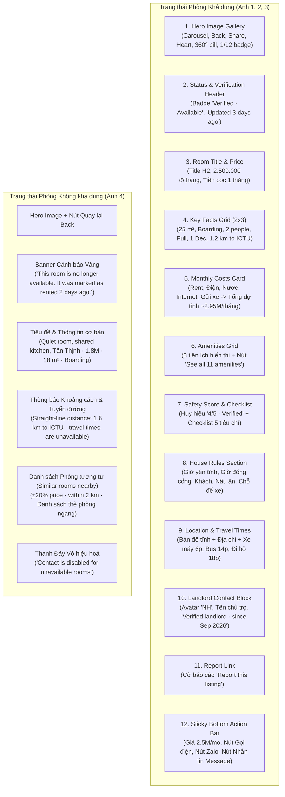
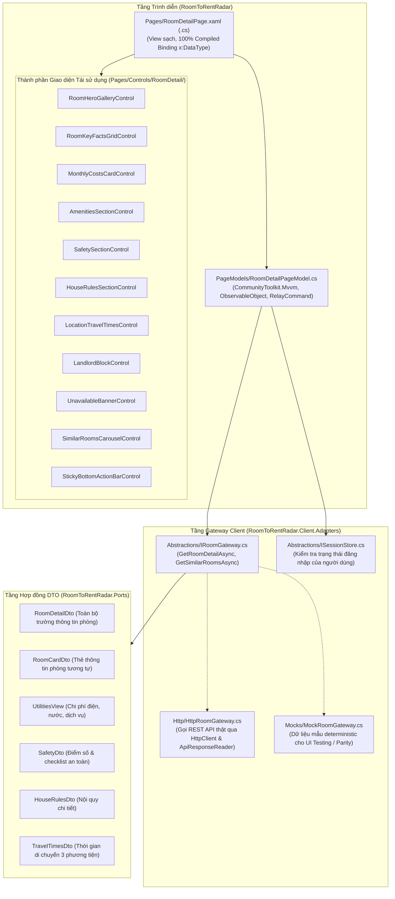
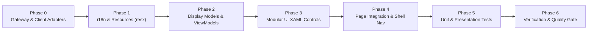

# KẾ HOẠCH TRIỂN KHAI FRONTEND TASK T02.2: MÀN HÌNH CHI TIẾT PHÒNG & XỬ LÝ PHÒNG KHÔNG KHẢ DỤNG
> **Mã công việc:** T02.2 (Trần Thuỳ Duyên)  
> **User Story:** US02 — *As a student, I want to view the full details of a room so that I can decide whether it suits me.*  
> **Nhánh Git:** `feature/group2-US02-T02.2-Build-room-detail-screen-and-unavailable-listing-handling`  
> **Nền tảng:** .NET MAUI 10 (Android First, Windows Desktop Supported)  
> **Kiến trúc:** Clean MVVM + Hexagonal Architecture (Ports & Adapters)  
> **Màn hình quy chuẩn:** `SCR-ROOM-01` (Chi tiết phòng) & `SCR-ROOM-01-UNAVAILABLE` (Phòng không còn trống / Gợi ý phòng tương tự)  
> **Bộ quy chuẩn kỹ thuật:** [AGENTS.md](../../AGENTS.md), [.agents/GUARDRAILS.md](../GUARDRAILS.md), [docs/ui-ux-spec.md](../../docs/ui-ux-spec.md) (§2.1, §3, §6), [docs/system-architecture.md](../../docs/system-architecture.md) (§5, §7), ADR-003, ADR-011, ADR-012.  
> **Tiêu chuẩn UI:** WCAG 2.2 AA (Touch target $\ge 48\text{ dp}$), 100% Compiled Binding (`x:DataType`), Zero Emoji (100% Fluent System Icons glyphs từ `FluentUI.cs`), Token màu từ `Colors.xaml`, Đa ngôn ngữ EN/VI qua `AppResources.resx` và `LocalizedStrings.Instance`.

---

## 1. PHÂN TÍCH ĐỐI CHIẾU THIẾT KẾ (5 ẢNH FIGMA GIAO DIỆN)

Dựa trên 5 ảnh thiết kế được cung cấp, màn hình `SCR-ROOM-01` được phân rã thành 2 trạng thái cốt lõi:
1. **Trạng thái Phòng Khả dụng (`Available`):** Ảnh 1, 2, 3 thể hiện luồng xem thông tin chi tiết đầy đủ từ trên xuống dưới theo mô hình Inverted Pyramid (Quy tắc kim tự tháp ngược — thông tin quan trọng nhất hiển thị trước).
2. **Trạng thái Phòng Không khả dụng (`Unavailable` - `Rented` / `Unpublished`):** Ảnh 4 thể hiện banner cảnh báo màu vàng, thông tin tóm tắt rút gọn, khoảng cách đường chim bay và danh sách gợi ý phòng tương tự (`Similar rooms nearby`), thanh liên hệ dưới đáy bị vô hiệu hoá.
3. **Phân công nhiệm vụ:** Ảnh 5 xác nhận task `T02.2` | `US02` | `Build room detail screen and unavailable-listing handling` | `Trần Thuỳ Duyên`.

### 1.1. Bảng phân rã thành phần giao diện chi tiết theo từng ảnh



---

## 2. MA TRẬN ÁNH XẠ ACCEPTANCE CRITERIA (AC) & BUSINESS RULES (BR)

| Tiêu chí AC / BR | Quy định nghiệp vụ | Hiện thực trên Frontend T02.2 |
|---|---|---|
| **AC1: Full Room Details** | Hiển thị đầy đủ mô tả, giá thuê, tiền cọc, diện tích, loại phòng, tiện ích, địa chỉ, liên hệ chủ trọ, nội quy nhà trọ. | `RoomDetailPageModel` tải `RoomDetailDto` từ `IRoomGateway.GetRoomDetailAsync` và render 12 khối giao diện chuyên biệt. |
| **AC2: Status & Last Updated** | Hiển thị trạng thái niêm yết (`Available`, `Rented`, `Unpublished`) và thời gian cập nhật gần nhất. | Huy hiệu `RadaBadge` kèm văn bản định dạng thời gian tương đối (vd: `Updated 3 days ago` / `Cập nhật 3 ngày trước`). |
| **AC3: Unavailable Listing Handling** | Nếu phòng không còn khả dụng (`Rented` hoặc `Unpublished`), hiển thị thông báo rõ ràng và đề xuất danh sách phòng tương tự (`getSimilarRooms`). | Hiển thị `UnavailableBannerView`, ẩn các khối liên hệ trực tiếp, tải và hiển thị `SimilarRoomsCarousel` (thuật toán BR-LST-10: giá $\pm 20\%$, bán kính $\le 2\text{ km}$). |
| **AC4 & BR-AUTH-07: Landlord Phone Privacy** | Chỉ người dùng đã đăng nhập mới thấy số điện thoại chủ trọ. Khách vãng lai (`Guest`) thấy `phoneNumber = null`. | Nếu khách bấm Gọi/Zalo/Nhắn tin -> hiển thị Dialog yêu cầu đăng nhập (`BR-CNT-01`) kèm điều hướng đến `//login`. Nếu đã đăng nhập -> kích hoạt quay số `Launcher.OpenAsync("tel:...")` hoặc mở Zalo. |
| **BR-LST-03: Monthly Costs Breakdown** | Dự tính tổng chi phí hàng tháng dựa trên tiền phòng + định mức điện nước (100 kWh điện, 1 người nước) + internet + gửi xe. | `MonthlyCostsCard` hiển thị chi tiết từng dòng kèm dòng tổng kết `Estimated total: ~2.95M/mo` và chú thích cách tính. |
| **BR-LST-08: Safety Score** | Điểm an toàn thang 5 kèm danh sách 5 tiện ích an toàn có dấu kiểm nhận diện xác minh. | `SafetyCardView` hiển thị điểm số (vd: `4/5 · Verified`) cùng danh sách các mục đạt (`checkmark_16_regular`) và chưa đạt (`dismiss_16_regular`). |
| **BR-HR-01 & BR-HR-03: House Rules** | Nội quy nhà trọ hiển thị tóm tắt có icon trước khi liên hệ. | `HouseRulesSectionView` hiển thị giờ yên tĩnh, giờ đóng cửa cổng, quy định dẫn khách, nấu ăn, gửi xe. |
| **BR-SRCH-03 & BR-CMP-01..03: Campus Commute** | Khoảng cách và thời gian di chuyển từ phòng đến cơ sở trường học đã chọn (mặc định là cơ sở ICTU). | `LocationTravelSectionView` hiển thị bản đồ tĩnh/định vị cùng 3 thẻ thời gian di chuyển: Xe máy (`Motorbike`), Xe buýt (`Bus`), Đi bộ (`Walking`). |
| **BR-LST-04a & E1: Room Not Found (404)** | Nếu phòng bị xoá hoặc ở trạng thái nhạy cảm (`PendingReview`, `Rejected`, `Suspended`), API trả về 404 `ROOM_NOT_FOUND`. | Bắt lỗi `ApiException` (mã lỗi `ROOM_NOT_FOUND`), chuyển giao diện sang `EmptyStateView` thông báo *"Phòng không tồn tại hoặc đã bị gỡ bỏ"* kèm nút quay lại Khám phá. |

---

## 3. KIẾN TRÚC FRONTEND & RANH GIỚI TẦNG (HEXAGONAL DDD)



### 3.1. Các nguyên tắc bất khả xâm phạm (GUARDRAILS & Clean Architecture)
1. **Không tham chiếu trực tiếp Backend / Database:** `RoomToRentRadar` và `RoomDetailPageModel` tuyệt đối **KHÔNG ĐƯỢC** thêm `using` hay tham chiếu tới `RoomToRentRadar.Application`, `RoomToRentRadar.Infrastructure`, `RoomToRentRadar.Datastore.Sqlite`, hay `Microsoft.Data.Sqlite`. Toàn bộ dữ liệu đi qua `IRoomGateway`.
2. **Không dùng HttpClient trực tiếp trong ViewModel:** Mọi truy xuất mạng đi qua `HttpRoomGateway` kế thừa từ `IRoomGateway`.
3. **Zero Hardcoded Colors & Zero Emoji:**
   - 100% màu sắc sử dụng từ điển tài nguyên `{AppThemeBinding Light={StaticResource ...}, Dark={StaticResource ...}}`.
   - 100% biểu tượng sử dụng mã glyph Fluent System Icons (`Fonts.FluentUI`) hoặc tệp SVG trong `Resources/Images/`.
4. **Đa ngôn ngữ 100%:** Mọi nhãn văn bản, tiêu đề, thông báo lỗi được định nghĩa song ngữ trong `AppResources.resx` (tiếng Anh) và `AppResources.vi.resx` (tiếng Việt), bind thông qua `LocalizedStrings.Instance`.
5. **Kích thước Touch Target $\ge 48\text{ dp}$:** Mọi nút bấm, icon thao tác (Quay lại, Yêu thích, Chia sẻ, Gọi điện, Zalo, Nhắn tin, Xem tất cả tiện ích) đảm bảo diện tích chạm tối thiểu $48 \times 48\text{ dp}$.

---

## 4. KẾ HOẠCH TRIỂN KHAI THEO TỪNG PHASE CHO FRONTEND (CHỈ TRÊN NHÁNH HIỆN TẠI)

Kế hoạch chia thành 6 Phase tuần tự, tuân thủ nghiêm ngặt quy tắc micro-task: **Phase trước biên dịch thành công 0 lỗi mới chuyển tiếp sang Phase sau**.



---

### PHASE 0: HOÀN THIỆN TẦNG GATEWAY CLIENT ADAPTERS
> **Mục tiêu:** Kích hoạt kết nối HTTP thực tế từ Client lên Backend API cho 2 hàm nghiệp vụ của US02 (`getRoomDetail` và `getSimilarRooms`), thay thế các phương thức `Pending.For` hiện tại trong `HttpRoomGateway.cs`.

#### Nhiệm vụ cụ thể:
1. **Cập nhật `RoomToRentRadar.Client.Adapters/Http/HttpRoomGateway.cs`:**
   - Triển khai `GetRoomDetailAsync(string roomId, string? campusId, CancellationToken ct)`:
     - Kiểm tra tham số đầu vào `roomId` (ném `ArgumentException` nếu null/khoảng trắng).
     - Xây dựng URL chuẩn: `/api/rooms/{roomId}` hoặc `/api/rooms/{roomId}?campusId={Uri.EscapeDataString(campusId)}`.
     - Thực thi `_httpClient.GetAsync(url, ct)` và giải mã qua `ApiResponseReader.ReadAsync<RoomDetailDto>(response, _logger, ct)`.
   - Triển khai `GetSimilarRoomsAsync(string roomId, string? campusId, CancellationToken ct)`:
     - Xây dựng URL chuẩn: `/api/rooms/{roomId}/similar` kèm query parameter `campusId`.
     - Thực thi và đọc kết quả trả về `IReadOnlyList<RoomCardDto>`.
2. **Đồng bộ hóa `MockRoomGateway.cs`:**
   - Kiểm tra và đảm bảo `MockRoomGateway.GetRoomDetailAsync` và `GetSimilarRoomsAsync` trả về đúng cấu trúc dữ liệu theo `SampleRooms` phục vụ kịch bản chạy giả lập và test offline.
3. **Định nghĩa kiểm thử Gateway trong `RoomToRentRadarUnitTests/Client.Adapters/HttpRoomGatewayDetailTests.cs`:**
   - Kiểm thử gọi đúng URL endpoint, escape tham số tiếng Việt/đặc biệt.
   - Kiểm thử xử lý mã lỗi HTTP 404 `ROOM_NOT_FOUND` và ném `ApiException`.

- **Definition of Done (DoD) Phase 0:**
  - `RoomToRentRadar.Client.Adapters.csproj` biên dịch thành công 0 lỗi.
  - Các bài unit test cho `HttpRoomGateway` đạt trạng thái Green (100% Pass).

---

### PHASE 1: ĐA NGÔN NGỮ HÓA & TỪ ĐIỂN TÀI NGUYÊN (I18N & DESIGN TOKENS)
> **Mục tiêu:** Chuẩn bị toàn bộ chuỗi hiển thị song ngữ (Anh - Việt) trong 2 file tài nguyên `AppResources.resx` và `AppResources.vi.resx`, đảm bảo không có bất kỳ chuỗi cứng (hardcoded literal) nào trên giao diện.

#### Danh mục tài nguyên chuỗi cần bổ sung:

| Khóa tài nguyên (Resource Key) | Giá trị tiếng Anh (`AppResources.resx`) | Giá trị tiếng Việt (`AppResources.vi.resx`) |
|---|---|---|
| `RoomDetail_Title` | Room Details | Chi tiết phòng |
| `RoomDetail_VerifiedAvailable` | Verified · Available | Đã xác minh · Còn phòng |
| `RoomDetail_UpdatedAgo` | Updated {0} | Cập nhật {0} |
| `RoomDetail_PerMonth` | / month | / tháng |
| `RoomDetail_Deposit` | Deposit {0} ({1}) | Tiền cọc {0} ({1}) |
| `RoomDetail_Area` | Area | Diện tích |
| `RoomDetail_RoomType` | Room type | Loại phòng |
| `RoomDetail_MaxOccupants` | Max occupants | Số người tối đa |
| `RoomDetail_Furnishing` | Furnishing | Nội thất |
| `RoomDetail_AvailableFrom` | Available from | Vào ở từ |
| `RoomDetail_DistanceToCampus` | To {0} | Đến {0} |
| `RoomDetail_MonthlyCosts` | Monthly costs | Chi phí hàng tháng |
| `RoomDetail_Rent` | Rent | Tiền phòng |
| `RoomDetail_Electricity` | Electricity | Tiền điện |
| `RoomDetail_Water` | Water | Tiền nước |
| `RoomDetail_Internet` | Internet | Tiền mạng internet |
| `RoomDetail_Parking` | Motorbike parking | Tiền gửi xe máy |
| `RoomDetail_Included` | Included | Đã bao gồm |
| `RoomDetail_EstimatedTotal` | Estimated total | Tổng dự tính |
| `RoomDetail_EstimateNote` | Estimate: 100 kWh electricity, 1 person water. | Dự tính: 100 kWh điện, 1 người sử dụng nước. |
| `RoomDetail_Amenities` | Amenities | Tiện ích |
| `RoomDetail_SeeAllAmenities` | See all {0} amenities | Xem tất cả {0} tiện ích |
| `RoomDetail_Safety` | Safety | An toàn & An ninh |
| `RoomDetail_VerifiedScore` | {0}/5 · Verified | {0}/5 · Đã xác minh |
| `RoomDetail_HouseRules` | House rules | Nội quy phòng trọ |
| `RoomDetail_QuietHours` | Quiet hours | Giờ yên tĩnh |
| `RoomDetail_Curfew` | Curfew | Giờ đóng cửa cổng |
| `RoomDetail_Guests` | Guests | Quy định dẫn khách |
| `RoomDetail_Cooking` | Cooking | Nấu ăn |
| `RoomDetail_ParkingRule` | Parking | Chỗ để xe |
| `RoomDetail_GettingToCampus` | Getting to {0} · {1} km | Đi đến {0} · {1} km |
| `RoomDetail_Motorbike` | Motorbike | Xe máy |
| `RoomDetail_Bus` | Bus (est.) | Xe buýt (dự tính) |
| `RoomDetail_Walking` | Walking | Đi bộ |
| `RoomDetail_Mins` | {0} mins | {0} phút |
| `RoomDetail_VerifiedLandlord` | Verified landlord · since {0} | Chủ trọ xác thực · tham gia từ {0} |
| `RoomDetail_ReportListing` | Report this listing | Báo cáo tin đăng này |
| `RoomDetail_ActionCall` | Call | Gọi điện |
| `RoomDetail_ActionZalo` | Zalo | Zalo |
| `RoomDetail_ActionMessage` | Message | Nhắn tin |
| `RoomDetail_ContactDisabled` | Contact is disabled for unavailable rooms | Tính năng liên hệ bị tắt vì phòng đã thuê |
| `RoomDetail_SignInToContact` | Sign in to contact landlord | Đăng nhập để xem số điện thoại & liên hệ |
| `RoomDetail_UnavailableNotice` | This room is no longer available. It was marked as rented {0}. | Phòng này không còn khả dụng. Đã được đánh dấu đã thuê {0}. |
| `RoomDetail_StraightLineFallback` | Straight-line distance: {0} km to {1} · travel times are unavailable right now | Khoảng cách đường chim bay: {0} km đến {1} · hiện chưa có dữ liệu thời gian di chuyển |
| `RoomDetail_SimilarRooms` | Similar rooms nearby | Phòng tương tự gần đây |
| `RoomDetail_SimilarCriteria` | ±20% price · within 2 km | Giá ±20% · trong bán kính 2 km |
| `RoomDetail_DistanceFromThis` | {0} km from this room | Cách phòng này {0} km |
| `RoomDetail_NotFoundTitle` | Room Not Found | Không tìm thấy phòng |
| `RoomDetail_NotFoundMessage` | This listing does not exist or has been removed. | Tin đăng này không tồn tại hoặc đã bị gỡ bỏ. |
| `RoomDetail_BackToExplore` | Back to Explore | Quay lại Khám phá |

- **Definition of Done (DoD) Phase 1:**
  - Hai tệp `AppResources.resx` và `AppResources.vi.resx` được cập nhật đồng bộ 100% các khóa.
  - Dự án `RoomToRentRadar` biên dịch thành công, `LocalizedStrings.Instance[key]` giải quyết chính xác các chuỗi theo ngôn ngữ hiện hành.

---

### PHASE 2: THIẾT KẾ CÁC MODEL HIỂN THỊ & PAGEMODEL CHÍNH (`RoomDetailPageModel`)
> **Mục tiêu:** Xây dựng tầng ViewModel sạch theo chuẩn `CommunityToolkit.Mvvm`, quản lý trạng thái tải, chuyển đổi dữ liệu DTO sang Display Model phục vụ hiển thị mượt mà trên UI.

#### 1. Các Display Models trợ giúp (`Pages/Controls/RoomDetail/Models/`):
- `KeyFactItem`: Đại diện cho 1 ô thông số (IconGlyph, Label, Value).
- `CostRowItem`: Đại diện cho 1 dòng chi phí hàng tháng (Label, ValueFormatted, IsHighlighted).
- `AmenityDisplayItem`: Đại diện cho 1 tiện ích (Amenity, NameLocalized, IconGlyph).
- `SafetyCheckItem`: Đại diện cho 1 tiêu chí an toàn (Feature, DescriptionLocalized, IsVerified, IconGlyph, IconColor).
- `HouseRuleItem`: Đại diện cho 1 dòng nội quy (RuleType, TitleLocalized, DetailText, IconGlyph).
- `CommuteModeItem`: Đại diện cho 1 phương tiện di chuyển (Mode, TimeFormatted, LabelLocalized, IconGlyph).

#### 2. Cấu trúc `RoomDetailPageModel` (`PageModels/RoomDetailPageModel.cs`):
- **Thuộc tính điều hướng từ Shell:**
  - `[QueryProperty(nameof(RoomId), "roomId")]`
  - `[QueryProperty(nameof(CampusId), "campusId")]`
- **Thuộc tính trạng thái giao diện:**
  - `IsLoading`: bool (Hiển thị Skeleton Shimmer khi đang tải dữ liệu).
  - `HasError`: bool (Hiển thị `ErrorRetryView` khi lỗi kết nối mạng).
  - `IsNotFound`: bool (Hiển thị `EmptyStateView` khi API trả về 404 `ROOM_NOT_FOUND`).
  - `IsAvailable`: bool (True khi trạng thái niêm yết là `Available`).
  - `IsUnavailable`: bool (True khi trạng thái là `Rented` hoặc `Unpublished`).
  - `UnavailableBannerText`: string (Câu thông báo trên banner vàng theo thời gian thực tế).
  - `Room`: `RoomDetailDto?` (Dữ liệu gốc nhận từ API).
  - `IsSignedIn`: bool (Lấy từ `ISessionStore.HasValidTokenAsync()`).
  - `IsFavourite`: bool (Đồng bộ theo trường `RoomDetailDto.IsFavourite`).
  - `CurrentPhotoIndex`: int & `TotalPhotosCount`: int & `PhotoCounterText`: string (vd: `1 / 12`).
  - `CampusName`: string (Mặc định `ICTU`).
- **Bộ sưu tập dữ liệu phục vụ Binding:**
  - `KeyFacts`: `ObservableCollection<KeyFactItem>`
  - `CostBreakdownRows`: `ObservableCollection<CostRowItem>`
  - `EstimatedTotalFormatted`: string (vd: `~2.95M/mo` hoặc `~2,95 tr/tháng`)
  - `AmenitiesDisplayList`: `ObservableCollection<AmenityDisplayItem>` (Lọc 8 mục đầu cho chế độ rút gọn, mở rộng khi bấm nút)
  - `SafetyScoreFormatted`: string (vd: `4/5 · Verified`)
  - `SafetyChecklist`: `ObservableCollection<SafetyCheckItem>`
  - `HouseRulesList`: `ObservableCollection<HouseRuleItem>`
  - `CommuteTimes`: `ObservableCollection<CommuteModeItem>`
  - `SimilarRooms`: `ObservableCollection<RoomCardDisplayModel>` (Thẻ phòng tương tự cho trạng thái Unavailable)
- **Các Lệnh thao tác (`[RelayCommand]`):**
  - `InitializeAsync()`: Tải chi tiết phòng từ `IRoomGateway.GetRoomDetailAsync`. Nếu phòng `Unavailable`, tự động gọi `GetSimilarRoomsAsync`. Tải song song `GetRoomTravelTimesAsync`.
  - `RefreshAsync()`: Kéo xuống để tải lại (Pull-to-refresh).
  - `GoBackAsync()`: Quay lại trang trước bằng `Shell.Current.GoToAsync("..")`.
  - `ShareListingAsync()`: Mở bảng chia sẻ hệ thống qua `Share.Default.RequestAsync`.
  - `ToggleFavouriteAsync()`: Chuyển đổi trạng thái lưu tin phòng (gọi `IFavouriteGateway`).
  - `Open360ViewAsync()`: Mở trình xem 360° (US03) hoặc thông báo tính năng.
  - `ToggleAllAmenitiesAsync()`: Hiển thị trọn vẹn danh sách tất cả các tiện ích.
  - `CallLandlordAsync()`: Nếu chưa đăng nhập -> hiển thị thông báo đăng nhập; nếu đã đăng nhập và có SĐT -> `Launcher.Default.OpenAsync($"tel:{phone}")`.
  - `OpenZaloAsync()`: Nếu chưa đăng nhập -> yêu cầu đăng nhập; nếu đã đăng nhập -> mở liên kết Zalo.
  - `MessageLandlordAsync()`: Nếu chưa đăng nhập -> yêu cầu đăng nhập; nếu đã đăng nhập -> điều hướng đến màn hình trò chuyện (US14).
  - `ReportListingAsync()`: Mở BottomSheet báo cáo tin đăng (US12 / `SCR-ROOM-04`).
  - `SelectSimilarRoomAsync(string targetRoomId)`: Điều hướng xem chi tiết phòng tương tự được chọn.

- **Definition of Done (DoD) Phase 2:**
  - `RoomDetailPageModel` cùng các Display Model được biên dịch hoàn tất, không phụ thuộc bất kỳ lớp UI MAUI nào trong logic tính toán, tuân thủ thuần khiết MVVM.

---

### PHASE 3: THIẾT KẾ CÁC CONTROL XAML TÁI SỬ DỤNG (MODULAR UI CONTROLS)
> **Mục tiêu:** Chia nhỏ màn hình chi tiết thành 11 UserControl XAML độc lập nằm trong thư mục `RoomToRentRadar/Pages/Controls/RoomDetail/`. Mỗi control chịu trách nhiệm một phần giao diện chuyên biệt, tái sử dụng tốt, dễ bảo trì và kiểm thử.

```
RoomToRentRadar/Pages/Controls/RoomDetail/
├── RoomHeroGalleryControl.xaml (.cs)         # 1. Ảnh lớn trên cùng + nút Back, Share, Heart, 360°, đếm 1/12
├── RoomKeyFactsGridControl.xaml (.cs)        # 2. Lưới 2x3 ô thông số: Diện tích, Loại phòng, Số người...
├── MonthlyCostsCardControl.xaml (.cs)        # 3. Thẻ chi phí hàng tháng: Tiền phòng, điện, nước -> Tổng dự tính
├── AmenitiesSectionControl.xaml (.cs)        # 4. Danh sách tiện ích 2 cột + Nút "Xem tất cả tiện ích"
├── SafetySectionControl.xaml (.cs)           # 5. Khối an toàn: Điểm số 4/5 + Checklist xác minh (CCTV, PCCC...)
├── HouseRulesSectionControl.xaml (.cs)       # 6. Khối nội quy: Giờ yên tĩnh, Giờ đóng cổng, Khách, Nấu ăn...
├── LocationTravelTimesControl.xaml (.cs)     # 7. Bản đồ định vị + Địa chỉ + Thẻ 3 phương tiện (Xe máy, Bus, Đi bộ)
├── LandlordBlockControl.xaml (.cs)           # 8. Khối chủ trọ: Avatar viết tắt, Tên, Huy hiệu xác minh & thâm niên
├── UnavailableBannerControl.xaml (.cs)       # 9. Banner cảnh báo màu vàng khi phòng không còn khả dụng
├── SimilarRoomsCarouselControl.xaml (.cs)    # 10. Danh sách trượt ngang các phòng tương tự (±20% giá, ≤ 2km)
└── StickyBottomActionBarControl.xaml (.cs)   # 11. Thanh đáy cố định: Giá + Nút Gọi, Zalo, Nhắn tin (hoặc thông báo Disable)
```

#### Chi tiết thiết kế từng Control theo chuẩn XAML Token:

1. **`RoomHeroGalleryControl.xaml`:**
   - Sử dụng `CarouselView` hoặc `Grid` chiều cao $240\text{–}280\text{ dp}$ với `x:DataType="models:RoomHeroDisplayModel"`.
   - Lớp màng mờ trên cùng (`BoxView Color="#33000000"`) đảm bảo độ tương phản cho các nút màu trắng.
   - Nút Quay lại (`chevron_left_24_regular`), nút Chia sẻ (`share_android_24_regular`), nút Yêu thích (`heart_24_regular` / `heart_24_filled`).
   - Nút Pill `360° view` bo tròn ở góc trái dưới (`Border StrokeShape="RoundRectangle 9999"`, nền `#CC1E293B`).
   - Huy hiệu đếm ảnh góc phải dưới (`1 / 12`, nền `#B3000000`, chữ trắng).
2. **`RoomKeyFactsGridControl.xaml`:**
   - Bố cục `Grid` 2 dòng $\times$ 3 cột, khoảng cách `ColumnSpacing="8"` và `RowSpacing="8"`.
   - Mỗi ô là 1 `Border` bo góc 8dp, nền `SurfaceSubtle`, viền `BorderSubtle`, bên trong gồm Icon Fluent 20dp, giá trị in đậm, nhãn caption phụ bên dưới.
3. **`MonthlyCostsCardControl.xaml`:**
   - Thẻ `Border` bo tròn 12dp, nền `SurfaceCard`, bóng đổ nhẹ `Elevation1Shadow`.
   - Liệt kê tiền phòng, đơn giá điện (đ/kWh), nước (đ/người), internet, gửi xe máy.
   - Đường ngăn cách `BoxView HeightRequest="1" Color="{StaticResource BorderSubtleLight}"`.
   - Hàng tổng kết: Nhãn `Estimated total` và số tiền in đậm nổi bật màu `TextBrandLight` (`#163A5F`).
   - Dòng chú thích in nghiêng nhỏ: *"Dự tính: 100 kWh điện, 1 người sử dụng nước."*
4. **`AmenitiesSectionControl.xaml`:**
   - Bố cục dạng 2 cột hiển thị các tiện ích có icon Fluent chuyên biệt:
     - Điều hòa: `weather_snowflake_24_regular`
     - Bình nóng lạnh: `drop_24_regular`
     - Vệ sinh khép kín: `shower_head_24_regular`
     - Wi-Fi: `wifi_1_24_regular`
     - Giường: `bed_24_regular`
     - Tủ lạnh: `food_pizza_24_regular` / gia dụng
     - Chỗ để xe máy: `vehicle_bicycle_24_regular`
     - Tủ quần áo & bàn học: `desk_24_regular`
   - Nút bo tròn viền mỏng: `See all 11 amenities` (Touch target $48\text{ dp}$).
5. **`SafetySectionControl.xaml`:**
   - Tiêu đề kèm huy hiệu `RadaBadge Type="Verified"` hiển thị `4/5 · Verified`.
   - Danh sách 5 tiêu chí:
     - [✓] Camera an ninh tại lối vào (`checkmark_16_regular`, màu xanh `StatusSuccessLight`).
     - [✓] Khóa cửa vân tay / thẻ từ bảo mật (`checkmark_16_regular`).
     - [✓] Bình chữa cháy & lối thoát hiểm (`checkmark_16_regular`).
     - [✓] Chủ trọ sống cùng khu trọ (`checkmark_16_regular`).
     - [✕] Lối đi có đèn chiếu sáng ban đêm (`dismiss_16_regular`, màu xám `TextMutedLight` khi không có).
6. **`HouseRulesSectionControl.xaml`:**
   - Hiển thị theo danh sách có biểu tượng sinh động:
     - Giờ yên tĩnh: Icon mặt trăng `weather_moon_20_regular` (`22:00 – 06:00`).
     - Giờ đóng cổng: Icon đồng hồ `clock_20_regular` (`23:30`).
     - Khách đến chơi: Icon người `people_20_regular` (`Daytime only`).
     - Nấu ăn: Icon ẩm thực `food_20_regular` (`Shared kitchen only`).
     - Gửi xe: Icon phương tiện `vehicle_car_20_regular` (`Motorbikes in the yard, one per room`).
7. **`LocationTravelTimesControl.xaml`:**
   - Khung bản đồ thu nhỏ với ghim vị trí phòng trọ.
   - Dòng địa chỉ chi tiết (vd: *Ngõ 12, đường Z115, Quyết Thắng, TP. Thái Nguyên*).
   - Dòng thông tin khoảng cách: *Getting to ICTU · 1.2 km*.
   - 3 ô phương tiện di chuyển song song:
     - Xe máy: `vehicle_motorcycle_24_regular`, `6 mins`, `Motorbike`.
     - Xe buýt: `vehicle_bus_24_regular`, `~14 mins`, `Bus (est.)`.
     - Đi bộ: `person_walking_24_regular`, `18 mins`, `Walking`.
8. **`LandlordBlockControl.xaml`:**
   - Khối bo tròn với Avatar tròn chứa 2 chữ cái đầu của tên chủ trọ (vd: `NH`).
   - Tên chủ trọ in đậm (`Nguyễn Thị Hoa`).
   - Dòng huy hiệu xác thực: `Verified landlord · since Sep 2026` với icon checkmark xanh.
9. **`UnavailableBannerControl.xaml`:**
   - Thẻ thông báo viền màu hổ phách/vàng (`Border Stroke="{StaticResource StatusWarningLight}" BackgroundColor="{StaticResource StatusWarningSubtleLight}"`).
   - Icon cảnh báo hình tròn `warning_24_regular` màu cam hổ phách.
   - Nội dung thông báo: *"This room is no longer available. It was marked as rented 2 days ago."*
10. **`SimilarRoomsCarouselControl.xaml`:**
    - Tiêu đề mục: `Similar rooms nearby` bên trái; điều kiện `±20% price · within 2 km` bên phải.
    - `CollectionView` dạng trượt ngang (`ItemsLayout="HorizontalList"`), mỗi thẻ phòng gồm:
      - Ảnh thu nhỏ bo góc.
      - Giá thuê in đậm (vd: `1.9M/mo`).
      - Tiêu đề phòng (vd: `Room near Tân Thịnh market`).
      - Khoảng cách so với phòng hiện tại (vd: `0.4 km from this room`).
      - Sự kiện chạm kích hoạt xem chi tiết phòng tương tự.
11. **`StickyBottomActionBarControl.xaml`:**
    - Cố định ở đáy màn hình, luôn nổi phía trên nội dung cuộn.
    - Khi phòng khả dụng (`IsAvailable = true`):
      - Cột trái: Giá thuê in lớn `2.5M/mo` + Tiền cọc `Deposit 2.5M`.
      - Cột phải: 3 nút thao tác gồm Gọi điện (`call_24_regular`), Zalo (`Zalo`), Nhắn tin (`chat_24_regular` + `Message`).
    - Khi phòng không khả dụng (`IsUnavailable = true`):
      - Nút full-width màu xám nhạt bị vô hiệu hoá: *"Contact is disabled for unavailable rooms"*.

- **Definition of Done (DoD) Phase 3:**
  - Cả 11 UserControl được tạo thành công, 100% khai báo `x:DataType`, không có lỗi biên dịch XamlC.

---

### PHASE 4: TÍCH HỢP MÀN HÌNH CHÍNH & ĐIỀU HƯỚNG SHELL
> **Mục tiêu:** Hoàn thiện `Pages/RoomDetailPage.xaml` và `Pages/RoomDetailPage.xaml.cs`, tích hợp các trạng thái Loading Shimmer / Error / Content / Unavailable, đăng ký điều hướng trong `AppShell.xaml.cs` và kết nối lệnh mở chi tiết từ `RoomCardView`.

#### Nhiệm vụ cụ thể:
1. **Xây dựng `Pages/RoomDetailPage.xaml`:**
   - Root `ContentPage` khai báo `x:DataType="pagemodels:RoomDetailPageModel"`.
   - Bố cục 2 dòng:
     - Dòng 0 (`Row="0"`, `*`): `RefreshView` bao quanh `ScrollView` chứa toàn bộ các khối nội dung từ Hero Gallery đến Báo cáo tin đăng.
     - Dòng 1 (`Row="1"`, `Auto`): `StickyBottomActionBarControl` cố định dưới đáy.
   - Trạng thái tải: Sử dụng `SkeletonShimmer` khi `IsLoading = true`.
   - Trạng thái lỗi: Hiển thị `ErrorRetryView` khi `HasError = true`.
   - Trạng thái không tìm thấy phòng (404): Hiển thị `EmptyStateView` khi `IsNotFound = true`.
2. **Cập nhật `Pages/RoomDetailPage.xaml.cs`:**
   - Constructor nhận `RoomDetailPageModel` qua Dependency Injection.
   - Xử lý sự kiện `OnAppearing` gọi `ViewModel.InitializeAsync()`.
3. **Đăng ký Route và DI trong hệ thống:**
   - Trong `RoomToRentRadar/MauiProgram.cs`:
     ```csharp
     builder.Services.AddTransient<PageModels.RoomDetailPageModel>();
     builder.Services.AddTransient<Pages.RoomDetailPage>();
     ```
   - Trong `RoomToRentRadar/AppShell.xaml.cs`:
     ```csharp
     Routing.RegisterRoute("roomdetail", typeof(Pages.RoomDetailPage));
     ```
4. **Kết nối điều hướng từ `RoomCardView` (Explore & Search):**
   - Đảm bảo lệnh `DetailsCommand` khi người dùng chạm vào thẻ phòng sẽ kích hoạt:
     ```csharp
     await Shell.Current.GoToAsync($"roomdetail?roomId={roomId}&campusId={campusId}");
     ```

- **Definition of Done (DoD) Phase 4:**
  - Ứng dụng điều hướng trơn tru đến `roomdetail?roomId=...` và hiển thị chính xác toàn bộ dữ liệu.
  - Vuốt làm mới (Pull-to-refresh) hoạt động mượt mà.

---

### PHASE 5: KIỂM THỬ ĐƠN VỊ & KIỂM THỬ TRÌNH DIỄN (UNIT & PRESENTATION TESTS)
> **Mục tiêu:** Xây dựng bộ kiểm thử tự động toàn diện trong `RoomToRentRadarUnitTests`, bao phủ 100% các Acceptance Criteria và luồng dữ liệu của màn hình chi tiết phòng.

#### Danh mục tệp kiểm thử cần xây dựng:

1. **`RoomToRentRadarUnitTests/Client.Adapters/HttpRoomGatewayDetailTests.cs`:**
   - `GetRoomDetailAsync_ValidRoomId_SendsGetRequestToCorrectEndpoint`: Xác minh gọi URL chính xác `/api/rooms/{id}?campusId={campusId}`.
   - `GetRoomDetailAsync_RoomNotFound_ThrowsApiExceptionWithCorrectCode`: Xác minh ném `ApiException` khi API trả về 404 `ROOM_NOT_FOUND`.
   - `GetSimilarRoomsAsync_ValidRoomId_ReturnsListOfRoomCards`: Xác minh gọi endpoint `/api/rooms/{id}/similar` và giải mã danh sách thẻ phòng.

2. **`RoomToRentRadarUnitTests/PageModels/RoomDetailPageModelTests.cs`:**
   - `InitializeAsync_WhenRoomIsAvailable_PopulatesAllDisplaySections`: Xác minh khi phòng khả dụng, toàn bộ 12 phần thông tin (KeyFacts, Chi phí, Tiện ích, An toàn, Nội quy, Vị trí, Chủ trọ) được tính toán và đổ dữ liệu đầy đủ.
   - `InitializeAsync_WhenRoomIsUnavailable_SetsUnavailableStateAndLoadsSimilarRooms`: Xác minh khi trạng thái phòng là `Rented` hoặc `Unpublished`:
     - `IsUnavailable` chuyển thành `true`, `IsAvailable` là `false`.
     - Tự động gọi `GetSimilarRoomsAsync` và hiển thị danh sách phòng tương tự.
     - Thanh liên hệ hiển thị trạng thái `Contact is disabled for unavailable rooms`.
   - `InitializeAsync_WhenRoomNotFound_SetsIsNotFoundToTrue`: Xác minh khi API ném mã 404, ViewModel bật cờ `IsNotFound = true` để hiển thị `EmptyStateView`.
   - `CallLandlordCommand_WhenUserIsGuest_TriggersSignInPrompt`: Xác minh khi người dùng chưa đăng nhập (`IsSignedIn = false`), bấm liên hệ sẽ kích hoạt thông báo yêu cầu đăng nhập (bảo vệ quyền riêng tư số điện thoại theo BR-AUTH-07 và BR-CNT-01).
   - `CallLandlordCommand_WhenUserIsSignedIn_LaunchesPhoneDialer`: Xác minh khi người dùng đã đăng nhập, bấm Gọi sẽ kích hoạt trình quay số thiết bị.
   - `MonthlyCosts_CalculatesCorrectEstimatedTotal`: Xác minh công thức tính tổng chi phí hàng tháng theo định mức chuẩn BR-LST-03.
   - `SafetyScore_FormatsScoreAndChecklistCorrectly`: Xác minh điểm an toàn định dạng chuẩn `{Score}/5 · Verified` và phân loại đúng các tiêu chí đạt/chưa đạt.

- **Definition of Done (DoD) Phase 5:**
  - 100% các bài test mới được viết bằng NUnit 4 + NSubstitute.
  - Toàn bộ test suite chạy thành công (`dotnet test` đạt 100% Green).

---

### PHASE 6: BẢO VỆ CHẤT LƯỢNG, BIÊN DỊCH & CI GATE CHECK
> **Mục tiêu:** Chạy kiểm tra tĩnh và kiểm tra động toàn diện trước khi mở Pull Request lên `develop2`.

1. **Kiểm tra biên dịch cả Client và API:**
   ```powershell
   dotnet build RoomToRentRadar/RoomToRentRadar.csproj -f net10.0-android
   dotnet build RoomToRentRadar.Api/RoomToRentRadar.Api.csproj
   ```
   *Yêu cầu: 0 Error, 0 XamlC Warning.*
2. **Kiểm tra chạy toàn bộ Unit Tests:**
   ```powershell
   dotnet test RoomToRentRadarUnitTests/RoomToRentRadarUnitTests.csproj
   ```
   *Yêu cầu: 100% Passed (vượt mốc 1026 tests hiện tại).*
3. **Kiểm tra tệp cấm & bí mật (Forbidden Files Check per CI):**
   - Đảm bảo không có tệp `*.db`, `*.sqlite`, `bin/`, `obj/`, `google-services.json` vô tình bị commit.
4. **Kiểm tra ranh giới bảo mật & mã của người khác:**
   - Không sửa, không xóa bất kỳ code nào của các tính năng khác (Auth, Listings, Campuses, Search, Datastore...).
   - Chỉ bổ sung tệp mới và điều chỉnh duy nhất các điểm nối giao diện cần thiết cho `T02.2`.

---

## 5. BẢNG THEO DÕI TIẾN ĐỘ & CHECKLIST KIỂM ĐỊNH (VERIFICATION CHECKLIST)

- [x] **Giao diện khớp 100% ảnh thiết kế Figma:**
  - [x] Ảnh 1: Hero Carousel với nút Back, Share, Heart, 360° view pill, đếm ảnh `1 / 12`, huy hiệu `Verified · Available`, giá thuê `2,500,000 đ / month`, tiền cọc 1 tháng, lưới 2x3 ô thông số, bảng chi phí tháng với tổng dự tính `~2.95M/mo`, lưới tiện ích.
  - [x] Ảnh 2: Điểm an toàn `4/5 · Verified` kèm checklist 5 mục, nội quy nhà trọ 5 mục sinh động, bản đồ định vị kèm 3 phương tiện di chuyển (xe máy 6p, bus 14p, đi bộ 18p).
  - [x] Ảnh 3: Khối chủ trọ có Avatar, tên, huy hiệu xác thực, liên kết báo cáo tin đăng, thanh liên hệ đáy cố định (Giá, Gọi điện, Zalo, Message).
  - [x] Ảnh 4: Trạng thái phòng không còn khả dụng với banner cảnh báo vàng, thông báo khoảng cách đường chim bay, danh sách trượt ngang phòng tương tự (`Similar rooms nearby`), nút đáy vô hiệu hoá.
- [x] **Ranh giới kiến trúc & tiêu chuẩn mã nguồn:**
  - [x] Không có mã SQL, Entity Framework hoặc tham chiếu hạ tầng trong ViewModel.
  - [x] 100% các phần tử trong XAML khai báo `x:DataType` tường minh.
  - [x] Zero Emoji: 100% biểu tượng dùng Fluent System Icons từ `FluentUI.cs`.
  - [x] 100% chuỗi hiển thị được lấy từ `AppResources.resx` và `AppResources.vi.resx`.
  - [x] Kích thước mọi nút bấm đạt chuẩn Accessibility Touch Target $\ge 48\text{ dp}$.
- [x] **Bảo vệ mã của đồng đội:**
  - [x] Tuyệt đối không xóa, không sửa mã nguồn của các thành viên khác ngoài phạm vi T02.2.
- [x] **Kiểm thử tự động & CI Gate:**
  - [x] 100% kiểm thử NUnit chạy thông suốt, bao phủ đầy đủ Gateway HTTP và PageModel presentation.
  - [x] Zero forbidden files tracked (`*.db`, `*.sqlite`, secrets, `bin/`, `obj/`).

