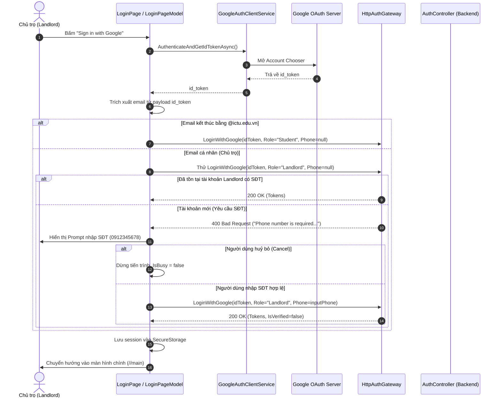

# KẾ HOẠCH TRIỂN KHAI: HỖ TRỢ CHỦ TRỌ ĐĂNG NHẬP GOOGLE TRÊN LOGINPAGE

> **Mã công việc:** `feat(US13/T13.3)`  
> **Câu chuyện người dùng:** `US13` — Authentication & RBAC  
> **Nhiệm vụ:** `T13.3` — Build login, registration, and role-selection UI screens with token storage  
> **Kiến trúc tuân thủ:** Hexagonal / Clean Architecture (.NET 10, ASP.NET Core, .NET MAUI)  
> **Tài liệu nguồn:** `AGENTS.md`, `docs/prd.md`, `docs/business-analysis.md` (`BR-AUTH-03`, `BR-AUTH-04`), `docs/use-cases.md`, `docs/api/openapi.yaml`

---

## 1. Bối cảnh & Yêu cầu bài toán

1. **Hiện trạng:**
   * Sinh viên ICTU đã đăng nhập Google thành công với email trường (`@ictu.edu.vn`) qua luồng OIDC Hybrid flow.
   * Tại màn hình `LoginPage` (LoginPageModel.cs), phương thức `LoginWithGoogleAsync` đang hardcode:
     ```csharp
     var request = new GoogleLoginRequest(
         IdToken: idToken,
         Role: "Student", // <-- Luôn cố định vai trò Student
         DeviceInfo: DeviceInfo.Current.Model);
     ```
   * Khi chủ trọ sử dụng email cá nhân (ví dụ `@gmail.com`) bấm "Sign in with Google", backend nhận role là `Student` nên từ chối do vi phạm quy tắc `BR-AUTH-04` (yêu cầu email `@ictu.edu.vn`).
   * Trong khi đó, tại `RoleSelectionPageModel.cs`, luồng xử lý Landlord Google Login (yêu cầu nhập số điện thoại Việt Nam) đã được nhóm cài đặt hoàn chỉnh và backend (`LoginWithGoogleUseCase`) đã hỗ trợ 100%.

2. **Mục tiêu triển khai:**
   * Tích hợp cơ chế tự động nhận diện vai trò và xử lý đăng nhập Google cho **Chủ trọ (Landlord)** trực tiếp trên màn hình `LoginPage`.
   * Nếu email từ Google là `@ictu.edu.vn`: Gửi `Role: "Student"`, không hỏi số điện thoại.
   * Nếu email từ Google là email thường (không phải `@ictu.edu.vn`):
     * Xác định vai trò `Role: "Landlord"`.
     * **Trường hợp 1 (Chủ trọ đã có tài khoản / đã có SĐT):** Đăng nhập thành công ngay lập tức mà không cần hỏi lại SĐT.
     * **Trường hợp 2 (Chủ trọ mới đăng ký lần đầu):** Hiển thị hộp thoại `DisplayPromptAsync` yêu cầu nhập Số điện thoại liên hệ (`^(0|\+84)[0-9]{9}$` theo `BR-AUTH-03`).
     * Sau khi nhập SĐT hợp lệ, gửi `Role: "Landlord"` kèm `PhoneNumber` để hoàn tất đăng ký/đăng nhập.
     * Nếu người dùng bấm Huỷ (Cancel), huỷ tiến trình đăng nhập an toàn, không báo lỗi đỏ khó chịu.

---

## 2. Tiêu chí nghiệm thu (Acceptance Criteria - AC)

| Mã AC | Điều kiện kiểm thử | Kết quả mong đợi |
|---|---|---|
| **AC-01** | Sinh viên đăng nhập Google với email `@ictu.edu.vn`. | Tự động nhận diện role `Student`, không hỏi SĐT, đăng nhập thành công vào trang chủ. |
| **AC-02** | Chủ trọ đã đăng ký trước đó đăng nhập Google bằng Gmail cá nhân. | Tự động nhận diện role `Landlord`, không hỏi lại SĐT, đăng nhập thành công vào trang chủ. |
| **AC-03** | Chủ trọ mới lần đầu đăng nhập Google bằng Gmail cá nhân. | Hiển thị dialog yêu cầu nhập Số điện thoại liên hệ (placeholder `0912345678`). |
| **AC-04** | Chủ trọ mới nhập SĐT hợp lệ (`0987654321` hoặc `+84987654321`). | Tạo tài khoản Chủ trọ với `IsVerified = false`, đăng nhập thành công vào trang chủ. |
| **AC-05** | Chủ trọ mới nhập SĐT sai định dạng hoặc để trống. | Hiển thị cảnh báo lỗi định dạng SĐT từ tài nguyên đa ngôn ngữ, cho phép nhập lại hoặc dừng. |
| **AC-06** | Chủ trọ mới bấm "Huỷ" tại dialog nhập SĐT. | Dừng luồng đăng nhập an toàn, trả `IsBusy = false`, không hiển thị thông báo lỗi chung chung. |

---

## 3. Kiến trúc luồng xử lý (Sequence Diagram)



---

## 4. Các bước triển khai chi tiết (Action Plan)

### Bước 1: Xây dựng Utility giải mã Payload JWT Client (`JwtPayloadHelper`)
* **Vị trí:** `RoomToRentRadar/DeviceAdapters/JwtPayloadHelper.cs`
* **Nhiệm vụ:**
  * Giải mã an toàn phần Base64Url của `idToken` (phần Payload ở giữa `.` thứ 1 và thứ 2).
  * Trích xuất trường `email` bằng `System.Text.Json.JsonDocument` mà không cần thư viện ngoài.
  * Hỗ trợ hàm `IsIctuEmail(string? email)` để kiểm tra nhanh tiền tố/hậu tố `@ictu.edu.vn`.

### Bước 2: Cập nhật ViewModel `LoginPageModel.cs`
* **Vị trí:** `RoomToRentRadar/PageModels/LoginPageModel.cs`
* **Nhiệm vụ:**
  * Bổ sung hàm regex kiểm tra số điện thoại Việt Nam chuẩn `BR-AUTH-03`: `^(0|\+84)[0-9]{9}$`.
  * Cập nhật phương thức `LoginWithGoogleAsync()`:
    1. Lấy `idToken` từ Google.
    2. Đọc `email` từ `idToken` qua `JwtPayloadHelper`.
    3. Nếu `email` là `@ictu.edu.vn` $\rightarrow$ gửi `Role: "Student"`.
    4. Nếu `email` là email cá nhân $\rightarrow$ xử lý luồng Landlord:
       * Thử gọi API với `Role: "Landlord"` và `PhoneNumber = null`.
       * Nếu thành công: Lưu session và chuyển trang.
       * Nếu API trả về mã lỗi đòi hỏi số điện thoại (chủ trọ mới):
         * Gọi `Shell.Current.DisplayPromptAsync` để hỏi SĐT.
         * Validate định dạng SĐT.
         * Gọi lại `LoginWithGoogleAsync` với SĐT vừa nhập.
    5. Xử lý trường hợp huỷ prompt mượt mà (`IsBusy = false`, không quăng lỗi).

### Bước 3: Đảm bảo Đa ngôn ngữ (i18n)
* **Vị trí:** `RoomToRentRadar/Resources/Strings/AppResources.resx` và `AppResources.vi.resx`
* **Kiểm tra và tái sử dụng các khóa:**
  * `PromptLandlordPhoneTitle` ("Số điện thoại Chủ trọ" / "Landlord Phone Number")
  * `PromptLandlordPhoneMessage` ("Vui lòng nhập số điện thoại liên hệ..." / "Please enter your Vietnamese contact phone number...")
  * `PhoneNumberRequiredTitle`, `PhoneNumberRequiredMessage`
  * Bổ sung khóa thông báo lỗi định dạng SĐT không hợp lệ nếu chưa có: `InvalidPhoneNumberFormat`.

### Bước 4: Kiểm thử và Xác minh (Testing & Verification)
1. **Kiểm thử tự động:**
   * Chạy toàn bộ test suite: `dotnet test RoomToRentRadarUnitTests/RoomToRentRadarUnitTests.csproj`.
   * Đảm bảo 163/163 unit tests hiện tại tiếp tục PASSED 100%.
2. **Kiểm thử thực tế trên Android Emulator:**
   * Test case 1: Đăng nhập bằng tài khoản `@ictu.edu.vn` $\rightarrow$ vào thẳng Home dưới vai trò Student.
   * Test case 2: Đăng nhập bằng tài khoản `@gmail.com` lần đầu $\rightarrow$ hiện pop-up hỏi SĐT $\rightarrow$ nhập `0912345678` $\rightarrow$ tạo tài khoản Chủ trọ và vào Home.
   * Test case 3: Đăng xuất, bấm lại Google chọn tài khoản `@gmail.com` vừa tạo $\rightarrow$ vào thẳng Home dưới vai trò Landlord mà không hỏi lại SĐT.
   * Test case 4: Bấm Huỷ tại pop-up hỏi SĐT $\rightarrow$ trở lại màn hình đăng nhập bình thường, không văng lỗi.

---

## 5. Đánh giá Rủi ro & Giải pháp phòng ngừa

| Rủi ro | Mức độ | Biện pháp xử lý |
|---|---|---|
| Token Google JWT bị định dạng lạ không parse được email | Thấp | Bọc trong khối `try-catch`, fallback về role `Student` mặc định hoặc thông báo lỗi tường minh. |
| Người dùng nhập số điện thoại có ký tự lạ hoặc khoảng trắng | Trung bình | Tự động `.Trim()`, loại bỏ khoảng trắng và kiểm tra bằng Regex `^(0|\+84)[0-9]{9}$` trước khi gửi lên API. |
| Người dùng bấm ra ngoài màn hình đóng dialog prompt | Thấp | Kiểm tra `if (phoneInput == null) return;` để dừng an toàn, trả `IsBusy = false`. |

