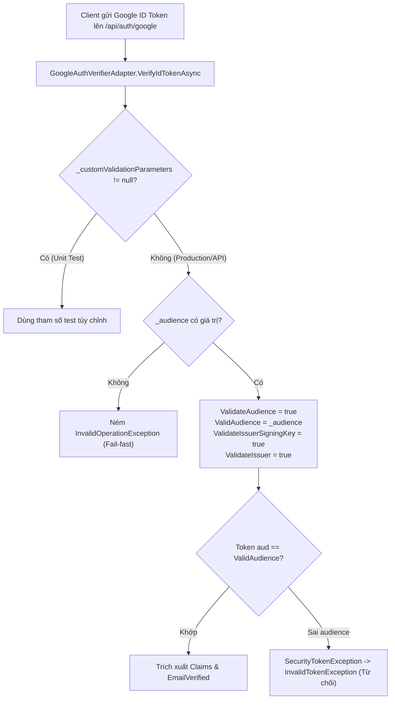
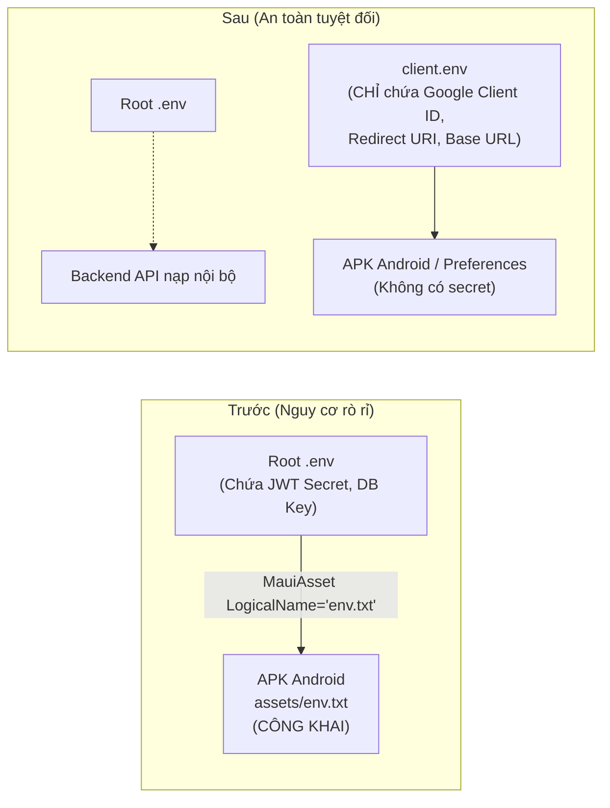
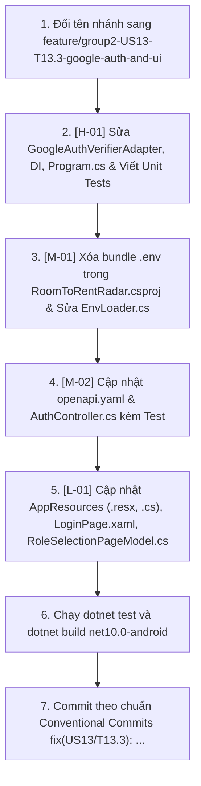

# KẾ HOẠCH KHẮC PHỤC TOÀN DIỆN (BRANCH REVIEW REMEDIATION PLAN)

> **Mã công việc:** `fix(US13/T13.3)`  
> **Câu chuyện người dùng:** `US13` — Authentication & RBAC  
> **Nhiệm vụ:** `T13.3` — Build login, registration, and role-selection UI screens with token storage  
> **Nhánh đích (đổi tên theo AGENTS.md §7):** `feature/group2-US13-T13.3-google-auth-and-ui`  
> **Tài liệu căn cứ:**  
> - `AGENTS.md` (§5 Architecture, §6 Conventions, §7 Git workflow, §8 Boundaries, §10 DoD)  
> - `docs/business-analysis.md` (`BR-AUTH-04`, `BR-AUTH-03`, §10 External services)  
> - `docs/adr/adr-005-authentication-and-session.md` & `docs/adr/adr-012-error-handling-and-problem-details.md`  
> - `docs/api/openapi.yaml`  
> - `.agents/GUARDRAILS.md` (§1.1, §1.2, §1.3, §1.5 Universal Production-Grade Principles)  
> - `docs/ui-ux-spec.md` (Tokens, §6 i18n US15)

---

## 1. Mục tiêu & Ma trận đối chiếu lỗi

Kế hoạch này khắc phục triệt để 5 vấn đề phát hiện từ Review đợt 1, đảm bảo nhánh tính năng đạt chuẩn 100% để tạo Pull Request hợp lệ vào `develop2`.

| Mã lỗi | Mức độ | Tệp bị ảnh hưởng | Tài liệu quy chuẩn vi phạm | Biện pháp khắc phục chuẩn hóa |
|---|---|---|---|---|
| **[H-01]** | **HIGH** | `GoogleAuthVerifierAdapter.cs`<br>`DependencyInjection.cs`<br>`Program.cs` | `BR-AUTH-04`<br>`GUARDRAILS §1.5.4` | Bật bắt buộc `ValidateAudience = true`, nạp `_audience` từ config/env, fail-fast ném lỗi nếu thiếu audience ở production. |
| **[M-01]** | **MEDIUM** | `RoomToRentRadar.csproj`<br>`EnvLoader.cs`<br>`.gitignore` | `AGENTS.md §5`<br>`ADR-003`<br>`GUARDRAILS §1.5` | Xóa bỏ `..\.env` khỏi `MauiAsset`, cô lập cấu hình client vào `client.env` chỉ chứa public keys, bổ sung `client.env.example`. |
| **[M-02]** | **MEDIUM** | `docs/api/openapi.yaml`<br>`AuthController.cs` | `AGENTS.md §5`<br>`ADR-012` | Thêm phản hồi `403 Forbidden` vào `/api/auth/google` trong OpenAPI spec và attribute `[ProducesResponseType]` trên controller. |
| **[L-01]** | **LOW** | `RoleSelectionPageModel.cs`<br>`LoginPage.xaml`<br>`AppResources.*.resx` | `AGENTS.md §6`<br>`US15 (i18n)` | Đưa `ContinueWithGoogleStudent`, `ContinueWithGoogleLandlord`, `OrSignInWithEmail` vào resource đa ngôn ngữ (en/vi). |
| **[L-02]** | **LOW** | Git Branch & Commits | `AGENTS.md §7` | Đổi tên nhánh sang `feature/group2-US13-T13.3-google-auth-and-ui`, commit theo định dạng Conventional Commits `fix(US13/T13.3): ...`. |

---

## 2. Thiết kế chi tiết & Giải pháp kỹ thuật

### 2.1. [H-01] Khắc phục lỗ hổng OIDC Confused Deputy (Audience Validation)



#### Quy tắc triển khai:
1. **`GoogleAuthVerifierAdapter.cs`:**
   - Trong constructor, gán `_audience`:
     ```csharp
     _audience = audience
         ?? Environment.GetEnvironmentVariable("GOOGLE_CLIENT_ID")
         ?? Environment.GetEnvironmentVariable("Google__ClientId");
     ```
   - Trong `VerifyIdTokenAsync`: Khi `_customValidationParameters == null`, kiểm tra:
     ```csharp
     if (string.IsNullOrWhiteSpace(_audience))
     {
         throw new InvalidOperationException("Google Client ID (Audience) must be configured for GoogleAuthVerifierAdapter.");
     }
     ```
   - Bắt buộc kiểm tra audience:
     ```csharp
     ValidateAudience = true,
     ValidAudience = _audience,
     ```
2. **`DependencyInjection.cs`:**
   - Thêm tham số tùy chọn `string? googleClientId = null` vào `AddInfrastructure`.
   - Khi đăng ký adapter, truyền `googleClientId` hoặc nạp từ môi trường.
3. **`Program.cs`:**
   - Đọc `googleClientId` từ `builder.Configuration["Google:ClientId"] ?? Environment.GetEnvironmentVariable("GOOGLE_CLIENT_ID")` và truyền vào `AddInfrastructure`.
4. **Unit Tests:**
   - Bổ sung test kiểm tra:
     - Token có `aud` khác với `ValidAudience` $\rightarrow$ Ném `InvalidTokenException`.
     - Token có `aud` khớp $\rightarrow$ Trích xuất payload thành công.
     - Khi chạy không có audience ở chế độ production $\rightarrow$ Ném `InvalidOperationException`.

---

### 2.2. [M-01] Cô lập cấu hình Client và loại bỏ đóng gói `..\.env` vào APK



#### Quy tắc triển khai:
1. **`RoomToRentRadar/RoomToRentRadar.csproj`:**
   - Xóa bỏ dòng:
     ```xml
     <MauiAsset Include="..\.env" LogicalName="env.txt" Condition="Exists('..\.env')" />
     ```
   - Thay thế bằng asset client an toàn (tùy chọn trong môi trường dev):
     ```xml
     <MauiAsset Include="client.env" LogicalName="client.env" Condition="Exists('client.env')" />
     ```
2. **`.gitignore`:**
   - Đảm bảo `client.env` nằm trong danh sách ignore.
3. **`RoomToRentRadar/client.env.example`:**
   - Tạo file mẫu hướng dẫn cấu hình cho mobile client:
     ```bash
     # RoomToRentRadar - Client Configuration Template
     # Chỉ đặt các thông số public của mobile app (KHÔNG đặt server secret vào đây)
     GOOGLE_CLIENT_ID=your-google-client-id.apps.googleusercontent.com
     GOOGLE_REDIRECT_URI=com.companyname.roomtorentradar:/oauth2redirect
     API_BASE_URL=http://10.0.2.2:5000
     ```
4. **`EnvLoader.cs`:**
   - Loại bỏ hoàn toàn logic đọc `env.txt`.
   - Chỉ đọc `client.env` từ package assets nếu có; ưu tiên `File.Exists(".env")` khi chạy Windows Desktop debug.

---

### 2.3. [M-02] Khớp hợp đồng lỗi `403 Forbidden` trên OpenAPI & Controller

#### Quy tắc triển khai:
1. **`docs/api/openapi.yaml`:**
   - Tại `paths: /api/auth/google > post > responses`, bổ sung phản hồi 403:
     ```yaml
           '400': { $ref: '#/components/responses/BadRequest' }
           '401': { $ref: '#/components/responses/Unauthorized' }
           '403': { $ref: '#/components/responses/Forbidden' }
     ```
2. **`RoomToRentRadar.Api/Controllers/AuthController.cs`:**
   - Tại action `GoogleLogin`, bổ sung attribute:
     ```csharp
     [HttpPost("google")]
     [AllowAnonymous]
     [ProducesResponseType(typeof(AuthTokensDto), StatusCodes.Status200OK)]
     [ProducesResponseType(typeof(ProblemDetails), StatusCodes.Status400BadRequest)]
     [ProducesResponseType(typeof(ProblemDetails), StatusCodes.Status401Unauthorized)]
     [ProducesResponseType(typeof(ProblemDetails), StatusCodes.Status403Forbidden)]
     public async Task<ActionResult<AuthTokensDto>> GoogleLogin(...)
     ```
3. **Unit Tests:**
   - Trong `AuthControllerAndRbacTests.cs`, thêm test kiểm tra phản chiếu (`Reflection`) đảm bảo endpoint `GoogleLogin` có khai báo `ProducesResponseType` với mã `StatusCodes.Status403Forbidden`.

---

### 2.4. [L-01] Bản địa hóa đa ngôn ngữ (i18n US15)

#### Quy tắc triển khai:
1. **`AppResources.resx` (English - en-US):**
   ```xml
   <data name="ContinueWithGoogleStudent" xml:space="preserve">
     <value>Continue with Google (Student)</value>
   </data>
   <data name="ContinueWithGoogleLandlord" xml:space="preserve">
     <value>Continue with Google (Landlord)</value>
   </data>
   <data name="OrSignInWithEmail" xml:space="preserve">
     <value>or sign in with Email</value>
   </data>
   ```
2. **`AppResources.vi.resx` (Vietnamese - vi-VN):**
   ```xml
   <data name="ContinueWithGoogleStudent" xml:space="preserve">
     <value>Tiếp tục với Google (Sinh viên)</value>
   </data>
   <data name="ContinueWithGoogleLandlord" xml:space="preserve">
     <value>Tiếp tục với Google (Chủ trọ)</value>
   </data>
   <data name="OrSignInWithEmail" xml:space="preserve">
     <value>hoặc đăng nhập bằng Email</value>
   </data>
   ```
3. **`AppResources.cs`:**
   ```csharp
   public static string ContinueWithGoogleStudent => GetString(nameof(ContinueWithGoogleStudent));
   public static string ContinueWithGoogleLandlord => GetString(nameof(ContinueWithGoogleLandlord));
   public static string OrSignInWithEmail => GetString(nameof(OrSignInWithEmail));
   ```
4. **`RoleSelectionPageModel.cs`:**
   - Cập nhật getter `ContinueWithGoogleText`:
     ```csharp
     public string ContinueWithGoogleText => SelectedRole == "Student"
         ? AppResources.ContinueWithGoogleStudent
         : AppResources.ContinueWithGoogleLandlord;
     ```
   - Trong constructor, đăng ký lắng nghe `LocalizedStrings.Instance.PropertyChanged` để tự động kích hoạt `OnPropertyChanged(nameof(ContinueWithGoogleText))` khi đổi ngôn ngữ.
5. **`LoginPage.xaml`:**
   - Cập nhật dòng 103:
     ```xml
     <Label Grid.Column="1"
            Text="{Binding [OrSignInWithEmail], Source={x:Static loc:LocalizedStrings.Instance}}"
            Style="{StaticResource TextCaption}"
            TextColor="{AppThemeBinding Light={StaticResource TextMutedLight}, Dark={StaticResource TextMutedDark}}"
            VerticalTextAlignment="Center" />
     ```

---

### 2.5. [L-02] Chuẩn hóa Git Branch và Commit Messages

#### Quy tắc triển khai:
1. **Đổi tên nhánh làm việc:**
   ```powershell
   git branch -m feature/group2-US13-T13.3-google-auth-and-ui
   ```
2. **Quy ước commit:**
   - Commit duy nhất chứa toàn bộ các sửa đổi remediate:
     `fix(US13/T13.3): enforce audience validation, isolate client config, add 403 contract and i18n`
   - Chỉ sử dụng danh tính git cá nhân của user, không thêm `Co-Authored-By` hay dòng AI attribution nào (theo `AGENTS.md §7`).

---

## 3. Kế hoạch kiểm thử & Tiêu chí nghiệm thu (Definition of Done)

### 3.1. Các ca kiểm thử bổ sung (Verification Test Cases)
1. `VerifyIdTokenAsync_MismatchedAudience_ThrowsInvalidTokenException`: Token do Google ký nhưng mang `aud != ValidAudience` bị từ chối với `InvalidTokenException`.
2. `VerifyIdTokenAsync_ValidAudience_Succeeds`: Token hợp lệ mang đúng `aud` xác thực thành công.
3. `VerifyIdTokenAsync_ProductionModeWithoutAudience_ThrowsInvalidOperationException`: Adapter không có audience trong môi trường production bị chặn khởi chạy.
4. `GoogleLogin_Has403ForbiddenResponseTypeAttribute`: Controller khai báo đầy đủ 403 Forbidden.
5. `RoleSelectionPageModel_LanguageSwitch_UpdatesContinueWithGoogleText`: Thay đổi ngôn ngữ cập nhật tức thì thuộc tính `ContinueWithGoogleText`.

### 3.2. Tiêu chí nghiệm thu (Checklist)
- [ ] 0 Lỗi biên dịch: `dotnet build RoomToRentRadar.Api` (0 Warning, 0 Error).
- [ ] 0 Lỗi biên dịch: `dotnet build RoomToRentRadar -f net10.0-android` (0 Warning, 0 Error).
- [ ] 100% Unit Tests Passed: Toàn bộ $\ge 167$ unit tests chạy thành công.
- [ ] Không rò rỉ file `.env` vào gói APK Android.
- [ ] Tên nhánh và commit message chuẩn định dạng `AGENTS.md §7`.

---

## 4. Trình tự thực thi từng bước



