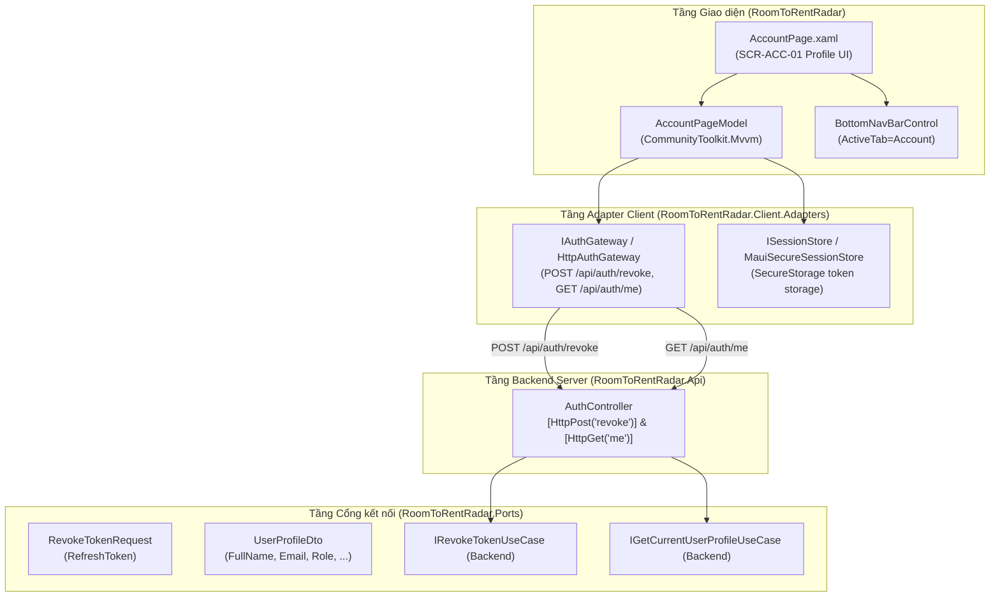

# KẾ HOẠCH TRIỂN KHAI MÀN HÌNH TÀI KHOẢN (ACCOUNT / PROFILE) & KẾT NỐI API LOGOUT (US13 / T13.4*)

> **Mã công việc:** `US13` / `T13.4*` · Màn hình: `SCR-ACC-01` (Account)  
> **Tài liệu quy chuẩn:** Tuân thủ triệt để [AGENTS.md](file:///f:/Mobile%20Class%20Project/RoomToRentRadar/AGENTS.md), [.agents/GUARDRAILS.md](file:///f:/Mobile%20Class%20Project/RoomToRentRadar/.agents/GUARDRAILS.md), [ui-ux-spec.md](file:///f:/Mobile%20Class%20Project/RoomToRentRadar/docs/ui-ux-spec.md#L249-L252) (§5 `SCR-ACC-01`), [openapi.yaml](file:///f:/Mobile%20Class%20Project/RoomToRentRadar/docs/api/openapi.yaml) (`revokeToken`, `getCurrentUser`) và ADR-003.  
> **Nhánh làm việc:** `feature/navigation-bar-and-user-profile-ui`  
> **Nền tảng:** .NET MAUI 10 (Android first & Windows)  
> **Kiến trúc:** Clean MVVM + Hexagonal Ports & Adapters  
> **Tiêu chuẩn UI:** WCAG 2.2 AA (Touch Target $\ge 48\text{ dp}$), 100% Compiled Binding (`x:DataType`), 100% Fluent System Icons glyphs từ `FluentUI.cs` (Không dùng Emoji), Zero Hardcoded Colors (sử dụng Semantic Design Tokens).

---

## 1. MỤC TIÊU VÀ PHẠM VI DỰ ÁN

### 1.1. Mục tiêu giao diện (`SCR-ACC-01`)
Xây dựng giao diện trang Tài khoản (`AccountPage`) khớp 100% bản thiết kế Claude Design canvas (`T13.4* · Account · US13 · SCR-ACC-01`):
1. **Tiêu đề trang (Header):** `Account` (chữ lớn, đậm, màu Navy Brand `ActionPrimaryLight` / `#163A5F`).
2. **Thẻ hồ sơ người dùng (User Profile Card):**
   - Thẻ nền Navy tối (`Navy800` / `#162234`), bo góc `RoundRectangle 16`.
   - Avatar tròn chứa chữ cái viết tắt (Initials, e.g. "LM") nền xanh Teal (`#256D85` / `#3572A5`).
   - Họ và tên người dùng (e.g. `Lê Minh`) chữ trắng, đậm (`TextH2`).
   - Email người dùng (e.g. `minh.le@ictu.edu.vn`) chữ xám sáng (`TextMutedLight` / `Slate400`).
   - Huy hiệu vai trò & phương thức đăng nhập: Pill container bo góc với text `Student · signed in with ICTU` (hoặc `Landlord · verified`).
3. **Danh sách cài đặt & liên kết chính (Menu Group Card):**
   - Thẻ nền trắng bo góc `RoundRectangle 16`, viền subtle, shadow nhẹ.
   - Hàng 1: `[location icon] My campus` -> Hiển thị `ICTU >`
   - Hàng 2: `[globe icon] Language` -> Hiển thị `English >`
   - Hàng 3: `[person icon] Personal details` -> `>`
   - Hàng 4: `[star icon] Saved searches` -> Hiển thị `3 >`
   - Hàng 5: `[bell icon] Notifications` -> Hiển thị `2 new >`
   - Hàng 6: `[info icon] Help, terms & privacy` -> `>`
4. **Cài đặt thông báo (Push Notifications Toggle Card):**
   - Thẻ nền trắng riêng biệt, bo góc `RoundRectangle 16`.
   - Hàng: `[bell icon] Push notifications` -> Nút bật/tắt (Switch).
5. **Nút Đăng xuất chuẩn thiết kế (Sign Out Button):**
   - Nút Outline bo góc `RoundRectangle 12`, viền đỏ `StatusDangerLight` (`#DC2626`), nền trắng.
   - Icon: Exit/Logout glyph (`FluentUI.sign_out_24_regular`).
   - Text: `Sign out` (chữ đỏ đậm, căn giữa).
6. **Footer chân trang:**
   - Text bản quyền: `RoomToRentRadar 1.0 · Group 2, ICTU`.
7. **Thanh điều hướng đáy (Bottom Navigation Bar):**
   - `BottomNavBarControl` với `ActiveTab="Account"` (tab Account đang kích hoạt với thanh Teal ở đỉnh).

### 1.2. Mục tiêu kỹ thuật Backend Integration (Logout API)
- Gọi đúng API Backend `/api/auth/revoke` (theo `IAuthGateway.RevokeTokenAsync` và RFC 7009):
  1. Lấy `RefreshToken` và `AccessToken` từ `ISessionStore`.
  2. Tạo `RevokeTokenRequest(RefreshToken)` và gửi POST lên `/api/auth/revoke` kèm Bearer Token.
  3. Xóa dữ liệu phiên người dùng trên thiết bị qua `_sessionStore.ClearSessionAsync()`.
  4. Điều hướng người dùng về `//login` và ẩn Bottom Navigation Bar.
  5. Đảm bảo xử lý lỗi mạng / server lỗi an toàn: dù server trả về lỗi hay mất kết nối mạng, phiên cục bộ vẫn được dọn sạch để không giam người dùng ở trạng thái hỏng.

---

## 2. THIẾT KẾ KIẾN TRÚC & PHÂN TẦNG HEXAGONAL (PORTS & ADAPTERS)

---

## 3. ÁNH XẠ ICON GLYPHS TỪ FLUENTUI.CS (ZERO EMOJI)

Tuyệt đối không dùng emoji theo quy tắc `AGENTS.md` §6:
1. `My campus`: `FluentUI.location_24_regular` (`\uf4f9`)
2. `Language`: `FluentUI.globe_24_regular` (`\uf45b`)
3. `Personal details`: `FluentUI.person_24_regular` (`\uf5be`)
4. `Saved searches`: `FluentUI.star_24_regular` (`\uf710`)
5. `Notifications`: `FluentUI.alert_24_regular` (`\uf115`)
6. `Help, terms & privacy`: `FluentUI.info_24_regular` (`\uf4a4`)
7. `Push notifications`: `FluentUI.alert_24_regular` (`\uf115`)
8. `Sign out`: `FluentUI.sign_out_24_regular` (`\uf6da`)
9. `Chevron Right`: `FluentUI.chevron_right_20_regular` (`\uf2b0`)

---

## 4. KẾ HOẠCH TRIỂN KHAI CHI TIẾT (STEP-BY-STEP WORKFLOW)

### Bước 1: Nâng cấp `AccountPageModel` (`@Core` & `@UI`)
- Thêm phụ thuộc `IAuthGateway` vào `AccountPageModel(IAuthGateway authGateway, ISessionStore sessionStore)`.
- Cập nhật các thuộc tính MVVM:
  - `DisplayName`: Tên hiển thị (e.g. "Lê Minh").
  - `Initials`: Chữ viết tắt avatar (e.g. "LM") tự động sinh từ `DisplayName`.
  - `Email`: Email người dùng (e.g. "minh.le@ictu.edu.vn").
  - `RoleBadgeText`: Chuỗi badge (e.g. "Student · signed in with ICTU" hoặc "Landlord · verified").
  - `CampusName`: Tên campus hiện tại ("ICTU").
  - `LanguageName`: Ngôn ngữ ("English").
  - `SavedSearchesCount`: Số lượt tìm kiếm đã lưu ("3").
  - `UnreadNotificationsCount`: Số thông báo ("2 new").
  - `IsPushNotificationsEnabled`: Trạng thái bật/tắt push notifications (mặc định `true`).
  - `IsBusy`: Trạng thái tải.
- Triển khai `InitializeAsync()`:
  - Đọc `GetCachedUserProfileAsync()` hiển thị tức thì.
  - Gọi `_authGateway.GetCurrentUserProfileAsync(accessToken)` để làm mới dữ liệu từ server.
- Triển khai `SignOutAsync()`:
  - Lấy `RefreshToken` và `AccessToken` từ `_sessionStore`.
  - Gọi `_authGateway.RevokeTokenAsync(new RevokeTokenRequest(refreshToken), accessToken)` tới API Backend.
  - Bọc trong `try-catch` đảm bảo xóa sạch `ClearSessionAsync()` kể cả khi ngắt mạng.
  - Điều hướng an toàn về `//login`.

### Bước 2: Thiết kế lại toàn diện `AccountPlaceholderPage.xaml` (`@UI`)
- Đổi tên hoặc chuẩn hóa trang thành `AccountPage.xaml` (hoặc hoàn thiện `AccountPlaceholderPage.xaml`).
- Triển khai cấu trúc layout:
  1. `PageHeaderBar` hoặc Header Label lớn: `"Account"` (`TextH1`, Navy Brand `#163A5F`).
  2. Hero Card: Navy Card `#162234`, Avatar tròn "LM", Tên, Email, Role pill.
  3. Menu Card 1: 6 hàng cài đặt với icon tương ứng, nhãn, giá trị và chevron phải.
  4. Menu Card 2: Push notifications switch card.
  5. Sign out button: Nút Outline viền đỏ `#DC2626`, icon `sign_out_24_regular`, text `Sign out`.
  6. Footer label: `"RoomToRentRadar 1.0 · Group 2, ICTU"`.
  7. `BottomNavBarControl Grid.Row="2" ActiveTab="Account"`.

### Bước 3: Đăng ký & Đồng bộ Dependency Injection (`@Core`)
- Cập nhật [MauiProgram.cs](file:///f:/Mobile%20Class%20Project/RoomToRentRadar/RoomToRentRadar/MauiProgram.cs) đảm bảo `AccountPageModel` nhận đúng `IAuthGateway` và `ISessionStore`.

### Bước 4: Kiểm thử Tự động & Hướng dẫn Xác minh (`@QA`)
- Viết Unit Tests cho `AccountPageModel`:
  - `SignOut_WhenCalled_RevokesTokenOnBackendAndClearsSession`: Xác minh `RevokeTokenAsync` được gọi đúng `RefreshToken` và `ClearSessionAsync` được thực hiện.
  - `SignOut_WhenBackendFails_StillClearsSessionAndNavigatesToLogin`: Xác minh tính kiên cường (resilience) khi mạng lỗi.
  - `Initialize_WhenUserExists_ComputesInitialsAndBadgeCorrectly`: Kiểm tra sinh avatar initials "LM" từ "Lê Minh".
- Chạy `dotnet test RoomToRentRadarUnitTests`.
- Chạy `dotnet build RoomToRentRadar/RoomToRentRadar.csproj -f net10.0-android`.

---

## 5. TIÊU CHÍ HOÀN THÀNH (ACCEPTANCE CRITERIA)

1. **AC-ACC-01:** Màn hình `Account` khớp 100% hình ảnh tham chiếu thiết kế (`T13.4* · Account · US13 · SCR-ACC-01`).
2. **AC-ACC-02:** Avatar hiển thị chữ cái viết tắt (Initials) chuẩn (e.g. "LM" cho "Lê Minh").
3. **AC-ACC-03:** Các hàng menu hiển thị đúng icon glyphs từ `FluentUI.cs` và giá trị tương ứng (ICTU, English, 3, 2 new).
4. **AC-ACC-04:** Chức năng Sign out gọi đúng API Backend `POST /api/auth/revoke` kèm `RevokeTokenRequest(refreshToken)`.
5. **AC-ACC-05:** Sau khi Sign out, token và hồ sơ bị xóa khỏi `ISessionStore`, app điều hướng về `//login` và ẩn Bottom Bar.
6. **AC-ACC-06:** Toàn bộ unit tests và build Android/Windows đạt 0 lỗi, 100% pass.
