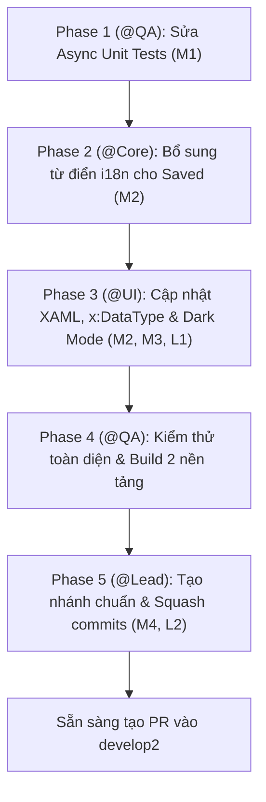

# KẾ HOẠCH TRIỂN KHAI KHẮC PHỤC BUGS & CHUẨN HÓA GIT TRƯỚC KHI MỞ PR (US13 / T13.4)

> **Mục tiêu:** Giải quyết triệt để 100% các phát hiện từ phiên Review ([M1], [M2], [M3], [M4], [L1], [L2]), chuẩn hóa tên nhánh theo quy ước nhóm và squash commit tinh gọn trước khi tạo PR vào `develop2`.  
> **Mã công việc:** `US13` / `T13.4*` (kết hợp nền tảng `US15` i18n)  
> **Màn hình:** `SCR-ACC-01` (Account), `SCR-HOME-01` (Bottom Bar), `SCR-MAP-01` (Map), `SCR-SAVED-01` (Saved), `SCR-CHAT-01` (Messages)  
> **Quy chuẩn đối chiếu:** [AGENTS.md](file:///f:/Mobile%20Class%20Project/RoomToRentRadar/AGENTS.md) (§6, §7, §9), [docs/ui-ux-spec.md](file:///f:/Mobile%20Class%20Project/RoomToRentRadar/docs/ui-ux-spec.md) (§2.1, §3.1.1, §6).

---

## 1. DANH SÁCH MỤC CẦN KHẮC PHỤC

| Mã | Mức độ | Tệp bị ảnh hưởng | Vấn đề & Giải pháp |
|---|:---:|---|---|
| **M1** | Medium | `RoomToRentRadarUnitTests/ClientAdapters/HttpAuthGatewayTests.cs` | Thêm `await` trực tiếp trước `Assert.ThrowsAsync<T>`, loại bỏ các lệnh `await Task.CompletedTask;` giả lập. |
| **M2** | Medium | `RoomToRentRadar/Resources/Strings/AppResources.resx`<br/>`RoomToRentRadar/Resources/Strings/AppResources.vi.resx`<br/>`RoomToRentRadar/Pages/SavedPlaceholderPage.xaml` | Bổ sung 4 cặp từ khóa song ngữ cho Saved Rooms (`Saved_Title`, `Saved_Subtitle`, `Saved_EmptyTitle`, `Saved_EmptyMessage`), gán binding qua `LocalizedStrings.Instance` và thêm `x:DataType="ContentPage"`. |
| **M3** | Medium | `RoomToRentRadar/Pages/MapPlaceholderPage.xaml`<br/>`RoomToRentRadar/Pages/MessagesPlaceholderPage.xaml` | Bổ sung thuộc tính biên dịch `x:DataType="ContentPage"` trên thẻ gốc `<ContentPage>`. |
| **L1** | Low | `RoomToRentRadar/Pages/AccountPlaceholderPage.xaml` | Đổi màu nút Đăng xuất từ `{StaticResource StatusDangerLight}` sang `{AppThemeBinding Light={StaticResource StatusDangerLight}, Dark={StaticResource StatusDangerDark}}` để hiển thị sắc nét `#EF4444` trên nền tối Dark Mode. |
| **M4 & L2 & Squash** | Medium / Process | Git Branch & History | Tạo nhánh chuẩn `feature/group2-US13-T13.4-bottom-nav-and-profile-ui`, squash 14 commit trung gian thành 2 commit logic sạch sẽ tuân thủ Conventional Commits (≤ 20 words, không AI attribution). |

---

## 2. QUY TRÌNH THỰC HIỆN THEO VAI TRÒ (5 GIAI ĐOẠN)



---

### 🔹 Giai đoạn 1: Chuẩn hóa Async Test trong `HttpAuthGatewayTests.cs` (`@QA`)
- **Tệp:** `RoomToRentRadarUnitTests/ClientAdapters/HttpAuthGatewayTests.cs`
- **Sửa đổi dòng 259 & 287:**
  ```csharp
  // 1. RevokeTokenAsync_WhenNullRequest_ThrowsArgumentNullException
  await Assert.ThrowsAsync<ArgumentNullException>(async () =>
      await gateway.RevokeTokenAsync(null!));

  // 2. RevokeTokenAsync_WhenServerReturns401_ThrowsApiException
  var ex = await Assert.ThrowsAsync<ApiException>(async () =>
      await gateway.RevokeTokenAsync(new RevokeTokenRequest("invalid-refresh-token"), bearerToken: "expired-token"));

  Assert.That(ex, Is.Not.Null);
  Assert.That(ex!.StatusCode, Is.EqualTo(HttpStatusCode.Unauthorized));
  Assert.That(ex.ErrorCode, Is.EqualTo("UNAUTHORIZED"));
  ```
- **Xóa bỏ:** Các dòng `await Task.CompletedTask;` không còn cần thiết.

---

### 🔹 Giai đoạn 2: Bổ sung từ điển Song ngữ cho Saved Rooms (`@Core`)
- **Tệp 1:** `RoomToRentRadar/Resources/Strings/AppResources.resx` (English fallback)
  - `Saved_Title`: `Saved Rooms`
  - `Saved_Subtitle`: `Favorites & Search Alerts`
  - `Saved_EmptyTitle`: `No Saved Rooms Yet`
  - `Saved_EmptyMessage`: `Tap the heart icon on any room listing in Explore to save it here for quick access, price updates, and room comparison (US10).`
- **Tệp 2:** `RoomToRentRadar/Resources/Strings/AppResources.vi.resx` (Tiếng Việt)
  - `Saved_Title`: `Phòng đã lưu`
  - `Saved_Subtitle`: `Yêu thích & Thông báo tìm kiếm`
  - `Saved_EmptyTitle`: `Chưa có phòng nào được lưu`
  - `Saved_EmptyMessage`: `Nhấn vào biểu tượng trái tim trên bất kỳ phòng nào tại trang Khám phá để lưu lại, theo dõi biến động giá và so sánh phòng (US10).`

---

### 🔹 Giai đoạn 3: Cập nhật XAML `x:DataType`, i18n & Theme Binding (`@UI`)

#### 1. Cập nhật `SavedPlaceholderPage.xaml`
- Thêm `xmlns:loc="clr-namespace:RoomToRentRadar.Resources.Strings"` và `x:DataType="ContentPage"`.
- Liên kết text qua `loc:LocalizedStrings.Instance`:
  ```xml
  <common:PageHeaderBar Grid.Row="0"
                         Title="{Binding [Saved_Title], Source={x:Static loc:LocalizedStrings.Instance}}"
                         Subtitle="{Binding [Saved_Subtitle], Source={x:Static loc:LocalizedStrings.Instance}}"
                         CanGoBack="False" />
  ...
  <feedback:EmptyStateView
      IconGlyph="{x:Static fonts:FluentUI.heart_24_regular}"
      Title="{Binding [Saved_EmptyTitle], Source={x:Static loc:LocalizedStrings.Instance}}"
      Message="{Binding [Saved_EmptyMessage], Source={x:Static loc:LocalizedStrings.Instance}}"
      HasAction="False" />
  ```

#### 2. Cập nhật `MapPlaceholderPage.xaml` & `MessagesPlaceholderPage.xaml`
- Thêm `x:DataType="ContentPage"` trên thẻ gốc `<ContentPage>`.

#### 3. Cập nhật nút Đăng xuất trên `AccountPlaceholderPage.xaml`
- Đổi từ `StatusDangerLight` sang `AppThemeBinding`:
  ```xml
  <Border StrokeShape="RoundRectangle 12"
          StrokeThickness="1.5"
          Stroke="{AppThemeBinding Light={StaticResource StatusDangerLight}, Dark={StaticResource StatusDangerDark}}"
          BackgroundColor="{AppThemeBinding Light={StaticResource SurfaceCardLight}, Dark={StaticResource SurfaceCardDark}}"
          ...>
      ...
      <FontImageSource Glyph="{x:Static fonts:FluentUI.sign_out_24_regular}"
                       FontFamily="{x:Static fonts:FluentUI.FontFamily}"
                       Size="20"
                       Color="{AppThemeBinding Light={StaticResource StatusDangerLight}, Dark={StaticResource StatusDangerDark}}" />
      ...
      <Label Text="{Binding [Account_Item_SignOut], Source={x:Static loc:LocalizedStrings.Instance}}"
             TextColor="{AppThemeBinding Light={StaticResource StatusDangerLight}, Dark={StaticResource StatusDangerDark}}"
             ... />
  </Border>
  ```

---

### 🔹 Giai đoạn 4: Xác minh Build & Kiểm thử toàn diện (`@QA`)
Chạy kiểm tra độc lập 3 lệnh:
1. `dotnet test RoomToRentRadarUnitTests/RoomToRentRadarUnitTests.csproj` (Yêu cầu: 100% Pass, không giảm số lượng test).
2. `dotnet build RoomToRentRadar.Api/RoomToRentRadar.Api.csproj` (0 lỗi, 0 cảnh báo).
3. `dotnet build RoomToRentRadar/RoomToRentRadar.csproj -f net10.0-android` (0 lỗi, 0 cảnh báo).

---

### 🔹 Giai đoạn 5: Chuẩn hóa Nhánh Git & Squash Commits (`@Lead`)
Thực hiện chuyển đổi 14 commit rải rác hiện tại thành **2 commit cấu trúc sạch sẽ**:

1. **Tạo nhánh chuẩn từ `develop2`:**
   ```powershell
   git checkout -b feature/group2-US13-T13.4-bottom-nav-and-profile-ui
   ```
2. **Squash thành 2 commit logic:**
   - **Commit 1 (Adapters, Formatting & Tests):**  
     `feat(US13/T13.4): add user profile formatter and gateway revoke unit tests`  
     *(Bao gồm `UserProfileFormatter.cs`, `UserProfileFormatterTests.cs`, `HttpAuthGatewayTests.cs`)*
   - **Commit 2 (MAUI UI, Navigation, Account & i18n):**  
     `feat(US13/T13.4): add bottom nav, account page with guest flow and i18n`  
     *(Bao gồm `BottomNavBarControl`, `AccountPageModel`, các trang XAML, từ điển `AppResources`, các kế hoạch `.agents/plans/`)*
3. **Kiểm tra thông tin commit:**
   - Cam kết chỉ mang danh tính người dùng (`git config user.name / user.email`).
   - Tuyệt đối không chứa `Co-Authored-By` hoặc bất kỳ dòng attribution AI nào theo quy định [AGENTS.md §7](file:///f:/Mobile%20Class%20Project/RoomToRentRadar/AGENTS.md#L131-L132).

---

## 3. TIÊU CHÍ HOÀN THÀNH (DEFINITION OF DONE)

- [ ] Toàn bộ 4 phát hiện Medium ([M1], [M2], [M3], [M4]) và 2 phát hiện Low ([L1], [L2]) được xử lý hoàn toàn.
- [ ] Cú pháp `await Assert.ThrowsAsync` được áp dụng chuẩn xác trên các test bất đồng bộ.
- [ ] 100% màn hình ContentPage mới (`Map`, `Saved`, `Messages`) đều có `x:DataType="ContentPage"`.
- [ ] Không còn bất kỳ chuỗi tiếng Anh tĩnh nào hardcode trong mã XAML của các trang placeholder.
- [ ] `dotnet build` API và Android đạt 0 lỗi, 0 cảnh báo; `dotnet test` 100% pass.
- [ ] Nhánh Git mang tên đúng chuẩn `feature/group2-US13-T13.4-bottom-nav-and-profile-ui` với lịch sử commit tinh gọn.
