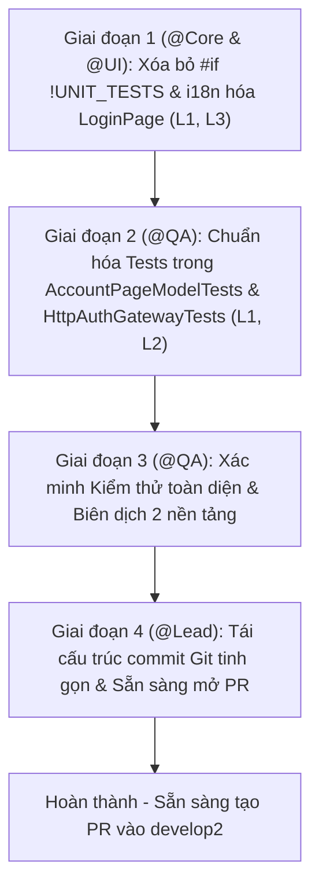

# KẾ HOẠCH XỬ LÝ TRIỆT ĐỂ CÁC PHÁT HIỆN LOW (US13 / T13.4*)

> **Mục tiêu:** Xử lý toàn bộ các phát hiện kỹ thuật mức Low được ghi nhận trong đợt Review nhánh `feature/group2-US13-T13.4-bottom-nav-and-profile-ui`, làm sạch hoàn toàn nợ kỹ thuật (technical debt), bảo đảm tuân thủ triệt để [AGENTS.md](file:///f:/Mobile%20Class%20Project/RoomToRentRadar/AGENTS.md) và [.agents/GUARDRAILS.md](file:///f:/Mobile%20Class%20Project/RoomToRentRadar/.agents/GUARDRAILS.md) trước khi mở PR vào `develop2`.  
> **Mã công việc:** `US13` / `T13.4*` (hỗ trợ nền tảng `US15` i18n)  
> **Nhánh làm việc:** `feature/group2-US13-T13.4-bottom-nav-and-profile-ui` $\rightarrow$ `develop2`  
> **Quy chuẩn đối chiếu:** [AGENTS.md §6, §7, §8, §9](file:///f:/Mobile%20Class%20Project/RoomToRentRadar/AGENTS.md), [.agents/GUARDRAILS.md §1.3, §1.5](file:///f:/Mobile%20Class%20Project/RoomToRentRadar/.agents/GUARDRAILS.md), [docs/ui-ux-spec.md §6](file:///f:/Mobile%20Class%20Project/RoomToRentRadar/docs/ui-ux-spec.md#6-content--formatting-rules-en-us-vi-vn), [docs/business-analysis.md](file:///f:/Mobile%20Class%20Project/RoomToRentRadar/docs/business-analysis.md) (`BR-I18N-01..04`).

---

## 1. BẢNG PHÂN TÍCH CÁC HẠNG MỤC CẦN KHẮC PHỤC

| Mã | Mức độ | Tệp bị ảnh hưởng | Vấn đề hiện tại | Giải pháp triển khai | Vai trò đảm nhiệm |
|:---:|:---:|---|---|---|:---:|
| **L1** | **Low** | `RoomToRentRadar/PageModels/AccountPageModel.cs`<br/>`RoomToRentRadarUnitTests/PageModels/AccountPageModelTests.cs` | Dòng 225 trong `SwitchLanguage` bọc `LocalizedStrings.Instance.SetCulture(culture)` trong `#if !UNIT_TESTS`. Điều này làm giảm tính bao phủ thực tế trong test, trong khi `LocalizedStrings.cs` đã được liên kết vào dự án test. | Gỡ bỏ `#if !UNIT_TESTS` quanh `SetCulture`. Bổ sung phương thức `[TearDown]` trong `AccountPageModelTests.cs` để hoàn nguyên văn hóa về `en-US`, bảo đảm tính cô lập kiểm thử. | `@Core` (Model)<br/>`@QA` (Tests) |
| **L2** | **Low** | `RoomToRentRadarUnitTests/ClientAdapters/HttpAuthGatewayTests.cs` | 2 test `RevokeTokenAsync_WhenNullRequest...` và `RevokeTokenAsync_WhenServerReturns401...` sử dụng `await Task.CompletedTask;` chỉ để tránh cảnh báo CS1998 của `public async Task` khi dùng `Assert.ThrowsAsync<T>` (vốn là phương thức đồng bộ trong NUnit). | Chuẩn hóa chữ ký thành `public void` hoặc sử dụng assertion ngoại lệ tự nhiên của NUnit, loại bỏ triệt để dòng `await Task.CompletedTask;` giả lập, tuân thủ `GUARDRAILS §1.5.5`. | `@QA` |
| **L3** | **Low (Bonus)** | `RoomToRentRadar/Pages/LoginPage.xaml`<br/>`RoomToRentRadar/Resources/Strings/AppResources.resx`<br/>`RoomToRentRadar/Resources/Strings/AppResources.vi.resx` | Chuỗi footer `"Don't have an account?"` và nút `"Create account"` trên `LoginPage.xaml` vẫn là chuỗi tiếng Anh cứng (tồn đọng từ PR #22). | Khai báo 2 khóa tài nguyên `Auth_DontHaveAccount` và `Auth_CreateAccount` vào `.resx` (EN & VI), bind qua `LocalizedStrings.Instance` để đạt 100% i18n trên màn đăng nhập. | `@UI` |

---

## 2. QUY TRÌNH THỰC HIỆN THEO RANH GIỚI VAI TRÒ (4 GIAI ĐOẠN)



---

### 🔹 Giai đoạn 1: Chuẩn hóa Mã nguồn Sản xuất (`@Core` & `@UI`)
> **Ranh giới:** `@Core` sửa `AccountPageModel.cs`, `@UI` sửa `LoginPage.xaml` và bộ tài nguyên `.resx`. Không sửa các tệp test ([AGENTS.md §9](file:///f:/Mobile%20Class%20Project/RoomToRentRadar/AGENTS.md#L156-L167)).

#### 1. Gỡ bỏ `#if !UNIT_TESTS` quanh `SetCulture` trong `AccountPageModel.cs`
- **Tệp:** `RoomToRentRadar/PageModels/AccountPageModel.cs` (Dòng 222–240)
- **Trước khi sửa:**
  ```csharp
  public void SwitchLanguage(string cultureCode)
  {
      var culture = new System.Globalization.CultureInfo(cultureCode);
  #if !UNIT_TESTS
      RoomToRentRadar.Resources.Strings.LocalizedStrings.Instance.SetCulture(culture);
  #endif
      LanguageName = cultureCode.StartsWith("vi", StringComparison.OrdinalIgnoreCase) ? "Tiếng Việt" : "English";
      ...
  }
  ```
- **Sau khi sửa:**
  ```csharp
  public void SwitchLanguage(string cultureCode)
  {
      var culture = new System.Globalization.CultureInfo(cultureCode);
      RoomToRentRadar.Resources.Strings.LocalizedStrings.Instance.SetCulture(culture);
      LanguageName = cultureCode.StartsWith("vi", StringComparison.OrdinalIgnoreCase) ? "Tiếng Việt" : "English";
      ...
  }
  ```

#### 2. Đa ngôn ngữ hóa footer trên `LoginPage.xaml`
- **Tệp 1:** `RoomToRentRadar/Resources/Strings/AppResources.resx`
  - Thêm `Auth_DontHaveAccount`: `Don't have an account?`
  - Thêm `Auth_CreateAccount`: `Create account`
- **Tệp 2:** `RoomToRentRadar/Resources/Strings/AppResources.vi.resx`
  - Thêm `Auth_DontHaveAccount`: `Chưa có tài khoản?`
  - Thêm `Auth_CreateAccount`: `Tạo tài khoản`
- **Tệp 3:** `RoomToRentRadar/Pages/LoginPage.xaml` (Dòng 148–165)
  - Đổi binding text:
    ```xml
    <Label Text="{Binding [Auth_DontHaveAccount], Source={x:Static loc:LocalizedStrings.Instance}}"
           Style="{StaticResource TextBodyMedium}"
           TextColor="{AppThemeBinding Light={StaticResource TextMutedLight}, Dark={StaticResource TextMutedDark}}"
           VerticalOptions="Center" />
    <Button Text="{Binding [Auth_CreateAccount], Source={x:Static loc:LocalizedStrings.Instance}}"
            Style="{StaticResource GhostButton}"
            Command="{Binding NavigateToRoleSelectionCommand}"
            TextColor="{AppThemeBinding Light={StaticResource ActionPrimaryLight}, Dark={StaticResource Teal400}}"
            FontSize="{StaticResource FontSizeBodyMedium}"
            HeightRequest="36"
            VerticalOptions="Center" />
    ```

---

### 🔹 Giai đoạn 2: Chuẩn hóa Kỹ thuật Kiểm thử (`@QA`)
> **Ranh giới:** `@QA` chỉ chỉnh sửa các tệp test trong `RoomToRentRadarUnitTests`, không can thiệp mã nguồn sản xuất ([AGENTS.md §9](file:///f:/Mobile%20Class%20Project/RoomToRentRadar/AGENTS.md#L156-L167)).

#### 1. Bổ sung `[TearDown]` trong `AccountPageModelTests.cs` (Bảo đảm tính độc lập)
- **Tệp:** `RoomToRentRadarUnitTests/PageModels/AccountPageModelTests.cs`
- **Bổ sung sau dòng 23:**
  ```csharp
  [TearDown]
  public void TearDown()
  {
      // Khôi phục văn hóa về en-US sau mỗi test để không làm ảnh hưởng test khác
      RoomToRentRadar.Resources.Strings.LocalizedStrings.Instance.SetCulture(new System.Globalization.CultureInfo("en-US"));
  }
  ```

#### 2. Loại bỏ `await Task.CompletedTask;` trong `HttpAuthGatewayTests.cs`
- **Tệp:** `RoomToRentRadarUnitTests/ClientAdapters/HttpAuthGatewayTests.cs` (Dòng 252–292)
- **Sau khi sửa:**
  ```csharp
  [Test]
  public void RevokeTokenAsync_WhenNullRequest_ThrowsArgumentNullException()
  {
      var handler = new MockHttpMessageHandler(_ => new HttpResponseMessage(HttpStatusCode.NoContent));
      var client = new HttpClient(handler) { BaseAddress = new Uri("http://localhost:5000") };
      var gateway = new HttpAuthGateway(client);

      Assert.ThrowsAsync<ArgumentNullException>(async () =>
          await gateway.RevokeTokenAsync(null!));
  }

  [Test]
  public void RevokeTokenAsync_WhenServerReturns401_ThrowsApiException()
  {
      var problem = new
      {
          type = "about:blank",
          title = "Unauthorized",
          status = 401,
          detail = "Invalid token",
          errorCode = "UNAUTHORIZED"
      };

      var handler = new MockHttpMessageHandler(req =>
      {
          return new HttpResponseMessage(HttpStatusCode.Unauthorized)
          {
              Content = JsonContent.Create(problem)
          };
      });

      var client = new HttpClient(handler) { BaseAddress = new Uri("http://localhost:5000") };
      var gateway = new HttpAuthGateway(client);

      var ex = Assert.ThrowsAsync<ApiException>(async () =>
          await gateway.RevokeTokenAsync(new RevokeTokenRequest("invalid-refresh-token"), bearerToken: "expired-token"));

      Assert.That(ex, Is.Not.Null);
      Assert.That(ex!.StatusCode, Is.EqualTo(HttpStatusCode.Unauthorized));
      Assert.That(ex.ErrorCode, Is.EqualTo("UNAUTHORIZED"));
  }
  ```

---

### 🔹 Giai đoạn 3: Xác minh Kiểm thử & Biên dịch (`@QA`)
Thực thi tuần tự 3 lệnh bắt buộc theo [AGENTS.md §11](file:///f:/Mobile%20Class%20Project/RoomToRentRadar/AGENTS.md#L182-L187):
```powershell
# 1. Kiểm tra build Backend API
dotnet build RoomToRentRadar.Api/RoomToRentRadar.Api.csproj

# 2. Kiểm tra build .NET MAUI Android
dotnet build RoomToRentRadar/RoomToRentRadar.csproj -f net10.0-android

# 3. Chạy toàn bộ Unit Tests
dotnet test RoomToRentRadarUnitTests/RoomToRentRadarUnitTests.csproj
```
**Chỉ tiêu chấp nhận:**
- 0 lỗi biên dịch, 0 cảnh báo (0 Warnings, 0 Errors).
- 100% tests vượt qua (645+ Passed, 0 Failed, 0 Skipped).

---

### 🔹 Giai đoạn 4: Quản lý Git & Đóng gói Commit (`@Lead`)
> **Quy chuẩn đối chiếu:** [AGENTS.md §7](file:///f:/Mobile%20Class%20Project/RoomToRentRadar/AGENTS.md#L110-L140).

- **Cấu trúc commit tinh gọn:** Cập nhật trực tiếp vào 2 commit hiện có trên nhánh thông qua `git commit --fixup` hoặc `git rebase -i`:
  - **Commit 1:** `732750b feat(US13/T13.4): add user profile formatter and gateway revoke unit tests` (chứa các cập nhật của `HttpAuthGatewayTests.cs`).
  - **Commit 2:** `5d7dfff feat(US13/T13.4): add bottom nav, account page with guest flow and i18n` (chứa các cập nhật của `AccountPageModel.cs`, `LoginPage.xaml`, `.resx`, và `AccountPageModelTests.cs`).
- **Tiêu chuẩn thông điệp commit:**
  - Định dạng Conventional Commits: `<type>(<USxx>/<Txx.y>): <summary>`.
  - Tiếng Anh, câu mệnh lệnh, $\le 20$ từ.
  - Tuyệt đối không chứa `Co-Authored-By`, "Generated with..." hay bất kỳ AI attribution nào.
  - Chỉ mang danh tính git của người dùng (`vantuancaptain-t <nguyenvantuan20122005@gmail.com>`).

---

## 3. TIÊU CHÍ HOÀN THÀNH (ACCEPTANCE CRITERIA CHECKLIST)

- [ ] Lệnh `LocalizedStrings.Instance.SetCulture(culture)` trong `AccountPageModel.cs` chạy trực tiếp mà không còn bọc `#if !UNIT_TESTS`.
- [ ] `AccountPageModelTests.cs` có phương thức `[TearDown]` reset văn hóa về `en-US`, không gây ảnh hưởng chéo giữa các test.
- [ ] Các test `RevokeTokenAsync` trong `HttpAuthGatewayTests.cs` được làm sạch, không còn dòng `await Task.CompletedTask;` giả lập.
- [ ] 2 chuỗi footer trên `LoginPage.xaml` (`Auth_DontHaveAccount` và `Auth_CreateAccount`) được song ngữ hóa hoàn toàn vào `AppResources.resx` và `AppResources.vi.resx`.
- [ ] `dotnet build` API và Android đạt 0 Warning, 0 Error.
- [ ] `dotnet test` đạt 100% pass (tối thiểu 645 tests).
- [ ] Lịch sử commit giữ đúng 2 commit chuẩn chỉnh, sẵn sàng mở Pull Request vào `develop2`.
