# KẾ HOẠCH TRIỂN KHAI QUỐC TẾ HÓA (I18N) & HOÀN THIỆN REVIEW BOTTOM NAV & ACCOUNT (US13 / T13.03 / US15)

> **Mã công việc:** `US13` / `T13.03` (kết hợp nền tảng `US15` / `BR-I18N-01..04`)  
> **Màn hình:** `SCR-ACC-01` (Account), `SCR-HOME-01` (Explore / Bottom Bar), `SCR-AUTH-01` (Sign In / Guest), `SCR-MAP-01` (Map), `SCR-CHAT-01` (Messages)  
> **Tài liệu quy chuẩn:** [AGENTS.md](file:///f:/Mobile%20Class%20Project/RoomToRentRadar/AGENTS.md), [docs/business-analysis.md](file:///f:/Mobile%20Class%20Project/RoomToRentRadar/docs/business-analysis.md) (§7.2a `BR-I18N-01..04`), [docs/ui-ux-spec.md](file:///f:/Mobile%20Class%20Project/RoomToRentRadar/docs/ui-ux-spec.md) (§6 Copy & Formatting rules), [docs/prd.md](file:///f:/Mobile%20Class%20Project/RoomToRentRadar/docs/prd.md) (§6 US13, US15).  
> **Quyết định phạm vi:** Triển khai **NGAY TRONG NHÁNH NÀY** cấu trúc i18n chuẩn (.resx + LocalizedStrings) cho Bottom Navigation Bar và trang Account để giải quyết triệt để phát hiện M3 từ Review.

---

## 1. MỤC TIÊU CỤ THỂ

1. **Xây dựng hạ tầng đa ngôn ngữ chuẩn mực (US15 Foundation):**
   - Khởi tạo thư mục tài nguyên `RoomToRentRadar/Resources/Strings/`.
   - Tạo file từ điển gốc tiếng Anh: `AppResources.resx` (en-US, default fallback).
   - Tạo file từ điển tiếng Việt: `AppResources.vi.resx` (vi-VN).
   - Xây dựng lớp thông báo biến đổi chuỗi động `LocalizedStrings.cs` kế thừa `INotifyPropertyChanged` theo đúng cú pháp quy định tại `docs/ui-ux-spec.md` §6 (`{Binding [Key], Source={x:Static loc:LocalizedStrings.Instance}}`).
2. **Quốc tế hóa 100% Bottom Navigation Bar (`BottomNavBarControl`):**
   - Thay thế toàn bộ chuỗi hardcode: "Explore", "Map", "Saved", "Messages", "Account" và các thuộc tính `SemanticProperties.Description`, `SemanticProperties.Hint` sang từ điển đa ngôn ngữ.
3. **Quốc tế hóa 100% trang Account (`AccountPlaceholderPage`):**
   - Chuyển toàn bộ chuỗi tiêu đề, thẻ chào mừng khách, các mục cài đặt ("My campus", "Language", "Personal details", "Saved searches", "Notifications", "Help, terms & privacy", "Push notifications", "Sign out") sang từ điển.
   - Chức năng chọn ngôn ngữ tức thì (`NavigateLanguageCommand`) kích hoạt đổi văn hóa ứng dụng giữa `en-US` và `vi-VN` không cần khởi động lại app (`BR-I18N-02`).
4. **Hỗ trợ song ngữ cho Huy hiệu vai trò (`UserProfileFormatter`):**
   - Bổ sung tham số xác định ngôn ngữ (hoặc nhận diện theo `CultureInfo.CurrentUICulture`) cho `FormatRoleBadge` để hiển thị nhãn chuẩn: "Khách · chưa đăng nhập", "Chủ trọ · đã xác minh", "Chủ trọ · chờ xác minh", "Sinh viên · đăng nhập qua ICTU".
5. **Bảo đảm chất lượng & Quy chuẩn Git:**
   - Viết trọn bộ Unit Tests cho `LocalizedStrings` và việc chuyển đổi ngôn ngữ.
   - Đảm bảo 100% test pass (hiện có 632 test), biên dịch 0 lỗi, 0 cảnh báo.
   - Commit từng cụm thay đổi đúng luật `feat(US13/T13.03)`.

---

## 2. KIẾN TRÚC KỸ THUẬT I18N (DYNAMIC RUNTIME BINDING)

```mermaid
flowchart TD
    subgraph ResourceDictionaries ["1. Từ điển Tài nguyên Chuỗi (Resources/Strings)"]
        EnResx["AppResources.resx<br/>(Tiếng Anh - en-US Fallback)"]
        ViResx["AppResources.vi.resx<br/>(Tiếng Việt - vi-VN)"]
    end

    subgraph DynamicNotifier ["2. Lớp Cung cấp Chuỗi Động (Dynamic Notifier)"]
        LocStrings["LocalizedStrings.Instance<br/>INotifyPropertyChanged"]
        Indexer["this[string key] => AppResources.GetString(key, Culture)"]
        SetCulture["SetCulture(CultureInfo culture)<br/>PropertyChanged?.Invoke(this, new PropertyChangedEventArgs(null))"]
        LocStrings --> Indexer
        LocStrings --> SetCulture
        EnResx --> Indexer
        ViResx --> Indexer
    end

    subgraph XamlViewBinding ["3. Liên kết Giao diện XAML (Runtime Re-render)"]
        BottomNav["BottomNavBarControl.xaml<br/>Text='{Binding [Nav_Explore], Source={x:Static loc:LocalizedStrings.Instance}}'"]
        AccountPage["AccountPlaceholderPage.xaml<br/>Text='{Binding [Account_SignOut], Source={x:Static loc:LocalizedStrings.Instance}}'"]
        LoginPage["LoginPage.xaml<br/>Text='{Binding [Auth_ContinueAsGuest], Source={x:Static loc:LocalizedStrings.Instance}}'"]
        LocStrings -.-> BottomNav
        LocStrings -.-> AccountPage
        LocStrings -.-> LoginPage
    end

    subgraph LanguageSwitchFlow ["4. Luồng Chuyển Đổi Ngôn Ngữ (Account -> Language)"]
        TapLang["Bấm 'Language' trên SCR-ACC-01"] --> PickLang["Hộp thoại / Picker: English vs Tiếng Việt"]
        PickLang --> ApplyCulture["LocalizedStrings.Instance.SetCulture(culture)"]
        ApplyCulture --> ReRender["Mọi View cập nhật tức thì (Không cần restart app)"]
    end
```

---

## 3. DANH MỤC KHÓA TỪ ĐIỂN CHUẨN HÓA (STRING KEYS SPECIFICATION)

### A. Thanh điều hướng đáy (Bottom Navigation Bar)
| Resource Key | English (en-US) | Tiếng Việt (vi-VN) |
|---|---|---|
| `Nav_Explore` | Explore | Khám phá |
| `Nav_Map` | Map | Bản đồ |
| `Nav_Saved` | Saved | Đã lưu |
| `Nav_Messages` | Messages | Tin nhắn |
| `Nav_Account` | Account | Tài khoản |
| `Nav_Hint_Explore` | Browse verified student rooms near ICTU | Xem danh sách phòng trọ sinh viên gần ICTU |
| `Nav_Hint_Map` | View rooms on interactive map near campus | Xem phòng trọ trên bản đồ tương tác gần trường |
| `Nav_Hint_Saved` | View saved favorites and search alerts | Xem danh sách phòng đã lưu và thông báo tìm kiếm |
| `Nav_Hint_Messages` | Chat with verified landlords | Trò chuyện với chủ trọ đã xác minh |
| `Nav_Hint_Account` | View account profile and app preferences | Xem hồ sơ tài khoản và cài đặt ứng dụng |

### B. Trang Tài khoản (Account Screen - `SCR-ACC-01`)
| Resource Key | English (en-US) | Tiếng Việt (vi-VN) |
|---|---|---|
| `Account_Title` | Account | Tài khoản |
| `Account_Guest_WelcomeTitle` | Welcome to RoomToRentRadar | Chào mừng đến với RoomToRentRadar |
| `Account_Guest_WelcomeMessage` | Sign in to save favorite rooms, receive instant price alerts, and chat with verified landlords. | Đăng nhập để lưu phòng yêu thích, nhận thông báo giá tức thì và trò chuyện với chủ trọ đã xác minh. |
| `Account_Guest_SignIn` | Sign In | Đăng nhập |
| `Account_Guest_Register` | Register | Đăng ký |
| `Account_Item_MyCampus` | My campus | Trường của tôi |
| `Account_Item_Language` | Language | Ngôn ngữ |
| `Account_Item_PersonalDetails` | Personal details | Thông tin cá nhân |
| `Account_Item_SavedSearches` | Saved searches | Tìm kiếm đã lưu |
| `Account_Item_Notifications` | Notifications | Thông báo |
| `Account_Item_Help` | Help, terms & privacy | Trợ giúp, điều khoản & quyền riêng tư |
| `Account_Item_PushNotifications` | Push notifications | Thông báo đẩy |
| `Account_Item_SignOut` | Sign out | Đăng xuất |
| `Account_Footer_Copyright` | RoomToRentRadar 1.0 · Group 2, ICTU | RoomToRentRadar 1.0 · Nhóm 2, ICTU |
| `Account_Language_PromptTitle` | Select Language / Chọn ngôn ngữ | Chọn ngôn ngữ / Select Language |
| `Account_Language_PromptCancel` | Cancel | Hủy |

### C. Huy hiệu vai trò & Đăng nhập (Role Badges & Auth Flow)
| Resource Key | English (en-US) | Tiếng Việt (vi-VN) |
|---|---|---|
| `Role_Guest` | Guest · not signed in | Khách · chưa đăng nhập |
| `Role_Landlord_Verified` | Landlord · verified | Chủ trọ · đã xác minh |
| `Role_Landlord_Pending` | Landlord · pending verification | Chủ trọ · chờ xác minh |
| `Role_Student_IctuSso` | Student · signed in with ICTU | Sinh viên · đăng nhập qua ICTU |
| `Role_Student_VerifiedEmail` | Student · verified email | Sinh viên · đã xác minh email |
| `Role_Admin` | Administrator · ICTU Radar | Quản trị viên · ICTU Radar |
| `Auth_ContinueAsGuest` | Continue as Guest (Browse rooms) | Tiếp tục với tư cách Khách (Duyệt phòng) |

---

## 4. KẾ HOẠCH BỐ CỤC CÁC BƯỚC THỰC HIỆN (EXECUTION PHASES)

### 🔹 Giai đoạn 1: Hạ tầng Từ điển Tài nguyên (`Resources/Strings`)
1. Tạo thư mục `RoomToRentRadar/Resources/Strings/`.
2. Tạo file `AppResources.resx` và `AppResources.vi.resx` chứa đầy đủ các khóa chuỗi ở Mục 3.
3. Tạo lớp sinh mã / trình quản lý `AppResources.cs` và `LocalizedStrings.cs` với cơ chế indexer `this[string key]`.
4. Cập nhật `RoomToRentRadar.csproj` đảm bảo cấu hình `EmbeddedResource` hoạt động tối ưu đa nền tảng.

### 🔹 Giai đoạn 2: Nâng cấp `UserProfileFormatter` & Unit Tests
1. Cập nhật `UserProfileFormatter.FormatRoleBadge` để hỗ trợ đa ngôn ngữ (hoặc truyền mã ngôn ngữ / tự động nhận theo văn hóa hiện hành).
2. Viết thêm Unit Test kiểm thử Role Badge bằng cả tiếng Anh và tiếng Việt trong `UserProfileFormatterTests.cs`.
3. Viết Unit Test cho `LocalizedStringsTests.cs` kiểm tra:
   - Tra cứu key tiếng Anh trả về chuỗi tiếng Anh.
   - Đổi văn hóa sang `vi-VN` tra cứu cùng key trả về chuỗi tiếng Việt.
   - Tra cứu key không tồn tại trả về fallback `[key]`.

### 🔹 Giai đoạn 3: Áp dụng XAML Binding trên UI Controls & Pages
1. **`BottomNavBarControl.xaml`:**
   - Khai báo namespace `xmlns:loc="clr-namespace:RoomToRentRadar.Resources.Strings"`.
   - Đổi toàn bộ các thuộc tính `Text` và `SemanticProperties` sang `{Binding [Nav_...], Source={x:Static loc:LocalizedStrings.Instance}}`.
2. **`AccountPlaceholderPage.xaml`:**
   - Thay thế toàn bộ văn bản tĩnh bằng binding `LocalizedStrings`.
   - Đảm bảo layout các nút và danh sách không bị vỡ hoặc che khuất khi chuỗi tiếng Việt dài hơn tiếng Anh 20-30%.
3. **`LoginPage.xaml`:**
   - Thay chuỗi nút "Continue as Guest" bằng binding `{Binding [Auth_ContinueAsGuest], Source={x:Static loc:LocalizedStrings.Instance}}`.
4. **`AccountPageModel.cs`:**
   - Nâng cấp lệnh `NavigateLanguageCommand` để hiển thị ActionSheet cho phép người dùng chọn giữa "English" và "Tiếng Việt".
   - Khi người dùng chọn, gọi `LocalizedStrings.Instance.SetCulture(new CultureInfo(selectedLang))` và cập nhật `LanguageName`.

### 🔹 Giai đoạn 4: Xác minh, Kiểm thử & Commit theo Cụm
1. Chạy `dotnet test RoomToRentRadarUnitTests/RoomToRentRadarUnitTests.csproj` đảm bảo 100% test pass.
2. Chạy `dotnet build RoomToRentRadar/RoomToRentRadar.csproj -f net10.0-android` xác nhận build thành công 0 lỗi.
3. Commit từng cụm thay đổi theo đúng quy ước `feat(US13/T13.03)`.

---

## 5. TIÊU CHÍ HOÀN THÀNH (DEFINITION OF DONE)

- [ ] Toàn bộ chuỗi trên thanh điều hướng đáy và trang tài khoản được quản lý trong `AppResources.resx` và `AppResources.vi.resx`.
- [ ] Bấm vào mục "Language" trên trang Account có thể chuyển đổi mượt mà giữa tiếng Anh và tiếng Việt.
- [ ] Giao diện tự động re-render ngôn ngữ mới ngay lập tức mà không cần khởi động lại ứng dụng.
- [ ] Không còn chuỗi văn bản nào bị hardcode tĩnh trong `AccountPlaceholderPage.xaml` và `BottomNavBarControl.xaml`.
- [ ] Toàn bộ bộ Unit Test (bao gồm các test i18n mới) đạt tỷ lệ Pass 100%.
- [ ] Biên dịch MAUI Android và Unit Test đạt 0 lỗi, 0 cảnh báo.
- [ ] Các commit được phân bổ rõ ràng với message `feat(US13/T13.03): ...`.
