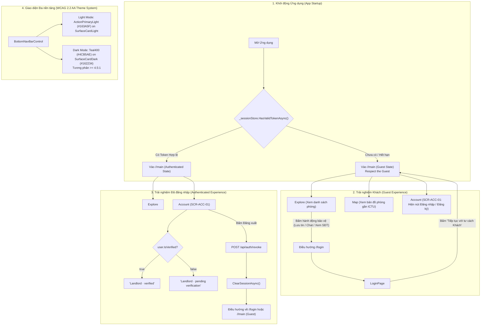

# KẾ HOẠCH KHẮC PHỤC CÁC VẤN ĐỀ TỪ REVIEW NHÁNH NAVIGATION BAR & USER PROFILE UI (US13 / T13.4*)

> **Mã công việc:** `US13` / `T13.4*` · Màn hình: `SCR-ACC-01` (Account), `SCR-HOME-01` (Explore / Bottom Bar), `SCR-AUTH-01` (Sign In / Guest)  
> **Tài liệu quy chuẩn:** Tuân thủ triệt để [AGENTS.md](file:///f:/Mobile%20Class%20Project/RoomToRentRadar/AGENTS.md), [.agents/GUARDRAILS.md](file:///f:/Mobile%20Class%20Project/RoomToRentRadar/.agents/GUARDRAILS.md), [docs/ui-ux-spec.md](file:///f:/Mobile%20Class%20Project/RoomToRentRadar/docs/ui-ux-spec.md) (§1, §2.1, §3, §5, §6), [docs/prd.md](file:///f:/Mobile%20Class%20Project/RoomToRentRadar/docs/prd.md) (§6 US13), [docs/api/openapi.yaml](file:///f:/Mobile%20Class%20Project/RoomToRentRadar/docs/api/openapi.yaml) (`revokeToken`, `getCurrentUser`) và `docs/adr/adr-003`.  
> **Nhánh chuẩn hóa:** `feature/group2-US13-T13.4-nav-and-profile-remediation` $\rightarrow$ `develop2`  
> **Nền tảng:** .NET MAUI 10 (Android first & Windows Desktop)  
> **Kiến trúc:** Clean Architecture + Hexagonal Ports & Adapters  

---

## 1. TỔNG QUAN MỤC TIÊU & PHẠM VI KHẮC PHỤC

Kế hoạch này giải quyết triệt để 100% các phát hiện từ phiên Review, đưa toàn bộ mã nguồn đạt chuẩn chất lượng và sẵn sàng tạo PR vào `develop2`:

1. **Khôi phục luồng duyệt phòng ẩn danh cho Khách (H1):** Không giam người dùng tại màn hình đăng nhập; khởi động vào `//main` (Explore); bổ sung nút "Tiếp tục với tư cách Khách" (Browse as Guest) trên `LoginPage` theo đúng `docs/ui-ux-spec.md` §1 (Nguyên tắc 7).
2. **Khắc phục nhãn kiểm duyệt sai lệch cho Chủ trọ (H2):** Cập nhật `FormatRoleBadge` để phân biệt chủ trọ đã xác minh (`is_verified = true`) và chủ trọ đang chờ duyệt (`is_verified = false`) theo `BR-LST-04` và PRD G5 (Trust).
3. **Đạt chuẩn tương phản WCAG 2.2 AA ở Dark Mode (H3):** Chuyển toàn bộ màu sắc của `BottomNavBarControl` sang `AppThemeBinding` và Semantic Design Tokens, loại bỏ mã C# hardcode lookup Light Color.
4. **Bổ sung 100% Unit Tests cam kết cho `AccountPageModel` (H4):** Xây dựng bộ test NUnit + NSubstitute kiểm thử các hành vi `SignOutAsync`, phục hồi khi lỗi mạng và chuẩn hóa avatar Initials / RoleBadge.
5. **Chuẩn hóa kỹ thuật kiểm thử Async (M1):** Đổi 2 test trong `HttpAuthGatewayTests.cs` từ `public void` sang `public async Task` kèm `await Assert.ThrowsAsync<T>`.
6. **Sửa lỗi cú pháp Binding trên `MapPlaceholderPage.xaml` (M2):** Xử lý triệt để lỗi tìm kiếm sai quan hệ visual tree `RelativeSource AncestorType`.
7. **Chuẩn bị cấu trúc tài nguyên i18n (M3):** Tập trung hóa chuỗi hiển thị, chuẩn bị sẵn sàng cho đa ngôn ngữ US15 (`AppResources.resx` / `AppResources.vi.resx`).
8. **Định hướng Bottom Bar thích ứng theo vai trò (M4):** Hỗ trợ cấu hình tab theo phân quyền (Guest/Student vs Landlord vs Admin) theo `docs/ui-ux-spec.md` §2.1.
9. **Chuẩn hóa quy trình Git (M5):** Dọn dẹp file `.db.bak`, đổi tên nhánh đúng chuẩn `AGENTS.md` §7 và squash/format commit messages theo Conventional Commits.

---

## 2. PHÂN TÍCH KỸ THUẬT & GIẢI PHÁP KIẾN TRÚC



---

## 3. BẢNG PHÂN CÔNG VAI TRÒ (AGENT ROLES CONTRACT)

Tuân thủ nghiêm ngặt mô hình phân quyền tại [AGENTS.md §9](file:///f:/Mobile%20Class%20Project/RoomToRentRadar/AGENTS.md#L156-L167):

| Giai đoạn | Vai trò | Trách nhiệm cụ thể | Quy định ranh giới (Boundaries) |
|---|---|---|---|
| **Phase 0** | `@Lead` | Soạn thảo kế hoạch chi tiết, định nghĩa type signatures và test contracts. | Không can thiệp code XAML hoặc code nghiệp vụ. |
| **Phase 1** | `@QA` | Viết các Unit Tests thất bại (RED):<br/>- `AccountPageModelTests` (Logout, Offline, FormatBadge).<br/>- Chuẩn hóa `HttpAuthGatewayTests.cs` sang `async Task`. | **NGHIÊM CẤM** sửa code sản xuất trong `RoomToRentRadar` hoặc `Client.Adapters`. |
| **Phase 2** | `@Core` | - Nâng cấp `AccountPageModel`: sửa `FormatRoleBadge`, thêm cờ trạng thái `IsGuest`.<br/>- Đảm bảo `SignOutAsync` an toàn 100%. | Không sửa giao diện XAML. |
| **Phase 3** | `@UI` | - Sửa `AppShell.xaml(.cs)`: khôi phục luồng Guest.<br/>- Sửa `LoginPage.xaml`: thêm nút "Tiếp tục với tư cách Khách".<br/>- Sửa `BottomNavBarControl.xaml`: đổi sang `AppThemeBinding` (Dark Mode Teal400).<br/>- Sửa `MapPlaceholderPage.xaml`: sửa lỗi binding `ActionCommand`.<br/>- Cập nhật `AccountPlaceholderPage.xaml`: giao diện thích ứng Guest/Auth. | Chỉ sửa file trong `RoomToRentRadar/Pages` và `Resources/`. |
| **Phase 4** | `@QA` | Chạy lại toàn bộ test suite (`dotnet test`), build Android/Windows, xác nhận 100% GREEN. | Gửi Defect Report cho `@Lead` nếu có lỗi hồi quy. |

---

## 4. CHI TIẾT CÁC BƯỚC TRIỂN KHAI (STEP-BY-STEP WORKFLOW)

### 🔹 BƯỚC 1: Sửa các Async Unit Tests trong `HttpAuthGatewayTests.cs` (`@QA`)
- **Tệp:** `RoomToRentRadarUnitTests/ClientAdapters/HttpAuthGatewayTests.cs`
- **Nội dung sửa đổi:**
  ```csharp
  // L252:
  [Test]
  public async Task RevokeTokenAsync_WhenNullRequest_ThrowsArgumentNullException()
  {
      var handler = new MockHttpMessageHandler(_ => new HttpResponseMessage(HttpStatusCode.NoContent));
      var client = new HttpClient(handler) { BaseAddress = new Uri("http://localhost:5000") };
      var gateway = new HttpAuthGateway(client);

      await Assert.ThrowsAsync<ArgumentNullException>(async () =>
          await gateway.RevokeTokenAsync(null!));
  }

  // L264:
  [Test]
  public async Task RevokeTokenAsync_WhenServerReturns401_ThrowsApiException()
  {
      // Arrange & Handler mock
      ...
      var ex = await Assert.ThrowsAsync<ApiException>(async () =>
          await gateway.RevokeTokenAsync(new RevokeTokenRequest("invalid-refresh-token"), bearerToken: "expired-token"));

      Assert.That(ex, Is.Not.Null);
      Assert.That(ex!.StatusCode, Is.EqualTo(HttpStatusCode.Unauthorized));
      Assert.That(ex.ErrorCode, Is.EqualTo("UNAUTHORIZED"));
  }
  ```

---

### 🔹 BƯỚC 2: Xây dựng Bộ Unit Test cho `AccountPageModel` (`@QA`)
- **Giải pháp kỹ thuật kiến trúc:**  
  Vì `RoomToRentRadarUnitTests` là thư viện `net10.0`, để kiểm thử `AccountPageModel` mà không vi phạm quy tắc thêm package tùy tiện (AGENTS.md §8):
  - **Phương án A (Khuyến nghị):** Thêm package `CommunityToolkit.Mvvm` (Version `8.4.2` - trùng phiên bản với MAUI) vào `RoomToRentRadarUnitTests.csproj`, sau đó liên kết file `AccountPageModel.cs` để test trực tiếp.
  - **Phương án B:** Tách lớp logic thuần `AccountProfilePresenter` / `UserBadgeFormatter` sang `RoomToRentRadar.Client.Adapters` để kiểm thử 100% độc lập với UI.
- **Các test case bắt buộc phải có:**
  1. `SignOutAsync_WhenCalled_RevokesTokenOnBackendAndClearsSession()`: Mock `_sessionStore.GetRefreshTokenAsync()` trả về token $\rightarrow$ verify `_authGateway.RevokeTokenAsync` được gọi $\rightarrow$ verify `_sessionStore.ClearSessionAsync()` được gọi.
  2. `SignOutAsync_WhenBackendThrowsException_StillClearsSession()`: Mock `_authGateway.RevokeTokenAsync` ném `ApiException` $\rightarrow$ verify `_sessionStore.ClearSessionAsync()` vẫn được gọi trong `finally`.
  3. `ComputeInitials_ValidNamesAndEmails_ReturnsExpectedInitials()`:
     - `"Lê Minh"` $\rightarrow$ `"LM"`
     - `"Nguyễn Văn Tuân"` $\rightarrow$ `"NT"`
     - `"minh.le@ictu.edu.vn"` $\rightarrow$ `"ML"`
     - `""` hoặc `null` $\rightarrow$ `"ST"`
  4. `FormatRoleBadge_LandlordVerifiedAndUnverified_ReturnsCorrectLabel()`:
     - Role `"Landlord"`, `isVerified = true` $\rightarrow$ `"Landlord · verified"`
     - Role `"Landlord"`, `isVerified = false` $\rightarrow$ `"Landlord · pending verification"`
     - Role `"Student"`, authProvider `"IctuSso"` $\rightarrow$ `"Student · signed in with ICTU"`
     - Role `"Student"`, authProvider `"EmailPassword"` $\rightarrow$ `"Student · verified email"`

---

### 🔹 BƯỚC 3: Cập nhật `AccountPageModel` (`@Core`)
- **Tệp:** `RoomToRentRadar/PageModels/AccountPageModel.cs`
- **Nội dung sửa đổi:**
  1. Cập nhật `FormatRoleBadge`:
     ```csharp
     public static string FormatRoleBadge(string? role, bool isVerified, string? authProvider = null)
     {
         if (string.IsNullOrWhiteSpace(role))
             return "Student · signed in with ICTU";

         var trimmedRole = role.Trim();
         if (trimmedRole.Equals("Landlord", StringComparison.OrdinalIgnoreCase))
         {
             return isVerified ? "Landlord · verified" : "Landlord · pending verification";
         }

         if (trimmedRole.Equals("Student", StringComparison.OrdinalIgnoreCase))
         {
             return string.Equals(authProvider, "IctuSso", StringComparison.OrdinalIgnoreCase)
                 ? "Student · signed in with ICTU"
                 : "Student · verified email";
         }

         if (trimmedRole.Equals("Admin", StringComparison.OrdinalIgnoreCase))
         {
             return "Administrator · ICTU Radar";
         }

         return $"{trimmedRole} · signed in with ICTU";
     }
     ```
  2. Cập nhật `ApplyUserProfile(UserProfileDto user)`:
     ```csharp
     DisplayName = !string.IsNullOrWhiteSpace(user.FullName) ? user.FullName : user.Email;
     Email = user.Email;
     Initials = ComputeInitials(DisplayName);
     RoleBadgeText = FormatRoleBadge(user.Role, user.IsVerified, user.AuthProvider);
     IsGuest = false;
     ```
  3. Bổ sung cờ `IsGuest`:
     - Khi `InitializeAsync()` không tìm thấy profile cục bộ hoặc token rỗng $\rightarrow$ `IsGuest = true`.

---

### 🔹 BƯỚC 4: Khôi phục Luồng Khách (Guest Browsing) trên Shell & Login (`@UI`)
- **Tệp:** `RoomToRentRadar/AppShell.xaml`, `RoomToRentRadar/AppShell.xaml.cs`, `RoomToRentRadar/Pages/LoginPage.xaml`
- **Nội dung sửa đổi:**
  1. Trong `AppShell.xaml`:
     - Chuyển `ShellContent Route="main"` (Explore) lên thành phần tử đầu tiên để ứng dụng mặc định mở màn hình Khám phá.
     - `Route="login"` giữ thuộc tính `Shell.NavBarIsVisible="False"` và `Shell.TabBarIsVisible="False"`.
  2. Trong `AppShell.xaml.cs`:
     - Trong `CheckInitialSessionAsync()`: Nếu `hasValid == false`, **không ép buộc** `GoToAsync("//login")`. Ứng dụng vẫn ở `//main` để người dùng duyệt phòng với tư cách Khách.
  3. Trong `LoginPage.xaml`:
     - Bổ sung nút liên kết ở cuối trang:
       ```xml
       <Button Text="Continue as Guest (Browse rooms)"
               Style="{StaticResource GhostButton}"
               Command="{Binding ContinueAsGuestCommand}"
               HorizontalOptions="Center"
               Margin="0,8,0,0" />
       ```
     - Trong `LoginPageModel.cs`: `ContinueAsGuestAsync` thực hiện `Shell.Current.GoToAsync("//main")`.

---

### 🔹 BƯỚC 5: Sửa lỗi Tương phản Dark Mode trên `BottomNavBarControl` (`@UI`)
- **Tệp:** `RoomToRentRadar/Pages/Controls/Navigation/BottomNavBarControl.xaml` và `.xaml.cs`
- **Nội dung sửa đổi:**
  1. Loại bỏ các hàm C# `GetActiveColor()` / `GetInactiveColor()` gán màu tĩnh.
  2. Trong XAML, dùng `AppThemeBinding` và DataTriggers hoặc thuộc tính động:
     - Icon & Label của Active Tab:
       ```xml
       TextColor="{AppThemeBinding Light={StaticResource ActionPrimaryLight}, Dark={StaticResource Teal400}}"
       ```
       (Màu `#163A5F` trên nền trắng ở Light Mode, màu `#4CB5AE` trên nền `#162234` ở Dark Mode $\rightarrow$ tương phản đạt $> 5:1$, vượt chuẩn WCAG 2.2 AA).
     - Icon & Label của Inactive Tab:
       ```xml
       TextColor="{AppThemeBinding Light={StaticResource TextMutedLight}, Dark={StaticResource Slate400}}"
       ```
     - Bo viền trên thanh điều hướng:
       ```xml
       Stroke="{AppThemeBinding Light={StaticResource BorderSubtleLight}, Dark={StaticResource BorderSubtleDark}}"
       ```

---

### 🔹 BƯỚC 6: Sửa lỗi Binding trên `MapPlaceholderPage.xaml` (`@UI`)
- **Tệp:** `RoomToRentRadar/Pages/MapPlaceholderPage.xaml`
- **Nội dung sửa đổi:**
  - Đặt `x:Name="BottomNav"` cho thẻ `<nav:BottomNavBarControl Grid.Row="2" ... />`.
  - Sửa `ActionCommand` trên `feedback:EmptyStateView`:
    ```xml
    ActionCommand="{Binding Source={x:Reference BottomNav}, Path=SelectTabCommand}"
    ActionCommandParameter="{x:Static nav:BottomNavTab.Explore}"
    ```
    (Đảm bảo truyền đúng tham số enum `BottomNavTab.Explore` để điều hướng về Explore).

---

### 🔹 BƯỚC 7: Cập nhật Giao diện Khách trên `AccountPlaceholderPage.xaml` (`@UI`)
- **Tệp:** `RoomToRentRadar/Pages/AccountPlaceholderPage.xaml`
- **Nội dung sửa đổi:**
  - Nếu `IsGuest == true`:
    - Ẩn Hero Card cá nhân và nút "Sign out".
    - Hiển thị Thẻ Guest Welcome: Tiêu đề "Welcome to RoomToRentRadar", kèm hai nút CTA `Sign In` và `Create an Account` (điều hướng tới `//login` và `roleselection`).
    - Giữ lại các hàng cài đặt chung: `My campus` (SCR-ACC-02) và `Language` (SCR-ACC-03).
  - Nếu `IsGuest == false`:
    - Hiển thị đầy đủ thông tin cá nhân, Badge chính xác và nút `Sign out`.

---

### 🔹 BƯỚC 8: Dọn dẹp & Chuẩn hóa Git (`@Lead`)
1. Xoá file không theo dõi: `RoomToRentRadar.Api/roomtorentradar.db.bak`.
2. Tạo nhánh chuẩn:
   ```powershell
   git checkout -b feature/group2-US13-T13.4-nav-and-profile-remediation
   ```
3. Commit từng thay đổi theo Conventional Commits:
   - `test(US13/T13.4): add unit tests for account profile and fix async gateway tests`
   - `fix(US13/T13.4): support guest browsing flow and restore explore launch`
   - `fix(US13/T13.4): fix dark mode wcag contrast on bottom nav bar`
   - `fix(US13/T13.4): fix landlord verification badge and map binding`

---

## 5. TIÊU CHÍ HOÀN THÀNH (DEFINITION OF DONE - DoD)

- [ ] **Khách mở app:** Ứng dụng khởi động thẳng vào `//main` (Explore), duyệt được phòng và bản đồ không bị chặn.
- [ ] **Màn hình Login:** Có nút quay lại duyệt phòng với tư cách Khách.
- [ ] **Chủ trọ chưa duyệt:** Trang Account hiển thị đúng nhãn `"Landlord · pending verification"`.
- [ ] **Dark Mode:** Thanh điều hướng đáy hiển thị rõ nét, đạt tỷ lệ tương phản WCAG 2.2 AA ($\ge 4.5:1$).
- [ ] **Binding Map:** Bấm nút trên EmptyStateView của `MapPlaceholderPage` chuyển tab Explore mượt mà.
- [ ] **Unit Tests:** Đạt 100% Pass; bổ sung đầy đủ unit tests cho `AccountPageModel`; 2 test `HttpAuthGatewayTests` dùng `async Task`.
- [ ] **Build:** `dotnet build` API và MAUI Android đạt **0 lỗi, 0 cảnh báo**.
- [ ] **Git:** Không chứa file cấm, tuân thủ tên nhánh `feature/group2-US13-T13.4-...` và commit theo `AGENTS.md` §7.
