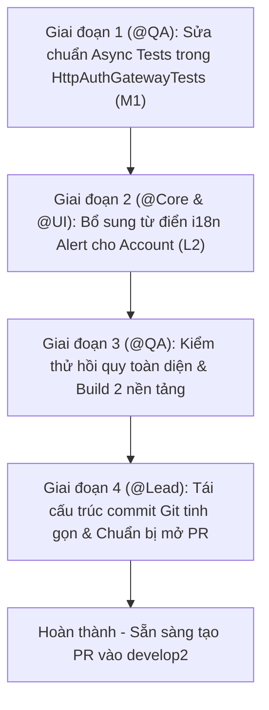

# KẾ HOẠCH TRIỂN KHAI KHẮC PHỤC TỒN TẠI & HOÀN THIỆN NHÁNH US13 / T13.4

> **Mục tiêu:** Khắc phục triệt để phát hiện Medium [M1] (async tests thiếu `await`), bổ sung song ngữ cho các hộp thoại Account [L2], xác minh toàn bộ build/test và tái cấu trúc commit Git theo chuẩn nhóm trước khi mở PR vào `develop2`.  
> **Mã công việc:** `US13` / `T13.4*` (kết hợp nền tảng `US15` i18n)  
> **Nhánh làm việc:** `feature/group2-US13-T13.4-bottom-nav-and-profile-ui` $\rightarrow$ `develop2`  
> **Quy chuẩn đối chiếu:** [AGENTS.md](file:///f:/Mobile%20Class%20Project/RoomToRentRadar/AGENTS.md) (§6, §7, §9), [.agents/GUARDRAILS.md](file:///f:/Mobile%20Class%20Project/RoomToRentRadar/.agents/GUARDRAILS.md) (§1.5), [docs/business-analysis.md](file:///f:/Mobile%20Class%20Project/RoomToRentRadar/docs/business-analysis.md) (`BR-I18N-01..04`), [docs/ui-ux-spec.md](file:///f:/Mobile%20Class%20Project/RoomToRentRadar/docs/ui-ux-spec.md) (§6).

---

## 1. BẢNG PHÂN TÍCH HẠNG MỤC CẦN SỬA ĐỔI

| Mã | Mức độ | Tệp bị ảnh hưởng | Vấn đề hiện tại | Giải pháp triển khai | Vai trò đảm nhiệm |
|:---:|:---:|---|---|---|:---:|
| **M1** | **Medium** | `RoomToRentRadarUnitTests/ClientAdapters/HttpAuthGatewayTests.cs` | 2 test async (`RevokeTokenAsync_WhenNullRequest...` và `RevokeTokenAsync_WhenServerReturns401...`) đang khai báo `public void` và gọi `Assert.ThrowsAsync<T>` không có `await`. | Đổi chữ ký sang `public async Task`, thêm `await` trước `Assert.ThrowsAsync<T>`, tuân thủ [AGENTS.md §6](file:///f:/Mobile%20Class%20Project/RoomToRentRadar/AGENTS.md#L98). | `@QA` |
| **L2** | **Low** | `RoomToRentRadar/Resources/Strings/AppResources.resx`<br/>`RoomToRentRadar/Resources/Strings/AppResources.vi.resx`<br/>`RoomToRentRadar/PageModels/AccountPageModel.cs` | Các hộp thoại thông báo Alert tạm thời ("My Campus", "Personal Details", "Help & Privacy") đang dùng chuỗi tiếng Anh cứng. | Khai báo 7 cặp chuỗi tài nguyên song ngữ cho Alert vào `.resx`, cập nhật `AccountPageModel` lấy chuỗi qua `LocalizedStrings.Instance[key]`. | `@Core` & `@UI` |
| **P1** | **Process** | Git History (2 commits) | Đưa các tệp sửa đổi vào đúng cấu trúc 2 commit logic sạch sẽ, không tạo commit rác, không chứa AI attribution. | Cập nhật commit 1 (chứa test `HttpAuthGatewayTests.cs`) và commit 2 (chứa MAUI i18n & model) qua git rebase / amend. | `@Lead` |

---

## 2. QUY TRÌNH THỰC HIỆN THEO RANH GIỚI VAI TRÒ (4 GIAI ĐOẠN)



---

### 🔹 Giai đoạn 1: Chuẩn hóa Async Unit Tests (`@QA`)
> **Ranh giới:** Vai trò `@QA` chỉ chỉnh sửa tệp kiểm thử trong `RoomToRentRadarUnitTests`, không can thiệp mã nguồn sản xuất ([AGENTS.md §9](file:///f:/Mobile%20Class%20Project/RoomToRentRadar/AGENTS.md#L156-L167)).

- **Tệp:** `RoomToRentRadarUnitTests/ClientAdapters/HttpAuthGatewayTests.cs`
- **Sửa đổi dòng 252–292:**
  ```csharp
  [Test]
  public async Task RevokeTokenAsync_WhenNullRequest_ThrowsArgumentNullException()
  {
      var handler = new MockHttpMessageHandler(_ => new HttpResponseMessage(HttpStatusCode.NoContent));
      var client = new HttpClient(handler) { BaseAddress = new Uri("http://localhost:5000") };
      var gateway = new HttpAuthGateway(client);

      await Assert.ThrowsAsync<ArgumentNullException>(async () =>
          await gateway.RevokeTokenAsync(null!));
  }

  [Test]
  public async Task RevokeTokenAsync_WhenServerReturns401_ThrowsApiException()
  {
      var problem = new
      {
          type = "about:blank",
          title = "Unauthorized",
          status = 401,
          detail = "Invalid token",
          errorCode = "UNAUTHORIZED"
      };

      var handler = new MockHttpMessageHandler(req =>
      {
          return new HttpResponseMessage(HttpStatusCode.Unauthorized)
          {
              Content = JsonContent.Create(problem)
          };
      });

      var client = new HttpClient(handler) { BaseAddress = new Uri("http://localhost:5000") };
      var gateway = new HttpAuthGateway(client);

      var ex = await Assert.ThrowsAsync<ApiException>(async () =>
          await gateway.RevokeTokenAsync(new RevokeTokenRequest("invalid-refresh-token"), bearerToken: "expired-token"));

      Assert.That(ex, Is.Not.Null);
      Assert.That(ex!.StatusCode, Is.EqualTo(HttpStatusCode.Unauthorized));
      Assert.That(ex.ErrorCode, Is.EqualTo("UNAUTHORIZED"));
  }
  ```

---

### 🔹 Giai đoạn 2: Đa ngôn ngữ hóa Hộp thoại Alert trên Account (`@Core` & `@UI`)
> **Ranh giới:** Cập nhật tài nguyên chuỗi và ViewModel `AccountPageModel.cs` để hỗ trợ hiển thị song ngữ chuẩn [BR-I18N-03](file:///f:/Mobile%20Class%20Project/RoomToRentRadar/docs/business-analysis.md#L125).

#### 1. Bổ sung khóa tài nguyên vào `AppResources.resx` (en-US fallback)
- `Common_Ok`: `OK`
- `Account_Alert_CampusTitle`: `My Campus`
- `Account_Alert_CampusMessage`: `ICTU (Information & Communication Technology University) is your default campus reference.`
- `Account_Alert_PersonalDetailsTitle`: `Personal Details`
- `Account_Alert_PersonalDetailsMessage`: `Name: {0}\nEmail: {1}\nRole: {2}`
- `Account_Alert_HelpTitle`: `Help & Privacy`
- `Account_Alert_HelpMessage`: `RoomToRentRadar 1.0\nGroup 2 ICTU Mobile Rental Radar Project.`

#### 2. Bổ sung khóa tài nguyên vào `AppResources.vi.resx` (vi-VN)
- `Common_Ok`: `Đồng ý`
- `Account_Alert_CampusTitle`: `Trường của tôi`
- `Account_Alert_CampusMessage`: `ICTU (Trường Đại học Công nghệ Thông tin & Truyền thông) là cơ sở mặc định của bạn.`
- `Account_Alert_PersonalDetailsTitle`: `Thông tin cá nhân`
- `Account_Alert_PersonalDetailsMessage`: `Họ và tên: {0}\nEmail: {1}\nVai trò: {2}`
- `Account_Alert_HelpTitle`: `Trợ giúp & Quyền riêng tư`
- `Account_Alert_HelpMessage`: `RoomToRentRadar 1.0\nDự án Radar Phòng trọ Sinh viên ICTU - Nhóm 2.`

#### 3. Cập nhật phương thức trong `AccountPageModel.cs`
Lấy chuỗi động từ `LocalizedStrings.Instance`:
```csharp
[RelayCommand]
private async Task NavigateCampusAsync()
{
    var title = RoomToRentRadar.Resources.Strings.LocalizedStrings.Instance["Account_Alert_CampusTitle"];
    var message = RoomToRentRadar.Resources.Strings.LocalizedStrings.Instance["Account_Alert_CampusMessage"];
    var ok = RoomToRentRadar.Resources.Strings.LocalizedStrings.Instance["Common_Ok"];
    await ShowAlertAsync(title, message, ok);
}

[RelayCommand]
private async Task NavigatePersonalDetailsAsync()
{
    var title = RoomToRentRadar.Resources.Strings.LocalizedStrings.Instance["Account_Alert_PersonalDetailsTitle"];
    var template = RoomToRentRadar.Resources.Strings.LocalizedStrings.Instance["Account_Alert_PersonalDetailsMessage"];
    var message = string.Format(template, DisplayName, Email, RoleBadgeText);
    var ok = RoomToRentRadar.Resources.Strings.LocalizedStrings.Instance["Common_Ok"];
    await ShowAlertAsync(title, message, ok);
}

[RelayCommand]
private async Task NavigateHelpAsync()
{
    var title = RoomToRentRadar.Resources.Strings.LocalizedStrings.Instance["Account_Alert_HelpTitle"];
    var message = RoomToRentRadar.Resources.Strings.LocalizedStrings.Instance["Account_Alert_HelpMessage"];
    var ok = RoomToRentRadar.Resources.Strings.LocalizedStrings.Instance["Common_Ok"];
    await ShowAlertAsync(title, message, ok);
}
```

---

### 🔹 Giai đoạn 3: Kiểm thử toàn diện & Biên dịch xác thực (`@QA`)
Thực thi tuần tự 3 lệnh bắt buộc theo [AGENTS.md §11](file:///f:/Mobile%20Class%20Project/RoomToRentRadar/AGENTS.md#L170):

1. **Chạy Unit Tests toàn bộ giải pháp:**
   ```powershell
   dotnet test RoomToRentRadarUnitTests/RoomToRentRadarUnitTests.csproj
   ```
   *Yêu cầu:* 100% test pass (645/645 hoặc cao hơn), không có test nào bị bỏ qua hoặc bị giảm.
2. **Biên dịch Server API:**
   ```powershell
   dotnet build RoomToRentRadar.Api/RoomToRentRadar.Api.csproj
   ```
   *Yêu cầu:* 0 Error(s), 0 Warning(s).
3. **Biên dịch Client MAUI Android:**
   ```powershell
   dotnet build RoomToRentRadar/RoomToRentRadar.csproj -f net10.0-android
   ```
   *Yêu cầu:* 0 Error(s), 0 Warning(s).

---

### 🔹 Giai đoạn 4: Chuẩn hóa Lịch sử Git & Commit (`@Lead`)
Cập nhật nhánh `feature/group2-US13-T13.4-bottom-nav-and-profile-ui` để duy trì chính xác **2 commit sạch sẽ**:

- **Commit 1 (Adapters & Unit Tests):**  
  `feat(US13/T13.4): add user profile formatter and gateway revoke unit tests`  
  *(Chứa `UserProfileFormatter.cs`, `UserProfileFormatterTests.cs`, và `HttpAuthGatewayTests.cs` đã fix `await`)*
- **Commit 2 (MAUI UI, Navigation, Account & i18n):**  
  `feat(US13/T13.4): add bottom nav, account page with guest flow and i18n`  
  *(Chứa toàn bộ mã giao diện MAUI, các trang XAML, từ điển `AppResources`, `AccountPageModel` và kế hoạch `.agents/plans/`)*

> [!IMPORTANT]
> - Commit message tuân thủ Conventional Commits, thể mệnh lệnh, $\le 20$ từ.
> - Tuyệt đối không thêm `Co-Authored-By` hoặc bất kỳ dòng attribution AI nào theo [AGENTS.md §7](file:///f:/Mobile%20Class%20Project/RoomToRentRadar/AGENTS.md#L131).

---

## 3. TIÊU CHÍ NGHIỆM THU (DEFINITION OF DONE)

- [ ] 100% bài test async trong `HttpAuthGatewayTests.cs` sử dụng `public async Task` và `await Assert.ThrowsAsync<T>`.
- [ ] Các thông báo Alert trong `AccountPageModel` hiển thị song ngữ Anh/Việt chính xác theo thiết lập ngôn ngữ hiện hành.
- [ ] `dotnet build` đạt 0 lỗi, 0 cảnh báo trên cả 2 dự án `RoomToRentRadar.Api` và `RoomToRentRadar (net10.0-android)`.
- [ ] `dotnet test` đạt 100% Passed (≥ 645 tests).
- [ ] Nhánh Git sạch, up to date với `develop2`, lịch sử đúng 2 commit logic chuẩn Conventional Commits.
- [ ] Sẵn sàng để người dùng xác nhận và mở Pull Request vào `develop2`.
