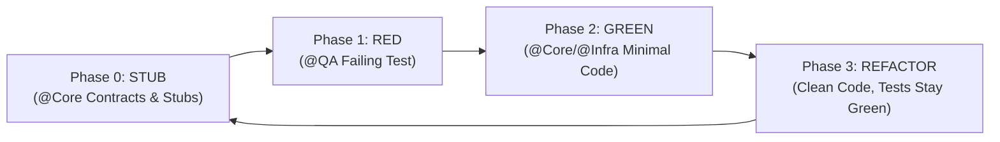

# Test-Driven Development (TDD) Protocol

Derived from `obra/superpowers/test-driven-development`. Guarantees automated test coverage for all features and eliminates superfluous code.

## 1. Mandatory 4-Phase C# TDD Cycle



### Phase 0: STUB (Contract & Throw-NotImplemented Stubs)
- Because C# is statically typed, `@Core` first creates the agreed DTOs (`RoomToRentRadar.Ports/Contracts/`), Interfaces (`I*UseCase`, `I*Repository`, `I*Port` in `RoomToRentRadar.Ports/`), and `*UseCase` stub classes in `RoomToRentRadar.Application/` whose methods throw `new NotImplementedException()`.
- Verify `dotnet build RoomToRentRadar/RoomToRentRadar.csproj` and `dotnet build RoomToRentRadar.Api/RoomToRentRadar.Api.csproj` succeed with `0` errors before handing off to `@QA`.

### Phase 1: RED (Write a Failing Test)
- `@QA` authors the unit test cases within `RoomToRentRadarUnitTests/` referencing the Phase 0 contracts and stubs.
- Execute:
  ```powershell
  dotnet test RoomToRentRadarUnitTests/RoomToRentRadarUnitTests.csproj
  ```
- **Prerequisite:** The test project **MUST COMPILE CLEANLY (0 build errors)** and **MUST FAIL** at runtime due to `NotImplementedException` or unmet assertion criteria.

### Phase 2: GREEN (Make the Test Pass)
- The developer agent (`@Core` or `@Infra`) replaces `NotImplementedException` with the **minimal** production code required to satisfy the test.
- No speculative coding beyond what is verified by the test case.
- Re-run test command -> Must output `Failed: 0`, `Passed: 100%`.

### Phase 3: REFACTOR (Safely Improve Code)
- Clean up implementation, adopt idiomatic .NET 10 / C# conventions, eliminate duplication (DRY).
- Re-run the full test suite to guarantee zero regressions.

## 2. Test Framework & Core Mocking Rules
- **Standard Test Framework:** **NUnit 4** (`[TestFixture]`, `[SetUp]`, `[Test]`, `[TestCase]`, and constraint-based assertions via `Assert.That(...)`). Do **NOT** use xUnit (`[Fact]`, `[Theory]`) or MSTest.
- **Standard Mocking Library:** **NSubstitute** (`Substitute.For<IPort>()`). Do **NOT** mix `Moq` and `NSubstitute` in the same test suite.
- Never connect to live databases or live remote networks within Unit Tests; always mock Output Ports (`I*Repository` and `I*Port`, e.g., `IRoomRepository`, `IUserRepository`, `IRoomApiClientPort`, `ILocalCachePort`, `IMapRadarPort`, `IUserSessionPort`).
