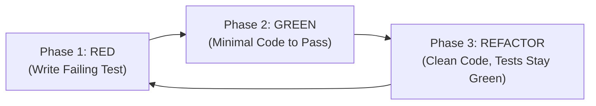

# Test-Driven Development (TDD) Protocol

Derived from `obra/superpowers/test-driven-development`. Guarantees automated test coverage for all features and eliminates superfluous code.

## 1. Mandatory 3-Phase Cycle



### Phase 1: RED (Write a Failing Test)
- QA Agent authors the test case within `RoomToRentRadarUnitTests`.
- Execute:
  ```powershell
  dotnet test RoomToRentRadarUnitTests/RoomToRentRadarUnitTests.csproj
  ```
- **Prerequisite:** The test **MUST FAIL** due to missing feature behavior, NOT due to compilation errors.

### Phase 2: GREEN (Make the Test Pass)
- The developer agent (@Core or @Infra) writes the **minimal** production code required to satisfy the test.
- No speculative coding beyond what is verified by the test case.
- Re-run test command -> Must output `Passed: 100%`.

### Phase 3: REFACTOR (Safely Improve Code)
- Clean up implementation, adopt idiomatic C# 10 conventions, eliminate duplication (DRY).
- Re-run the full test suite to guarantee zero regressions.

## 2. Core Mocking Rules
- When testing Use Cases, always mock Output Ports using `Moq` or `NSubstitute`.
- Never connect to live databases or live remote networks within Unit Tests.
