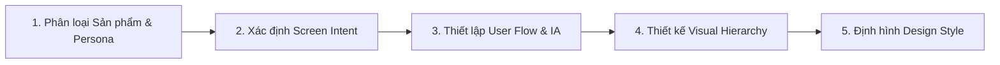

# UI/UX Design Intelligence & Requirement Analysis

> **Tham chiếu tri thức cốt lõi:**
> - `primer/design` (GitHub Primer Design Guidelines - Mental Models & Cohesion)
> - `shopify/polaris` (Shopify Polaris UX Principles - Actionable Screen Intents)
> - `alexpate/awesome-design-systems` (Information Architecture & Content Strategy)
> - **Nielsen Norman Group (NN/g):** 10 Usability Heuristics & Laws of UX

---

## 1. NGUYÊN TẮC CỐT LÕI (CORE PRINCIPLES)

Agent **KHÔNG ĐƯỢC** bắt đầu sinh mã (XAML / HTML / React) ngay khi nhận yêu cầu. Mọi quyết định giao diện đều phải đi qua 5 bước phân tích định hình:

---

## 2. BƯỚC 1: XÁC ĐỊNH LOẠI SẢN PHẨM & NGƯỜI DÙNG MỤC TIÊU (PERSONA CONTEXT)

Mỗi loại ứng dụng đòi hỏi triết lý bố cục khác nhau hoàn toàn:

| Loại sản phẩm | Ví dụ tiêu biểu | Bối cảnh sử dụng & Tâm lý người dùng | Nguyên tắc bố cục chủ đạo |
| :--- | :--- | :--- | :--- |
| **Marketplace / Consumer Discovery** | Thuê trọ, Đặt phòng, E-Commerce | Dùng 1 tay trên điện thoại, đang di chuyển, quyết định bằng cảm xúc & hình ảnh trực quan | **Visual-First:** Ảnh lớn, lướt thẻ mượt (card lists), giá tiền hiển thị đậm nét, khoảng cách bấm rộng rãi. |
| **Utility / Workflow Tool** | Check-in, Quản lý đăng tin, Quét mã | Muốn hoàn thành việc nhanh nhất có thể, sợ sai sót | **Speed & Clarity:** Giảm thiểu thao tác nhập liệu, tự động điền (autofill), nút CTA cố định ở đáy màn hình. |
| **Data-Dense / Management** | Dashboard chủ nhà, Thống kê doanh thu | Màn hình lớn/tablet, cần so sánh đối chiếu số liệu | **High Density:** Bố cục chia cột rõ ràng, nhãn súc tích, bộ lọc đa chiều (faceted filtering). |

### Phân tích Ngữ cảnh Người dùng (Persona Constraints):
* **Thiết bị & Môi trường:** Người dùng là sinh viên tìm trọ thường xem điện thoại ngoài trời nắng (độ tương phản phải cao) hoặc kết nối mạng 4G chập chờn (cần layout không bị giật lag).
* **Cognitive Load (Tải nhận thức):** Giảm thiểu tối đa số bước phải nhớ trong đầu. Sử dụng mô hình nhận biết thay vì gợi nhớ (*Recognition over Recall*).

---

## 3. BƯỚC 2: XÁC ĐỊNH MỤC ĐÍCH MÀN HÌNH (SCREEN INTENT & PRIMARY ACTION)

Áp dụng quy tắc vàng từ **Shopify Polaris**: **"Mỗi màn hình chỉ có DUY NHẤT 1 mục đích tối thượng"**.

1. **Primary Intent (Ý định cốt lõi):**
   * Xác định đúng 1 hành động chính mà 80% người dùng vào màn hình này để làm (Ví dụ: Tại trang chi tiết phòng $\rightarrow$ Hành động chính là *"Liên hệ chủ trọ / Đặt lịch xem"*).
   * Primary Action phải sở hữu độ ưu tiên thị giác cao nhất (Nút Primary CTA nổi bật nhất, kích thước lớn, luôn nằm trong tầm ngón cái - Thumb Zone).
2. **Secondary Intent (Ý định thứ cấp):**
   * Các hành động bổ trợ: *"Lưu yêu thích"*, *"Chia sẻ"*, *"Xem so sánh"*.
   * Phải dùng phong cách Outlined / Ghost / Icon button để không tranh chấp với Primary CTA.
3. **Loại bỏ "Zombie Elements":**
   * Cấm đưa các widget trang trí, banner quảng cáo không phục vụ mục đích chính làm rối màn hình.

---

## 4. BƯỚC 3: KIẾN TRÚC THÔNG TIN (IA) & USER FLOW

Áp dụng cấu trúc từ **GitHub Primer Design**: Thông tin được sắp xếp theo mức độ giảm dần về tầm quan trọng.

### 4.1. Quy tắc Kim tự tháp Ngược (Inverted Pyramid Content Structure)
1. **Phần đỉnh (Top 25% màn hình):** Thông tin định danh tối quan trọng (Tên phòng, Giá niêm yết, Khoảng cách tới trường).
2. **Phần thân (Middle 50% màn hình):** Bằng chứng thuyết phục & chi tiết (Ảnh/360 viewer, tiện ích điều hòa/nóng lạnh, an ninh, mô tả).
3. **Phần đáy (Bottom 25% màn hình):** Chốt chặn hành động & tương tác (Sticky Footer chứa giá tổng và nút gọi điện/nhắn tin).

### 4.2. Nguyên lý Progressive Disclosure (Tiết lộ thông tin lũy tiến)
* Không đổ toàn bộ dữ liệu 20 thuộc tính của phòng lên màn hình chính.
* Chỉ hiển thị 4-6 thuộc tính cốt lõi (Giá, Diện tích, Điều hòa, WC riêng). Các thông tin sâu hơn (Hợp đồng, giờ giới nghiêm) đặt trong danh sách "Xem thêm" hoặc Bottom Sheet khi người dùng chủ động yêu cầu.

### 4.3. Thiết kế Trọn vẹn User Flow (Happy Path + Edge Cases)
Agent phải định nghĩa đủ 4 trạng thái của luồng trước khi code:
* **Happy Path:** Tìm kiếm $\rightarrow$ Lọc kết quả $\rightarrow$ Chọn phòng $\rightarrow$ Xem chi tiết $\rightarrow$ Liên hệ thành công.
* **Empty State:** Tìm kiếm không có kết quả $\rightarrow$ Cung cấp gợi ý mở rộng bán kính tìm kiếm hoặc nút *"Xóa bộ lọc"*.
* **Error State:** Mất mạng hoặc API lỗi $\rightarrow$ Thông báo thân thiện kèm nút *"Thử lại"* (Retry).
* **Loading State:** Dùng Skeleton loading giữ nguyên khung giao diện thay vì màn hình trắng trơn hoặc Spinner xoay tròn đơn điệu.

---

## 5. BƯỚC 4: VISUAL HIERARCHY & CÁC ĐỊNH LUẬT UX CỐT LÕI (LAWS OF UX)

Agent phải tuân thủ nghiêm ngặt 4 định luật UX chuẩn mực:

### 1. Định luật Jakob (Jakob's Law)
* Người dùng kỳ vọng app của bạn hoạt động tương tự các app họ đã quen dùng (Airbnb, Shopee, Google Maps).
* **Cấm:** Đảo lộn vị trí thanh điều hướng (Thanh điều hướng chính phải ở Bottom Bar trên Mobile, Search bar ở trên cùng, Back button luôn ở góc trên bên trái).

### 2. Định luật Hick (Hick's Law)
* Thời gian ra quyết định tăng theo cấp số nhân với số lượng lựa chọn.
* **Quy chuẩn:**
  * Bộ lọc nhanh (Quick Filters/Chips) chỉ nên chứa tối đa 4-5 tiêu chí phổ biến nhất (Ví dụ: `< 2 triệu`, `Có máy lạnh`, `Dưới 2km`, `Gần ICTU`).
  * Danh sách tùy chọn dài phải phân nhóm hoặc có thanh tìm kiếm con.

### 3. Định luật Fitts (Fitts's Law)
* Tốc độ chạm tới mục tiêu phụ thuộc vào **khoảng cách** và **kích thước** của mục tiêu đó.
* **Quy chuẩn Mobile:**
  * Kích thước vùng cảm ứng tối thiểu: **$44 \times 44\text{ pt}$** (theo Apple HIG) hoặc **$48 \times 48\text{ dp}$** (theo Android Material).
  * Đặt nút quan trọng nhất ở 1/3 dưới cùng màn hình (Thumb Zone) để người dùng chạm tới dễ dàng mà không cần với ngón tay.

### 4. Định luật Miller (Miller's Law)
* Trí nhớ ngắn hạn của con người chỉ ghi nhớ được khoảng $7 \pm 2$ cụm thông tin.
* **Quy chuẩn:** Phải nhóm dữ liệu thành từng cụm thẻ (Card Chunking) trực quan (Cụm Tổng quan, Cụm Tiện ích, Cụm Chi phí phát sinh, Cụm Bản đồ & Vị trí).

---

## 6. BƯỚC 5: CHỌN PHONG CÁCH THIẾT KẾ & TRÁNH "GENERIC AI SLOP"

Rất nhiều hệ thống AI sinh ra giao diện rập khuôn, nhàm chán và thiếu tính ứng dụng thực tế. Agent bắt buộc phải tuân theo phong cách thiết kế sau:

### Phong cách khuyến nghị: "Clean Utility & Content-Focused"
* **Đặc trưng:** Tôn vinh nội dung và hình ảnh thực tế; giao diện đóng vai trò nền tảng nâng đỡ dữ liệu.
* **Whitespace (Khoảng trắng):** Khoảng trắng là một thành phần thiết kế có chủ đích, không phải "vùng trống cần lấp đầy". Dùng padding rộng rãi ($16\text{px} - 24\text{px}$) để mắt người dùng được nghỉ ngơi.
* **Typography:** Dùng 1 Font họ Sans-serif rõ ràng (Inter, Roboto, SF Pro). Phân cấp độ quan trọng bằng **Font Weight** (`SemiBold`, `Regular`) và kích thước, tránh lạm dụng màu sắc sặc sỡ để phân cấp.

### Danh sách điều CẤM (Anti-Patterns - Anti-AI UI Slop):
* ❌ **CẤM** lạm dụng nền Gradient tím hồng / neon xanh phát sáng không mục đích.
* ❌ **CẤM** dùng viền bo góc tròn xoe quá đà ($30\text{px} - 40\text{px}$) trên các khối vuông lớn khiến bố cục lỏng lẻo.
* ❌ **CẤM** đặt 2 nút Primary có độ nổi bật bằng nhau trên cùng một viewport (Gây tê liệt quyết định).
* ❌ **CẤM** nhồi nhét icon trang trí trước mọi dòng chữ nếu icon đó không tăng thêm ý nghĩa nhận diện.

---

## 7. SELF-AUDIT CHECKLIST CHO AGENT TRƯỚC KHI BƯỚC VÀO THIẾT KẾ CHI TIẾT

Trước khi chuyển sang bước dựng Design System hoặc code Component, Agent phải tự xác minh các câu hỏi sau:

- [ ] **Target Audience:** Màn hình này thiết kế cho ai? (Sinh viên xem nhanh trên điện thoại hay Chủ nhà quản lý phòng?)
- [ ] **Single Purpose:** Mục tiêu số 1 không thể thiếu của màn hình này là gì?
- [ ] **Thumb Zone:** Nút bấm quan trọng nhất có nằm ở vùng ngón cái dễ chạm tới nhất không?
- [ ] **Content Hierarchy:** Người dùng có nắm được thông tin cốt lõi (Giá, Địa điểm, Tình trạng) trong vòng 3 giây đầu tiên quét mắt không?
- [ ] **Failsafe States:** Đã dự trù layout khi danh sách trống (Empty), khi tải dữ liệu (Skeleton), và khi mất mạng (Error) chưa?
- [ ] **Anti-Slop:** Thiết kế có bị sa vào bẫy giao diện AI rập khuôn (màu tím neon, bóng đổ gắt, thiếu tương phản) không?

