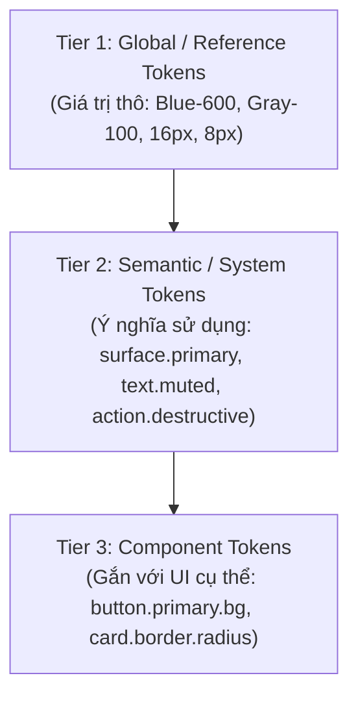

# Design System Architecture & Token Management

> **Tham chiếu tri thức cốt lõi:**
> - `shadcn-ui/ui` (Semantic Color Mapping & Component Token Architecture)
> - `alexpate/awesome-design-systems` (Shopify Polaris, IBM Carbon, GitHub Primer Tokens)
> - `tailwindlabs/tailwindcss` (Spacing Scale, Color Shades 50–950, Elevation)
> - **W3C Design Tokens Community Group (DTCG)** Standard Format

---

## 1. NGUYÊN TẮC CỐT LÕI (CORE PRINCIPLES)

1. **Zero Hardcoded Values:** Tuyệt đối **CẤM** viết cứng mã màu Hex (như `#3B82F6`), kích thước Pixel (`font-size: 15px`), hoặc border-radius lẻ tẻ trong component. Mọi giá trị UI phải trích xuất từ Design Tokens.
2. **Kiến trúc Token 3 cấp (3-Tier Token Architecture):**



* Component trong ứng dụng **chỉ được phép tiêu thụ Tier 2 hoặc Tier 3**, không bao giờ tham chiếu trực tiếp Tier 1 để đảm bảo việc đổi theme (Dark/Light) không làm gãy giao diện.

---

## 2. BẢNG MÀU NGỮ NGHĨA (SEMANTIC COLOR SYSTEM)

Dựa trên cấu trúc chuẩn từ `shadcn-ui` và GitHub Primer, hệ thống màu sắc phải phục vụ đúng ngữ cảnh ngữ nghĩa:

| Nhóm Semantic Token | Tên Token (Light Mode) | Tên Token (Dark Mode) | Ý nghĩa & Vị trí sử dụng |
| :--- | :--- | :--- | :--- |
| **Surface & Background** | `surface.canvas` (`#F8FAFC`)<br>`surface.card` (`#FFFFFF`)<br>`surface.elevated` (`#FFFFFF`) | `surface.canvas` (`#0F172A`)<br>`surface.card` (`#1E293B`)<br>`surface.elevated` (`#334155`) | Nền tổng thể ứng dụng, nền thẻ chứa nội dung, nền popover/modal nổi. |
| **Content & Typography** | `text.primary` (`#0F172A`)<br>`text.secondary` (`#475569`)<br>`text.muted` (`#94A3B8`)<br>`text.inverse` (`#FFFFFF`) | `text.primary` (`#F8FAFC`)<br>`text.secondary` (`#CBD5E1`)<br>`text.muted` (`#64748B`)<br>`text.inverse` (`#0F172A`) | Tiêu đề chính, văn bản mô tả phụ, nhãn phụ (caption/time), chữ tương phản trên nền tối. |
| **Interactive & Brand** | `action.primary.bg` (`#2563EB`)<br>`action.primary.hover` (`#1D4ED8`)<br>`action.secondary.bg` (`#F1F5F9`) | `action.primary.bg` (`#3B82F6`)<br>`action.primary.hover` (`#60A5FA`)<br>`action.secondary.bg` (`#1E293B`) | Nút CTA quan trọng nhất (Tìm phòng, Đặt lịch), màu hover/pressed, nút phụ (Lọc, Hủy). |
| **Status & Feedback** | `status.success` (`#16A34A`)<br>`status.warning` (`#D97706`)<br>`status.danger` (`#DC2626`)<br>`status.info` (`#0284C7`) | `status.success` (`#22C55E`)<br>`status.warning` (`#F59E0B`)<br>`status.danger` (`#EF4444`)<br>`status.info` (`#38BDF8`) | Phòng còn trống / Đã xác thực, Phòng sắp hết, Hết phòng / Báo cáo vi phạm, Thông tin tiện ích. |
| **Borders & Outlines** | `border.subtle` (`#E2E8F0`)<br>`border.focus` (`#2563EB`) | `border.subtle` (`#334155`)<br>`border.focus` (`#60A5FA`) | Đường kẻ phân cách card, viền input, viền focus khi tương tác bàn phím. |

---

## 3. TYPOGRAPHY SCALE (HỆ THỐNG PHÂN CẤP CHỮ)

Áp dụng thang đo tỷ lệ hình học chuẩn (Typography Scale) để đảm bảo nhịp điệu đọc rõ ràng và không bị lộn xộn:

| Role Name | Size / Line-Height | Weight | Letter-Spacing | Mục đích sử dụng |
| :--- | :--- | :--- | :--- | :--- |
| **Display** | $32\text{px} / 40\text{px}$ ($2.0\text{rem}$) | Bold (700) | $-0.02\text{em}$ | Giá tiền nổi bật, Hero Header màn hình chào |
| **Heading 1 (H1)** | $24\text{px} / 32\text{px}$ ($1.5\text{rem}$) | Bold (700) | $-0.01\text{em}$ | Tên màn hình chính (Page Title: "Chi tiết phòng trọ") |
| **Heading 2 (H2)** | $20\text{px} / 28\text{px}$ ($1.25\text{rem}$) | SemiBold (600) | $-0.01\text{em}$ | Tiêu đề khối (Section Header: "Tiện ích đi kèm", "Vị trí") |
| **Heading 3 (H3)** | $16\text{px} / 24\text{px}$ ($1.0\text{rem}$) | SemiBold (600) | $0\text{em}$ | Tiêu đề thẻ nhỏ, Tên chủ nhà, Tên tiện ích |
| **Body Large** | $16\text{px} / 24\text{px}$ ($1.0\text{rem}$) | Regular (400) | $0\text{em}$ | Đoạn văn mở đầu, thông báo quan trọng |
| **Body Medium** | $14\text{px} / 20\text{px}$ ($0.875\text{rem}$) | Regular (400) | $0\text{em}$ | Văn bản chuẩn của ứng dụng (Mô tả phòng, điều khoản) |
| **Caption / Label** | $12\text{px} / 16\text{px}$ ($0.75\text{rem}$) | Medium (500) | $+0.01\text{em}$ | Timestamp, nhãn badge ("Còn phòng", "Đã duyệt"), helper text input |

* **Tỷ lệ Line-Height vàng:**
  * Tiêu đề lớn (Headings): Dùng hệ số $1.2 - 1.33$ để chữ cô đọng, không bị loãng.
  * Văn bản đọc (Body): Dùng hệ số $1.4 - 1.5$ để mắt người dễ dàng chuyển dòng mà không bị nhảy cóc.

---

## 4. QUY CHUẨN SPACING, SIZING, RADIUS & SHADOWS (8PT GRID SYSTEM)

Mọi kích thước padding, margin, width, height đều tuân theo hệ số cơ sở **$8\text{pt}$** (với bước đệm $4\text{pt}$ cho các chi tiết nhỏ):

### 4.1. Spacing Scale
* `space-1` ($4\text{px}$): Khoảng cách giữa icon và label phụ, khoảng đệm trong tag/badge.
* `space-2` ($8\text{px}$): Khoảng cách giữa các phần tử liên quan chặt chẽ (title và subtitle).
* `space-3` ($12\text{px}$): Padding trong input text, khoảng cách giữa các chips.
* `space-4` ($16\text{px}$): **Tiêu chuẩn vàng** cho Screen Margin (khoảng cách 2 mép màn hình mobile) và Card Padding.
* `space-6` ($24\text{px}$): Khoảng cách giữa các khối nội dung lớn (Section gap).
* `space-8` ($32\text{px}$): Khoảng cách trước khối CTA chính hoặc khoảng đệm header.

### 4.2. Corner Radius Scale (Bo góc có chủ đích)
* `radius-sm` ($4\text{px}$): Checkbox, Tooltip, Tags kỹ thuật.
* `radius-md` ($8\text{px}$): Input text fields, Nút bấm tiêu chuẩn (Buttons).
* `radius-lg` ($12\text{px}$): **Tiêu chuẩn cho Thẻ (Room Cards)**, Dialogs, Dropdown menu.
* `radius-xl` ($16\text{px}$ - $20\text{px}$): Bottom Sheets, Modal lớn.
* `radius-full` ($9999\text{px}$): Avatar tròn, Pill filter chips, Badges trạng thái.

### 4.3. Elevation & Shadow System (Độ nổi thị giác)
* **Elevation 1 (Low / Card):** `0px 1px 3px rgba(0,0,0,0.08)` $\rightarrow$ Dành cho Card nằm trên nền canvas để tạo độ tách biệt nhẹ.
* **Elevation 2 (Medium / Dropdown & Sheet):** `0px 4px 12px rgba(0,0,0,0.12)` $\rightarrow$ Dành cho Bottom Sheet, Bộ lọc nổi.
* **Elevation 3 (High / Dialog & Modal):** `0px 12px 24px rgba(0,0,0,0.18)` $\rightarrow$ Dành cho Pop-up xác nhận, Cảnh báo thoát.

---

## 5. KIẾN TRÚC DARK MODE & LIGHT MODE THEME

Để Dark Mode đạt chuẩn chất lượng cao, Agent phải tuân thủ nguyên lý chiếu sáng của **Material Design 3 & Apple HIG**:

1. **Tuyệt đối không dùng Pure Black (`#000000`) làm nền toàn màn hình:**
   * Dùng Dark Slate/Navy (`#0F172A` hoặc `#121212`). Pure black gây hiện tượng "cháy mắt" và tạo vệt bóng nhờn (OLED smearing) khi cuộn nhanh.
2. **Nguyên lý Elevation trong Dark Mode (Độ sáng tăng dần theo độ cao):**
   * Trong Dark Mode, bóng đổ (Shadow) gần như vô hình. Để biểu thị một thành phần nằm đè lên thành phần khác, **màu nền phải sáng hơn**:
     * Layer 0 (Màn hình chính): `#0F172A`
     * Layer 1 (Card phòng trọ): `#1E293B` (+5% lightness)
     * Layer 2 (Modal / Popup): `#334155` (+10% lightness)
3. **Giảm độ rực màu của Accent / Primary Colors:**
   * Màu Primary ở Light Mode thường dùng tone 600 (`#2563EB`). Sang Dark Mode phải chuyển thành tone 400 hoặc 500 (`#3B82F6` hoặc `#60A5FA`) để giảm độ chói mắt và tăng tương phản với nền tối.

---

## 6. QUY CHUẨN ĐỒNG NHẤT COMPONENT (COMPONENT CONSISTENCY)

Agent phải đảm bảo mọi Component tuân thủ ma trận trạng thái:

```
[Default]  --->  [Hover / Focused]  --->  [Pressed / Active]  --->  [Disabled]  --->  [Loading]
```

1. **Nút bấm (Button Anatomy):**
   * Phải hỗ trợ đủ 4 biến thể: `Primary` (Solid), `Secondary` (Soft/Tinted), `Outline` (Viền mảnh), `Ghost` (Chỉ có chữ/icon).
   * Trạng thái `Disabled` phải hạ opacity xuống $40\% - 50\%$ và tắt hoàn toàn sự kiện click/tap (`pointer-events: none`).
   * Trạng thái `Loading` phải hiển thị Spinner có kích thước tương xứng và giữ nguyên chiều rộng của nút (tránh giật layout khi text đổi thành loading).
2. **Trường nhập liệu (Input Anatomy):**
   * Chiều cao tối thiểu thân thiện với ngón tay: $44\text{px} - 48\text{px}$.
   * Phải luôn có rõ ràng: Placeholder mờ, Label cố định, Helper/Error text bên dưới, và viền `border.focus` nổi bật khi được active.

---

## 7. SELF-AUDIT CHECKLIST CHO AGENT

Trước khi hoàn tất tài liệu Design System hoặc áp dụng vào code:

- [ ] **No Hardcode:** Tất cả màu sắc và khoảng cách có được gọi qua Design Token không?
- [ ] **Contrast Verification:** Độ tương phản giữa Text và Background có đạt chuẩn tối thiểu $4.5:1$ (theo WCAG AA) cho cả 2 theme không?
- [ ] **8pt Adherence:** Các giá trị margins, paddings, gaps có chia hết cho 4 hoặc 8 không?
- [ ] **Dark Mode Elevation:** Các card và modal trong Dark Mode có sáng hơn màu nền tổng thể không?
- [ ] **Touch Target:** Chiều cao các nút bấm và inputs có đạt tối thiểu $44\text{px}$ không?

