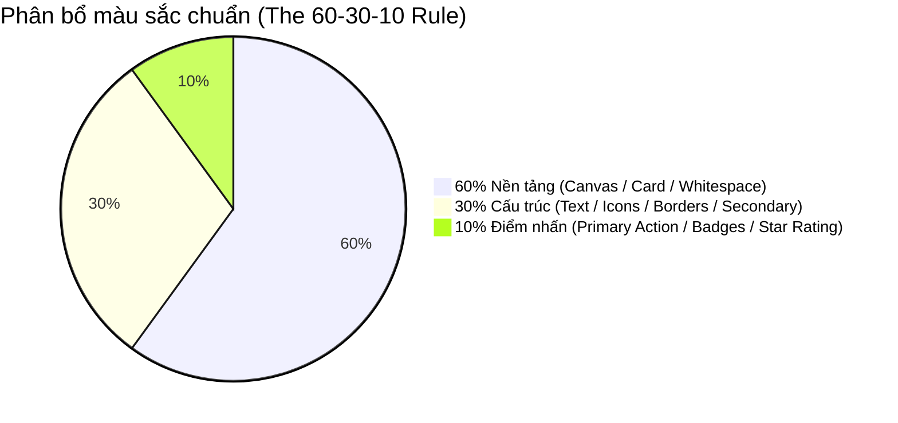

# Visual Design Excellence & Anti-AI Slop Standards

> **Tham chiếu tri thức cốt lõi:**
> - `primer/design` (GitHub Primer Visual Principles - Layout Balance & Typography Hierarchy)
> - `apple/hig-guidelines` (Apple Human Interface Guidelines - Fluid Animation & Clarity)
> - `google/material-design` (Motion Physics, Responsive Layout Grids, Elevation)
> - `refactoringui/book` (Steve Schoger & Adam Wathan - Practical Visual Design Rules)

---

## 1. NGUYÊN TẮC CỐT LÕI (AESTHETIC PHILOSOPHY)

1. **Content is King, UI is the Stage:** Giao diện đẹp không phải là giao diện nhiều hiệu ứng hào nhoáng, mà là giao diện làm nổi bật nội dung (hình ảnh phòng trọ, giá cả, thông số) và giúp người dùng ra quyết định nhanh nhất.
2. **Intentionality (Tính có chủ đích):** Mọi khoảng trống (whitespace), màu sắc, đường viền (border) và hiệu ứng chuyển động đều phải có lý do tồn tại. Nếu bỏ một chi tiết ra mà giao diện không mất đi ý nghĩa, hãy bỏ nó.

---

## 2. BỐ CỤC & HỆ THỐNG LƯỚI (COMPOSITION & GRID SYSTEMS)

Áp dụng hệ thống lưới thích ứng chuẩn (Responsive Layout Grid):

```
Mobile (Phone):       4 Cột  | Margin: 16px | Gutter: 12-16px | Max-width: 100%
Tablet (Portrait):    8 Cột  | Margin: 24px | Gutter: 16px    | Max-width: 100%
Desktop / Landscape: 12 Cột  | Margin: Auto | Gutter: 24px    | Max-width: 1280px (Centered)
```

### Quy tắc Vàng về Bố cục:
* **The Alignment Rule (Quy tắc gióng hàng):** Mọi phần tử trên màn hình phải gióng thẳng hàng với ít nhất một phần tử khác (cùng gióng lề trái, cùng gióng tâm, hoặc cùng nằm trên đường lưới). Bố cục bị coi là "nghiệp dư" khi các dòng chữ hoặc icon bị lệch 2–4px so với lề chuẩn.
* **Proximity Rule (Quy tắc khoảng cách gần):** Các thành phần liên quan nhau phải nằm gần nhau hơn các thành phần khác.
  * Khoảng cách giữa Tiêu đề và Mô tả con: $4\text{px} - 8\text{px}$.
  * Khoảng cách giữa Khối thông tin này và Khối thông tin khác: $24\text{px} - 32\text{px}$.

---

## 3. PHÂN CẤP THỊ GIÁC BẬC CAO (TYPOGRAPHY & VISUAL HIERARCHY)

Để mắt người dùng tự động quét đúng thứ tự mà không cần nỗ lực, Agent phải áp dụng **3 đòn bẩy phân cấp thị giác** (Three Hierarchy Levers):

| Cấp độ ưu tiên | Kỹ thuật sử dụng | Ví dụ thực tế trên Card Phòng Trọ |
| :--- | :--- | :--- |
| **P1: Điểm neo đầu tiên (Focal Point)** | Size lớn + Font Bold + Màu tương phản cao | **2.500.000 đ/tháng** (`Display`, Bold, Text Primary) |
| **P2: Nhận diện nội dung** | Size vừa + Font SemiBold + Màu tiêu chuẩn | **Phòng trọ khép kín gần cổng ICTU** (`Heading 3`, SemiBold) |
| **P3: Chi tiết bổ trợ** | Size nhỏ + Font Regular + Màu hạ tone (Muted) | *Cách trường 350m • Đã bao gồm wifi* (`Body Medium / Caption`, Text Muted) |

### Nhịp điệu Dọc (Vertical Rhythm):
* **Khoảng cách trước tiêu đề luôn lớn hơn khoảng cách sau tiêu đề:**
  * Sai lầm phổ biến: Đặt tiêu đề nằm chính giữa 2 khối với khoảng cách trên = dưới (ví dụ $16\text{px} - 16\text{px}$). Điều này khiến tiêu đề bị "bơ vơ".
  * Chuẩn mực: Khoảng cách phía trên tiêu đề là $24\text{px}$, khoảng cách phía dưới tiêu đề gắn liền với nội dung là $8\text{px}$.

---

## 4. HÀI HÒA MÀU SẮC & QUY TẮC 60–30–10 (COLOR HARMONY)

Không bao giờ để ứng dụng biến thành một "hộp bút chì màu". Tuân thủ nghiêm ngặt tỷ lệ phân bổ màu:



1. **60% Nền tảng (Dominant Color):** Màu nền trung tính (`#F8FAFC` ở Light mode, `#0F172A` ở Dark mode). Đây là không gian thở của giao diện.
2. **30% Cấu trúc (Secondary Color):** Màu chữ chính, viền thẻ mờ, icon điều hướng. Đảm bảo tính dễ đọc và phân chia ranh giới nội dung.
3. **10% Điểm nhấn (Accent Color):** Màu thương hiệu (Brand Blue / Emerald Green). **CHỈ DÙNG** cho các điểm tương tác: nút "Đặt phòng", badge "Đã xác minh", icon đánh giá sao, hoặc đường link điều hướng.

---

## 5. CÂN BẰNG THỊ GIÁC & QUY TẮC QUÉT MẮT (SCANNING PATTERNS)

* **F-Shaped Pattern (Dành cho màn hình danh sách, chi tiết nhiều chữ):** Người dùng quét ngang đỉnh màn hình $\rightarrow$ quét xuống lề trái $\rightarrow$ quét ngang ngắn hơn $\rightarrow$ lướt dọc mép trái.
  * *Hành động của Agent:* Đặt hình ảnh đại diện và các từ khóa quan trọng (Giá tiền, Loại phòng) bám sát lề trái.
* **Z-Shaped Pattern (Dành cho màn hình landing, onboarding, checkout):** Người dùng quét từ góc trên trái $\rightarrow$ trên phải $\rightarrow$ chéo xuống dưới trái $\rightarrow$ dừng lại ở góc dưới phải.
  * *Hành động của Agent:* Đặt Logo ở trên trái, nút "Bỏ qua/Đăng nhập" ở trên phải, và nút Primary CTA kết thúc ở góc dưới cùng.

---

## 6. CHUYỂN ĐỘNG TINH TẾ (MICRO-INTERACTIONS & MOTION PHYSICS)

Chuyển động (Motion) giúp người dùng cảm nhận được phản hồi vật lý và hiểu được cấu trúc không gian của app:

### 6.1. Thời lượng chuyển động chuẩn (Duration Scale)
* **Micro-feedback ($100\text{ms} - 150\text{ms}$):** Hiệu ứng bấm nút (Scale down $0.98$ khi ấn), checkbox tick chọn, bật tắt toggle switch.
* **Component Transition ($200\text{ms} - 250\text{ms}$):** Mở rộng accordion, dropdown menu trượt xuống, đổi tab nội dung.
* **Spatial Transition ($300\text{ms} - 350\text{ms}$):** Bottom sheet trượt từ đáy lên, Modal phóng to từ giữa màn hình, chuyển trang.
* ⚠️ **Tuyệt đối CẤM chuyển động kéo dài quá $400\text{ms}$:** Mọi hiệu ứng trên 400ms đều gây ức chế cho người dùng và tạo cảm giác app bị chậm lag.

### 6.2. Đường cong gia tốc (Easing Curves)
* **Khi xuất hiện (Enter viewport):** Dùng `Ease-Out` (`cubic-bezier(0.0, 0.0, 0.2, 1)`) $\rightarrow$ Phần tử xuất hiện nhanh để người dùng không phải đợi, sau đó giảm tốc nhẹ nhàng khi dừng.
* **Khi biến mất (Exit viewport):** Dùng `Ease-In` (`cubic-bezier(0.4, 0.0, 1, 1)`) $\rightarrow$ Bắt đầu trôi đi và tăng tốc biến mất nhanh chóng.
* **Không dùng Linear Motion:** Chuyển động đều không có trong tự nhiên; nó làm giao diện có cảm giác như máy móc thô cứng.

---

## 7. CẨM NANG BÀI TRỪ "GENERIC AI SLOP" (ANTI-PATTERNS CHECKLIST)

Rất nhiều trợ lý ảo và mô hình AI sinh ra giao diện "nhìn qua thì đẹp nhưng không dùng được trong thực tế". Agent bắt buộc phải loại bỏ các thói quen xấu sau:

| Thói quen xấu của AI (AI Slop) | Hậu quả thực tế | Cách giải quyết chuẩn mực (Pro-Design) |
| :--- | :--- | :--- |
| **Lạm dụng Gradient Tím/Hồng neon** | Gây nhức mắt, biến mọi app thành phong cách Crypto/Web3 rẻ tiền | Dùng màu nền Solid trung tính sạch sẽ. Chỉ dùng gradient cực nhẹ (tinh tế $\le 5\%$ độ biến thiên sáng) cho các banner đặc biệt. |
| **Bo góc tròn xoe $30\text{px} - 40\text{px}$ trên Card** | Lãng phí diện tích hiển thị ở 4 góc, làm text bị ép vào giữa | Bo góc Card tối đa $12\text{px} - 16\text{px}$ (`radius-lg`). Giữ dáng hình học vững chãi, gọn gàng. |
| **Lạm dụng Glassmorphism (Nền mờ đục)** | Text trên nền ảnh bị nhòe nhoẹt, rớt điểm tương phản accessibility | Dùng thẻ Card màu đặc có độ tương phản cao, viền mảnh $1\text{px}$ (`border.subtle`). |
| **Bóng đổ đen kịt, sắc cạnh (`0 10px 20px #000`)** | Tạo cảm giác dơ bẩn và nặng nề cho giao diện | Dùng bóng đổ đa tầng mờ tự nhiên: `0 1px 3px rgba(0,0,0,0.06), 0 4px 12px rgba(0,0,0,0.04)`. |
| **Text màu xám nhạt trên nền trắng** | Người dùng mắt kém hoặc đứng ngoài trời không đọc được | Độ tương phản giữa text và nền bắt buộc phải $\ge 4.5:1$ (tương đương xám đậm Slate-600 trở lên). |
| **Khoảng cách text đè sát mép thẻ** | Cảm giác ngột ngạt, chữ dính vào viền | Luôn đảm bảo Card Padding tối thiểu $16\text{px}$ (ở mobile) và $20\text{px}$ (ở tablet/desktop). |

---

## 8. SELF-AUDIT CHECKLIST CHO AGENT TRƯỚC KHI XUẤT BẢN THIẾT KẾ

- [ ] **Lưới & Canh lề:** Các phần tử có bám sát hệ thống lưới (Grid 4 cột mobile / 12 cột desktop) và gióng thẳng hàng không?
- [ ] **Quy tắc 60–30–10:** Màu nhấn (Accent color) có bị dùng quá $10\%$ diện tích màn hình không?
- [ ] **Tương phản Chữ:** Text nhỏ nhất có đạt chuẩn tương phản tối thiểu $4.5:1$ không?
- [ ] **Nhịp điệu khoảng cách:** Khoảng cách trên tiêu đề có lớn gấp đôi khoảng cách từ tiêu đề đến nội dung con không?
- [ ] **Thời lượng chuyển động:** Có hiệu ứng nào kéo dài quá $350\text{ms}$ không?
- [ ] **Anti-Slop Clean:** Giao diện đã được làm sạch, không có gradient tím hồng lòe loẹt hay bóng đổ đen kịt chưa?

