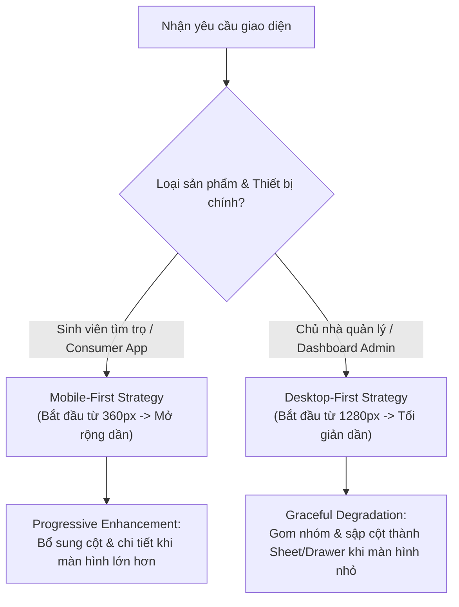
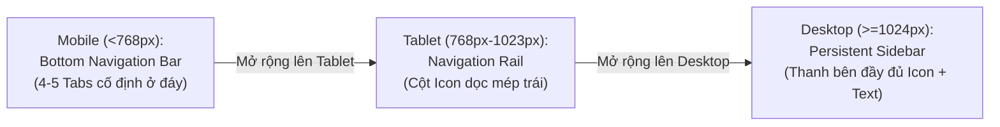

# Responsive & Adaptive Cross-Platform Design

> **Tham chiếu tri thức cốt lõi:**
> - `tailwindlabs/tailwindcss` (Breakpoints Architecture: `sm`, `md`, `lg`, `xl`, `2xl`)
> - `shopify/polaris` & `primer/design` (Adaptive Navigation, Card Transformation for Tables)
> - `radix-ui/primitives` (Dialog vs Drawer Adaptive State Transitions)
> - **Google Web Fundamentals & Apple HIG** (Fluid Scaling, Safe Area Insets, Dynamic Viewport)

---

## 1. NGUYÊN TẮC CỐT LÕI (STRATEGY & CONTEXT)

Agent phải lựa chọn chiến lược tiếp cận phù hợp ngay từ đầu dựa trên đặc thù người dùng:



* **Mobile-First Rule (Dành cho RoomToRentRadar Client):** Luôn đảm bảo giao diện hoạt động hoàn hảo và không bị che khuất trên màn hình nhỏ nhất ($360\text{px} - 390\text{px}$) trước khi viết quy tắc cho màn hình lớn.

---

## 2. HỆ THỐNG BREAKPOINTS CHUẨN MỰC

Sử dụng hệ thống ngưỡng kích thước chuẩn ngành để đảm bảo giao diện mượt mà trên mọi thiết bị:

| Breakpoint | Kích thước Viewport | Thiết bị đại diện | Cấu trúc Cột Layout |
| :--- | :--- | :--- | :--- |
| **`xs` (Mobile Phone)** | $< 640\text{px}$ | iPhone 13/14/15, Pixel 7/8, Galaxy S23 | **1 cột danh sách** (100% width), Margin: $16\text{px}$ |
| **`sm` (Large Phone/Phablet)** | $640\text{px} - 767\text{px}$ | Màn hình gập khi mở, Điện thoại xoay ngang | **1–2 cột thích ứng**, Margin: $20\text{px}$ |
| **`md` (Tablet Portrait)** | $768\text{px} - 1023\text{px}$ | iPad Mini, iPad 10.2", Galaxy Tab đứng | **2 cột chia đôi** (Card Grid), Margin: $24\text{px}$ |
| **`lg` (Tablet Landscape/Laptop)** | $1024\text{px} - 1279\text{px}$ | iPad Pro ngang, MacBook Air 13", Laptop nhỏ | **3 cột nội dung** + Sidebar cố định |
| **`xl` (Desktop Display)** | $\ge 1280\text{px}$ | Màn hình máy tính bàn, iMac, Monitor ngoài | **4 cột Card Grid** (Max-width: $1280\text{px}$ căn giữa) |

---

## 3. KỸ THUẬT ADAPTIVE LAYOUTS & DYNAMIC VIEWPORT

### 3.1. Biến đổi Lưới Thẻ phòng trọ (Card Grid Auto-Adaptive)
Tuyệt đối không viết cứng số cột cho toàn bộ màn hình. Sử dụng công thức co giãn tự động:

* **Mobile ($< 768\text{px}$):** Thẻ phòng trải dài theo chiều ngang màn hình, hình ảnh nằm phía trên, thông tin nằm phía dưới (Stacked Card).
* **Tablet ($768\text{px} - 1023\text{px}$):** Thẻ chuyển thành 2 cột đều nhau (`repeat(2, 1fr)`).
* **Desktop ($\ge 1024\text{px}$):** Có thể linh hoạt hiển thị dạng 3 cột (`repeat(3, 1fr)`) hoặc chuyển sang dạng Thẻ ngang (Horizontal Split: Ảnh bên trái $40\%$, Thông tin bên phải $60\%$) để tối ưu chiều ngang.

### 3.2. Xử lý Vùng An Toàn (Safe Area Insets) & Dynamic Viewport Height
* **Tai thỏ & Thanh vuốt (Notch & Home Indicator):** Luôn áp dụng `Safe Area Insets` (`env(safe-area-inset-top)`, `env(safe-area-inset-bottom)`) cho các thanh cố định (Header, Bottom Navigation Bar).
* **Tránh bẫy `100vh` trên trình duyệt di động:**
  * Sai lầm: Đặt `height: 100vh` làm các nút bấm ở đáy bị che mất bởi thanh địa chỉ (Address bar) của Safari/Chrome.
  * Chuẩn mực: Dùng `100dvh` (Dynamic Viewport Height) hoặc sử dụng Layout căn chỉnh linh hoạt (`Flexbox` / `Grid`) với `flex: 1`.

---

## 4. BIẾN ĐỔI THANH ĐIỀU HƯỚNG (RESPONSIVE NAVIGATION)

Điều hướng là thành phần thay đổi mạnh nhất theo kích thước màn hình. Agent phải áp dụng mô hình chuyển dịch 3 tầng:



### Quy chuẩn Tương tác Điều hướng:
1. **Mobile Bottom Bar:** Tối đa 5 mục (`Khám phá`, `Bản đồ`, `Yêu thích`, `So sánh`, `Cá nhân`). Chiều cao chuẩn: $56\text{px} - 64\text{px}$ + Safe Area Bottom.
2. **Bộ lọc tìm kiếm (Filter Pattern):**
   * Mobile: Hiển thị nút "Bộ lọc" $\rightarrow$ Nhấn vào mở **Bottom Sheet / Full-screen Drawer**.
   * Desktop: Hiển thị thanh bên cố định (Sticky Sidebar Filters) nằm bên trái màn hình kết quả tìm kiếm.
3. **Hộp thoại (Dialog vs Sheet):**
   * Mobile: Trượt từ dưới lên (Bottom Sheet) để ngón tay dễ đóng.
   * Desktop: Căn giữa màn hình (Center Modal Dialog) có lớp phủ làm mờ (Backdrop overlay).

---

## 5. THÍCH ỨNG BIỂU MẪU & BẢNG DỮ LIỆU (FORMS & TABLES)

### 5.1. Biểu mẫu Thích ứng (Responsive Forms)
* **Desktop:** Biểu mẫu đăng tin phòng trọ có thể chia thành 2 cột (Cột trái: Thông tin cơ bản, Cột phải: Upload ảnh & Tiện ích).
* **Mobile Rule:** **Bắt buộc chuyển về 1 cột duy nhất (Single-Column Form)**. 
  * Lý do: Khi bàn phím ảo bật lên trên điện thoại, layout 2 cột sẽ bị co dúm và che mất con trỏ soạn thảo.
  * Tách form dài thành nhiều bước (Multi-step Wizard) kèm thanh tiến trình (Step Progress Indicator) thay vì một trang cuộn vô tận.

### 5.2. Bảng dữ liệu Thích ứng (Card Transformation for Tables)
Bảng nhiều cột (ví dụ: Bảng so sánh 3 phòng trọ hoặc Bảng hóa đơn tiền điện nước) thường bị vỡ vụn trên màn hình điện thoại:

```
[Desktop Table View]                   [Mobile Card Transformation]
| Tên phòng | Diện tích | Giá tiền |    --->   +---------------------------------+
| Phòng 101 |   25 m2   | 2.500k   |           | Phòng 101                       |
| Phòng 102 |   30 m2   | 3.200k   |           | • Diện tích: 25 m2              |
                                               | • Giá tiền:  2.500k/tháng       |
                                               +---------------------------------+
```

* **Quy chuẩn thực thi:**
  * Khi màn hình $< 640\text{px}$, hủy bỏ cấu trúc thẻ `<table>`.
  * Biến đổi mỗi hàng dữ liệu (`<tr>`) thành một thẻ con (`Card`) độc lập. Các tiêu đề cột trở thành nhãn (`Label`) nằm cạnh giá trị (`Value`).
  * Đối với bảng so sánh tính năng (Feature Comparison Table): Cố định cột tiêu chí (Sticky Column đầu tiên), cho phép người dùng cuộn ngang (Horizontal Swipe) để duyệt qua các phòng trọ.

---

## 6. SELF-AUDIT CHECKLIST CHO AGENT KHI XỬ LÝ RESPONSIVE

Trước khi bàn giao code hoặc layout:

- [ ] **Zero Horizontal Scroll:** Toàn bộ trang web / ứng dụng có bị thanh cuộn ngang ngoài ý muốn ở độ rộng $360\text{px}$, $390\text{px}$, $768\text{px}$ và $1280\text{px}$ không?
- [ ] **Touch Target Integrity:** Các nút bấm, icon menu trên màn hình nhỏ có duy trì kích thước tối thiểu $44\text{px} \times 44\text{px}$ không?
- [ ] **Safe Area Coverage:** Header có bị đè bởi tai thỏ/dynamic island, và Bottom Bar có bị thanh gạt Home Indicator che khuất không?
- [ ] **Font Scalability:** Các dòng tiêu đề lớn có bị tràn mép màn hình (overflow) hoặc tự động co chữ/ngắt dòng hợp lý trên màn hình $360\text{px}$ không?
- [ ] **Form Keyboard Safety:** Khi focus vào input ở cuối form trên mobile, giao diện có tự động đẩy lên để tránh bị bàn phím ảo che mất không?

