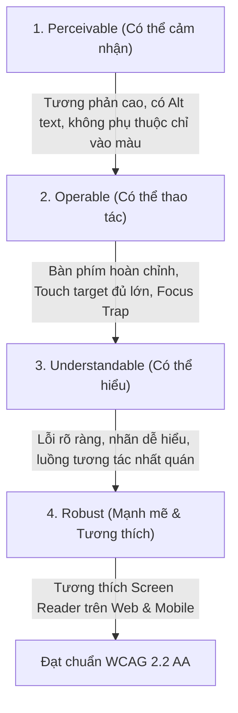

# Accessibility Excellence (WCAG 2.2 AA & Universal Design)

> **Tham chiếu tri thức cốt lõi:**
> - `dequelabs/axe-core` (Automated Accessibility Rules & Validation Engine)
> - `w3c/wai-aria-practices` (WAI-ARIA Authoring Practices Guide - APG)
> - `jsx-eslint/eslint-plugin-jsx-a11y` (Semantic Element Linting Rules)
> - **WCAG 2.2 Guidelines** (W3C Recommendation: Target Size, Focus Appearance, Dragging Movements)
> - **Microsoft .NET MAUI Accessibility Guide** (`SemanticProperties.Description`, `AutomationProperties`)

---

## 1. NGUYÊN TẮC CỐT LÕI (THE FOUR POUR PRINCIPLES)

Mọi thành phần giao diện mà Agent xây dựng phải thỏa mãn 4 nguyên tắc cơ bản của WCAG 2.2:



---

## 2. ĐỘ TƯƠNG PHẢN MÀU SẮC & THỊ GIÁC (COLOR CONTRAST STANDARDS)

Để người dùng mắt kém hoặc người dùng sử dụng thiết bị dưới ánh nắng mặt trời gắt có thể đọc được:

| Loại phần tử | Tiêu chuẩn WCAG 2.2 AA | Ngưỡng tương phản tối thiểu | Ví dụ thực tế |
| :--- | :--- | :--- | :--- |
| **Văn bản thông thường (Body Text)** | Kích thước $< 18\text{pt}$ ($24\text{px}$) hoặc $< 14\text{pt}$ bold | **$\ge 4.5:1$** | Đoạn văn mô tả phòng, địa chỉ, tiện ích |
| **Văn bản kích thước lớn (Headings)** | Kích thước $\ge 18\text{pt}$ ($24\text{px}$) hoặc $\ge 14\text{pt}$ bold | **$\ge 3.0:1$** | Tiêu đề màn hình, Giá tiền lớn dạng Display |
| **Giao diện phi văn bản (UI Elements)** | Viền Input, Icon trạng thái, Checkbox | **$\ge 3.0:1$** | Viền hộp nhập liệu tìm kiếm, viền Card phòng |

### Quy tắc Vàng: "Không dùng Màu sắc làm nguồn chỉ dẫn duy nhất"
* **Sai lầm:** Khi phòng trọ đã hết chỗ, chỉ đổi chữ sang màu xám hoặc đỏ mà không có nhãn. Người mù màu (Color blindness) sẽ không phân biệt được.
* **Chuẩn mực:** Luôn kết hợp **Màu sắc + Biểu tượng (Icon) + Nhãn chữ rõ ràng (Text Label)**.
  * Trạng thái lỗi form: Viền đỏ + Icon chấm than ⚠️ + Dòng chữ *"Vui lòng nhập số điện thoại hợp lệ"*.
  * Trạng thái duyệt phòng: Màu xanh lá + Icon tích xanh ✓ + Nhãn *"Đã xác thực"*.

---

## 3. ĐIỀU HƯỚNG BÀN PHÍM & QUẢN LÝ TIÊU ĐIỂM (KEYBOARD & FOCUS)

Mọi thao tác thực hiện được bằng chuột hoặc chạm tay đều **bắt buộc** thực hiện được $100\%$ bằng bàn phím.

### 3.1. Chỉ báo Tiêu điểm Rõ ràng (Visible Focus States)
* ❌ **CẤM TUYỆT ĐỐI:** Sử dụng `outline: none` hoặc `border: none` khi focus mà không có phong cách thay thế.
* ✅ **Chuẩn mực Focus Ring:**
  * Sử dụng viền đôi có khoảng đệm tách biệt: `outline: 2px solid var(--border-focus); outline-offset: 2px;`.
  * Màu của đường viền focus phải có độ tương phản $\ge 3:1$ với màu nền xung quanh.

### 3.2. Khóa tiêu điểm trong Cửa sổ nổi (Modal / Sheet Focus Trapping)
Khi một Dialog, Modal xác nhận đặt cọc hoặc Bottom Sheet bộ lọc xuất hiện:
1. **Focus Trap:** Tiêu điểm bàn phím phải tự động nhảy vào phần tử tương tác đầu tiên bên trong Modal (thường là ô input đầu tiên hoặc nút Đóng).
2. Khi người dùng bấm `Tab` hoặc `Shift + Tab`, tiêu điểm chỉ được di chuyển tuần hoàn bên trong Modal, **không được phép** nhảy ra ngoài trang nền phía sau.
3. **Phím Escape (`ESC`):** Bấm `ESC` phải đóng ngay lập tức Modal/Sheet và **trả tiêu điểm về đúng nút đã kích hoạt nó** trước đó.

---

## 4. CÂY NGỮ NGHĨA & HỖ TRỢ SCREEN READER (SEMANTIC TREE)

Trợ lý đọc màn hình (VoiceOver trên iOS, TalkBack trên Android, NVDA/JAWS trên Desktop) dựa vào cây ngữ nghĩa để giải thích ứng dụng cho người khiếm thị:

### 4.1. Phân biệt Đúng đắn giữa Button và Link
* **Dùng `<button>` (hoặc Button control):** Khi nhấn vào để thực hiện một hành động trong trang (Mở bộ lọc, Gửi yêu cầu thuê, Lưu phòng, Xóa tìm kiếm).
* **Dùng `<a>` (hoặc Navigation Link):** Khi nhấn vào để chuyển hướng URL hoặc chuyển sang một trang mới hoàn toàn.
* ❌ **Cấm:** Gán sự kiện click vào thẻ `<div>` hoặc `<Label>` thông thường mà không có role và accessibility attributes.

### 4.2. Nhãn Trợ năng (Accessible Names & ARIA / Semantic Properties)
Mọi nút bấm dạng Icon (Icon-only Button) bắt buộc phải có mô tả bằng lời nói:

```xml
<!-- .NET MAUI Client -->
<Button ImageSource="icon_heart.png"
        SemanticProperties.Description="Lưu phòng trọ này vào danh sách yêu thích"
        SemanticProperties.Hint="Nhấn đúp để lưu hoặc bỏ lưu" />
```

```html
<!-- Web / HTML Interface -->
<button aria-label="Đóng cửa sổ bộ lọc tìm kiếm">
    <svg aria-hidden="true">...</svg>
</button>
```

### 4.3. Mô tả Hình ảnh (Alt Text Guidelines)
* **Hình ảnh truyền tải thông tin (Ảnh phòng trọ):** Alt text phải mô tả chi tiết nội dung hữu ích: `alt="Phòng trọ 25 mét vuông sạch sẽ, có giường gỗ, điều hòa Casper và ban công thoáng mát gần ICTU"`.
* **Hình ảnh trang trí (Decorative Icons/Dividers):** Đặt `alt=""` hoặc `aria-hidden="true"` để Screen Reader bỏ qua, tránh gây phiền nhiễu cho người nghe.

---

## 5. THÔNG BÁO ĐỘNG & BÁO LỖI BIỂU MẪU (LIVE REGIONS & FORM ERRORS)

### 5.1. Vùng thông báo Động (Live Regions)
Khi ứng dụng hoàn tất việc lọc hoặc tải thêm dữ liệu phòng trọ trong nền (Infinite scroll):
* Sử dụng `aria-live="polite"` (hoặc `SemanticProperties.LiveSetting = "Polite"`): Trình đọc màn hình sẽ đợi người dùng đọc xong câu hiện tại rồi mới thông báo: *"Đã tải thêm 10 phòng trọ gần trường ICTU"*.
* Sử dụng `aria-live="assertive"` **chỉ dành cho các cảnh báo khẩn cấp** (Mất kết nối mạng, Lỗi lưu trữ hệ thống).

### 5.2. Liên kết Lỗi Biểu mẫu Chặt chẽ (Accessible Form Validation)
Khi một trường nhập liệu không hợp lệ (ví dụ: Số điện thoại nhập sai):
1. Đánh dấu thuộc tính trạng thái: `aria-invalid="true"`.
2. Liên kết thông báo lỗi với ô nhập liệu qua thuộc tính: `aria-describedby="phone-error-msg"`.
3. Khi người dùng focus vào ô số điện thoại, Screen Reader sẽ đọc cả tên trường lẫn lỗi: *"Số điện thoại, đang nhập dữ liệu, không hợp lệ: Số điện thoại phải gồm 10 chữ số"*.

---

## 6. QUY CHUẨN KÍCH THƯỚC VÙNG CẢM ỨNG (TOUCH TARGET SIZE)

Theo tiêu chuẩn WCAG 2.2 (Success Criterion 2.5.8) và Apple/Android Guidelines:

* **Kích thước tối thiểu tuyệt đối:** $24\text{px} \times 24\text{px}$ (với khoảng cách đệm an toàn xung quanh).
* **Khuyến nghị cho Mobile (RoomToRentRadar Client):** **Tối thiểu $44\text{px} \times 44\text{px}$** cho toàn bộ các nút bấm, icon bookmark, và filter chips.
* Nếu icon có kích thước đồ họa nhỏ ($20\text{px}$), Agent phải bọc ngoài một vùng đệm (Padding) trong suốt để vùng cảm ứng thực tế vẫn đạt $44\text{px}$.

---

## 7. SELF-AUDIT CHECKLIST CHO AGENT TRƯỚC KHI BÀN GIAO GIAO DIỆN

- [ ] **Contrast Verification:** Đã chạy công cụ kiểm tra độ tương phản màu (Color Contrast Analyzer) đảm bảo Text $\ge 4.5:1$ và Icons/Borders $\ge 3:1$ chưa?
- [ ] **Keyboard Navigable:** Có thể dùng phím `Tab`, `Shift+Tab`, `Space`, `Enter` và `ESC` để duyệt và tương tác toàn bộ màn hình mà không cần dùng chuột/chạm tay không?
- [ ] **Focus Visible:** Khi dùng bàn phím duyệt qua các phần tử, viền focus ring có hiển thị rõ ràng không?
- [ ] **Icon-Only Labeling:** Tất cả các nút chỉ có icon (Back, Close, Filter, Search, Heart) đã có `aria-label` hoặc `SemanticProperties.Description` chưa?
- [ ] **Modal Trap:** Khi mở Bottom Sheet hoặc Popup, tiêu điểm có bị khóa bên trong và phím `ESC` có đóng được không?
- [ ] **Touch Target Size:** Các nút bấm trên màn hình điện thoại có đạt kích thước chạm tối thiểu $44\text{px} \times 44\text{px}$ không?

