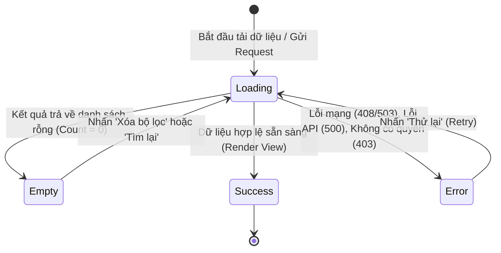

# UX Interaction Engineering & State Machine Architecture

> **Tham chiếu tri thức cốt lõi:**
> - `radix-ui/primitives` (Finite State Machine for Modals, Dropdowns, Tooltips, Toasts)
> - `shopify/polaris` (Form Validation UX, Destructive Confirmations, Contextual Feedback)
> - `google/material-design` (Snackbar Guidelines, Optimistic UI Updates, Gesture Motion)
> - `davidortinau/maui-skills` (Pull-to-Refresh, Infinite Scroll Thresholds, SwipeView Controls)

---

## 1. MÁY TRẠNG THÁI 4 CHIỀU CỐT LÕI (THE 4 ESSENTIAL UI STATES)

Mỗi màn hình danh sách, chi tiết hoặc luồng xử lý dữ liệu **bắt buộc** phải thiết kế đầy đủ 4 trạng thái độc lập trước khi hoàn thiện:

### 1.1. Loading State (Trạng thái Tải dữ liệu)
* ❌ **Cấm:** Chỉ hiển thị 1 icon vòng xoay (Spinner) cô độc ở giữa màn hình trắng xóa.
* ✅ **Chuẩn mực:** Sử dụng **Skeleton Shimmer** (khung xương mô phỏng).
  * Khung skeleton phải có kích thước và bố cục giống $100\%$ với thẻ phòng trọ thật (vùng ảnh, thanh giá tiền, tiêu đề).
  * Giúp giảm tải nhận thức và loại bỏ hiện tượng giật nảy giao diện (Cumulative Layout Shift - CLS) khi dữ liệu đổ về.

### 1.2. Empty State (Trạng thái Rỗng)
Empty state không được là "ngõ cụt" (Dead-end). Phải bao gồm đủ **3 thành phần phục hồi**:
1. **Hình minh họa theo ngữ cảnh (Contextual Illustration):** Icon hoặc hình vẽ thể hiện rõ ý nghĩa (Hộp rỗng cho chưa có phòng yêu thích, Kính lúp cho tìm kiếm không có kết quả).
2. **Tiêu đề & Hướng dẫn súc tích:** *"Không tìm thấy phòng trọ phù hợp"* + *"Hãy thử giảm bớt tiêu chí lọc hoặc mở rộng bán kính tìm kiếm quanh ICTU"*.
3. **Nút hành động phục hồi (Recovery CTA):** Nút *"Xóa bộ lọc"* hoặc *"Khám phá tất cả phòng trọ"*.

### 1.3. Error State (Trạng thái Sự cố)
* Cung cấp thông báo thân thiện bằng tiếng Việt, giải thích lý do cụ thể thay vì mã lỗi kỹ thuật (Cấm hiện: `NullReferenceException` hay `HTTP 500 Internal Error`).
* **Bắt buộc có nút "Thử lại" (Retry Button):** Cho phép người dùng gọi lại hàm API vừa lỗi mà không cần phải thoát màn hình hoặc mở lại ứng dụng.

### 1.4. Success State (Trạng thái Thành công)
* Hiển thị phản hồi tức thì khi thao tác hoàn tất (Icon tích xanh chuyển động nhẹ, Toast thông báo, hoặc Bottom Sheet xác nhận đặt phòng thành công).

---

## 2. TRẢI NGHIỆM BIỂU MẪU & XÁC THỰC (FORM VALIDATION UX)

Trải nghiệm điền form quyết định tỷ lệ hoàn tất đăng tin hoặc liên hệ của người dùng:

### 2.1. Thời điểm kích hoạt Báo lỗi (Validation Timing)
* ❌ **Premature Validation (CẤM):** Không báo lỗi khi người dùng vừa mới gõ 1–2 ký tự đầu tiên (Gây ức chế tâm lý).
* ✅ **On-Blur Validation (Rời khỏi ô):** Kiểm tra tính hợp lệ ngay khi người dùng chuyển tiêu điểm sang ô tiếp theo.
* ✅ **Realtime Error Recovery (Khi đang sửa):** Khi một ô đã bị báo lỗi đỏ, hãy chuyển sang chế độ lắng nghe tức thời (Debounce $300\text{ms}$) để **xóa ngay thông báo lỗi** ngay khi người dùng vừa sửa đúng.

### 2.2. Hỗ trợ Nhập liệu Thông minh (Smart Input Aids)
* **Tự động định dạng tiền tệ:** Khi người dùng nhập giá phòng `2500000`, ô input tự động hiển thị `2.500.000 đ/tháng`.
* **Bàn phím chuyên biệt trên Mobile:**
  * Trường Số điện thoại / Giá tiền: Bật bàn phím số (`Keyboard="Numeric"` / `type="tel"`).
  * Trường Email: Bật bàn phím email có sẵn ký tự `@` và `.com`.
* **Trường mật khẩu:** Luôn có nút hình con mắt (👁️) để bật/tắt hiển thị mật khẩu.

---

## 3. CƠ CHẾ CỬA SỔ NỔI & TẤM PHỦ (MODALS, DRAWERS & DROPDOWNS)

Áp dụng tiêu chuẩn trạng thái từ `radix-ui/primitives`:

### 3.1. Khóa cuộn nền (Scroll-Locking)
* Khi Modal đặt lịch hẹn hoặc Bottom Sheet lọc phòng trọ mở ra: **Trang nền phía sau phải bị khóa cuộn hoàn toàn**. Không để xảy ra hiện tượng người dùng vuốt trên popup nhưng trang web/app bên dưới lại cuộn theo.

### 3.2. Quy tắc Đóng linh hoạt (Dismissal Rules)
Cửa sổ nổi phải cho phép đóng bằng **3 cách độc lập**:
1. Nhấn nút đóng rõ ràng (✕ Close Button) ở góc trên.
2. Nhấn vào lớp nền tối xung quanh (Click/Tap Backdrop Overlay).
3. Bấm phím `Escape` (trên bàn phím) hoặc vuốt thanh gạt xuống (Swipe down on mobile handle bar).

### 3.3. Cảnh báo Mất dữ liệu (Dirty State Protection)
* Nếu người dùng đã nhập dữ liệu vào biểu mẫu đăng phòng mà vô tình bấm ra ngoài để đóng Modal:
  * **Cấm đóng ngay lập tức.**
  * Phải kích hoạt hộp thoại xác nhận: *"Hủy bỏ thay đổi? Dữ liệu bạn vừa nhập sẽ bị mất."* với 2 lựa chọn: *"Tiếp tục chỉnh sửa"* (Primary) và *"Hủy bỏ"* (Destructive).

---

## 4. PHẢN HỒI, THÔNG BÁO & CẬP NHẬT LẠC QUAN (FEEDBACK & OPTIMISTIC UI)

### 4.1. Thông báo Toast / SnackBar
* **Thời lượng tồn tại:** Tự động biến mất sau $3000\text{ms} - 4000\text{ms}$.
* **Vị trí hiển thị:** Cố định ở mép trên (Top-center) hoặc mép dưới (Bottom, nằm ngay trên Bottom Navigation Bar, không được che mất thanh điều hướng).
* **Nút Hoàn tác (Undo Action):** Đối với các hành động xóa tin hoặc bỏ yêu thích, Toast nên đi kèm nút *"Hoàn tác"* trong 5 giây.

### 4.2. Kỹ thuật Cập nhật Lạc quan (Optimistic UI Updates)
* **Kịch bản "Bấm Tim Yêu Thích":**
  1. Người dùng chạm vào icon Trái tim trên thẻ phòng trọ.
  2. UI đổi sang màu đỏ và nhảy số đếm ngay lập tức tại $0\text{ms}$ (Không để người dùng chờ đợi mạng).
  3. Client ngầm gửi Request lên Web API.
  4. Nếu API trả về lỗi (mất mạng/timeout): Lập tức đảo ngược trạng thái trái tim về ban đầu và hiện Toast thông báo: *"Không thể lưu phòng. Vui lòng kiểm tra lại kết nối."*

### 4.3. Xác nhận Hành động Phá hủy (Destructive Action Confirmation)
* Các hành động có tính rủi ro cao (Xóa bài đăng phòng trọ, Hủy hợp đồng, Xóa tài khoản):
  * Tuyệt đối không xóa bằng 1 click đơn lẻ.
  * Phải kích hoạt Modal xác nhận 2 bước với nút bấm màu đỏ nguy hiểm (`action.danger`) đặt tách biệt với nút Hủy bỏ.

---

## 5. CÁC MẪU ĐIỀU HƯỚNG & CỬ CHỈ VUỐT CHẠM (GESTURES & NAVIGATION)

### 5.1. Kéo để Làm mới (Pull-to-Refresh)
* Kéo danh sách phòng trọ xuống từ đỉnh màn hình để gọi hàm làm mới dữ liệu.
* Kèm phản hồi xúc giác nhẹ (Haptic feedback) trên thiết bị di động khi đạt ngưỡng kích hoạt.

### 5.2. Cuộn Vô Tận Liền Mạch (Infinite Scroll Threshold)
* Tuyệt đối không đợi người dùng cuộn kịch đáy mới bắt đầu tải thêm trang tiếp theo.
* Đặt ngưỡng kích hoạt trước **5 phần tử** (`RemainingItemsThreshold="5"`). Khi người dùng cuộn đến phần tử thứ 15 trên 20, hệ thống đã âm thầm tải trang tiếp theo ở chế độ nền.

### 5.3. Bảo toàn Trạng thái Điều hướng (Back-Stack Preservation)
* Khi người dùng cuộn danh sách phòng xuống vị trí thứ 50, bấm vào xem chi tiết phòng, rồi bấm nút "Quay lại" (Back button):
  * **Giao diện bắt buộc phải giữ nguyên vị trí cuộn ở phòng thứ 50.**
  * Cấm hiện tượng tự động nhảy giật ngược lên đỉnh danh sách hoặc tải lại toàn bộ từ đầu khiến người dùng bị mất dấu.

---

## 6. SELF-AUDIT CHECKLIST CHO AGENT KHI TRIỂN KHAI TƯƠNG TÁC

- [ ] **State Coverage:** Màn hình đã có đủ thiết kế cho 4 trạng thái: Loading (Skeleton), Empty (có nút phục hồi), Error (có nút Thử lại), và Success chưa?
- [ ] **Form Validation Timing:** Có bị lỗi báo đỏ ngay từ ký tự đầu tiên không? Đã tự format tiền tệ chưa?
- [ ] **Scroll Lock:** Khi Modal/Sheet mở lên, nền phía sau có bị khóa cuộn $100\%$ không?
- [ ] **Dirty State Guard:** Có cơ chế cảnh báo khi đóng form có dữ liệu chưa lưu không?
- [ ] **Optimistic Interaction:** Nút lưu yêu thích/bookmark có phản hồi đổi màu ngay lập tức tại $0\text{ms}$ không?
- [ ] **Back-Stack Scroll:** Khi bấm Back từ trang chi tiết, vị trí cuộn của danh sách trước đó có được bảo toàn nguyên vẹn không?

