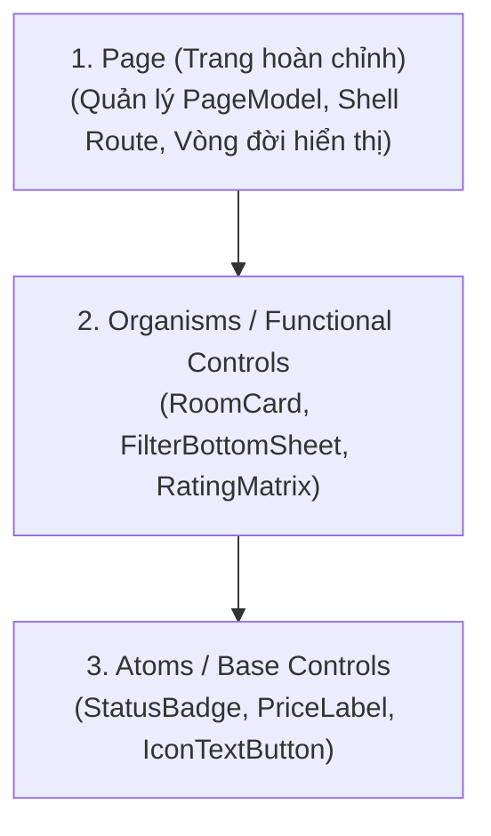

# Frontend UI Implementation & Clean Component Engineering

> **Tham chiếu tri thức cốt lõi:**
> - `shadcn-ui/ui` (Component Composability, Slot/Content Injection & Clean Prop Interfaces)
> - `patrickjs/awesome-cursorrules` (Frontend Separation of Concerns & Clean Code Patterns)
> - **RoomToRentRadar Architecture Rules** (Hexagonal Boundary Isolation & CommunityToolkit.Mvvm)
> - **Microsoft .NET MAUI Compiled Bindings** (`x:DataType` Enforcement & Virtualized Layouts)

---

## 1. NGUYÊN TẮC BẢO TOÀN KIẾN TRÚC (ARCHITECTURAL GUARDRAILS)

Giao diện là tầng thích ứng hiển thị (Presentation Adapter). Agent **BẮT BUỘC** tuân thủ các giới hạn bất di bất dịch:

```
[ View (.xaml) ]  <--- Compiled Binding (x:DataType) --->  [ PageModel ]
                                                                 │
                                                      Injected Input Port
                                                                 ▼
                                                        [ I*UseCase ]
                                                                 │
                                                  (Core Application Logic)
```

### Các điều CẤM TUYỆT ĐỐI (Strict Prohibitions):
* ❌ **CẤM:** Gọi trực tiếp `HttpClient` từ PageModel hoặc code-behind của XAML.
* ❌ **CẤM:** Thực hiện truy vấn SQLite hoặc Cosmos DB từ tầng UI.
* ❌ **CẤM:** Bỏ qua `x:DataType` trong các `DataTemplate` của `CollectionView` / `ListView`.
* ❌ **CẤM:** Viết logic nghiệp vụ (tính toán tiền tệ, xác thực quyền) trong code-behind (`.xaml.cs`). Code-behind chỉ được dùng cho animation giao diện thuần túy nếu XAML không hỗ trợ.

---

## 2. PHÂN RÃ THIẾT KẾ THÀNH COMPONENT (COMPONENT DECOMPOSITION)

Áp dụng mô hình kiến trúc phân cấp component 3 tầng để đảm bảo code gọn gàng, dễ bảo trì:



### 2.1. Cấu trúc Thư mục Chuẩn
* `Pages/`: Chứa các màn hình hoàn chỉnh (`RoomListingPage.xaml`, `RoomDetailsPage.xaml`).
* `Pages/Controls/`: Chứa các component con tái sử dụng (`RoomCardView.xaml`, `ComparisonColumnView.xaml`).
* `PageModels/`: Chứa Presentation Logic kế thừa `CommunityToolkit.Mvvm` (`RoomListingPageModel.cs`).

### 2.2. Khai báo Compiled Binding Bắt buộc
Mọi file XAML phải chỉ rõ kiểu dữ liệu biên dịch tĩnh để tối ưu hiệu năng và bắt lỗi tại thời điểm build:

```xml
<!-- Khai báo x:DataType trên ContentPage -->
<ContentPage xmlns="http://schemas.microsoft.com/dotnet/2021/maui"
             xmlns:x="http://schemas.microsoft.com/winfx/2009/xaml"
             xmlns:vm="clr-namespace:RoomToRentRadar.PageModels"
             x:Class="RoomToRentRadar.Pages.RoomListingPage"
             x:DataType="vm:RoomListingPageModel">
    
    <!-- Khai báo x:DataType trên từng DataTemplate -->
    <CollectionView ItemsSource="{Binding Rooms}">
        <CollectionView.ItemTemplate>
            <DataTemplate x:DataType="contracts:RoomCardDto">
                <controls:RoomCardView Room="{Binding .}" />
            </DataTemplate>
        </CollectionView.ItemTemplate>
    </CollectionView>
</ContentPage>
```

---

## 3. THIẾT KẾ COMPONENT TÁI SỬ DỤNG (REUSABLE COMPONENT DESIGN)

Một component tái sử dụng tốt phải tuân thủ nguyên tắc **Single Responsibility** và sở hữu API giao tiếp trong sáng:

### 3.1. Thuộc tính Ràng buộc (Bindable Properties)
* Truyền dữ liệu vào component qua DTO bất biến (Immutable DTO):

```csharp
public partial class RoomCardView : ContentView
{
    public static readonly BindableProperty RoomProperty =
        BindableProperty.Create(
            nameof(Room),
            typeof(RoomCardDto),
            typeof(RoomCardView),
            default(RoomCardDto));

    public RoomCardDto Room
    {
        get => (RoomCardDto)GetValue(RoomProperty);
        set => SetValue(RoomProperty, value);
    }
}
```

### 3.2. Ủy quyền Sự kiện (Command Delegation)
* Component không tự ý thực hiện hành động lưu hoặc chuyển trang. Component nhận vào `ICommand` từ PageModel cha và kích hoạt:

```xml
<!-- Trong RoomCardView.xaml -->
<Button Text="Chi tiết"
        Command="{Binding Source={RelativeSource AncestorType={x:Type vm:RoomListingPageModel}}, Path=NavigateToDetailsCommand}"
        CommandParameter="{Binding Id}" />
```

---

## 4. QUY CHUẨN ĐỊNH KIỂU & TIÊU THỤ TOKENS (STYLING CONVENTIONS)

1. **Tuyệt đối không Hardcode giá trị:** Mọi thuộc tính màu sắc, font chữ và kích thước phải tiêu thụ trực tiếp từ Resources / Design Tokens của `02. design-system`.

```xml
<!-- SAI: Viết cứng màu sắc và kích thước -->
<Label Text="2.500.000 đ" TextColor="#2563EB" FontSize="18" FontAttributes="Bold" />

<!-- ĐÚNG: Tiêu thụ Semantic Tokens -->
<Label Text="{Binding PriceFormatted}"
       TextColor="{DynamicResource ActionPrimaryBg}"
       Style="{StaticResource TextDisplayBold}" />
```

2. **Quy tắc Đặt tên Nhất quán:**
   * **File View:** Kèm hậu tố `Page` hoặc `View` (`RoomListingPage.xaml`, `AmenitiesGridView.xaml`).
   * **PageModel:** Kèm hậu tố `PageModel` (`RoomListingPageModel.cs`).
   * **Commands:** Bắt đầu bằng động từ hành động + hậu tố `Command` (`LoadMoreRoomsCommand`, `ApplyPriceFilterCommand`).
   * **Booleans:** Bắt đầu bằng tiền tố trạng thái (`IsLoading`, `IsRefreshing`, `HasError`, `CanCompare`).

---

## 5. TÍCH HỢP API QUA INPUT PORTS (CLEAN API INTEGRATION)

PageModel giao tiếp với tầng Core Application hoàn toàn thông qua các interface **Input Port (`I*UseCase`)**:

```csharp
public partial class RoomListingPageModel : ObservableObject
{
    private readonly IGetVerifiedRoomsUseCase _getVerifiedRoomsUseCase;
    private readonly IBookmarkRoomUseCase _bookmarkRoomUseCase;

    [ObservableProperty]
    private ObservableCollection<RoomCardDto> _rooms = new();

    [ObservableProperty]
    private bool _isLoading;

    [ObservableProperty]
    private string _errorMessage = string.Empty;

    public RoomListingPageModel(
        IGetVerifiedRoomsUseCase getVerifiedRoomsUseCase,
        IBookmarkRoomUseCase bookmarkRoomUseCase)
    {
        _getVerifiedRoomsUseCase = getVerifiedRoomsUseCase;
        _bookmarkRoomUseCase = bookmarkRoomUseCase;
    }

    [RelayCommand]
    public async Task LoadRoomsAsync()
    {
        if (IsLoading) return;

        try
        {
            IsLoading = true;
            ErrorMessage = string.Empty;

            var request = new GetRoomsRequest(Page: 1, PageSize: 20);
            var result = await _getVerifiedRoomsUseCase.ExecuteAsync(request);

            Rooms.Clear();
            foreach (var room in result.Items)
            {
                Rooms.Add(room);
            }
        }
        catch (Exception ex)
        {
            ErrorMessage = "Không thể tải danh sách phòng trọ. Vui lòng thử lại.";
        }
        finally
        {
            IsLoading = false;
        }
    }
}
```

---

## 6. QUY TẮC "THE TWO-FILE RULE" & BẢO TOÀN KIẾN TRÚC

Khi triển khai code cho bất kỳ một tính năng UI nào:
1. **The Two-File Rule:** Không thực hiện refactor lan man vượt quá 2 file ngoài phạm vi task được giao (ví dụ: đang làm `RoomCardView.xaml` thì không được tự ý sửa cấu trúc database hoặc cấu hình API controller).
2. **Compile-First Verification:** Mọi tác vụ UI kết thúc phải đạt điều kiện tiên quyết:
   ```powershell
   dotnet build RoomToRentRadar/RoomToRentRadar.csproj
   ```
   Kết quả phải đạt **0 Compilation Errors** và **0 XamlC Binding Warnings**.

---

## 7. SELF-AUDIT CHECKLIST CHO AGENT TRƯỚC KHI BÀN GIAO MÃ NGUỒN UI

- [ ] **Compiled Bindings:** Đã khai báo `x:DataType` đầy đủ ở thẻ gốc `ContentPage` và tất cả `DataTemplate` chưa?
- [ ] **No Direct HTTP/DB:** Đã kiểm tra không có `HttpClient` hay SQLite query nào nằm trong code UI chưa?
- [ ] **Design Tokens In Use:** Có bất kỳ mã màu Hex `#...` hay kích thước viết cứng nào bị lọt lưới trong XAML không?
- [ ] **MVVM Separation:** Logic xử lý dữ liệu và điều hướng có nằm trọn vẹn trong PageModel thay vì code-behind không?
- [ ] **Zero Build Error:** Lệnh `dotnet build` có chạy thành công hoàn toàn không?
- [ ] **Memory Leaks Prevention:** Các event handlers hoặc subscriptions có được giải phóng hợp lý không?

