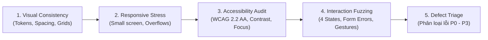

# UI Review & Quality Assurance Auditing

> **Tham chiếu tri thức cốt lõi:**
> - `dequelabs/axe-core` (Automated Accessibility & Contrast Auditing Engine)
> - `GoogleChrome/lighthouse` (Performance, Best Practices & Usability Rubric)
> - `storybookjs/storybook` & `chromatic` (Visual Regression & Component Testing Matrix)
> - **RoomToRentRadar Defect Escalation Standards** (P0–P3 Severity Triage Protocol)

---

## 1. NGUYÊN TẮC CỐT LÕI (THE GATEKEEPER MINDSET)

Agent thực hiện vai trò UI Review đóng vai trò là **người gác cổng chất lượng (Quality Gatekeeper)**. 
* Tuyệt đối không phê duyệt một giao diện chỉ bằng cảm tính: *"Trông có vẻ ổn"*.
* Mọi màn hình trước khi bàn giao bắt buộc phải trải qua ma trận thẩm định 5 giai đoạn:



---

## 2. GIAI ĐOẠN 1: KIỂM ĐỊNH TÍNH ĐỒNG NHẤT THỊ GIÁC (VISUAL CONSISTENCY)

Agent quét toàn bộ mã nguồn XAML / CSS / Component để đối chiếu với `02. design-system`:

1. **Token Adherence (Kiểm tra Viết cứng):**
   * Quét tìm các giá trị màu Hex viết cứng (`#...`), mã màu RGB, hoặc kích thước pixel lẻ tẻ (`13px`, `17px`, `23px`).
   * **Tiêu chí Đạt:** $100\%$ thuộc tính màu sắc, font chữ và khoảng cách phải trỏ về Semantic Tokens (`{DynamicResource ...}` / `{StaticResource ...}`).
2. **Spacing & Alignment Rhythm:**
   * Mọi khoảng đệm `Padding`, `Margin`, `Spacing`, `Gap` có chia hết cho 4 hoặc 8 không?
   * Các khối thông tin có bám sát lề an toàn ($16\text{px}$ trên mobile) không?
3. **Typography Role Check:**
   * Tiêu đề có đúng cấp bậc (`Heading 1` cho Page Title, `Heading 2` cho Section, `Body` cho mô tả) không? Có hiện tượng chữ to chữ nhỏ lộn xộn không?
4. **Dark Mode Parity:**
   * Bật giao diện ở Dark Mode: Các thẻ Card có nổi bật hơn màu nền Canvas không? Có hiện tượng chữ đen chìm nghỉm trên nền tối không?

---

## 3. GIAI ĐOẠN 2: THỬ TẢI THÍCH ỨNG & TRÀN LAYOUT (RESPONSIVE STRESS TEST)

Kiểm tra giao diện tại các điều kiện khắc nghiệt nhất:

### 3.1. Kiểm thử Kích thước Biên (Viewport Edge Cases)
* **Màn hình cực hẹp ($320\text{px} - 360\text{px}$):** Thử nghiệm trên màn hình điện thoại cũ hoặc chế độ màn hình chia đôi (Split-view).
  * Tiêu đề có bị tràn mép màn hình không?
  * Nút bấm có bị bóp méo làm mất chữ không?
* **Màn hình Tablet & Desktop ($768\text{px}$, $1024\text{px}$, $1280\text{px}$):**
  * Giao diện có tự động mở rộng từ 1 cột sang 2–3 cột không?
  * Nội dung có bị kéo dãn vô tận làm xấu giao diện không (Phải có `Max-Width: 1280px` căn giữa)?

### 3.2. Kiểm thử Dữ liệu Dài & Tràn Chữ (Text Overflow & Truncation)
* **Kịch bản Fuzzing:** Giả lập tên phòng trọ dài bất thường (150 ký tự: *"Phòng trọ cao cấp khép kín đầy đủ tiện nghi điều hòa nóng lạnh ban công view hồ sinh thái gần đại học ICTU..."*).
  * **Tiêu chuẩn:** Text dài phải có cơ chế cắt đuôi an toàn (`LineBreakMode="TailTruncation"` hoặc `text-overflow: ellipsis`) kèm giới hạn tối đa 2 dòng. Cấm hiện tượng text đẩy vỡ toàn bộ chiều cao của Card.
* **Kiểm tra Zero Horizontal Scroll:** Toàn bộ trang tuyệt đối không xuất hiện thanh cuộn ngang ngoài ý muốn.

### 3.3. Xung đột Bàn phím Ảo (Keyboard Obstruction Test)
* Mở form đăng tin, focus vào ô nhập liệu ở đáy màn hình:
  * Giao diện có tự động cuộn đẩy ô input lên trên bàn phím ảo không? Nút "Xác nhận" có bấm được khi bàn phím đang mở không?

---

## 4. GIAI ĐOẠN 3: KIỂM ĐỊNH KHẢ NĂNG TIẾP CẬN (ACCESSIBILITY AUDIT)

Dựa trên tiêu chuẩn `dequelabs/axe-core` và WCAG 2.2 AA:

| Hạng mục kiểm tra | Tiêu chí nghiệm thu | Cách thức xác minh |
| :--- | :--- | :--- |
| **Độ tương phản (Contrast)** | Text thường $\ge 4.5:1$<br>Tiêu đề lớn / Icons $\ge 3.0:1$ | Dùng Color Contrast Analyzer đo điểm màu chữ và màu nền |
| **Bàn phím (Keyboard Only)** | $100\%$ phần tử tương tác được bằng phím `Tab`, `Enter`, `Space`, `ESC` | Thử duyệt toàn bộ trang mà không dùng chuột hoặc màn hình cảm ứng |
| **Viền Focus (Focus Ring)** | Viền nhìn thấy rõ ràng trên mọi nút | Kiểm tra viền `2px solid` nổi bật khi tab tới |
| **Icon Buttons** | Tất cả nút icon đều có nhãn đọc | Quét tìm các thuộc tính `aria-label` hoặc `SemanticProperties.Description` |
| **Touch Target Size** | Vùng cảm ứng tối thiểu $\ge 44\text{px} \times 44\text{px}$ | Đo kích thước phần tử tương tác trên thiết bị di động |

---

## 5. GIAI ĐOẠN 4: KIỂM ĐỊNH TƯƠNG TÁC & MÁY TRẠNG THÁI (INTERACTION VERIFICATION)

Kiểm tra sự đầy đủ của các kịch bản tương tác từ `06. ux-interaction`:

1. **Chu trình 4 Trạng thái (4 States Cycle):**
   * *Đang tải:* Có hiện Skeleton Shimmer đúng khung hình không?
   * *Danh sách trống:* Có hiện hình minh họa + Hướng dẫn + Nút *"Xóa bộ lọc"* không?
   * *Mất mạng / Lỗi API:* Có thông báo thân thiện và nút *"Thử lại"* (Retry) hoạt động không?
2. **Hành vi Hộp thoại & Bottom Sheet:**
   * Mở modal: Trang nền bên dưới có bị khóa cuộn hoàn toàn không?
   * Bấm ra ngoài vùng tối (Backdrop) hoặc phím `ESC`: Modal có đóng êm ái không?
   * Form đang điền dở: Có hiển thị hộp thoại cảnh báo mất dữ liệu (Dirty Guard) trước khi đóng không?
3. **Phản hồi Nhanh (Optimistic Updates):**
   * Bấm nút Lưu yêu thích (Heart): Icon có chuyển đỏ ngay lập tức tại $0\text{ms}$ không? Nếu giả lập tắt mạng, trạng thái có tự động rollback và báo lỗi không?

---

## 6. MA TRẬN PHÂN LOẠI LỖI & MỨC ĐỘ ƯU TIÊN (DEFECT SEVERITY TRIAGE)

Mọi khiếm khuyết phát hiện trong quá trình review phải được gán nhãn ưu tiên chính xác:

```
[ P0: Blocker ]       --> Chặn phát hành ngay lập tức. Phải sửa trong ngày.
[ P1: Critical/High ] --> Lỗi ảnh hưởng nặng tới UX và tính năng chính. Sửa trước khi bàn giao.
[ P2: Medium ]        --> Lỗi trải nghiệm, thiếu sót a11y thứ cấp hoặc vi phạm spacing nhẹ.
[ P3: Cosmetic/Low ]  --> Sai lệch nhỏ về thẩm mỹ, micro-animation chưa tối ưu.
```

### Tiêu chí chi tiết từng cấp độ:
* **P0 — Blocker (Nguy cấp):**
  * Ứng dụng bị Crash hoặc đứng hình (Freeze).
  * Nút Primary CTA chính (ví dụ: "Đặt lịch xem phòng", "Gửi tin") bị vô hiệu hóa hoặc không thể bấm được.
  * Lỗi tràn layout che mất $100\%$ nội dung màn hình; người dùng bị kẹt trong modal không có cách nào thoát ra.
* **P1 — Critical / High (Nghiêm trọng):**
  * Layout bị vỡ vụn hoặc xuất hiện thanh cuộn ngang trên màn hình chuẩn điện thoại ($360\text{px} - 390\text{px}$).
  * Bàn phím ảo che mất nút "Lưu / Đăng tin" khiến người dùng không hoàn tất được biểu mẫu.
  * Độ tương phản màu sắc vi phạm nghiêm trọng ($< 3.0:1$), không thể đọc được giá tiền hoặc địa chỉ.
  * Mất mạng hoặc API lỗi nhưng màn hình xoay vô tận, không có thông báo lỗi hay nút Thử lại.
* **P2 — Medium (Trung bình):**
  * Khoảng cách Spacing bị lệch 4–8px so với 8pt grid; bố cục không thẳng hàng.
  * Icon button thiếu `aria-label` hoặc `SemanticProperties.Description` cho người khiếm thị.
  * Modal thiếu hỗ trợ phím `ESC` để đóng nhanh.
  * Sử dụng vòng xoay spinner thay vì Skeleton Shimmer.
* **P3 — Low / Cosmetic (Nhẹ):**
  * Bo góc bị lệch nhẹ giữa các thẻ (ví dụ thẻ 8px, thẻ 12px).
  * Thời lượng hiệu ứng chuyển động hơi nhanh ($100\text{ms}$ thay vì $250\text{ms}$).
  * Câu chữ mô tả trống (Empty state message) chưa được chau chuốt mượt mà.

---

## 7. MẪU BÁO CÁO KHIẾM KHUYẾT UI CHUẨN MỰC (UI DEFECT REPORT)

Khi phát hiện lỗi trong quá trình review, Agent xuất bản báo cáo theo định dạng cấu trúc sau:

```markdown
### 🚨 UI Defect Report: [Tên Màn Hình / Component]

- **Mức độ ưu tiên:** [P0 / P1 / P2 / P3]
- **Nhóm kiểm định:** [Visual Consistency | Responsive | Accessibility | Interaction]
- **Mô tả sự cố:** [Mô tả chi tiết hiện tượng lỗi phát sinh]
- **Thiết bị / Viewport phát hiện:** [Ví dụ: iPhone 14 (390px), Dark Mode]
- **Hành vi thực tế (Actual):** [Hình ảnh/Mã nguồn/Nội dung đang bị lỗi]
- **Kỳ vọng chuẩn mực (Expected):** [Tuân theo tiêu chuẩn nào trong Design System/WCAG]
- **Hành động khắc phục khuyến nghị:** [Chỉ rõ thuộc tính XAML hoặc Token cần sửa]
```

---

## 8. DEFINITION OF DONE (DoD) CHO MỖI MÀN HÌNH UI

Một màn hình UI chỉ được coi là **HOÀN TẤT VÀ SẴN SÀNG PHÁT HÀNH** khi thỏa mãn:
1. **0 Lỗi P0 và 0 Lỗi P1.**
2. $\le 2$ Lỗi P2 (đã được ghi nhận vào backlog cải tiến).
3. `dotnet build` đạt 0 lỗi biên dịch và 0 cảnh báo binding (`XamlC`).
4. Vượt qua toàn bộ checklist tự kiểm duyệt tại 4 giai đoạn trên.

