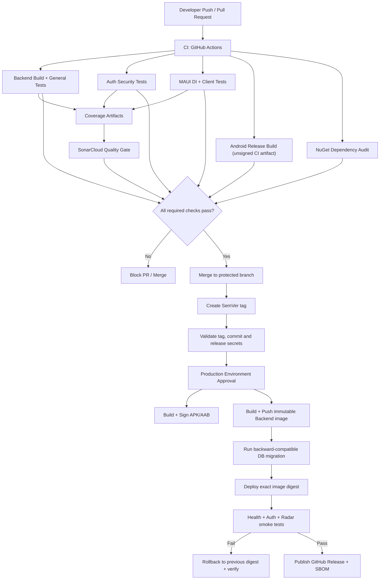

# RoomToRentRadar — Full-Stack CI/CD Technical Specification

> **Phiên bản tài liệu:** 2.0  
> **Ngày cập nhật:** 11/11/2026  
> **Phạm vi:** Backend API (.NET 10), ứng dụng Android (.NET MAUI), GitHub Actions, kiểm thử, bảo mật, phát hành và phục hồi  
> **Trạng thái:** Technical specification — cần xác minh các đường dẫn project và hạ tầng triển khai trước khi bật Production CD.

---

## 0. Mục tiêu, phạm vi và nguyên tắc

Tài liệu này định nghĩa cách xây dựng CI/CD cho RoomToRentRadar. Mục tiêu là tạo pipeline có thể phát hiện lỗi thật, không cho phép test bị bỏ qua âm thầm, không phát hành artifact thiếu hoặc chưa được xác minh, và không báo triển khai thành công khi backend chưa thực sự được cập nhật.

### 0.1. Phạm vi

| Thành phần | Phạm vi kiểm soát |
|---|---|
| Backend API (.NET 10) | Restore, build, unit/integration tests, Auth Security tests, coverage, dependency audit, container image, database migration |
| Mobile (.NET MAUI Android) | DI validation, ViewModel/service tests, SQLite tests, Android Release build, AOT/ILLink analysis, ký APK/AAB |
| Supply chain | GitHub Actions pin SHA, NuGet audit, CodeQL, SBOM, secret scanning |
| Release | SemVer validation, approval, immutable image, deployment, health check, smoke test |
| Recovery | Backend rollback, database compatibility, mobile roll-forward, release failure handling |

### 0.2. Nguyên tắc bắt buộc

1. **Fail closed:** thiếu secret, URL, artifact, test result, deploy command hoặc health endpoint phải làm pipeline thất bại; không được bỏ qua và trả Pass.
2. **Không đồng nhất Build với Deploy:** build image thành công không có nghĩa production đã được cập nhật.
3. **Không đồng nhất Artifact với Release:** APK tạo trong CI không mặc nhiên là APK Production đã ký.
4. **Không có Zero-Test Pass:** mỗi test suite bắt buộc phải chứng minh có test thực sự được thực thi.
5. **Immutable release:** deploy và rollback phải tham chiếu image digest, không chỉ dựa vào tag có thể bị ghi đè.
6. **Least privilege:** mỗi job chỉ nhận quyền GitHub và secrets cần thiết.
7. **Một nguồn cấu hình:** mỗi quality gate chỉ có một workflow chịu trách nhiệm để tránh status check trùng lặp hoặc mâu thuẫn.
8. **Không giả định hạ tầng:** deployment provider, registry, Dockerfile, migration project và endpoint phải được xác nhận từ repository/hạ tầng thực tế trước khi bật CD.

### 0.3. Các thông tin cần xác minh trong repository

Các giá trị dưới đây được kế thừa từ tài liệu đầu vào, không được xem là đã xác minh chỉ vì xuất hiện trong ví dụ:

| Giá trị | Giá trị tham chiếu | Việc cần xác minh |
|---|---|---|
| Backend test project | `src/RoomToRentRadar.Backend.Tests/RoomToRentRadar.Backend.Tests.csproj` | File có tồn tại và đúng tên không |
| MAUI app project | `src/RoomToRentRadar/RoomToRentRadar.csproj` | File có tồn tại và target framework chính xác không |
| MAUI client test project | `src/RoomToRentRadar.Client.Tests/RoomToRentRadar.Client.Tests.csproj` | Test project có target `net10.0` không |
| Solution | `RoomToRentRadar.sln` | Đường dẫn và tên chính xác |
| Android ApplicationId | `com.companyname.roomtorentradar` | Đối chiếu `ApplicationId` trong `.csproj` |
| Backend Dockerfile | Chưa xác định | Phải xác định Docker build context và Dockerfile |
| EF migration project | Chưa xác định | Xác định project chứa `DbContext` và migrations |
| Production deployment provider | Chưa xác định | Xác định Kubernetes, App Service, VM, container platform hoặc provider khác |
| Production API URL | GitHub Environment variable `PRODUCTION_API_URL` | Phải là URL HTTPS thực tế |

Nếu một đường dẫn hoặc giá trị khác với repository, phải cập nhật toàn bộ tài liệu và workflow trước khi triển khai.

---

## 1. Kiến trúc tổng thể



### 1.1. Các workflow được đề xuất

Để tránh SonarCloud được chạy hai lần hoặc status check không đồng nhất, sử dụng một workflow duy nhất cho từng trách nhiệm:

| File | Trách nhiệm | Trigger | Kết quả bắt buộc |
|---|---|---|---|
| `.github/workflows/ci.yml` | Backend tests, Auth tests, MAUI tests, Android CI build, dependency audit, coverage và SonarCloud | Push/PR theo branch policy; manual | Tất cả job bắt buộc Pass |
| `.github/workflows/codeql.yml` | CodeQL SAST | PR/push trên branch bảo vệ; schedule | CodeQL analysis hoàn tất, không có alert vượt policy |
| `.github/workflows/release.yml` | Validate tag, approval, ký mobile, build/push image, migration, deploy, smoke test, rollback, GitHub Release | Tag `v*` và manual có kiểm soát | Chỉ tạo GitHub Release khi toàn bộ release gate Pass |
| `.github/dependabot.yml` | Cập nhật NuGet và GitHub Actions | Weekly | PR cập nhật dependency |
| Secret scanning | GitHub Secret Scanning / Push Protection hoặc công cụ tương đương | Repository setting | Chặn secret bị commit |

**Quyết định thiết kế:** SonarCloud được đặt trong `ci.yml`. Không tạo thêm `sonarcloud.yml` chạy cùng chức năng. Nếu repository đã có workflow Sonar riêng, cần chọn một trong hai và xóa cấu hình trùng lặp.

---

## 2. CI — Backend Tests và Auth Security Gate

### 2.1. Tách test suite

Backend test được chia thành hai nhóm logic độc lập:

- `General`: unit test và integration test thông thường.
- `AuthSecurity`: refresh-token rotation, token reuse, concurrency, authentication timing và các kiểm thử bảo mật xác thực khác.

Không chỉ kiểm tra tổng số test của toàn project. Nếu nhóm AuthSecurity chạy bằng 0 test thì CI phải thất bại dù General Tests đã Pass.

Ví dụ filter xUnit:

```bash
dotnet test "$BACKEND_TEST_CSPROJ" \
  --configuration Release \
  --filter "Category!=AuthSecurity" \
  --logger "trx;LogFileName=backend-general.trx"

dotnet test "$BACKEND_TEST_CSPROJ" \
  --configuration Release \
  --filter "Category=AuthSecurity" \
  --logger "trx;LogFileName=backend-auth.trx"
```

> Trước khi dùng filter trên, xác nhận test project đang dùng xUnit Trait với đúng tên trait `Category`. Nếu project dùng NUnit Category hoặc MSTest TestCategory, cú pháp filter phải được điều chỉnh tương ứng.

### 2.2. Zero-Test Guard

Mỗi lần chạy phải ghi TRX vào một thư mục riêng để tránh ghi đè kết quả:

```bash
mkdir -p TestResults/Backend/General TestResults/Backend/Auth

dotnet test "$BACKEND_TEST_CSPROJ" \
  -c Release \
  --filter "Category!=AuthSecurity" \
  --logger "trx;LogFileName=backend-general.trx" \
  --results-directory TestResults/Backend/General

dotnet test "$BACKEND_TEST_CSPROJ" \
  -c Release \
  --filter "Category=AuthSecurity" \
  --logger "trx;LogFileName=backend-auth.trx" \
  --results-directory TestResults/Backend/Auth
```

Kiểm tra số test thực thi bằng parser XML. Không dùng `head -n 1` để lấy ngẫu nhiên một file TRX nếu test có thể sinh nhiều file:

```bash
set -euo pipefail

for trx in \
  TestResults/Backend/General/backend-general.trx \
  TestResults/Backend/Auth/backend-auth.trx
do
  if [ ! -s "$trx" ]; then
    echo "::error::Missing or empty TRX file: $trx"
    exit 1
  fi
done

GENERAL_EXEC=$(xmllint --xpath \
  "string(//*[local-name()='Counters']/@executed)" \
  TestResults/Backend/General/backend-general.trx)

AUTH_EXEC=$(xmllint --xpath \
  "string(//*[local-name()='Counters']/@executed)" \
  TestResults/Backend/Auth/backend-auth.trx)

if ! [[ "$GENERAL_EXEC" =~ ^[0-9]+$ ]] || [ "$GENERAL_EXEC" -lt 1 ]; then
  echo "::error::General test suite executed zero tests."
  exit 1
fi

if ! [[ "$AUTH_EXEC" =~ ^[0-9]+$ ]] || [ "$AUTH_EXEC" -lt 1 ]; then
  echo "::error::AuthSecurity test suite executed zero tests."
  exit 1
fi
```

Mức tối thiểu `>= 1` chỉ chứng minh suite không rỗng. Số lượng test bảo mật mong đợi nên được quản lý bằng test inventory hoặc acceptance criteria; không cố định `>= 2` nếu chưa có căn cứ từ số test thực tế.

### 2.3. Database integration tests

- Dùng PostgreSQL service container có phiên bản được pin rõ ràng.
- Connection string chỉ truyền qua environment variable/secret, không ghi vào log.
- Có health check cho service container và retry kết nối có giới hạn.
- Integration test phải chạy migration trên database test sạch.
- Không dùng database Production hoặc dữ liệu Production trong CI.
- Test phải dọn dữ liệu và không phụ thuộc thứ tự chạy.

Ví dụ cấu hình biến môi trường:

```yaml
env:
  ConnectionStrings__DefaultConnection: ${{ secrets.CI_TEST_DATABASE_CONNECTION }}
```

Với PostgreSQL service container trong GitHub Actions, có thể dùng database/user/password dành riêng cho CI. Không tái sử dụng secret Production.

---

## 3. Auth Security — Refresh Token Rotation

### 3.1. Yêu cầu bảo mật

1. Chỉ lưu hash của refresh token trong database; raw token chỉ trả về client tại thời điểm phát hành.
2. Token phải có entropy đủ mạnh, sinh bằng cryptographic random generator.
3. Token rotation phải thực hiện trong transaction.
4. Chỉ một request được phép tiêu thụ một refresh token.
5. Token hết hạn, token không tồn tại và token đã bị thu hồi đều không được cấp access token mới.
6. Có cơ chế phát hiện reuse token đã bị thu hồi.
7. Token family phải được quản lý bằng `FamilyId` hoặc định danh tương đương.
8. Ghi nhận thời điểm, IP và nguyên nhân revoke theo chính sách bảo mật; không log raw token.

### 3.2. Cảnh báo về race condition và token reuse

Không được mặc định rằng mọi request thua cuộc trong cuộc đua đồng thời đều là tấn công. Hai request refresh hợp lệ có thể được gửi gần như đồng thời do retry của client, mạng chậm hoặc nhiều request tab/device.

Nếu hệ thống lập tức revoke toàn bộ token family mỗi khi request thứ hai thấy token đã bị revoke, có thể gây logout ngoài ý muốn. Ngược lại, bỏ qua mọi reuse sẽ làm suy yếu khả năng phát hiện token bị đánh cắp.

**Thiết kế cần chốt trước khi code:**

- Có hỗ trợ idempotency key cho refresh request hay không.
- Có khoảng thời gian grace ngắn để nhận diện retry hợp lệ hay không.
- Cách xử lý hai request có cùng refresh token và cùng idempotency key.
- Cách xử lý reuse token từ request khác, khác idempotency key hoặc ngoài grace window.
- Cách bảo đảm response của request retry không tạo ra một token mới khác với token đã được phát hành.

### 3.3. Transaction và cập nhật nguyên tử

Có thể dùng conditional update để đảm bảo chỉ một request chuyển token từ trạng thái active sang revoked:

```sql
UPDATE RefreshTokens
SET RevokedAt = @Now,
    RevokedByIp = @Ip,
    ReplacedByTokenHash = @NewTokenHash
WHERE TokenHash = @IncomingTokenHash
  AND RevokedAt IS NULL
  AND ExpiresAt > @Now;
```

Sau đó kiểm tra `rowsAffected` trong cùng transaction:

- `1`: request đã tiêu thụ token; chèn replacement token trong cùng transaction.
- `0`: không được tạo replacement token. Phân loại token không tồn tại, hết hạn, đã revoke hoặc request retry hợp lệ theo chính sách idempotency đã chốt.
- Bất kỳ lỗi nào trước commit: rollback toàn bộ transaction.

**Lưu ý quan trọng về EF Core ExecutionStrategy:** khi bật retry strategy, transaction thủ công phải nằm trong delegate của `ExecutionStrategy`. Tuy nhiên, không được xem việc bọc transaction trong `ExecuteAsync` là đủ để xử lý commit ambiguity. Nếu kết nối đứt sau khi database commit nhưng trước khi client nhận response, retry có thể chạy lại logic. Cần idempotency/persisted operation result để tránh phát hành token khác hoặc revoke nhầm token family.

Không dùng đoạn code mẫu đơn giản để tự động revoke toàn bộ family chỉ vì `rowsAffected == 0`. Phần xử lý này phụ thuộc chính sách concurrency/reuse ở mục 3.2 và cần test integration với database thật.

### 3.4. Timing attack

- So sánh hash/token ở nơi cần thiết bằng `CryptographicOperations.FixedTimeEquals`.
- Với login, phản hồi lỗi cho email không tồn tại và password sai nên có hành vi thời gian tương đương ở mức hợp lý.
- Dummy password hash phải được tạo bằng cùng thuật toán/cấu hình chi phí như hash thực tế.
- Không tuyên bố có thể triệt tiêu hoàn toàn timing side-channel chỉ bằng một lần gọi BCrypt.
- Không ghi password, raw token, JWT hoặc secret vào log.

### 3.5. Test bắt buộc

| Test | Kỳ vọng |
|---|---|
| Refresh token hợp lệ | Chỉ phát hành một replacement token |
| Token hết hạn | 401; không tạo token mới |
| Token không tồn tại | 401; không tạo token mới |
| Hai request đồng thời cùng token | Kết quả đúng theo idempotency/concurrency policy; không tạo hai nhánh token |
| Retry cùng idempotency key | Trả kết quả nhất quán, không tạo token mới ngoài ý muốn |
| Reuse token đã revoke ngoài grace window | Revoke family theo policy và ghi audit event |
| Lỗi trước commit | Không có thay đổi dở dang |
| Commit thành công nhưng response lỗi | Retry không tạo trạng thái token bất nhất |
| Hash comparison | Dùng API constant-time thích hợp |

---

## 4. CI — MAUI DI, Client Tests và SQLite

### 4.1. DI validation

`ValidateOnBuild = true` và `ValidateScopes = true` hữu ích nhưng không tự động chứng minh mọi Page/ViewModel đều được đăng ký hoặc có thể khởi tạo trong runtime MAUI.

Tách kiểm thử thành hai tầng:

1. **Core DI tests chạy trên Linux:** kiểm tra registration của service, repository, ViewModel và các dependency không phụ thuộc UI platform.
2. **Platform/UI smoke tests:** khởi tạo Page/Shell và các thành phần cần Android runtime trên emulator hoặc thiết bị phù hợp.

Ví dụ test DI core phải là `async Task` nếu sử dụng `await using`:

```csharp
[Fact]
public async Task Core_services_should_resolve()
{
    var services = new ServiceCollection();

    MauiProgram.RegisterCoreServices(services);
    MauiProgram.RegisterViewModels(services);

    await using var provider = services.BuildServiceProvider(
        new ServiceProviderOptions
        {
            ValidateScopes = true,
            ValidateOnBuild = true
        });

    using var scope = provider.CreateScope();

    var viewModel = scope.ServiceProvider
        .GetRequiredService<ExampleViewModel>();

    Assert.NotNull(viewModel);
}
```

Đây là ví dụ cấu trúc. Thay `ExampleViewModel` và registration bằng type thực tế. Không quét và khởi tạo mọi `Page` trên Ubuntu nếu Page phụ thuộc `Application`, Handler, Dispatcher hoặc platform service chưa được khởi tạo.

### 4.2. SQLite concurrency tests

SQLite WAL cho phép reader và writer hoạt động đồng thời trong nhiều tình huống, nhưng SQLite vẫn chỉ có một writer tại một thời điểm.

Test phải sử dụng file database thật, không chỉ `:memory:`:

- Mỗi worker dùng connection riêng nếu mục tiêu là mô phỏng nhiều connection.
- Bật WAL và `busy_timeout` trên từng connection theo cách thư viện SQLite đang dùng hỗ trợ.
- Kiểm soát số writer đồng thời; không giả định 20 writer sẽ ghi song song không giới hạn.
- Có retry/backoff giới hạn cho `SQLITE_BUSY` nếu ứng dụng thiết kế như vậy.
- Kiểm tra số record, tính duy nhất, foreign key và tính toàn vẹn sau stress test.
- Xóa file database, `-wal` và `-shm` sau khi test hoàn tất.

Ví dụ cấu hình SQL (áp dụng trên từng connection khi phù hợp):

```sql
PRAGMA journal_mode=WAL;
PRAGMA busy_timeout=5000;
PRAGMA foreign_keys=ON;
```

Không xem `WAL` là giải pháp thay thế transaction hoặc cơ chế serialize writer.

### 4.3. Zero-Test Guard cho MAUI tests

- Xuất TRX vào thư mục riêng.
- Fail nếu không có TRX.
- Fail nếu `executed = 0`.
- Upload TRX/coverage bằng `if: always()` để giữ lại bằng chứng khi test fail.
- Không dùng `if: always()` cho các job phát hành hoặc deploy để vô tình chạy tiếp sau lỗi.

---

## 5. Android Build, AOT/Trimming và Artifact

### 5.1. Phân biệt CI artifact và Production artifact

| Artifact | Mục đích | Ký số |
|---|---|---|
| CI APK | Kiểm tra build, có thể cài trên môi trường test | Không dùng Production keystore |
| Release APK | Phát hành hoặc phân phối nội bộ | Bắt buộc Production signing |
| Release AAB | Google Play | Bắt buộc signing theo quy trình phát hành |

Không đặt tên CI artifact là `Signed.apk` nếu workflow không cấu hình rõ ràng signing key. Không xác minh chữ ký Production trên artifact CI.

### 5.2. Android build gate

- Setup Java 21 và .NET SDK version đã thống nhất.
- Cài workload `maui-android`.
- Build đúng target framework trong `.csproj`.
- Bật các analyzer phù hợp với SDK/MAUI workload đang sử dụng.
- Treat các cảnh báo trimming/AOT quan trọng thành error sau khi xác nhận mã cảnh báo được SDK hiện tại hỗ trợ.
- Không mặc định mọi thuộc tính MSBuild được đề xuất trên mạng đều hợp lệ với SDK đang dùng; xác minh bằng build thử và diagnostic output.

Ví dụ cấu hình cần đánh giá trong `.csproj`:

```xml
<PropertyGroup Condition="'$(Configuration)' == 'Release'">
  <PublishTrimmed>true</PublishTrimmed>
  <TrimMode>partial</TrimMode>
</PropertyGroup>
```

Chỉ thêm `RunAOTCompilation`, `AndroidEnableProfiledAot`, `EnableTrimAnalyzer`, `EnableAotAnalyzer` và danh sách `WarningsAsErrors` sau khi xác nhận chúng được SDK/MAUI workload hiện tại hỗ trợ và không làm sai cấu hình build.

### 5.3. Kiểm tra artifact

- Không hardcode giả định rằng mọi phiên bản SDK luôn xuất cùng một path.
- Xác định output path từ build log hoặc cấu hình project.
- Kiểm tra file tồn tại và không rỗng.
- Dùng `if-no-files-found: error` khi upload artifact.
- Với Production APK: kiểm tra chữ ký bằng `apksigner verify`.
- Với AAB: kiểm tra bằng `jarsigner -verify` hoặc công cụ Android phù hợp.
- Không dùng ngưỡng dung lượng tùy ý như `> 5MB` làm bằng chứng duy nhất cho APK hợp lệ. Có thể dùng ngưỡng cảnh báo nếu dự án có baseline rõ ràng.

Ví dụ kiểm tra file CI APK:

```bash
set -euo pipefail

APK="$(find ./src/RoomToRentRadar/bin/Release \
  -type f -name '*.apk' -print -quit)"

if [ -z "$APK" ] || [ ! -s "$APK" ]; then
  echo "::error::Android APK was not produced."
  exit 1
fi

echo "CI APK: $APK"
```

Đường dẫn và tên project ở ví dụ phải được xác minh theo repository thực tế.

---

## 6. Coverage và SonarCloud

### 6.1. Định dạng coverage

`dotnet test --collect:"XPlat Code Coverage"` thường tạo Cobertura nếu không cấu hình formatter khác. Với SonarCloud C#, cấu hình báo cáo OpenCover tương ứng và xác nhận file thực sự được tạo.

Ví dụ với Coverlet collector:

```bash
dotnet test "$TEST_PROJECT" \
  -c Release \
  --collect:"XPlat Code Coverage" \
  -- DataCollectionRunSettings.DataCollectors.DataCollector.Configuration.Format=opencover
```

### 6.2. Truyền coverage giữa các job

Job chạy test phải upload coverage artifact kể cả khi test thất bại (`if: always()`). Sonar job phải:

1. Chờ các job test hoàn tất thành công.
2. Download đúng artifacts của cùng workflow run.
3. Kiểm tra có file OpenCover.
4. Kiểm tra file XML parse được.
5. Gửi đúng report path cho SonarScanner.
6. Chờ Quality Gate và fail nếu SonarCloud không trả Pass.

Không chỉ cộng `visitedSequencePoints > 0` từ tất cả report rồi kết luận coverage đầy đủ. Cần xác nhận report của từng module bắt buộc có mặt (Backend và MAUI Client), đồng thời thiết lập coverage threshold/Quality Gate trên SonarCloud.

### 6.3. SonarCloud job dependencies

Sonar job cần khai báo dependency đúng với tất cả job tạo report. Ví dụ:

```yaml
sonarcloud-quality-gate:
  needs:
    - backend-tests
    - maui-client-tests
    - dependency-security-scan
```

Nếu policy yêu cầu Android build cũng phải Pass trước khi quality gate kết thúc, thêm `build-android-apk` vào `needs`. Không ghi trong sơ đồ rằng Sonar phụ thuộc Android build nếu YAML không thể hiện điều đó.

**Khuyến nghị:** giữ một job tên ổn định `SonarCloud Quality Gate` trong `ci.yml`; không đồng thời tạo job trùng trong `sonarcloud.yml`.

---

## 7. Dependency, SAST, Secret Scanning và SBOM

### 7.1. NuGet audit

- Bật NuGet Audit trong restore.
- Audit cả direct và transitive dependencies.
- Xác định severity policy. Đề xuất chặn Moderate/High/Critical; ngoại lệ phải có owner, lý do và thời hạn.
- Không chỉ grep một câu tiếng Anh từ output CLI để quyết định có CVE; output có thể thay đổi theo SDK/version.
- Lưu log audit như CI artifact nếu cần phục vụ điều tra.

### 7.2. CodeQL

- Scan C# backend và MAUI.
- Chạy trên PR vào branch bảo vệ, push branch chính và schedule.
- Dùng `permissions` tối thiểu phù hợp với CodeQL workflow.
- Không cho phép PR từ fork truy cập secrets không cần thiết.
- Branch protection phải yêu cầu đúng status check được GitHub hiển thị thực tế.

### 7.3. Secret scanning

Bật GitHub Secret Scanning và Push Protection nếu repository/plan hỗ trợ. Nếu không, tích hợp secret scanner phù hợp vào CI. Khi phát hiện secret:

1. Chặn merge.
2. Rotate/revoke secret ngay lập tức.
3. Xác định phạm vi truy cập.
4. Xóa secret khỏi lịch sử Git nếu cần, nhưng không xem việc rewrite history là thay thế cho rotate secret.

### 7.4. SBOM

SBOM được nhắc trong Release asset chỉ khi pipeline thực sự tạo ra và upload file đó.

Yêu cầu tối thiểu:

- Sinh SBOM cho backend container và/hoặc package tương ứng.
- Ghi rõ format (CycloneDX hoặc SPDX) và tool/version được pin.
- Gắn SBOM với đúng release version và image digest.
- Upload SBOM như GitHub Release asset.
- Nếu SBOM chưa được triển khai, không ghi trong sơ đồ rằng Release đã đính kèm SBOM.

---

## 8. CD — Release và Production Deployment

### 8.1. SemVer tag

GitHub Actions `on.push.tags` sử dụng glob pattern, không phải regex. Pattern như:

```yaml
on:
  push:
    tags:
      - 'v[0-9]+.[0-9]+.[0-9]+*'
```

không phải regex SemVer đáng tin cậy.

Dùng glob rộng và xác thực SemVer trong script:

```yaml
on:
  push:
    tags:
      - 'v*'
```

Sau đó kiểm tra chặt chẽ bằng shell:

```bash
set -euo pipefail

TAG="${RELEASE_TAG:?RELEASE_TAG is required}"

if [[ ! "$TAG" =~ ^v(0|[1-9][0-9]*)\.(0|[1-9][0-9]*)\.(0|[1-9][0-9]*)(-[0-9A-Za-z.-]+)?(\+[0-9A-Za-z.-]+)?$ ]]; then
  echo "::error::Invalid SemVer tag: $TAG"
  exit 1
fi
```

Với `workflow_dispatch`, truyền input qua `env`, không nội suy trực tiếp user input vào shell script:

```yaml
- name: Validate release tag
  env:
    RELEASE_TAG: ${{ inputs.tag || github.ref_name }}
  run: |
    set -euo pipefail
    # Validate "$RELEASE_TAG" here.
```

Ngoài format, cần xác minh tag tồn tại, trỏ tới commit được phép phát hành và không phải tag đã bị dùng cho release khác.

### 8.2. Production approval

Tạo GitHub Environments riêng nếu cần phân quyền độc lập:

- `production-mobile`
- `production-backend`

Cấu hình:
- Required reviewers.
- Deployment branches/tags giới hạn theo release policy.
- Secrets chỉ đặt ở environment tương ứng.
- Không cấp Production signing key cho job CI thông thường.

Approval phải xảy ra trước khi job truy cập secret Production hoặc thay đổi hạ tầng.

### 8.3. Backend image build và push

Đây là công việc bắt buộc của CD, không thể thay bằng một log `echo` hoặc webhook tùy chọn.

Pipeline phải thực hiện đầy đủ:

1. Xác định Dockerfile và build context đúng.
2. Build container từ commit đã được xác thực.
3. Gắn tag release để dễ tra cứu.
4. Push lên container registry.
5. Lấy image digest từ registry.
6. Lưu digest làm output/artifact của release.
7. Deploy bằng digest, không deploy bằng tag mutable.

Ví dụ lệnh build/push minh họa (cần cấu hình registry và Dockerfile thực tế):

```bash
docker build \
  --file "$BACKEND_DOCKERFILE" \
  --tag "$IMAGE_TAG" \
  "$BACKEND_BUILD_CONTEXT"

docker push "$IMAGE_TAG"
```

Sau push, phải truy vấn registry để lấy digest và kiểm tra image tồn tại. Không giả định `IMAGE_TAG` tự động là immutable.

### 8.4. EF Core migration

- Xác định migration assembly và startup project thật.
- Tạo migration bundle trong build/release process đã kiểm soát.
- Backup/restore strategy phải phù hợp với database provider.
- Chỉ chạy migration sau approval và trước khi deploy code phụ thuộc schema mới.
- Ưu tiên **Expand-and-Contract**: thêm schema tương thích trước, deploy code mới, migrate dữ liệu, rồi mới xóa schema cũ ở một release sau.
- Không tự động chạy migration downgrade khi rollback app nếu chưa có migration downgrade được thiết kế và kiểm chứng.
- Migration phải có log, timeout, quyền DB tối thiểu và cơ chế ngăn hai release chạy migration đồng thời.

### 8.5. Deployment adapter — điều kiện chưa thể tự suy đoán

Tài liệu đầu vào chưa xác định production provider. Vì vậy, chưa thể viết một lệnh deploy production thực thi được mà không biết môi trường đích.

Trước khi bật job deploy, cần cung cấp và xác minh:

- Provider/cluster/host đích.
- Cơ chế authentication.
- Lệnh hoặc API deploy chính thức.
- Cách lấy active image digest hiện tại.
- Cách cập nhật service về image digest mới.
- Cách xác nhận deployment rollout hoàn tất.
- Cách rollback và kiểm tra lại phiên bản cũ.

**Fail-closed:** nếu thiếu deployment configuration hoặc deploy adapter, release phải dừng trước khi tuyên bố thành công. Không dùng webhook optional mà khi rỗng vẫn cho job Pass.

### 8.6. Smoke tests bắt buộc

Không được bỏ qua smoke test khi `PRODUCTION_API_URL` rỗng.

Các bước tối thiểu:

1. Kiểm tra `PRODUCTION_API_URL` tồn tại và là HTTPS URL hợp lệ.
2. Poll `/health/live` và `/health/ready` với timeout tổng có giới hạn.
3. Kiểm tra version endpoint hoặc deployment metadata khớp image digest/version vừa deploy.
4. Chạy Auth smoke test với tài khoản/credential chuyên dụng có quyền tối thiểu, nếu API hỗ trợ flow này.
5. Chạy Radar endpoint với input test ổn định.
6. Kiểm tra status code và response contract cần thiết; không chỉ kiểm tra server trả về 200 nếu body sai.
7. Không ghi credential/token vào log.

Nếu API chưa có endpoint Auth/Radar phù hợp cho smoke test, cần tạo test contract hoặc test endpoint an toàn trước khi bật release gate.

---

## 9. Rollback và phục hồi

### 9.1. Backend rollback

Rollback phải dùng **previous image digest** đã ghi nhận trước deployment, không dùng chuỗi hiển thị như `previous-stable` hoặc tag mutable.

Quy trình:

1. Trước deploy, lấy image digest đang chạy và lưu lại.
2. Deploy image digest mới.
3. Chờ rollout hoàn tất.
4. Chạy health check và smoke test.
5. Nếu fail, deploy lại previous digest.
6. Chờ rollback rollout hoàn tất.
7. Kiểm tra health/readiness của bản cũ.
8. Gửi thông báo kết quả rollback và giữ nguyên trạng thái release thất bại.

Nếu rollback command hoặc rollback verification thất bại, phải đánh dấu release thất bại nghiêm trọng và phát cảnh báo. Không được log “đang rollback” rồi kết thúc mà không xác nhận kết quả.

### 9.2. Database rollback

Rollback container không đồng nghĩa rollback database.

- Chỉ rollback application code khi schema vẫn tương thích.
- Ưu tiên Expand-and-Contract.
- Không chạy `efbundle --target <PreviousMigration>` một cách tự động nếu chưa chứng minh migration downgrade an toàn.
- Với migration phá hủy dữ liệu, cần backup/restore plan, approval riêng và runbook.
- Ghi rõ RPO/RTO thực tế theo hạ tầng; không đặt mục tiêu RTO < 2 phút nếu chưa đo thử.

### 9.3. Mobile rollback

Android không phải lúc nào cũng cho phép downgrade app đã cài bằng APK có versionCode thấp hơn.

Chiến lược:
- Tắt tính năng gây lỗi bằng Feature Flag phía backend nếu có thể.
- Phát hành hotfix với `ApplicationVersion`/versionCode tăng cao hơn bản lỗi.
- Không mô tả việc cài lại APK cũ là quy trình rollback phổ quát.

---

## 10. GitHub Actions Security Baseline

### 10.1. Permissions

Đặt quyền mặc định tối thiểu ở workflow:

```yaml
permissions:
  contents: read
```

Chỉ mở quyền theo job:
- Push package: `packages: write`.
- Tạo GitHub Release: `contents: write`.
- CodeQL: quyền phù hợp theo tài liệu GitHub CodeQL hiện hành.
- Không cấp `write-all`.

### 10.2. Pin GitHub Actions

- Pin Action bên thứ ba bằng full commit SHA.
- Ghi chú version release tương ứng để người bảo trì đọc được.
- Cập nhật SHA qua Dependabot hoặc quy trình review.
- Không dùng tag mutable như `@v4` trong workflow Production nếu policy yêu cầu pin SHA.

### 10.3. Shell và injection

Không đưa dữ liệu có thể do người dùng kiểm soát trực tiếp vào shell expression:

Không an toàn:

```yaml
run: echo "${{ github.event.inputs.tag }}"
```

An toàn hơn:

```yaml
env:
  RELEASE_TAG: ${{ inputs.tag || github.ref_name }}
run: |
  set -euo pipefail
  printf '%s\n' "$RELEASE_TAG"
```

Luôn validate input trước khi dùng làm tag, path, image name hoặc tham số deploy.

### 10.4. Secrets

- Production secrets đặt trong GitHub Environment.
- Không echo secrets.
- Không đưa secret vào artifact.
- Dùng `GITHUB_TOKEN` với quyền tối thiểu thay vì PAT nếu phù hợp.
- Rotate secrets khi nghi ngờ lộ.
- Không truyền signing secrets vào job test/build CI không cần ký Production.

---

## 11. Branch Protection và Required Status Checks

Thiết lập rules cho `main` và `develop` theo chính sách nhóm:

- Require pull request.
- Require ít nhất một approval (điều chỉnh theo quy mô nhóm).
- Dismiss stale approvals khi có commit mới nếu phù hợp.
- Require status checks to pass.
- Require branch up to date nếu quy trình nhóm chấp nhận chi phí rebase/merge.
- Chặn force push và xóa branch bảo vệ.
- Bật conversation resolution nếu nhóm sử dụng review discussions.

### 11.1. Required checks

Tên status check phải lấy từ GitHub Actions sau khi workflow chạy thật; không tự đoán từ `name` trong tài liệu.

Danh sách logic cần bắt buộc:

1. Backend General Tests + Zero-Test Guard.
2. Backend AuthSecurity Tests + Zero-Test Guard.
3. MAUI Client Tests + Zero-Test Guard.
4. NuGet Dependency Audit.
5. Android CI Build.
6. SonarCloud Quality Gate.
7. CodeQL Security Scan.

Nếu Backend General và AuthSecurity nằm trong cùng một job, branch protection có thể chỉ hiển thị một check cho job đó. Nếu cần tách status check, tách thành hai job thực tế.

---

## 12. Release checklist

### 12.1. Trước khi tạo tag

- [ ] PR đã được review và merge vào branch release.
- [ ] Toàn bộ required checks Pass.
- [ ] CodeQL không có alert vượt policy.
- [ ] NuGet audit không có CVE bị chặn hoặc có exception được phê duyệt.
- [ ] SonarCloud Quality Gate Pass và nhận coverage từ các module bắt buộc.
- [ ] Version app/backend đã được cập nhật phù hợp.
- [ ] Migration đã review và có backward compatibility plan.
- [ ] Release notes đã chuẩn bị.
- [ ] Production secrets và environment reviewers đã cấu hình.

### 12.2. Trong release

- [ ] SemVer tag hợp lệ và trỏ đúng commit.
- [ ] Production approval được cấp.
- [ ] APK/AAB được ký bằng Production keystore.
- [ ] Chữ ký APK/AAB được xác minh.
- [ ] Backend image build và push thành công.
- [ ] Image digest được ghi lại.
- [ ] SBOM được tạo nếu release policy yêu cầu.
- [ ] Migration hoàn tất.
- [ ] Backend deploy đúng image digest.
- [ ] Health check và Auth/Radar smoke tests Pass.
- [ ] Rollback target được ghi lại.

### 12.3. Sau release

- [ ] GitHub Release chỉ được tạo sau khi các gate bắt buộc Pass.
- [ ] APK/AAB, SBOM và release notes được đính kèm đúng.
- [ ] Deployment version/digest được lưu trong release record.
- [ ] Kiểm tra log, error rate và health metrics sau deploy.
- [ ] Có người chịu trách nhiệm theo dõi release window.
- [ ] Nếu lỗi, thực hiện rollback và xác minh bản cũ hoạt động.

---

## 13. Observability và Post-release Monitoring

Release pipeline không thay thế monitoring vận hành.

Cần có:
- Structured logging với correlation/trace ID.
- Health endpoints phân biệt liveness và readiness.
- Metrics cho request rate, error rate, latency, database connection và background jobs.
- Alert cho HTTP 5xx tăng bất thường, health check fail, crash loop và database migration failure.
- Dashboard theo release version/image digest.
- Không log PII, password, access token hoặc refresh token.
- Runbook xác định người nhận cảnh báo và escalation path.

Ngưỡng alert phải được đặt dựa trên baseline và SLO thực tế; không tự đặt con số tùy ý trong pipeline.

---

## 14. Troubleshooting

| Hiện tượng | Nguyên nhân thường gặp | Hướng xử lý |
|---|---|---|
| AuthSecurity executed = 0 | Sai Trait/Category hoặc filter | Kiểm tra attribute và filter syntax theo test framework |
| TRX không tồn tại | Test command fail trước khi xuất result hoặc sai results directory | Kiểm tra log test, path và upload artifact |
| SQLite `database is locked` | Nhiều writer, connection lifetime không đúng, timeout/retry chưa phù hợp | Kiểm tra connection riêng, transaction, serialize writer và busy timeout |
| DI resolve thất bại | Thiếu registration, captive dependency hoặc service platform-specific | Tách core DI test và platform smoke test; kiểm tra lifetime |
| IL2026 / IL3050 | API reflection/dynamic code không tương thích trimming/AOT | Dùng source-generated metadata hoặc API phù hợp; xác nhận warning trong SDK hiện tại |
| Coverage không được Sonar nhận | Sai format, sai path hoặc artifact không được download | Kiểm tra OpenCover XML theo từng module và Sonar report path |
| Android APK không tồn tại | Build target/path sai hoặc publish thất bại | Kiểm tra `.csproj`, target framework và output log; fail nếu không có file |
| APK signing verification fail | Signing properties/keystore/alias sai | Kiểm tra secret mapping và xác minh bằng Android SDK tools |
| Release tag không hợp lệ | Dùng glob như regex hoặc SemVer validation sai | Trigger `v*`, validate SemVer trong script |
| Deploy job Pass nhưng production không đổi | Webhook/deploy step bị bỏ qua hoặc chỉ log | Bắt buộc deploy adapter; verify running digest sau deploy |
| Smoke test bị bỏ qua | Production URL thiếu và script exit 0 | Fail closed khi thiếu URL; cấu hình environment variable |
| Rollback không khôi phục được | Không lưu previous digest hoặc rollback command không xác nhận | Lưu digest trước deploy, kiểm tra rollout và health sau rollback |

---

## 15. Acceptance Criteria — Điều kiện nghiệm thu

Không coi tài liệu này là đã triển khai xong cho đến khi có bằng chứng cho từng tiêu chí:

| ID | Tiêu chí | Bằng chứng nghiệm thu |
|---|---|---|
| AC-01 | Backend General Tests chạy thực tế | TRX có `executed > 0` |
| AC-02 | AuthSecurity Tests chạy độc lập | TRX riêng có `executed > 0` |
| AC-03 | Không bỏ qua integration test DB | CI log cho thấy PostgreSQL healthy và test migration/integration Pass |
| AC-04 | MAUI DI core validation Pass | Test resolve các registrations được xác định |
| AC-05 | SQLite concurrency test dùng file DB | Test log và assertion dữ liệu sau stress test |
| AC-06 | Android CI artifact tồn tại | Artifact upload thành công với `if-no-files-found: error` |
| AC-07 | Production signing được xác minh | APK/AAB signature verification Pass |
| AC-08 | Coverage được SonarCloud nhận | Backend và MAUI reports hiện diện; Quality Gate Pass |
| AC-09 | Dependency audit thực thi | Audit output được lưu và không có CVE bị policy chặn |
| AC-10 | CodeQL chạy trên branch bảo vệ | GitHub Security analysis thành công |
| AC-11 | Release tag được validate | Tag SemVer hợp lệ và trỏ đúng commit |
| AC-12 | Backend image immutable | Registry trả về digest và release record lưu digest |
| AC-13 | Migration an toàn | Migration review + compatibility/backup plan |
| AC-14 | Deploy thực sự cập nhật production | Runtime version/digest khớp image đã phát hành |
| AC-15 | Smoke test không thể bị skip | Thiếu URL hoặc endpoint làm job fail |
| AC-16 | Rollback được kiểm chứng | Deploy lỗi trong staging; rollback về previous digest và health check Pass |
| AC-17 | GitHub Release có đúng assets | APK/AAB và SBOM (nếu policy yêu cầu) đính kèm |
| AC-18 | Monitoring sau release hoạt động | Dashboard/alert và runbook được xác nhận |

---

## 16. Thứ tự triển khai đề xuất

Không triển khai tất cả cùng lúc. Chia theo các mốc để giảm rủi ro:

### Phase 1 — CI correctness

1. Xác minh solution/project paths và test framework.
2. Tách Backend General và AuthSecurity suites.
3. Thêm Zero-Test Guard và upload TRX.
4. Thiết lập PostgreSQL integration test service.
5. Hoàn thiện MAUI core DI tests và SQLite file-based tests.
6. Build Android CI artifact, chưa dùng Production signing key.

**Exit criteria:** AC-01 đến AC-06 Pass.

### Phase 2 — Quality và supply chain

1. Cấu hình OpenCover cho từng test project.
2. Truyền coverage artifacts sang Sonar job.
3. Chọn một workflow Sonar duy nhất.
4. Bật NuGet audit, CodeQL và secret scanning.
5. Tạo SBOM và lưu artifact.

**Exit criteria:** AC-08 đến AC-10 và SBOM policy được nghiệm thu.

### Phase 3 — Release packaging

1. Validate SemVer và tag/commit.
2. Tạo GitHub Environments, reviewers và secrets.
3. Cấu hình Production Android signing.
4. Xác minh APK/AAB signature.
5. Build/push backend image và ghi digest.

**Exit criteria:** AC-07, AC-11, AC-12 Pass.

### Phase 4 — Production deployment và recovery

1. Chốt deployment provider/adapter.
2. Chốt migration strategy.
3. Triển khai staging trước Production.
4. Chạy health checks và smoke tests.
5. Thử rollback bằng previous image digest.
6. Bật Production approval và release.
7. Thiết lập monitoring sau release.

**Exit criteria:** AC-13 đến AC-18 Pass.

---

## 17. Giới hạn và quyết định còn mở

Các mục sau không thể được xác định chỉ từ tài liệu CI/CD hiện tại và cần xác minh trong repository hoặc hạ tầng:

1. Đường dẫn chính xác của Dockerfile, build context và EF migration project.
2. Provider triển khai Production và lệnh deploy/rollback cụ thể.
3. Endpoint Auth smoke test và cơ chế cấp test credential an toàn.
4. Cấu hình `ApplicationId`, Android version code và signing output path.
5. Test framework/trait syntax thực tế.
6. SLO, alert thresholds, RTO/RPO và quy trình backup database.
7. Coverage threshold thực tế phù hợp với baseline code.

Cho đến khi các mục này được xác nhận, phần Production CD là **specification cần hoàn thiện theo hạ tầng**, không phải workflow có thể copy nguyên trạng để triển khai ngay.

---

## 18. Kết luận

Tài liệu đặt ra một pipeline Full-Stack có các cổng kiểm soát rõ ràng cho Backend, Auth Security, MAUI, Android, dependency, coverage và release. Những điểm quan trọng nhất đã được chuẩn hóa là:

- Tách AuthSecurity khỏi General Tests và kiểm tra Zero-Test độc lập.
- Không coi race loser trong refresh-token flow mặc định là token theft.
- Sửa cách kiểm thử DI bất đồng bộ và tránh khởi tạo UI platform trên Linux không phù hợp.
- Tôn trọng giới hạn một writer của SQLite.
- Phân biệt CI APK và Production-signed APK/AAB.
- Đồng bộ Sonar job dependencies với artifacts thực tế.
- Validate SemVer bằng script thay vì dùng glob như regex.
- Loại bỏ deployment/smoke/rollback kiểu optional-success.
- Chỉ rollback bằng image digest đã ghi nhận và xác minh trạng thái sau rollback.
- Không tuyên bố có SBOM, monitoring hoặc deployment nếu pipeline chưa thực sự tạo ra chúng.

**Nguyên tắc cuối cùng:** CI có thể được triển khai trước khi biết Production provider; nhưng Production CD chỉ được bật khi deployment adapter, migration, smoke test và rollback đã được kiểm chứng trên staging.
