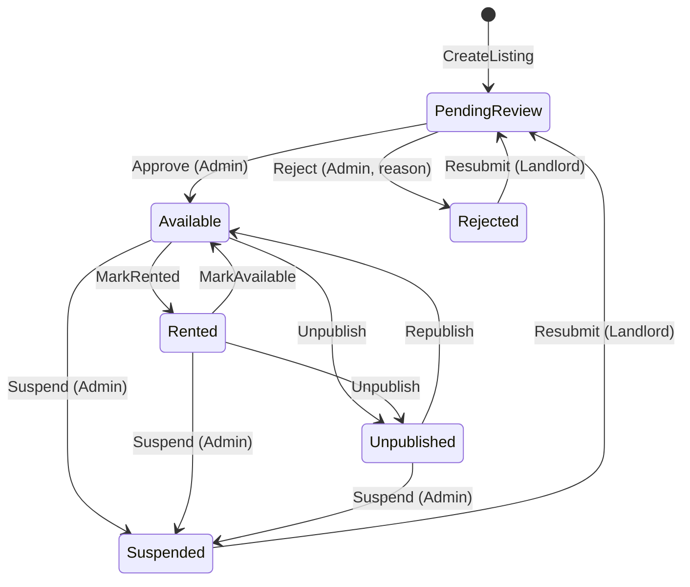

# ADR-011: Listing lifecycle state machine and two-level verification

- **Status:** Accepted
- **Date:** 2026-11-11
- **Related:** US01 AC4, US02 AC3, US08 AC2–AC3, US12, BR-LST-04..08, BR-AUTH-03

## Context
Trust is the product's main differentiator (Project Plan risk #6). Two open PRs model availability differently (`bool IsAvailable` vs `RoomStatus`). We need one explicit lifecycle that supports pending review, rejection, rented, unpublish and admin takedown, without hiding live listings for minor edits (Rightmove agents edit live listings).

## Options considered
| Option | Pros | Cons |
|---|---|---|
| Booleans (`IsAvailable`, `IsVerified`, `IsPublished`) | Simple | Invalid combinations representable (GUARDRAILS 1.5.3 violation) |
| Pre-moderation of every edit | Maximum control | Listing disappears on every price change → bad landlord UX, admin overload |
| **Single `Status` enum + `VerifiedAtUtc` + `NeedsReReview` flag (post-moderation of material edits)** | Invalid states unrepresentable; live listings stay live; admin queue small | Small window where a material edit is live before review |

## Decision
- **Level 1 — landlord verification:** Admin approves the landlord account (`Users.IsVerified`). Only verified landlords can create listings.
- **Level 2 — listing verification:** each new listing starts `PendingReview`; Admin approves → `Available` and sets `VerifiedAtUtc` (+ confirms safety features).
- States & transitions exactly as BR-LST-04:

- Implemented as domain methods on `Room` (`Approve`, `Reject`, `Resubmit`, `MarkRented`, `MarkAvailable`, `Unpublish`, `Republish`, `Suspend`) that throw `InvalidStateTransitionException` (→ HTTP 409) on illegal transitions. No public setter for `Status`.
- Material edits (address, pin, room type, new photos) on `Available`/`Rented` set `NeedsReReview = true`; Admin `AcknowledgeChanges` clears it or `Suspend`s.
- Public visibility = `Status == Available` and landlord verified.

## Consequences
- Positive: one model for US01, US02, US06, US08, US12; testable transitions.
- Negative: PR #6 / PR #16 must adopt this model.

## Compliance
Table-driven unit tests covering every allowed and forbidden transition.
