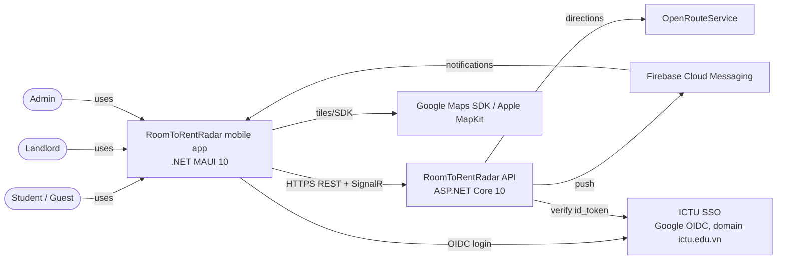
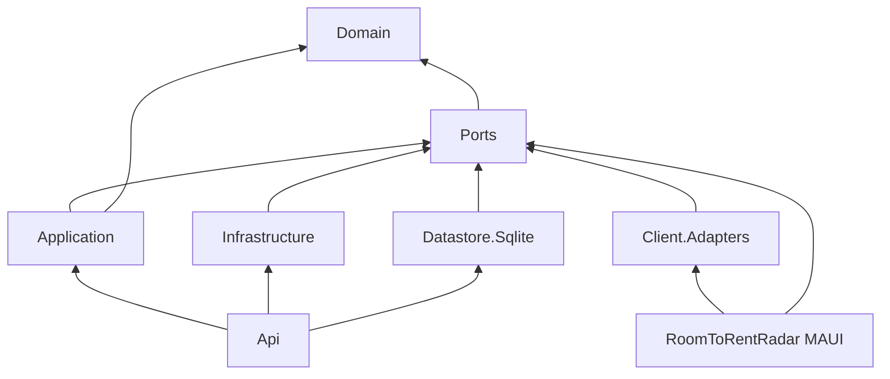

# System Architecture — RoomToRentRadar

| Field | Value |
|---|---|
| Status | Draft v1.0 — 2026-11-11 |
| Decisions | [adr/](adr/index.md) (ADR-001 … ADR-013) |
| Hard rules | `.agents/GUARDRAILS.md` (this document explains *how*; GUARDRAILS is the enforcement checklist) |

> **For AI agents:** §3 is the authoritative **project/folder map** and §4 the dependency rule. Put new code only where §3 says. If a file has no obvious home, stop and ask.

---

## 1. System context (C4 level 1)



## 2. Containers (C4 level 2)

| Container | Technology | Responsibility |
|---|---|---|
| Mobile app | .NET MAUI 10, CommunityToolkit.Mvvm, MAUI Maps, SQLite cache | UI, navigation, offline cache, device features (secure storage, share, dialer, push token). |
| API | ASP.NET Core 10 controllers, JWT bearer, SignalR hub, BackgroundServices | Business use cases, auth/RBAC, moderation, search, alerts, chat, media serving. |
| Database | SQLite file (`roomtorentradar.db`, WAL) | All server data ([erd.md](erd.md)). |
| Media store | Local disk folder behind `IPhotoStoragePort` | Photo originals and renditions ([ADR-008](adr/adr-008-media-storage-and-360-viewer.md)). |

## 3. Solution structure (target)

Projects marked **new** do not exist yet; ⚠ marks drift to fix.

```
RoomToRentRadar.slnx
├── 1. Core Hexagon
│   ├── RoomToRentRadar.Domain/              net10.0 · pure C#
│   │   ├── Aggregates/        User, Room, SavedSearch, ListingReport   (have Version/ConcurrencyToken — erd.md §3)
│   │   ├── Entities/          RefreshTokenSession, AuditLogEntry, RoomPhoto, Favourite, Conversation, Message, Notification, DeviceRegistration, Campus, ...
│   │   ├── ValueObjects/      EmailAddress, Money, GeoPoint, GeoPolygon, Address, Utilities, HouseRules, SearchCriteria
│   │   ├── Enums/             UserRole, AuthProvider, RoomType, ListingStatus, Amenity, SafetyFeature, ReportReason, ...
│   │   ├── Events/            ListingPublished, MessageSent, ...
│   │   ├── Services/          HaversineDistanceCalculator, PolygonContainment, SafetyScoreCalculator, SimilarRoomsPolicy
│   │   ├── Specifications/    ISpecification<T>, RoomMatchesCriteriaSpecification, ...
│   │   ├── Exceptions/        DomainValidationException, EntityNotFoundException, InvalidStateTransitionException, ...
│   │   └── Primitives/        IClock (time abstraction), Guard helpers
│   ├── RoomToRentRadar.Ports/               net10.0 · interfaces + DTOs
│   │   ├── Contracts/Requests/<Feature>/    *Request records (input whitelist)
│   │   ├── Contracts/Responses/<Feature>/   *Dto records (output projection)
│   │   ├── Contracts/Common/                PagedResult<T>, CursorPage<T>, ProblemCodes
│   │   ├── Inbound/UseCases/<Feature>/      I*UseCase (1 method ExecuteAsync)
│   │   └── Outbound/{Repositories,ExternalServices,Caching}/   I*Repository, I*Port
│   └── RoomToRentRadar.Application/         net10.0 · use cases
│       ├── UseCases/<Feature>/  *UseCase (Auth, Audit, Campuses, Rooms, Listings, Media, Favourites,
│       │                        SavedSearches, Alerts, TravelTime, Compare, HouseRules, Reports, Moderation, Chat, Notifications)
│       ├── Mappers/
│       └── DependencyInjection.cs   AddApplicationServices()
├── 2. Driven Adapters & Persistence
│   ├── RoomToRentRadar.Datastore.Sqlite/    net10.0 · the only datastore (ADR-002)
│   │   ├── Context/ (SqliteDbContext, MigrationRunner)   Migrations/ (NNN_name.sql)   Seed/ (campuses, demo data)
│   │   ├── Tables/ (row records)   Repositories/ (Sqlite*Repository)
│   │   └── DependencyInjection.cs   AddSqliteDatastore()
│   ├── RoomToRentRadar.Datastore.CosmosDb/  frozen (ADR-002)
│   └── RoomToRentRadar.Infrastructure/      net10.0 · non-DB driven adapters (server side)
│       ├── Adapters/Security/   JWT, PBKDF2, ICTU SSO verifier, security audit logger
│       ├── Adapters/Routing/    OpenRouteServiceTravelTimeAdapter          (new folder)
│       ├── Adapters/Push/       FcmPushNotificationAdapter                 (new folder)
│       ├── Adapters/Media/      LocalDiskPhotoStorageAdapter, SkiaImageProcessorAdapter (new folder)
│       ├── Adapters/Mocks/      Mock* + InMemory* (tests/Development only)
│       └── DependencyInjection.cs   AddInfrastructure()
├── 3. Driving Adapters
│   ├── RoomToRentRadar.Api/                 ASP.NET Core · composition root (server)
│   │   ├── Controllers/  (one per resource group, see openapi tags)
│   │   ├── Hubs/         ChatHub, SignalRRealtimeNotifierAdapter       (new)
│   │   ├── BackgroundJobs/ AlertMatcherService, PhotoCleanupService     (new)
│   │   ├── Middlewares/  ProblemDetails (errorCode), AuditLogging
│   │   ├── Authorization/ policies, ClaimsPrincipal extensions
│   │   └── Program.cs
│   ├── RoomToRentRadar.Client.Adapters/     net10.0 · NEW (ADR-003)
│   │   ├── Abstractions/  I*Gateway, ISessionStore, ICacheStore, IConnectivity, IPushTokenProvider
│   │   ├── Http/          Http*Gateway, AuthTokenHandler, ApiJsonContext (source-gen), ApiOptions
│   │   ├── Caching/       SqliteCacheStore, Cached*Gateway decorators, PendingOperationQueue
│   │   ├── Realtime/      SignalRChatConnection
│   │   └── DependencyInjection.cs   AddClientAdapters(ApiOptions)
│   └── RoomToRentRadar/                     .NET MAUI app · composition root (client)
│       ├── Pages/<Area>/        *Page.xaml (+ Pages/Controls/ reusable views)
│       ├── PageModels/<Area>/   *PageModel (CommunityToolkit.Mvvm)
│       ├── Converters/  Behaviors/   Resources/{Styles,Fonts,Images,Raw(pannellum)}
│       ├── DeviceAdapters/      MauiSecureSessionStore, MauiConnectivity, MauiPushTokenProvider, MauiShareService
│       ├── AppShell.xaml(.cs)   App.xaml(.cs)   MauiProgram.cs
│       └── ⚠ Data/, Models/, Utilities/, template Pages/PageModels → delete (MAUI template leftovers)
└── 4. Quality Assurance
    ├── RoomToRentRadarUnitTests/     NUnit 4 + NSubstitute: Architecture/, Domain/, Application/, Infrastructure/, Api/, ClientAdapters/ (new)
    └── RoomToRentRadarUIAppiumTests/ NUnit + Appium: Journeys/ (one file per story journey)
```

## 4. Dependency rule



- Core never references frameworks (MAUI, ASP.NET Core, HTTP, IdentityModel, SQLite, Cosmos) — enforced by `ArchitectureTests`.
- `RoomToRentRadar` (MAUI) **must not** reference `Application`, `Infrastructure`, `Datastore.*` (⚠ currently it does — fix per ADR-003).
- `Client.Adapters` references `Ports` **only for `Contracts`** (DTOs); it must not use `Inbound`/`Outbound` server ports or `Domain` types. Note: `Ports.csproj` references `Domain`, so these assemblies are still *available* to the client at compile time — the rule is enforced by an architecture test on namespaces used inside `Client.Adapters` and the MAUI project (`RoomToRentRadar.Ports.Inbound*`, `RoomToRentRadar.Ports.Outbound*`, `RoomToRentRadar.Domain*` forbidden).

## 5. Mobile client architecture

### 5.1 Pattern: MVVM + gateways
```
XAML Page ──binding──▶ PageModel ──▶ I<Feature>Gateway ──▶ Cached decorator ──▶ Http gateway ──▶ API
   (x:DataType)        ([ObservableProperty],             (ADR-004)            (ADR-003)
                        [RelayCommand], state machine)
```
- **PageModel state** is explicit: `Loading`, `Content`, `Empty`, `Error`, `Offline` (+ `IsRefreshing`). Every page renders all states (ui-ux-spec §4).
- PageModels receive navigation parameters via `IQueryAttributable`; no static state.
- Long lists: `CollectionView` with `RemainingItemsThreshold` for infinite scroll, fixed-height `DataTemplate`, compiled bindings.

### 5.2 Navigation (Shell)
Bottom `TabBar` (role-aware — ui-ux-spec §2): `explore`, `map`, `saved`, `messages`, `account`; landlord adds `my-listings`; admin adds `moderation`. Detail routes registered in `AppShell.xaml.cs`: `room` (`?id=`), `gallery`, `panorama`, `compare`, `filters`, `conversation` (`?id=`), `listing-editor` (`?id=`), `house-rules-editor`, `notifications`, `sign-in`, `register`, `moderation-room`, `moderation-report`.

### 5.3 DI registration (`MauiProgram.cs`, target)
```csharp
builder.Services.AddClientAdapters(apiOptions);          // gateways, cache, auth handler, SignalR
builder.Services.AddSingleton<ISessionStore, MauiSecureSessionStore>();
builder.Services.AddSingleton<IConnectivity, MauiConnectivity>();
builder.Services.AddTransientWithShellRoute<RoomDetailPage, RoomDetailPageModel>("room");
// ... one line per page
```

### 5.4 Device features
| Feature | API | Used by |
|---|---|---|
| Secure token storage | `SecureStorage` | ADR-005 |
| Preferences (guest campus, onboarding) | `Preferences` | BR-CMP-02 |
| Connectivity | `Connectivity.ConnectivityChanged` | ADR-004 |
| Dialer / Zalo | `PhoneDialer`, `Launcher.OpenAsync("https://zalo.me/…")` | UC-16 |
| Share image | `VisualElement.CaptureAsync()` + `Share.RequestAsync(ShareFileRequest)` | US10 AC3 |
| Photo picking | `MediaPicker` (multi-select where supported) | US08 |
| SSO | `WebAuthenticator` | US13 |
| Push | FCM plugin (ADR-010) | US07, US14 |

## 6. Server architecture

### 6.1 Request pipeline (order matters)
```
ResponseCompression → ForwardedHeaders → ProblemDetailsMiddleware (exception → problem+json + errorCode)
→ RateLimiter → Authentication (JWT) → Authorization → AuditLoggingMiddleware (mutations)
→ StaticFiles(/media, immutable cache) → Controllers / ChatHub (/hubs/chat) → /api/health
```

### 6.2 Request flow (example `GET /api/rooms`)
```
RoomsController.Search(query) → ISearchRoomsUseCase.ExecuteAsync(RoomSearchRequest)
  → validate (BR-SRCH-02) → ICampusRepository.GetAsync(campusId)
  → IRoomSearchReadModel.QueryCandidatesAsync(bbox, filters)   // SQL bbox + indexed filters
  → HaversineDistanceCalculator / PolygonContainment (Domain)   // exact filter + distance
  → sort (BR-SRCH-04) → page (BR-SRCH-05) → map RoomCardDto → PagedResult<RoomCardDto>
```

### 6.3 Port catalogue (Outbound, server)
| Port | Adapter(s) | Notes |
|---|---|---|
| `IUserRepository`, `IAuditLogRepository` | `Sqlite*`, `InMemory*` (tests) | exist |
| `ICampusRepository` | `SqliteCampusRepository` | read-only reference data |
| `IRoomRepository` (write: Get/Add/Update by id+owner) | `SqliteRoomRepository` | aggregate persistence incl. amenities/safety/house rules |
| `IRoomSearchReadModel` (read: candidates, pins, similar, compare) | `SqliteRoomSearchReadModel` | read/write segregation (ISP) |
| `IRoomPhotoRepository`, `IPhotoStoragePort`, `IImageProcessorPort` | Sqlite / LocalDisk / Skia | ADR-008 |
| `IFavouriteRepository`, `ISavedSearchRepository`, `IAlertLogRepository` | Sqlite | |
| `IListingReportRepository` | Sqlite | |
| `ITravelTimeCacheRepository`, `ITravelTimePort` | Sqlite / ORS, Mock | ADR-007 |
| `IConversationRepository`, `IMessageRepository`, `IRealtimeNotifierPort` | Sqlite / SignalR (Api) | ADR-009 |
| `IDeviceRegistrationRepository`, `INotificationRepository`, `IPushNotificationPort` | Sqlite / FCM, Mock | ADR-010 |
| `IDomainEventPublisher` | `ChannelDomainEventPublisher` | in-process events (ListingPublished) |
| `IClock` | `SystemClock` | testable time (replace `DateTime.UtcNow` in new code) |
| `IPasswordHasherPort`, `IJwtTokenServicePort`, `IIctuSsoVerifierPort`, `ISecurityAuditLoggerPort` | exist | ADR-005 |

### 6.4 Background jobs (`BackgroundService`)
| Job | Schedule | Work |
|---|---|---|
| `AlertMatcherService` | event-driven + every 5 min | BR-ALR-02..06 |
| `PhotoCleanupService` | hourly | delete unattached photos > 24 h (BR-MED-03) |
| `HousekeepingService` | daily 03:00 ICT | prune notifications > 90 d, expired refresh tokens, travel-time cache > 30 d |

## 7. Cross-cutting concerns

### 7.1 Security
- AuthN/AuthZ per [ADR-005](adr/adr-005-authentication-and-session.md); policies on every controller action; ownership enforced **in use cases/repositories** by passing `currentUserId` (never trusting route ids alone).
- Rate limits (built-in `RateLimiter`): auth 10/min/IP, reports 10/day/user, chat 30/min/user, uploads 30/10 min/user, default 120/min/user.
- Uploads: magic-byte validation, size limit (Kestrel `MaxRequestBodySize` 11 MB on upload endpoint), EXIF stripping, random storage names.
- HTTPS + HSTS outside Development; CORS not needed (no browser client).
- PII: phone only to signed-in users (BR-AUTH-07); logs never contain tokens/passwords.

### 7.2 Error model
`application/problem+json` with `errorCode` — [ADR-012](adr/adr-012-api-contract-and-error-model.md). Framework-generated errors must use the same shape: configure `ApiBehaviorOptions.InvalidModelStateResponseFactory` (model-binding 400 → `VALIDATION_FAILED` + `errors`), the rate limiter's `OnRejected` (429 → `RATE_LIMITED`) and `UseStatusCodePages` for bare 401/403/404. Until the global middleware exists, the current Auth endpoints return ProblemDetails **without** `errorCode`; the client must fall back to the HTTP status. Domain exceptions → HTTP:

| Exception | Status | errorCode (examples) |
|---|---|---|
| `DomainValidationException` | 400 | `VALIDATION_FAILED` |
| `InvalidCredentialsException`, `InvalidTokenException` | 401 | `INVALID_CREDENTIALS`, `INVALID_TOKEN` |
| `AccountLockedException` | 403 | `ACCOUNT_LOCKED` |
| `ForbiddenRoleException`, `LandlordNotApprovedException` | 403 | `FORBIDDEN_ROLE`, `LANDLORD_NOT_APPROVED` |
| `EntityNotFoundException`, `UserNotFoundException` | 404 | `ROOM_NOT_FOUND`, `CONVERSATION_NOT_FOUND` |
| `DuplicateEmailException`, `ConcurrencyConflictException`, `InvalidStateTransitionException`, `LimitExceededException` | 409 | `EMAIL_TAKEN`, `CONCURRENCY_CONFLICT`, `INVALID_STATE_TRANSITION`, `LISTING_NOT_AVAILABLE`, `ALREADY_REPORTED`, `LIMIT_EXCEEDED` |
| precondition failures | 412 / 428 | `ETAG_MISMATCH`, `IF_MATCH_REQUIRED` |
| `FileTooLargeException` (> 10 MB, BR-MED-02) | 413 | `FILE_TOO_LARGE` |
| `UnsupportedMediaTypeException` (not JPEG/PNG by magic bytes) | 415 | `UNSUPPORTED_MEDIA_TYPE` |
| rate limiter | 429 | `RATE_LIMITED` |

### 7.3 Concurrency & idempotency
`Version` columns + `If-Match` ([ADR-012](adr/adr-012-api-contract-and-error-model.md)); idempotent PUT/DELETE for favourites and devices; `clientMessageId` for chat; `(SavedSearchId, RoomId)` for alerts.

### 7.4 Observability
`ILogger` structured logs (console); audit trail in `AuditLogs` (existing middleware + security logger); `/api/health` for liveness.

### 7.5 Configuration
| Key | Purpose | Default (root `appsettings.json`) |
|---|---|---|
| `Jwt:*` | issuer, audience, lifetimes, `SigningKey` (secret) | no key → fail fast outside Dev |
| `Sqlite:ConnectionString` | DB path | `Data Source=roomtorentradar.db` |
| `Media:RootPath`, `Media:PublicBaseUrl` | photo storage | `media/` |
| `Routing:OpenRouteServiceApiKey`, `Routing:UseMock` | ADR-007 | `UseMock=false` |
| `Push:FirebaseCredentialsPath`, `Push:UseMock` | ADR-010 | `UseMock=false` |
| `IctuSso:*`, `IctuSso:UseMockVerifier` | ADR-005 | `false` |
| `Admin:SeedAccounts` | seeded admin e-mails | empty |
| Client `ApiOptions:BaseUrl` | per build/environment | emulator `http://10.0.2.2:5000` |

## 8. Performance budget & tactics

| Target | Tactic |
|---|---|
| List ≤ 3 s (NFR-01) | cache-then-network; `RoomCardDto` ~0.5 KB × 20; thumbs ≤ 60 KB; compiled bindings; server read cache 30 s |
| Filter ≤ 2 s (NFR-02) | 300 ms debounce; count-only query for live count in filter sheet; indexed bbox query + in-memory exact filter |
| Map ≤ 2 s | `RoomCardDto` (~0.5 KB, includes lat/lng) max 200 ≈ 100 KB compressed-friendly; pin preview needs no extra request |
| Detail instant feel | navigate with card data → render header immediately → fetch detail with `If-None-Match` |
| Alerts ≤ 15 min | event-driven matcher + 5-min sweep |
| Chat ≤ 2 s | SignalR WebSockets; optimistic bubbles |

## 9. Testing strategy

| Layer | Tooling | What |
|---|---|---|
| Domain | NUnit | invariants, state machine (all transitions), geometry, safety score, criteria matching |
| Application | NUnit + NSubstitute (ports) | each use case: happy path + every `E*` flow in use-cases.md + ownership |
| Datastore | NUnit + SQLite `:memory:` | repository contracts, concurrency (`Version`), migrations |
| Infrastructure | NUnit | adapters with fake HTTP handlers (ORS, FCM) |
| Api | NUnit + `WebApplicationFactory` | status codes, `errorCode`, policies, rate limits |
| Client.Adapters | NUnit + fake `HttpMessageHandler` | token refresh single-flight, cache decorators, offline queue |
| E2E | Appium | one journey per story (`Journeys/US01_BrowseListingsJourney.cs` …) |
| Architecture | reflection tests | dependency rule, aggregates have `ConcurrencyToken`, MAUI references |

## 10. Migration from current state (develop2 @ 8524ad8)

1. Replace MAUI template (`Data/`, `Models/`, template Pages/PageModels, `GlobalUsings` entries) with the shell in §5.2.
2. Create `RoomToRentRadar.Client.Adapters`; change MAUI project references (ADR-003) — requires csproj/slnx approval.
3. Add `*.db` to `.gitignore`, untrack `RoomToRentRadar.Api/roomtorentradar.db`.
4. Introduce migration runner + `Users.SelectedCampusId`, `Users.Version`.
5. Generalise `AuthExceptionHandlingMiddleware` → `ProblemDetailsMiddleware` with `errorCode`.
6. **PR #16 (US04) is the foundation for `Room`** (team decision 2026-11-11): it is aligned to [erd.md](erd.md) §4.4 and merged first; PR #6 (US02) and PR #13 (US03) then rebase onto it and keep only their own use cases/endpoints.
7. ~~Update `AGENTS.md` project map~~ (done — moved to repo root, 2026-11-11). Still to do: GUARDRAILS wording (Datastore split, client gateways, SQLite only).
