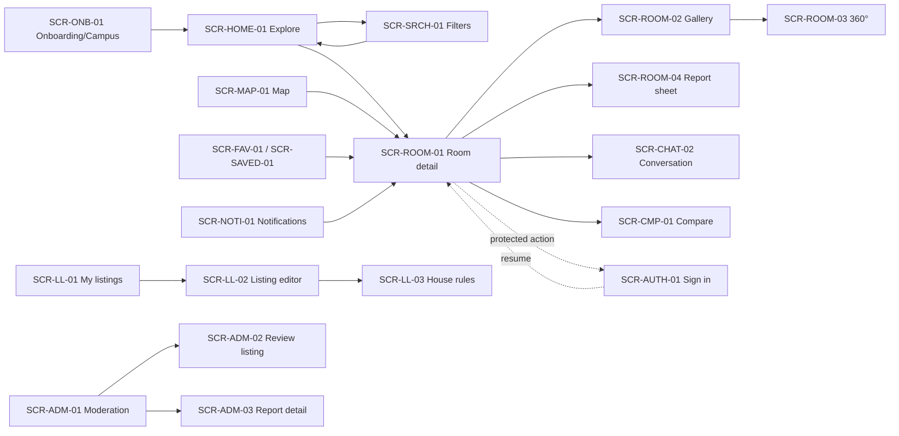

# UI/UX Specification — RoomToRentRadar

| Field | Value |
|---|---|
| Status | Draft v1.0 — 2026-11-11 |
| Platform | .NET MAUI 10 · Android first (ADR-013) · English UI (en-ENG) |
| Detailed method skills | `.agents/skills/ui/01…08` (this spec applies them to our screens) |
| Inputs | [use-cases.md](use-cases.md) (UC-*), [business-analysis.md](business-analysis.md) (BR-*) |

> **For AI agents:** every screen has an ID `SCR-<AREA>-NN`, a *primary action*, required *states* and the API operations it calls. A screen is not done until all listed states are implemented. Use only the tokens in §3 (no hard-coded colours/sizes in pages). Strings come from the copy rules in §6.

---

## 1. Design principles (applied)

1. **Visual-first discovery** (marketplace pattern, Rightmove): big cover photo, price in bold, distance to *my campus* on every card.
2. **One primary action per screen** (Polaris): e.g. detail → *Liên hệ*; filter sheet → *Xem N phòng*; editor step → *Tiếp tục*.
3. **Trust is visible:** verified badge, Safety Score, last-updated date, status banner — never hidden behind taps.
4. **Thumb zone:** primary actions in the bottom third (sticky bars, FAB-style buttons); touch targets ≥ 48 dp.
5. **Recognition over recall:** active filters as chips, saved searches named automatically, campus always shown.
6. **Never a blank screen:** skeletons for loading, helpful empty states, error with *Thử lại*, offline banner with cached data (ADR-004).
7. **Respect the guest:** browsing, details, map, compare work without an account; sign-in is requested only at the moment of a protected action, then the action resumes.

## 2. Information architecture & navigation

### 2.1 Bottom tabs (Shell `TabBar`, role-aware)

| Tab (route) | Guest | Student | Landlord | Admin |
|---|---|---|---|---|
| Khám phá (`explore`) — list | ✓ | ✓ | ✓ | ✓ |
| Bản đồ (`map`) | ✓ | ✓ | – | ✓ |
| Đã lưu (`saved`) — rooms / searches | ✓ (sign-in prompt) | ✓ | – | ✓ |
| Tin đăng (`my-listings`) | – | – | ✓ | – |
| Tin nhắn (`messages`) | ✓ (sign-in prompt) | ✓ | ✓ | ✓ |
| Kiểm duyệt (`moderation`) | – | – | – | ✓ |
| Tài khoản (`account`) | ✓ (sign in / register) | ✓ | ✓ | ✓ |

Max 5 tabs visible: Landlord = Khám phá, Tin đăng, Tin nhắn, Tài khoản; Admin = Khám phá, Bản đồ, Kiểm duyệt, Tin nhắn, Tài khoản (Admin reaches *Đã lưu* from Account). Tabs are rebuilt after sign-in/out.

### 2.2 Flow map



### 2.3 Campus selection pattern (US01, US09 — decided with references)

References: UniHomes/StuRents ("search near your university" as the first question), Airbnb/Rightmove (location chip at the top of results).
- **Onboarding** (first launch, 1 screen): "Bạn học ở trường nào?" — list of campuses with search box, ICTU preselected, *Bắt đầu* button. Skippable (keeps ICTU).
- **Campus chip** at the top of *Khám phá* and *Bản đồ*: `📍 Gần ICTU ▾` → bottom sheet picker (SCR-ACC-02). Changing it reloads results and travel times.
- Distance labels always name the campus: "1,2 km tới ICTU".
- Signed-in users: selection saved in profile (syncs); guests: on device (BR-CMP-02).

## 3. Design tokens (`Resources/Styles/Colors.xaml`, `Styles.xaml`)

Use semantic tokens only; method in `.agents/skills/ui/02-design-system`. The palette is the team's **"Navy Blue + Ocean Blue + Teal"** design system implemented in PR #22 (`Resources/Styles/Colors.xaml`, plan `.agents/plans/UI_DESIGN_SYSTEM_PLAN.md`). This document is the single source for *which pairs are allowed*; the XAML files are the single source for the values. If the two disagree, fix the XAML or open a docs PR — do not invent colours.

### 3.1 Colour (light / dark) — values from `Colors.xaml`
| Token (XAML key) | Light | Dark | Use |
|---|---|---|---|
| `ActionPrimary` | `#163A5F` (Navy) | `#3572A5` | primary buttons, active tab |
| `ActionSecondary` | `#256D85` (Ocean) | `#256D85` | secondary buttons, focus ring (`BorderFocus`) |
| `ActionAccent` | `#4CB5AE` (Teal) | `#5CE1D6` | highlights, badges, selected chips, illustrations |
| `TextBrand` | `#163A5F` | `#5CE1D6` | links, brand text |
| `SurfaceCanvas` | `#F4F7FA` | `#0B131E` | page background |
| `SurfaceCard` | `#FFFFFF` | `#162234` | cards |
| `SurfaceElevated` | `#FFFFFF` | `#22334B` | sheets, dialogs |
| `SurfaceSubtle` | `#E8EEF5` | `#1A283C` | chips, input fill |
| `TextPrimary` | `#1E293B` | `#F4F7FA` | body text, **prices** (bold, not coloured) |
| `TextSecondary` | `#475569` | `#CBD5E1` | secondary text |
| `TextMuted` | `#94A3B8` | `#64748B` | **non-essential** hints and disabled only |
| `TextInverse` | `#FFFFFF` | `#0B131E` | text on primary/secondary |
| `BorderSubtle` | `#E2E8F0` | `#273B55` | borders, dividers |
| `StatusSuccess` | `#16A34A` | `#4CB5AE` | verified badge (icon + text) |
| `StatusWarning` | `#D97706` | `#F59E0B` | pending/unavailable banners |
| `StatusDanger` | `#DC2626` | `#EF4444` | errors, destructive |
| `StatusInfo` | `#0284C7` | `#38BDF8` | info |
| `Favourite` *(to add)* | `#DC2626` | `#EF4444` | filled heart (reuse danger red) |

### 3.1.1 Allowed text/background pairs (WCAG 2.2 AA — contrast measured 2026-11-11)
| Pair | Ratio | Rule |
|---|---|---|
| `TextPrimary` on `SurfaceCanvas` / `SurfaceCard` | 13.6 : 1 | ✅ default body text |
| `TextSecondary` on white | 7.6 : 1 | ✅ |
| `TextInverse` on `ActionPrimary` (light) | 11.6 : 1 | ✅ primary button |
| `TextInverse` on `ActionSecondary` | 5.8 : 1 | ✅ secondary button |
| **`ActionPrimary` (Navy) text on `ActionAccent` (Teal)** | 4.7 : 1 | ✅ **accent button/badge text must be Navy** |
| ~~White on `ActionAccent` (light)~~ | 2.5 : 1 | ❌ **forbidden** (PR #22 `AccentButton` currently violates this) |
| ~~`ActionAccent` Teal used as text on white/canvas~~ | 2.3–2.5 : 1 | ❌ forbidden — Teal is a fill colour, not a text colour in light mode |
| `TextMuted` on white (light) | 2.6 : 1 | ⚠️ only for non-essential decoration; never for price, status, form errors or required info |
| `StatusSuccess`/`StatusWarning` as **text** on white | 3.3 / 3.2 : 1 | ⚠️ large text/icons only. For small text use darker variants `#15803D` (5.0 : 1) and `#B45309` (5.0 : 1) — add as `StatusSuccessText`/`StatusWarningText` |
| `StatusDanger` text on white | 4.8 : 1 | ✅ |
| Dark: `TextPrimary` on `SurfaceCanvas` | 17.3 : 1 | ✅ |
| Dark: `TextSecondary` on `SurfaceCard` | 10.8 : 1 | ✅ |
| Dark: `TextInverse` on `ActionAccent` | 11.7 : 1 | ✅ |
| Dark: `TextMuted` on `SurfaceCard` | 3.4 : 1 | ⚠️ non-essential only |
| Dark: `StatusDanger` on `SurfaceCard` | 4.3 : 1 | ⚠️ use for icons/large text, or lighten to ≥ `#F87171` for small text |

Icons and large text (≥ 18 pt or 14 pt bold) need ≥ 3 : 1. No gradients, no neon.

### 3.2 Typography (bundled Open Sans — full Vietnamese diacritics)
| Token | Size / weight | Use |
|---|---|---|
| `Display` | 24 / Semibold | screen titles |
| `Title` | 20 / Semibold | section titles, price on detail |
| `Headline` | 17 / Semibold | card title, price on card |
| `Body` | 15 / Regular | body |
| `Label` | 13 / Semibold | chips, buttons, badges |
| `Caption` | 12 / Regular | meta (distance, updated date) |
Line height 1.4; support OS font scaling up to 130% without truncating prices.

### 3.3 Spacing, shape, elevation
Spacing scale 4-pt: `4, 8, 12, 16, 24, 32`. Page padding 16. Card radius 12, chip radius 16 (pill), sheet radius 16 top. Elevation: cards flat with 1 px `Outline`; sheets/dialogs shadow level 2 only.

### 3.4 Iconography
Fluent System Icons (bundled `FluentSystemIcons-Regular.ttf`). Icons accompany meaning (♥, map, filter, chat, phone); no decorative icons before every line.

## 4. Global components & states

| Component | Spec |
|---|---|
| `RoomCard` | 16:10 cover (thumb), verified badge overlay top-left, ♥ top-right (48 dp hit), title (2 lines max), **price "2,5 tr/tháng"**, `25 m² · Phòng trọ · 1,2 km tới ICTU`, *So sánh* text button. Fixed height for scroll perf. |
| `FilterChip` | removable chip `Dưới 3 tr ✕`; *Xoá bộ lọc* text chip at end. |
| `StatusBanner` | full-width under header: Warning colour for `Rented`/`Unpublished` (public) and `PendingReview`/`Rejected`/`Suspended` (owner/admin views), Verified colour for approvals. |
| `StickyContactBar` | bottom of detail: price + *Gọi* · *Zalo* · primary *Nhắn tin*. Guest: single primary *Đăng nhập để liên hệ*. |
| `Skeleton` | grey blocks matching final layout; shimmer ≤ 1.2 s cycle. |
| `EmptyState` | illustration-free: icon + title + 1-line hint + one action. |
| `ErrorState` | message from errorCode map (§6) + *Thử lại*. |
| `OfflineBanner` | "Đang ngoại tuyến – hiển thị dữ liệu đã lưu" (Warning). |
| `Snackbar` | bottom, 5 s, one action (e.g. *Hoàn tác*). |
| `SignInPrompt` sheet | "Đăng nhập để …" + *Đăng nhập* / *Tạo tài khoản* / *Để sau*. |

Required states for every data screen: **Loading (skeleton) · Content · Empty · Error · Offline**.

## 5. Screen catalogue

Format: **Purpose · Primary action · Content · States/edge cases · API · Story**.

### SCR-ONB-01 Onboarding & campus
Purpose: set campus. Primary: *Bắt đầu*. Content: app value line, campus list with search. API: `listCampuses`. US01.

### SCR-AUTH-01 Sign in
Primary: *Đăng nhập*. Content: email, password (show/hide), *Đăng nhập bằng email ICTU* (outlined), *Quên mật khẩu?* (post-MVP: hidden), link *Tạo tài khoản*. States: inline field errors; `ACCOUNT_LOCKED` shows unlock time. API: `loginUser`, `loginWithIctuSso`. US13.

### SCR-AUTH-02 Register
Step 1 role cards: *Tôi là sinh viên* / *Tôi là chủ trọ*. Step 2 form (phone required for landlord, password rules shown live). Landlord success → banner "Tài khoản đang chờ xác minh (thường trong 24h)". API: `registerUser`. US13.

### SCR-HOME-01 Explore (list)
```
┌──────────────────────────────────┐
│ 📍 Gần ICTU ▾          🔔(2)     │  campus chip · notifications
│ [ 🔍 Bộ lọc (2) ] [Sắp xếp: Gần nhất ▾] │
│ (Dưới 3 tr ✕)(Phòng trọ ✕) Xoá bộ lọc  │  active chips
│ 128 phòng · ⭐ Lưu tìm kiếm           │  count always visible (US04 AC3)
│ ┌──────────────────────────────┐ │
│ │ [ cover photo        ✓Đã xác minh ♡] │
│ │ Phòng trọ khép kín gần ICTU  │ │
│ │ 2,5 tr/tháng                 │ │
│ │ 25 m² · Phòng trọ · 1,2 km tới ICTU │
│ └──────────────────────────────┘ │
│ ...infinite scroll (20/page)...  │
│ ┌ So sánh (2) ── So sánh ngay ┐  │  floating compare tray
├──────────────────────────────────┤
│ Khám phá  Bản đồ  Đã lưu  Tin nhắn  Tài khoản │
└──────────────────────────────────┘
```
Primary: open a room. States: skeleton cards; empty "Không có phòng phù hợp – thử tăng khoảng cách hoặc *Xoá bộ lọc*"; offline cached page. Pull-to-refresh. API: `searchRooms`. US01, US04, US06, US10.

### SCR-SRCH-01 Filters (bottom sheet, full height)
Content: rent range slider (0–10 tr, step 100k) + quick chips (*Dưới 1,5 tr*, *Dưới 2 tr*, *Dưới 3 tr*); area range (5–100 m²); room type multi-select chips; max distance segmented (*1 · 2 · 3 · 5 · 10 km*); sort radio. Sticky footer: *Xoá* (text) · primary **Xem 42 phòng** (live count, debounced 300 ms). API: `searchRooms` (pageSize=1 for count). US04 AC1–AC4.

### SCR-MAP-01 Map search
```
┌──────────────────────────────────┐
│ 📍 Gần ICTU ▾   [Bộ lọc (2)] [☰ Danh sách] │
│                                  │
│      (2,5tr)    (1,8tr)          │  price-label pins
│   ◆ICTU   ·····polygon·····      │  campus marker
│      (3,2tr)                     │
│                                  │
│ ┌ preview card: photo · 2,5 tr · 25 m² · 1,2 km ┐ │  on pin tap
│ [ ✏ Vẽ khu vực ]  [ ⭐ Lưu ]      │
└──────────────────────────────────┘
Draw mode: "Chạm để thêm điểm (3–20)"  [↶ Hoàn tác] [Xoá] [Xong]
```
Primary: *Vẽ khu vực* → *Xong*. Sort toggle *Giá / Khoảng cách* in list view. States: truncated hint "Phóng to để xem thêm"; invalid polygon message; no location permission required. API: `searchRoomsInArea`, `createSavedSearch`. US05.

### SCR-ROOM-01 Room detail
Order (inverted pyramid, US11 AC2 rules before contact):
1. Gallery header (swipe, `1/12`, 360° badge) — placeholder if none.
2. `StatusBanner` if not Available; *Cập nhật 3 ngày trước* (US02 AC2).
3. Title, **price/tháng**, deposit, verified badge, ♥, share, ⋯ (Báo cáo).
4. Key facts row: area · room type · max occupants · furnishing · available from.
5. **Chi phí hằng tháng**: rent, điện ₫/kWh, nước, internet, gửi xe, khác → "Ước tính ~2,9 tr/tháng".
6. Tiện nghi (grid, first 8 + *Xem tất cả*).
7. **An ninh**: Safety Score `4/5 ✓ đã xác minh` + checklist.
8. **Nội quy** (quiet hours, guests, cooking, parking, other) — always expanded summary (US11).
9. Vị trí: static map + address; **Di chuyển tới ICTU**: 🛵 8 phút · 🚌 ~19 phút (ước tính) · 🚶 25 phút; fallback text (US09).
10. Landlord block: name, *Đã xác minh*, member since.
11. If unavailable: **Phòng tương tự** carousel (US02 AC3).
12. `StickyContactBar` (disabled when unavailable).
States: header renders from card data instantly; sections skeleton; 404 → "Tin đăng không tồn tại". First contact tap → house-rules summary sheet (BR-HR-03). API: `getRoomDetail`, `getSimilarRooms`, `getRoomTravelTimes`. US02, US03, US09, US11.

### SCR-ROOM-02 Gallery · SCR-ROOM-03 360° viewer
Full-screen black, swipe, pinch-zoom, counter; panorama: drag + gyro toggle, *Đóng*. Progressive thumb→medium. US03.

### SCR-ROOM-04 Report sheet
Reason radio list (BR-RPT-01), note field (required for *Khác*), primary *Gửi báo cáo*; confirmation state "Cảm ơn bạn…". US12.

### SCR-FAV-01 Saved › Rooms
Segmented control *Phòng | Tìm kiếm*. Cards show current price & availability (unavailable greyed with label). Swipe or ♥ to remove → snackbar *Đã bỏ lưu · Hoàn tác* (5 s). Empty: "Nhấn ♡ để lưu phòng bạn thích". API: `listMyFavourites`, `removeFavourite`. US06.

### SCR-SAVED-01 Saved › Searches & alerts
Row: name, summary ("< 3 tr · Phòng trọ · ≤ 2 km · Vùng vẽ"), alert switch with states *Bật / Tạm dừng / Tắt*, ⋯ (Đổi tên, Xoá). Tap → runs search in Explore/Map. API: saved-search ops. US05 AC4, US07.

### SCR-NOTI-01 Notifications
List grouped *Hôm nay / Trước đó*; unread dot; tap deep-links; *Đánh dấu đã đọc*. API: `listMyNotifications`, `markNotificationsRead`. US07.

### SCR-CMP-01 Compare
Horizontal table, sticky first column (row labels), up to 3 columns with cover + title; rows BR-CPR-02; best value cell highlighted (Verified colour + "Tốt nhất"); *Xoá* per column; primary *Chia sẻ ảnh*. Empty (<2 rooms): "Thêm ít nhất 2 phòng để so sánh". API: `compareRooms`. US10.

### SCR-CHAT-01 Conversations · SCR-CHAT-02 Conversation
List: listing thumb, other party name, last message, time, unread badge. Conversation: pinned listing card (tap → detail), bubbles (mine right / Primary), status *Đang gửi / Đã gửi / Chưa gửi · Thử lại*, date separators, composer with send button (disabled when empty), load older on scroll top. Landlord sees the student's name only (no phone). API: chat ops + hub. US14.

### SCR-ACC-01 Account · SCR-ACC-02 Campus picker
Profile, role badge, landlord verification status, campus, notification settings (push on/off), *Đăng xuất*. Guest: sign-in/register CTAs. API: `getCurrentUser`, `updateMyProfile`. US13.

### SCR-LL-01 My listings (landlord)
Header counts by status (chips filter); card with status badge, views placeholder (post-MVP), actions per state (BR-LST-04): *Sửa*, *Đã cho thuê*/*Còn trống*, *Ngừng đăng*/*Đăng lại*, *Gửi duyệt lại*; rejection/suspension reason visible. Unverified landlord: banner + disabled *Đăng tin*. Primary FAB-style *+ Đăng tin*. API: `listMyListings` + transitions. US08.

### SCR-LL-02 Listing editor (wizard, 4 steps + review)
Progress `1/4`. **Ảnh** (grid, per-photo upload progress, drag to reorder, mark 360°, min 3 indicator) → **Thông tin** (numeric keypad for money with live "2.500.000 ₫" formatting) → **Vị trí** (address fields + draggable pin, starts at campus) → **Tiện ích & an ninh** (chips, utilities) → **Xem lại** → primary *Gửi duyệt*. Sticky *Tiếp tục* in thumb zone; draft autosave on device. Validation inline per BR-LST-01. API: `uploadPhoto`, `createListing`/`updateListing`. US08.

### SCR-LL-03 House rules editor
Time pickers (quiet hours, curfew), policy segmented controls, parking text, flags, other rules; *Lưu* creates a version; *Lịch sử* list. API: `updateHouseRules`, `listHouseRulesVersions`. US11 AC3.

### SCR-ADM-01 Moderation hub · SCR-ADM-02 Review listing · SCR-ADM-03 Report detail
Hub segmented *Chủ trọ (n) · Tin đăng (n) · Thay đổi (n) · Báo cáo (n)*, oldest first, high-priority reports pinned. Review listing: all fields, photos, pin, safety checklist toggles to confirm, primary *Duyệt*, secondary *Từ chối* (reason required). Report detail: listing summary, all reports, *Bỏ qua* / *Xử lý* (+ suspend toggle, note). API: admin ops. US08, US12, US13.

## 6. Content & formatting rules (en-ENG)

| Item | Rule | Example |
|---|---|---|
| Price on card | million with 1 decimal, dot/comma separator | `2.5M/mo`, `950k/mo` (< 1M) |
| Price on detail/forms | full VND, comma thousands | `2,500,000 ₫` |
| Area | `m²` | `25 m²` |
| Distance | 1 decimal | `1.2 km to ICTU`; < 1 km → `850 m` |
| Duration | minutes, `~` for estimates | `8 mins`, `~19 mins (est.)` |
| Dates | relative ≤ 7 days, else `yyyy-MM-dd` or `dd/MM/yyyy` | `3 days ago`, `2026-11-15` |
| Tone | friendly, concise | "You saved this room" |

`errorCode` → message map (client `Resources/Strings`): `INVALID_CREDENTIALS` "Invalid email or password." · `ACCOUNT_LOCKED` "Your account is temporarily locked, please try again in {time}." · `EMAIL_TAKEN` "This email address is already in use." · `LANDLORD_NOT_APPROVED` "Landlord account is pending approval." · `ROOM_NOT_FOUND` "Listing does not exist." · `LISTING_NOT_AVAILABLE` "Room is no longer available." · `ALREADY_REPORTED` "You have already reported this listing." · `LIMIT_EXCEEDED` "Limit reached." · `CONCURRENCY_CONFLICT`/`ETAG_MISMATCH` "Data has changed, please refresh." · `RATE_LIMITED` "Too many requests, please try again shortly." · network "No internet connection." · fallback "An unexpected error occurred, please try again.".

## 7. Accessibility & interaction

- `SemanticProperties.Description` on icon-only buttons (♥, share, filter); headings use `SemanticProperties.HeadingLevel`.
- Do not rely on colour alone (status banners include text; best-value cell includes "Best Value").
- Motion: 150–250 ms ease-out; respect reduced motion (no shimmer when animations disabled).
- Gestures always have a visible alternative (swipe-to-remove favourite ↔ ♥ button).
- Keyboard: numeric keypads for money/area; `ReturnType=Next` through forms.

## 8. Acceptance checklist per screen (for UI PRs)

- [ ] Matches screen spec order and primary action; tokens only.
- [ ] Loading / Empty / Error / Offline states implemented.
- [ ] `x:DataType` on page and every `DataTemplate`.
- [ ] Strings English (en-ENG) and formatted per §6; errors via `errorCode` map.
- [ ] Touch targets ≥ 48 dp; contrast AA; semantic descriptions.
- [ ] Protected actions trigger `SignInPrompt` and resume after login.
