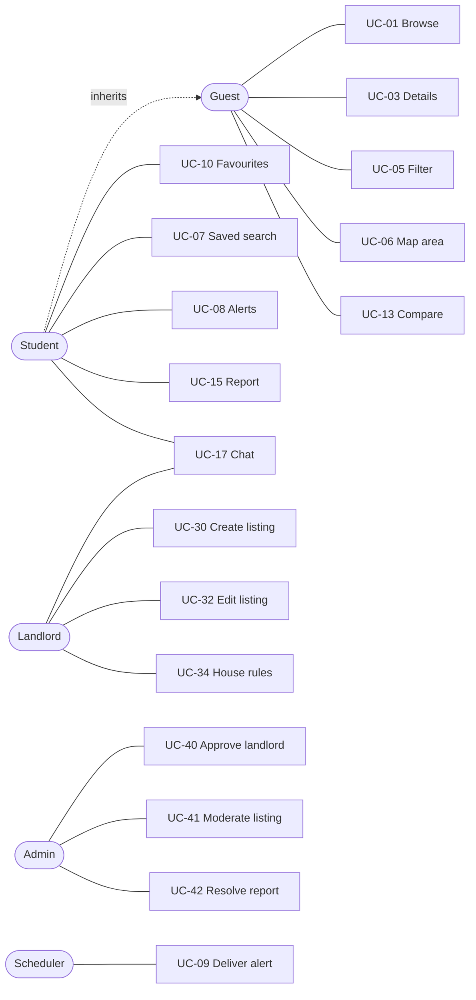

# Use Cases — RoomToRentRadar

<!--
CONTEXT NOTE (2026-11-12): every E* flow needs a test (AGENTS.md §6). §4 traceability matrix is machine-checked against
openapi.yaml operationIds, BR-* and SCR-* ids — keep it complete when adding a story (US15 → UC-25, SCR-ACC-03).
SCR-ONB-01 was retired on 2026-11-12 (no onboarding step; campus = ICTU by default, changed via SCR-ACC-02).
-->

| Field | Value |
|---|---|
| Status | Draft v1.0 — 2026-11-11 |
| Inputs | [prd.md](prd.md) (stories & AC), [business-analysis.md](business-analysis.md) (rules `BR-*`) |
| Outputs used by | [ui-ux-spec.md](ui-ux-spec.md) (screens `SCR-*`), [api/openapi.yaml](api/openapi.yaml) (`operationId`) |

> **For AI agents:** to implement a story, find its row in §4 *Traceability matrix*, then read the referenced UC (flows & errors), the `BR-*` rules, the screen spec and the API operation. Error flows (`E*`) are mandatory test cases (GUARDRAILS 1.5.5 negative testing).

---

## 1. Actors

| Actor | Type | Description |
|---|---|---|
| Guest | Primary | Anonymous user. Can browse, search, view details (no phone), compare. |
| Student | Primary | Signed-in `Student` (local or ICTU SSO). Guest capabilities + favourites, saved searches/alerts, contact, chat, report. |
| Landlord | Primary | Signed-in `Landlord`. **Unverified**: profile only. **Verified**: manage listings, reply to chats. |
| Admin | Primary | Moderation of landlords, listings, reports; audit logs. Has every Student permission too. |
| Scheduler | Secondary (system) | Background jobs inside the API (alert matcher, photo cleanup). |
| Routing service | Secondary (external) | OpenRouteService — travel time. |
| Push service | Secondary (external) | Firebase Cloud Messaging. |
| ICTU SSO | Secondary (external) | OIDC identity provider for `@ictu.edu.vn`. |
| Map SDK | Secondary (device) | Google Maps (Android) / Apple Maps (iOS) via .NET MAUI Maps. |

## 2. Use case template

Each UC: **Actor · Story/AC · Preconditions · Main flow · Alternatives (A) · Errors (E) · Postconditions · Rules**. Error HTTP codes follow [system-architecture.md §7.2](system-architecture.md#72-error-model).

---

## 3. Use cases

### 3.1 Discovery & search

#### UC-01 Browse verified rooms near campus
- **Actor:** Guest/Student · **Story:** US01 AC1–AC4
- **Pre:** selected campus known (default ICTU).
- **Main:** 1) User opens *Explore* (SCR-HOME-01). 2) App shows cached first page instantly (if any) and requests `searchRooms` with `campusId`, `sort=distance`, `pageNumber=1`. 3) System returns Available + verified listings with distance (BR-LST-06, BR-SRCH-03). 4) App renders cards (cover, title, rent, area, distance, verified badge, [heart]). 5) On scroll near end, app requests the next page.
- **A1:** user changes campus via chip → UC-02 → list reloads from page 1.
- **A2:** offline → cached page + banner "You are offline"; infinite scroll disabled.
- **E1:** server error → error state with *Retry*. **E2:** zero results → empty state suggesting increasing distance/clearing filters.
- **Post:** none (read-only). **Rules:** BR-CMP-03, BR-SRCH-03..05.

#### UC-02 Select campus
- **Actor:** Guest/Student · **Story:** US01 AC1, US09 AC2
- **Main:** 0) First launch uses ICTU as the campus with no question asked (BR-CMP-01). 1) User taps the campus chip on Explore/Map or *Campus* in Account → campus picker (SCR-ACC-02). 2) User picks a campus from `listCampuses`. 3) Guest → saved on device; signed-in → `updateMyProfile { selectedCampusId }`.
- **A1:** user signs in later → device choice is uploaded if profile has none; profile wins otherwise.
- **Rules:** BR-CMP-01..03.

#### UC-03 View room details
- **Actor:** Guest/Student · **Story:** US02 AC1–AC4, US11 AC1–AC2
- **Main:** 1) User taps a card/pin/favourite/alert. 2) App shows header from the card data immediately, requests `getRoomDetail` (campusId). 3) Screen shows gallery, title, rent, status, last-updated, key facts, monthly cost breakdown, amenities, Safety Score, house rules, location map, travel time (UC-12), landlord block, sticky contact bar.
- **A1 Guest:** landlord phone is `null`; contact bar shows "Sign in to contact" → UC-21 → returns to detail.
- **A2 Unavailable** (`Rented`/`Unpublished`, BR-LST-04a): banner "This room is no longer available", contact disabled, section "Similar rooms" from `getSimilarRooms` (BR-LST-10).
- **E1:** listing not found / `PendingReview`/`Rejected`/`Suspended` for non-owner → `404` → "Listing does not exist" + back.
- **Rules:** BR-AUTH-07, BR-LST-03, -06, -08, -09, -10, BR-HR-01, -03, BR-CNT-01.

#### UC-04 View gallery & 360°
- **Actor:** Guest/Student · **Story:** US03 AC1–AC4
- **Main:** 1) User taps gallery → full-screen swipe gallery (SCR-ROOM-02) loading `thumb` then `medium`. 2) Panorama items show a "360°" badge; tap opens viewer (SCR-ROOM-03) with drag/gyro.
- **A1:** no photos → placeholder image. **A2:** panorama viewer fails to load → show flat image + toast.
- **Rules:** BR-MED-01, -04, -05.

#### UC-05 Search with filters
- **Actor:** Guest/Student · **Story:** US04 AC1–AC4
- **Main:** 1) User taps *Filters* → filter sheet (SCR-SRCH-01) with live result count. 2) User sets rent/area range, room types, max distance, sort. 3) App calls `searchRooms` (debounced 300 ms) and shows count. 4) *Show N rooms* applies; active filters show as removable chips + count above the list.
- **A1:** remove a chip → re-query. **A2:** *Clear filters* → defaults (BR-SRCH-06).
- **E1:** invalid range is prevented client-side; server `400` shows inline message.
- **Rules:** BR-SRCH-01..06.

#### UC-06 Draw an area on the map
- **Actor:** Guest/Student · **Story:** US05 AC1–AC3
- **Main:** 1) User opens *Map* (SCR-MAP-01) centred on campus; current filter results shown as pins. 2) Taps *Draw area*, taps 3–20 points; polygon renders live; *Done*. 3) App calls `searchRoomsInArea` with polygon + filters + sort. 4) Pins show price labels; tapping a pin shows a preview card (cover, rent, area, distance) → tap → UC-03. 5) Toggle *List* shows the same results as a list sorted by the selected order.
- **A1:** *Clear area* → back to radius/filters results. **A2:** location permission is **not** required (map centres on campus).
- **E1:** < 3 points or self-intersecting → "Invalid area" (client) / `400` (server). **E2:** > 200 results → server returns 200 nearest + `truncated = true` → hint "Zoom in to see more".
- **Rules:** BR-SRCH-04, -07.

#### UC-07 Save a search (named area / filters)
- **Actor:** Student · **Story:** US05 AC4, US07 AC1
- **Main:** 1) From list or map, user taps *Save search*. 2) Sheet: name (prefilled e.g. "Near ICTU < 2M"), toggle *Get alerts*. 3) App calls `createSavedSearch` with current filters + polygon. 4) Appears in *Saved › Searches* (SCR-SAVED-01); tapping re-runs it.
- **A1:** Guest → sign-in prompt, then resumes. **A2:** alert toggle on & notification permission not granted → ask OS permission; if denied keep alert but inbox only (BR-ALR-06).
- **E1:** 11th saved search → `409` "Maximum 10 saved searches". **E2:** duplicate name → `409`.
- **Rules:** BR-SRCH-08, BR-ALR-01.

#### UC-08 Manage alerts
- **Actor:** Student · **Story:** US07 AC1, AC3
- **Main:** in SCR-SAVED-01 the user switches alert `Active`/`Paused`/`Off` (`setSavedSearchAlert`) or deletes the saved search (`deleteSavedSearch`).
- **Rules:** BR-ALR-01.

#### UC-09 Deliver new-listing alert (system)
- **Actor:** Scheduler · **Story:** US07 AC2, AC4
- **Trigger:** UC-41 approves a listing (first `Available`) → domain event `ListingPublished`; plus sweep every 5 min.
- **Main:** 1) Matcher loads saved searches with alert `Active`. 2) For each match (filters + polygon + distance to that search's campus) not yet alerted (BR-ALR-05): 3) if today's push count < 3 → send FCM to all user devices; 4) always write inbox notification + alert log.
- **A1:** no device token → inbox only. **A2:** FCM returns invalid token → delete token.
- **E1:** FCM outage → retry with backoff up to 10 min, then inbox only.
- **Post:** `SavedSearchAlertLogs` row per (search, room). **Rules:** BR-ALR-02..06.

#### UC-10 Add / remove favourite
- **Actor:** Student · **Story:** US06 AC1, AC2, AC4
- **Main:** 1) Tap [heart-outline] on card/detail → optimistic fill → `addFavourite` (PUT, idempotent). 2) Tap [heart] → optimistic clear → snackbar *Removed from saved · Undo* 5 s → then `removeFavourite`.
- **A1:** *Undo* within 5 s → restore, no API call (BR-FAV-03). **A2:** Guest → sign-in prompt, resume action after login. **A3:** offline → queued operation replayed when online.
- **E1:** API failure → revert icon + toast. **E2:** 201st favourite → `409`.
- **Rules:** BR-FAV-01..03.

#### UC-11 View favourites
- **Actor:** Student · **Story:** US06 AC2, AC3
- **Main:** *Saved › Rooms* lists favourites (`listMyFavourites`) with current rent and availability; unavailable ones greyed; actions: open detail, add to compare, remove.
- **Rules:** BR-FAV-04.

#### UC-12 View travel time to campus
- **Actor:** Guest/Student · **Story:** US09 AC1–AC3
- **Main:** detail requests `getRoomTravelTimes(roomId, campusId)`; shows distance + duration for Motorbike, Bus (est.), Walking.
- **A1:** routing unavailable → `isFallback = true` → "Straight-line distance: 1.2 km".
- **Rules:** BR-TRV-01..04.

#### UC-13 Compare rooms
- **Actor:** Guest/Student · **Story:** US10 AC1, AC2
- **Main:** 1) *Compare* on card/detail/favourite adds to device tray (badge on floating bar). 2) With ≥ 2 rooms, *Compare now* opens SCR-CMP-01 → `compareRooms(ids, campusId)`. 3) Table rows per BR-CPR-02, best value highlighted.
- **A1:** 4th room → dialog "Replace which room?". **A2:** a room became unavailable → column shows "No longer available" and stays.
- **Rules:** BR-CPR-01, -02.

#### UC-14 Share comparison as image
- **Actor:** Guest/Student · **Story:** US10 AC3
- **Main:** *Share* renders the table to PNG (captures the view) → OS share sheet (Zalo/Messenger/…).
- **Rules:** BR-CPR-03.

### 3.2 Trust & contact

#### UC-15 Report a listing
- **Actor:** Student/Landlord · **Story:** US12 AC1–AC3
- **Main:** 1) [more] › *Report listing* on detail. 2) Sheet: reason (radio), note. 3) `reportRoom` → `201`. 4) Confirmation "Thank you, we will review it within 24 hours".
- **A1:** Guest → sign-in prompt. **E1:** already reported (open) → `409` "You have already reported this listing". **E2:** `Other` without note → inline error. **E3:** daily limit → `429`.
- **Rules:** BR-RPT-01..03, -05.

#### UC-16 Call / Zalo the landlord
- **Actor:** Student · **Story:** US02 AC4, US11 AC2
- **Main:** 1) Tap *Call* or *Zalo* on contact bar. 2) First time for this listing → house-rules summary sheet → *Continue*. 3) App opens dialer (`tel:`) or `https://zalo.me/<phone>`.
- **Rules:** BR-CNT-01, BR-HR-03.

#### UC-17 Chat with landlord
- **Actor:** Student, Landlord · **Story:** US14 AC1–AC4
- **Main (start):** 1) Student taps *Message* on detail → (rules sheet, UC-16 step 2) → `startConversation(roomId)` returns existing or new conversation → SCR-CHAT-02 with listing card pinned.
- **Main (send):** 2) User types → `sendMessage { clientMessageId, body }` → bubble shows *Sending* → *Sent*. 3) Recipient online: SignalR `MessageReceived`; offline: FCM push.
- **Main (read):** 4) Opening a conversation calls `markConversationRead`; list (SCR-CHAT-01, `listMyConversations`) shows last message + unread badge; tab badge = total unread.
- **A1:** network drop → message stays *Not sent · Retry*; retry reuses `clientMessageId` (BR-CHT-04). **A2:** history paging `getConversationMessages(before=…)`.
- **E1:** listing not Available when starting → `409` "Room is no longer available". **E2:** non-participant → `404`. **E3:** rate limit → `429`.
- **Rules:** BR-CHT-01..07.

### 3.3 Accounts (US13 — backend implemented)

#### UC-20 Register
- **Actor:** Guest · **Story:** US13 AC1, AC4
- **Main:** SCR-AUTH-02: choose role *Student* / *Landlord* → email, password, full name, (phone, house name, and house address required for landlord), (student code optional) → `registerUser` → tokens → home. Landlord sees banner "Your account is awaiting verification".
- **E1:** duplicate email `409`. **E2:** weak password / invalid phone `400` (message from server shown inline). **E3:** `Admin` role → `403`.
- **Rules:** BR-AUTH-01..03, -05.

#### UC-21 Sign in with email/password
- **Main:** `loginUser` → tokens stored (refresh in SecureStorage) → resume pending action (favourite, contact…).
- **E1:** wrong credentials `401` "Invalid email or password.". **E2:** locked `403` "Account locked until HH:mm".
- **Rules:** BR-AUTH-05, -06.

#### UC-22 Sign in with Google / ICTU SSO
- **Main:** *Tiếp tục với Google / ICTU SSO* → system browser (WebAuthenticator) → id_token → `loginWithGoogle` → Student or Landlord account provisioned/linked. On initial registration, navigates to SCR-AUTH-02 with pre-filled details to complete phone, house name, house address, and password. On linking existing local account, verifies current password.
- **E1:** Student non-`@ictu.edu.vn` or missing `hd` → `400` "Student Google login requires an @ictu.edu.vn email address with verified hosted domain 'ictu.edu.vn'".
- **E2:** Landlord missing phone → `400` `AUTH_PHONE_REQUIRED`.
- **E2b:** Landlord missing boarding house name → `400` `AUTH_HOUSE_NAME_REQUIRED`.
- **E2c:** Landlord missing boarding house address → `400` `AUTH_HOUSE_ADDRESS_REQUIRED`.
- **E3:** Missing password on initial register → `400` `AUTH_PASSWORD_REQUIRED`.
- **E4:** Existing local account unconfirmed → `400` `AUTH_CURRENT_PASSWORD_REQUIRED` → prompt current password.
- **Rules:** BR-AUTH-03, BR-AUTH-04.

#### UC-23 Keep session / sign out
- **Main:** HTTP handler refreshes on `401` once (single-flight) via `refreshToken`; *Sign out* → `revokeToken` + clear tokens, device registration removed (`unregisterDevice`).
- **E1:** refresh fails → sign-out locally, show sign-in.

#### UC-24 Edit profile
- **Main:** SCR-ACC-01: full name, phone (landlord), selected campus, language (UC-25), notification preferences → `updateMyProfile`.

#### UC-25 Change app language
- **Actor:** any user (Guest/Student/Landlord/Admin) · **Story:** US15 AC1–AC4
- **Main:** 1) Account → *Language* opens the language picker (SCR-ACC-03) showing *English* and *Tiếng Việt*, current one checked. 2) User picks one. 3) App switches culture and every visible page re-renders immediately; the back stack is kept. 4) Choice saved on device; signed-in → `updateMyProfile { preferredLanguage }`.
- **A1:** offline and signed in → device switches immediately; the profile update is retried when back online (last choice wins).
- **A2:** first launch → language from the device (BR-I18N-01), no question asked.
- **E1:** profile update fails (5xx) → language stays switched on device; silent retry on next start.
- **Rules:** BR-I18N-01..04.

### 3.4 Landlord (US08, US11)

#### UC-30 Create listing
- **Actor:** Verified Landlord · **Story:** US08 AC1, AC2, AC4
- **Pre:** `is_verified = true` (else SCR-LL-01 shows "Awaiting verification" and *Post listing* disabled — `403` server-side).
- **Main (wizard SCR-LL-02, 4 steps):** 1) *Photos*: pick ≥ 3 photos (+ optional 360°) → each uploads immediately in background via `uploadPhoto` (progress per photo). 2) *Details*: title, room type, rent, deposit, area, occupants, furnishing, available-from, description. 3) *Location*: address line, ward, district; drag pin on map (starts at campus). 4) *Amenities & safety*: amenities, safety features, utilities pricing, house rules (optional, can be added later). 5) *Submit for review* → `createListing { photoIds, … }` → status `PendingReview` → success screen "Listing submitted for review (usually < 24 h)".
- **A1:** leave mid-way → draft kept on device (not server) and offered next time.
- **E1:** photo problems are rejected client-side first, and always re-checked by the server: > 10 MB → `413 FILE_TOO_LARGE`; not a real JPEG/PNG (magic bytes, even if named `.jpg`) → `415 UNSUPPORTED_MEDIA_TYPE`; other invalid input (empty file, panorama not 2:1, missing `kind`) → `400 VALIDATION_FAILED`. **E2:** < 3 photos → *Submit for review* disabled. **E3:** validation `400` per field.
- **Rules:** BR-LST-01..03, -11, BR-MED-01..03, BR-AUTH-03.

#### UC-31 Manage my listings
- **Main:** SCR-LL-01 lists own listings grouped by status with counts (Pending review, Live, Rented, Unpublished, Rejected/Suspended) via `listMyListings`; rejected shows reason.

#### UC-32 Edit listing
- **Actor:** Landlord (owner) · **Story:** US08 AC3
- **Main:** open editor prefilled from `getMyListing` (ETag) → change → `updateListing` with `If-Match` → saved; material changes flag re-review (BR-LST-05).
- **E1:** `409`/`412` concurrency → "This listing was updated elsewhere" + reload. **E2:** not owner → `404`.

#### UC-33 Change availability / unpublish / republish / resubmit
- **Main:** actions on SCR-LL-01 item: *Mark rented* (`markListingRented`), *Mark available* (`markListingAvailable`), *Unpublish* (`unpublishListing`), *Republish* (`republishListing`), *Resubmit* (`resubmitListing`). Invalid transitions return `409` (BR-LST-04).

#### UC-34 Update house rules
- **Actor:** Landlord (owner) · **Story:** US11 AC3
- **Main:** SCR-LL-03 → `updateHouseRules` → new version; history via `listHouseRulesVersions`.
- **Rules:** BR-HR-01, -02.

### 3.5 Admin (supporting US08, US12, US13)

#### UC-40 Approve landlord
- **Main:** SCR-ADM-01 › *Landlords* lists pending landlords (`listPendingLandlords`); Admin calls the phone to verify, taps *Approve* → `approveLandlord` → landlord gets push/inbox "Your account has been verified". New tokens carry `is_verified = true` after refresh.
- **E1:** user not a landlord → `400`.

#### UC-41 Moderate listing
- **Main:** *Listings* queue (`listModerationRooms?queue=pending`) oldest first → SCR-ADM-02 shows all fields, photos, pin → Admin ticks verified safety features → *Approve* (`approveListing`) → `Available`, `VerifiedAtUtc` set (first time) → triggers UC-09. Or *Reject* with reason (`rejectListing`) → landlord notified.
- **A1:** re-review queue (`queue=rereview`) → *Acknowledge changes* (`acknowledgeListingChanges`) or *Suspend* (`suspendListing`).

#### UC-42 Resolve report
- **Main:** *Reports* queue (`listReports?status=Open`, high-priority first, BR-RPT-05) → SCR-ADM-03 shows listing + all reports → *Dismiss* or *Take action* (optionally suspend listing) with note → `resolveReport`. Reporter gets inbox notification.

#### UC-44 Query audit logs
- **Main:** API only (`getAuditLogs`) through Scalar/HTTP client — no mobile screen in MVP. **Rules:** BR-AUD-02.

---

## 4. Traceability matrix

| Story | Use cases | Screens | API operations |
|---|---|---|---|
| US01 | UC-01, UC-02 | SCR-HOME-01, SCR-ACC-02 | `searchRooms`, `listCampuses`, `updateMyProfile` |
| US02 | UC-03, UC-16 | SCR-ROOM-01 | `getRoomDetail`, `getSimilarRooms` |
| US03 | UC-04 | SCR-ROOM-02, SCR-ROOM-03 | `getRoomDetail` (photos), static `/media/*` |
| US04 | UC-05 | SCR-SRCH-01, SCR-HOME-01 | `searchRooms` |
| US05 | UC-06, UC-07 | SCR-MAP-01, SCR-SAVED-01 | `searchRoomsInArea`, `createSavedSearch` |
| US06 | UC-10, UC-11 | SCR-FAV-01 | `listMyFavourites`, `addFavourite`, `removeFavourite` |
| US07 | UC-07, UC-08, UC-09 | SCR-SAVED-01, SCR-NOTI-01 | `listMySavedSearches`, `createSavedSearch`, `updateSavedSearch`, `deleteSavedSearch`, `setSavedSearchAlert`, `registerDevice`, `unregisterDevice`, `listMyNotifications`, `markNotificationsRead` |
| US08 | UC-30…UC-33, UC-41 | SCR-LL-01, SCR-LL-02, SCR-ADM-02 | `uploadPhoto`, `deletePhoto`, `createListing`, `listMyListings`, `getMyListing`, `updateListing`, `markListingRented`, `markListingAvailable`, `unpublishListing`, `republishListing`, `resubmitListing`, `listModerationRooms`, `getModerationRoom`, `approveListing`, `rejectListing`, `suspendListing`, `acknowledgeListingChanges` |
| US09 | UC-12 | SCR-ROOM-01 | `getRoomTravelTimes` |
| US10 | UC-13, UC-14 | SCR-CMP-01 | `compareRooms` |
| US11 | UC-03, UC-16, UC-34 | SCR-ROOM-01, SCR-LL-03 | `getRoomDetail`, `updateHouseRules`, `listHouseRulesVersions` |
| US12 | UC-15, UC-42 | SCR-ROOM-04, SCR-ADM-03 | `reportRoom`, `listReports`, `resolveReport` |
| US13 | UC-20…UC-24, UC-40, UC-44 | SCR-AUTH-01, SCR-AUTH-02, SCR-ACC-01, SCR-ADM-01 | `registerUser`, `loginUser`, `loginWithIctuSso`, `refreshToken`, `revokeToken`, `getCurrentUser`, `updateMyProfile`, `listPendingLandlords`, `approveLandlord`, `getAuditLogs` |
| — (ops) | — | — | `getHealth` |
| US14 | UC-17 | SCR-CHAT-01, SCR-CHAT-02 | `startConversation`, `listMyConversations`, `getConversation`, `getConversationMessages`, `sendMessage`, `markConversationRead`, hub `/hubs/chat` |
| US15 | UC-25 | SCR-ACC-01, SCR-ACC-03 | `updateMyProfile`, `getCurrentUser` |
